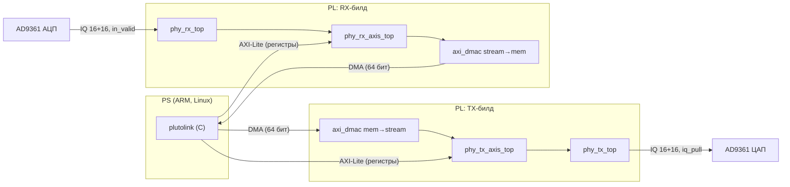
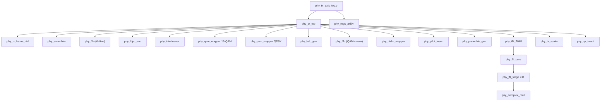
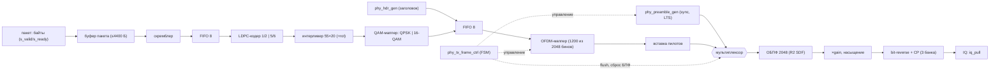
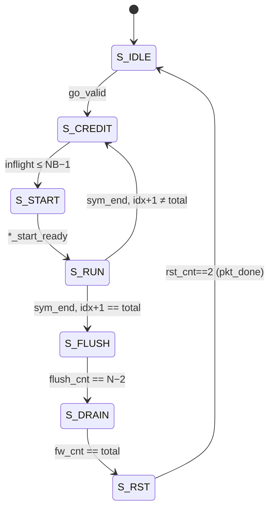
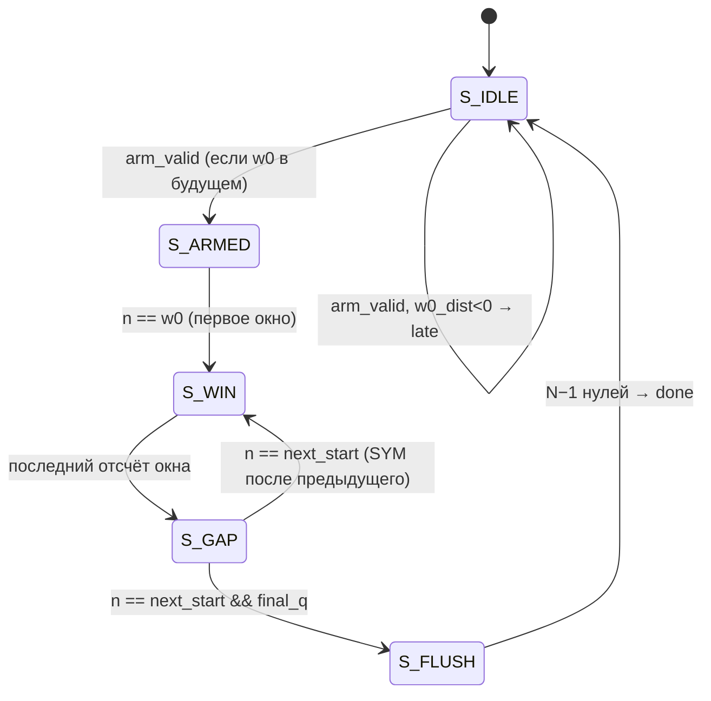
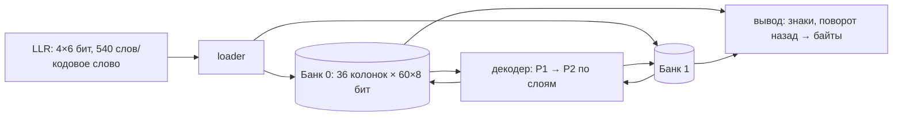

# Учебник-введение в проект OFDM-модема `nano_sdr_pluto_ofdm`

**Версия документа:** собран из `docs/book/*.md`; описывает состояние репозитория на ветке `OFDM_PHY_Z7020_RXENH` (v0.8.0, коммит `24a45896c`).
**Язык:** русский. **Читатель:** студент/инженер, знающий цифровую логику и базовый SystemVerilog, но не знакомый с OFDM и теорией связи.

> Метки: **[Код]** — следует из исходников (с файлом/строками); **[Теория]** — общеизвестное; **[Док]** — из `STATUS.md`/`ARCHITECTURE_DUALMODE.md`, не перепроверено; **Предположение** — мой вывод без подтверждения в коде. Неясное вынесено в §13.8.

## Оглавление


- **[Глава 0. Введение](#глава-0-введение)**
  - [0.1. Что это за проект](#01-что-это-за-проект)
  - [0.2. Общая архитектура в одном абзаце](#02-общая-архитектура-в-одном-абзаце)
  - [0.3. Как читать эту книгу](#03-как-читать-эту-книгу)
  - [0.4. Что нужно знать заранее](#04-что-нужно-знать-заранее)
  - [0.5. Структура репозитория](#05-структура-репозитория)
  - [0.6. История проекта (по `git log` и `STATUS.md`)](#06-история-проекта-по-git-log-и-statusmd)

- **[Глава 1. Основы цифровой связи](#глава-1-основы-цифровой-связи)**
  - [1.1. Бит, символ, скорость](#11-бит-символ-скорость)
  - [1.2. Полоса и спектральная эффективность](#12-полоса-и-спектральная-эффективность)
  - [1.3. Шум, SNR, BER, PER](#13-шум-snr-ber-per)
  - [1.4. Комплексный базовый диапазон (IQ)](#14-комплексный-базовый-диапазон-iq)
  - [1.5. Созвездия: BPSK, QPSK, 16-QAM](#15-созвездия-bpsk-qpsk-16-qam)
  - [1.6. Жёсткие и мягкие решения; LLR](#16-жёсткие-и-мягкие-решения-llr)
  - [1.7. FSK (врезка «чего здесь нет»)](#17-fsk-врезка-чего-здесь-нет)
  - [1.8. Что портит сигнал в канале](#18-что-портит-сигнал-в-канале)
  - [1.9. Помехоустойчивое кодирование (первое знакомство)](#19-помехоустойчивое-кодирование-первое-знакомство)
  - [1.10. Контрольные вопросы](#110-контрольные-вопросы)

- **[Глава 2. Идея OFDM](#глава-2-идея-ofdm)**
  - [2.1. Проблема, которую решает OFDM](#21-проблема-которую-решает-ofdm)
  - [2.2. Ортогональность поднесущих](#22-ортогональность-поднесущих)
  - [2.3. Числа проекта (нумерология)](#23-числа-проекта-нумерология)
  - [2.4. Циклический префикс](#24-циклический-префикс)
  - [2.5. Эквализация в частотной области](#25-эквализация-в-частотной-области)
  - [2.6. PAPR](#26-papr)
  - [2.7. Пилоты, преамбула и защитные бины](#27-пилоты-преамбула-и-защитные-бины)
  - [2.8. Как получить OFDM-сигнал: итоговая схема TX](#28-как-получить-ofdm-сигнал-итоговая-схема-tx)
  - [2.9. Контрольные вопросы](#29-контрольные-вопросы)

- **[Глава 3. ДПФ и БПФ](#глава-3-дпф-и-бпф)**
  - [3.1. Дискретное преобразование Фурье](#31-дискретное-преобразование-фурье)
  - [3.2. Алгоритм «разделяй и властвуй»: radix-2](#32-алгоритм-разделяй-и-властвуй-radix-2)
  - [3.3. Архитектура SDF (single-path delay feedback)](#33-архитектура-sdf-single-path-delay-feedback)
  - [3.4. БПФ и ОБПФ: трюк с перестановкой I/Q](#34-бпф-и-обпф-трюк-с-перестановкой-iq)
  - [3.5. Буфер bit-reverse и циклический префикс](#35-буфер-bit-reverse-и-циклический-префикс)
  - [3.5.1. Диаграмма потока кадров через SDF-ОБПФ (TX)](#351-диаграмма-потока-кадров-через-sdf-обпф-tx)
  - [3.6. Контрольные вопросы](#36-контрольные-вопросы)

- **[Глава 4. Синхронизация, оценка канала и эквализация](#глава-4-синхронизация-оценка-канала-и-эквализация)**
  - [4.1. Что нужно «узнать» приёмнику](#41-что-нужно-узнать-приёмнику)
  - [4.2. Временная синхронизация: Шмидль–Кокс](#42-временная-синхронизация-шмидлькокс)
  - [4.3. Частотная синхронизация (CFO)](#43-частотная-синхронизация-cfo)
  - [4.4. Окно БПФ, запас по CP и точная оценка тайминга](#44-окно-бпф-запас-по-cp-и-точная-оценка-тайминга)
  - [4.5. Оценка канала по LTS и эквализация ZF](#45-оценка-канала-по-lts-и-эквализация-zf)
  - [4.6. Оценка шума и MMSE](#46-оценка-шума-и-mmse)
  - [4.7. Мягкий демаппер: порог $T$ и веса](#47-мягкий-демаппер-порог-t-и-веса)
  - [4.8. Остаточные CPE и SFO: трекер по пилотам](#48-остаточные-cpe-и-sfo-трекер-по-пилотам)
  - [4.9. Сглаживание оценки канала](#49-сглаживание-оценки-канала)
  - [4.10. Code-aided уточнение (Patch B, идея)](#410-code-aided-уточнение-patch-b-идея)
  - [4.11. Контрольные вопросы](#411-контрольные-вопросы)

- **[Глава 5. Кодирование, скремблирование и вспомогательные блоки](#глава-5-кодирование-скремблирование-и-вспомогательные-блоки)**
  - [5.1. LFSR и скремблирование](#51-lfsr-и-скремблирование)
  - [5.2. Контрольные суммы](#52-контрольные-суммы)
  - [5.3. Интерливинг](#53-интерливинг)
  - [5.4. Масштабирование входа: «АРУ»](#54-масштабирование-входа-ару)
  - [5.5. Логарифмические коды и RSSI](#55-логарифмические-коды-и-rssi)
  - [5.6. Код LDPC](#56-код-ldpc)
  - [5.7. Символ-заголовок и повторное кодирование](#57-символ-заголовок-и-повторное-кодирование)
  - [5.8. Контрольные вопросы](#58-контрольные-вопросы)

- **[Глава 6. Арифметика с фиксированной точкой](#глава-6-арифметика-с-фиксированной-точкой)**
  - [6.1. Q-формат](#61-q-формат)
  - [6.2. Рост разрядности](#62-рост-разрядности)
  - [6.3. Округление и усечение](#63-округление-и-усечение)
  - [6.4. Насыщение](#64-насыщение)
  - [6.5. Блочно-плавающая запись весов эквалайзера](#65-блочно-плавающая-запись-весов-эквалайзера)
  - [6.6. Разрядности основных трактов](#66-разрядности-основных-трактов)
  - [6.7. Bit-exactness: золотые модели](#67-bit-exactness-золотые-модели)
  - [6.8. Контрольные вопросы](#68-контрольные-вопросы)

- **[Глава 7. Архитектура системы](#глава-7-архитектура-системы)**
  - [7.1. Положение PHY в системе](#71-положение-phy-в-системе)
  - [7.2. Иерархия модулей](#72-иерархия-модулей)
  - [7.3. Блок-схема TX (поток данных)](#73-блок-схема-tx-поток-данных)
  - [7.4. Блок-схема RX (поток данных)](#74-блок-схема-rx-поток-данных)
  - [7.5. Форматы данных (сводка)](#75-форматы-данных-сводка)
  - [7.6. Протоколы handshake](#76-протоколы-handshake)
  - [7.7. Тактирование и частоты](#77-тактирование-и-частоты)
  - [7.8. Структура кадра на воздухе](#78-структура-кадра-на-воздухе)
  - [7.9. Временная диаграмма TX (приёмка пакета и вывод)](#79-временная-диаграмма-tx-приёмка-пакета-и-вывод)
  - [7.10. Временная диаграмма RX (один пакет)](#710-временная-диаграмма-rx-один-пакет)
  - [7.11. Режимы: кто и где переключается](#711-режимы-кто-и-где-переключается)
  - [7.12. Что дальше](#712-что-дальше)

- **[Глава 8. Передатчик (`rtl/tx/`)](#глава-8-передатчик-rtltx)**
  - [8.1. Обзор и последовательность обработки](#81-обзор-и-последовательность-обработки)
  - [8.2. `phy_tx_top`](#82-phy_tx_top)
  - [8.3. `phy_tx_frame_ctrl`](#83-phy_tx_frame_ctrl)
  - [8.4. `phy_scrambler` (также `phy_descrambler`)](#84-phy_scrambler-также-phy_descrambler)
  - [8.5. `phy_ldpc_enc` (`rtl/common/phy_ldpc_enc.sv`)](#85-phy_ldpc_enc-rtlcommonphy_ldpc_encsv)
  - [8.6. `phy_interleaver` (`rtl/tx/phy_interleaver.sv`)](#86-phy_interleaver-rtltxphy_interleaversv)
  - [8.7. `phy_qam_mapper` (`rtl/tx/phy_qam_mapper.sv`)](#87-phy_qam_mapper-rtltxphy_qam_mappersv)
  - [8.8. Построение символа в частотной области](#88-построение-символа-в-частотной-области)
  - [8.9. Тракт ОБПФ → масштабирование → CP](#89-тракт-обпф--масштабирование--cp)
  - [8.10. Вспомогательные блоки: `phy_fifo`](#810-вспомогательные-блоки-phy_fifo)
  - [8.11. Сквозной пример: пакет 900 байт, MAX RANGE и MAX RATE](#811-сквозной-пример-пакет-900-байт-max-range-и-max-rate)
  - [8.12. Контрольные вопросы](#812-контрольные-вопросы)

- **[Глава 9. Приёмник (`rtl/rx/`)](#глава-9-приёмник-rtlrx)**
  - [9.1. Обзор и таблица модулей](#91-обзор-и-таблица-модулей)
  - [9.2. `phy_rx_top`: интерфейс и параметры](#92-phy_rx_top-интерфейс-и-параметры)
  - [9.3. Фронтенд](#93-фронтенд)
  - [9.4. Детектор `phy_sync_sc`](#94-детектор-phy_sync_sc)
  - [9.5. Грубое CFO, NCO-смеситель и линия задержки](#95-грубое-cfo-nco-смеситель-и-линия-задержки)
  - [9.6. Окно БПФ: `phy_rx_window`](#96-окно-бпф-phy_rx_window)
  - [9.7. БПФ и выбор бинов](#97-бпф-и-выбор-бинов)
  - [9.8. Оценка канала, шум и мягкие параметры](#98-оценка-канала-шум-и-мягкие-параметры)
  - [9.9. Эквалайзер и фазовый трекер](#99-эквалайзер-и-фазовый-трекер)
  - [9.10. Бэкенд: демаппер, заголовок, декодирование](#910-бэкенд-демаппер-заголовок-декодирование)
  - [9.11. LDPC-декодер `phy_ldpc_dec`](#911-ldpc-декодер-phy_ldpc_dec)
  - [9.12. Вспомогательные блоки приёмника](#912-вспомогательные-блоки-приёмника)
  - [9.13. Code-aided второй проход: `phy_ca_refine` и `phy_w_core` (Patch B)](#913-code-aided-второй-проход-phy_ca_refine-и-phy_w_core-patch-b)
  - [9.14. Контроллер `phy_rx_top`](#914-контроллер-phy_rx_top)
  - [9.15. Буфер пакета и выход `phy_rx_pkt_out`](#915-буфер-пакета-и-выход-phy_rx_pkt_out)
  - [9.16. Ресурсы и таймлайн RX (по документации)](#916-ресурсы-и-таймлайн-rx-по-документации)
  - [9.17. Контрольные вопросы](#917-контрольные-вопросы)

- **[Глава 10. Обёртки, регистры и формат пакета](#глава-10-обёртки-регистры-и-формат-пакета)**
  - [10.1. `phy_tx_axis_top.v`](#101-phy_tx_axis_topv)
  - [10.2. `phy_rx_axis_top.v`](#102-phy_rx_axis_topv)
  - [10.3. `phy_regs_axil.v`](#103-phy_regs_axilv)
  - [10.4. Формат записи пакета RX (`phy_rx_pkt_out`)](#104-формат-записи-пакета-rx-phy_rx_pkt_out)
  - [10.5. Тактовые домены и CDC (сводка)](#105-тактовые-домены-и-cdc-сводка)
  - [10.6. Программа `plutolink`](#106-программа-plutolink)
  - [10.7. Контрольные вопросы](#107-контрольные-вопросы)

- **[Глава 11. Верификация](#глава-11-верификация)**
  - [11.1. Философия: «золотые» модели и bit-exact](#111-философия-золотые-модели-и-bit-exact)
  - [11.2. Как запускать](#112-как-запускать)
  - [11.3. Соглашения тестбенчей](#113-соглашения-тестбенчей)
  - [11.4. Каталог тестбенчей](#114-каталог-тестбенчей)
  - [11.5. `phy_sim`: сценарии и RTL-in-the-loop](#115-phy_sim-сценарии-и-rtl-in-the-loop)
  - [11.6. Синтез и ресурсы](#116-синтез-и-ресурсы)
  - [11.7. Что покрыто и чего не хватает](#117-что-покрыто-и-чего-не-хватает)
  - [11.8. Контрольные вопросы](#118-контрольные-вопросы)

- **[Глава 12. Практика для новичка](#глава-12-практика-для-новичка)**
  - [12.1. Что понадобится](#121-что-понадобится)
  - [12.2. Первые 30 минут](#122-первые-30-минут)
  - [12.3. Рекомендуемый порядок знакомства с кодом](#123-рекомендуемый-порядок-знакомства-с-кодом)
  - [12.4. Типичные ошибки (из истории проекта и устройства кода)](#124-типичные-ошибки-из-истории-проекта-и-устройства-кода)
  - [12.5. Как попробовать на железе (по `sw/plutolink/README.md`)](#125-как-попробовать-на-железе-по-swplutolinkreadmemd)
  - [12.6. Идеи первых задач](#126-идеи-первых-задач)
  - [12.7. Справка: где искать](#127-справка-где-искать)

- **[Глава 13. Приложения](#глава-13-приложения)**
  - [13.1. Глоссарий (рус/англ)](#131-глоссарий-русангл)
  - [13.2. Параметры](#132-параметры)
  - [13.3. Регистры (сводка)](#133-регистры-сводка)
  - [13.4. Таблица модулей и путей](#134-таблица-модулей-и-путей)
  - [13.5. Таблица покрытия «файл → глава»](#135-таблица-покрытия-файл--глава)
  - [13.6. Литература и ссылки](#136-литература-и-ссылки)
  - [13.7. Результаты самопроверки](#137-результаты-самопроверки)
  - [13.8. Открытые вопросы к автору репозитория](#138-открытые-вопросы-к-автору-репозитория)

---

# Глава 0. Введение

## 0.1. Что это за проект

Каталог `projects/nano_sdr_pluto_ofdm` (ветка `OFDM_PHY_Z7020_RXENH`, версия **v0.8.0** по `STATUS.md`) — это
**физический уровень (PHY) цифрового радиомодема на OFDM**, целиком реализованный в программируемой логике (PL) ПЛИС
Zynq-7020 (`xc7z020clg400-1`, см. `STATUS.md`, раздел «Гілка `OFDM_PHY_Z7020`»). Радиочастотную часть выполняет трансивер
AD9361 на плате «Nano SDR Pluto». Назначение, как оно сформулировано в самом `STATUS.md` (заголовок): *«Long-Range Video PHY
(OFDM, 16-QAM, LDPC)»* — канал для передачи видеопотока на большую дальность.

Что делает модем (всё — по коду `rtl/`):

* **Передатчик** (`rtl/tx/`) принимает пакет байт, скремблирует его, кодирует помехоустойчивым кодом LDPC, перемешивает
  (интерливинг), отображает биты в точки созвездия QPSK или 16-QAM, раскладывает их по поднесущим OFDM, добавляет пилоты и
  преамбулу, делает обратное БПФ на 2048 точек, добавляет циклический префикс и выдаёт поток комплексных отсчётов 16 бит I/Q
  на ЦАП AD9361 со скоростью 30,72 МГц.
* **Приёмник** (`rtl/rx/`) получает отсчёты с АЦП, находит пакет (корреляция Шмидля–Кокса), оценивает и компенсирует
  частотный сдвиг (CFO), вырезает окна БПФ, оценивает канал по обучающему символу, эквалайзирует, отслеживает остаточную
  фазу и дрейф частоты дискретизации по пилотам, считает мягкие решения (LLR), декодирует LDPC, дескремблирует и
  выдаёт пакет по 64-битной AXI-Stream-шине в DMA процессорной части (PS).
* **Два режима работы** на одном и том же тракте (`ARCHITECTURE_DUALMODE.md`, `rtl/common/phy_pkg.sv:48`):
  *MAX RANGE* (QPSK + LDPC 1/2, 135 байт на OFDM-символ) и *MAX RATE* (16-QAM + LDPC 5/6, 450 байт на OFDM-символ).
  Режим указывается в специальном символе-заголовке каждого пакета.
* **Исторический «некодированный» режим** (параметр `CODED = 0`): 16-QAM без LDPC, 550 байт на символ. Он сохранён в
  RTL (`phy_tx_top.sv:20`, `phy_rx_top.sv:27`, модуль `phy_rx_decode`), хотя основной разработкой стал кодированный режим.

### 0.1.1. Важная оговорка про FSK

Задание на эту книгу упоминало FSK («OFDM-модем с демодулятором»). **В каталогах `rtl/rx/`, `rtl/tx/`, `rtl/common/`,
`tb/`, `python/`, `sim/`, `sw/` слова «FSK» нет совсем** (проверено `grep -ril fsk`). Из `git log` известно, что рядом в
репозитории лежит *отдельный* проект `nano_sdr_pluto_gfsk_demod` («RX-only GFSK demodulator in PL», коммит
`24090f4b2`), но он не входит в `nano_sdr_pluto_ofdm`. Поэтому в этой книге FSK **не** описывается как часть проекта; ему
посвящена лишь короткая справочная врезка в главе 1 (§1.7), чтобы читатель понимал, чем FSK отличается от того, что здесь
реализовано.

### 0.1.2. Что в проекте есть, а чего нет

| Есть в коде | Нет в коде (и потому не описывается как часть проекта) |
|---|---|
| OFDM, БПФ/ОБПФ 2048 (R2 SDF), циклический префикс | FSK/GFSK |
| QPSK, 16-QAM (Gray); модуль QAM 4/16/64 для общего случая | Радиочастотный тракт (он в AD9361 и в соседних Vivado-проектах) |
| Скремблер x¹⁵+x¹⁴+1, блочный интерливер | Автоматическая регулировка усиления (АРУ) как замкнутая петля: есть лишь статический сдвиг `phy_input_scale` |
| LDPC (QC, Z=60, N=2160), кодер и декодер layered normalized min-sum | Турбокоды, свёрточные коды, Витерби |
| Синхронизация Шмидля–Кокса, грубое CFO через CORDIC, NCO | Корреляция с известной последовательностью (LTS-корреляция) для точного тайминга — сознательно не используется (`STATUS.md`, «RX: архитектура») |
| LS-оценка канала по LTS, ZF и MMSE, 3-бинное сглаживание | MIMO, несколько антенн |
| Оценка шума по guard-бинам, оценка SNR | Адаптивная смена режима и HARQ (`STATUS.md`, v0.7.0 «Обмеження») |
| Трекер CPE и наклона SFO по пилотам | Полифазные/FIR-фильтры в PL (в сборках FIR убраны, `STATUS.md`) |
| CORDIC, sin/cos-ROM, рекуррентный DC-канселлер | Проверка на реальном железе: «на залізі нічого не перевірено» (`STATUS.md`) |

## 0.2. Общая архитектура в одном абзаце

```
  ПК/PS (ARM)                       PL (Zynq-7020)                              AD9361
  ┌───────────┐  DMA 64 бит   ┌─────────────────────────────┐   IQ 16+16   ┌──────────┐
  │ plutolink │──────────────▶│ phy_tx_axis_top → phy_tx_top│─────────────▶│ ЦАП (TX) │──▶ антенна
  │ (Linux, C)│               └─────────────────────────────┘              └──────────┘
  │           │  DMA 64 бит   ┌─────────────────────────────┐   IQ 16+16   ┌──────────┐
  │           │◀──────────────│ phy_rx_axis_top → phy_rx_top│◀─────────────│ АЦП (RX) │◀── антенна
  └───────────┘               └─────────────────────────────┘              └──────────┘
        ▲  AXI-Lite (регистры: phy_regs_axil)
```

Передатчик и приёмник собираются **в разные битстримы** («TX-only» и «RX-only», `STATUS.md`, раздел «Структура: спільне
ядро + два білди»): на одну плату грузится одна из ролей; для проверки нужны две платы. Общее ядро RTL лежит в этом
каталоге (`rtl/`), Vivado-проекты сборок — в соседних каталогах `nano_sdr_pluto_ofdm_tx/` и `nano_sdr_pluto_ofdm_rx/`
(в этот каталог они не входят, см. «Открытые вопросы»).

Вся обработка сигнала — в PL; в процессорную систему уходят только готовые пакеты (сопровождаемые метриками качества).

## 0.3. Как читать эту книгу

Книга устроена «от теории к коду».

| Часть | Главы | Что в них |
|---|---|---|
| Теория | 1–6 | Всё, что нужно знать, чтобы читать RTL: связь, OFDM, БПФ, синхронизация, FEC, fixed-point. Для каждого понятия сначала интуиция и пример, потом формулы. |
| Архитектура | 7 | Структурные схемы TX и RX, форматы данных, handshake, тактирование, временные диаграммы. |
| Реализация | 8, 9, 10 | Модуль за модулем: передатчик, приёмник, обёртки и регистры. |
| Проверка и практика | 11, 12 | Тестбенчи, симуляция, как начать работать. |
| Справочники | 13 | Глоссарий, параметры, регистры, таблицы модулей, литература, открытые вопросы, таблица покрытия файлов. |

**Если вы новичок в OFDM** — читайте последовательно, начиная с главы 1.
**Если вы знаете DSP, но не знаете проект** — прочитайте главу 7, затем 8 и 9, обращаясь к теории по ссылкам.
**Если вам нужно срочно найти модуль** — глава 13, таблица 13.4.

### 0.3.1. Соглашения о маркировке источников

Чтобы не смешивать факты и догадки, в тексте используются метки:

* **[Код]** — утверждение следует непосредственно из исходников; обязательно дана ссылка вида
  `rtl/rx/phy_sync_sc.sv`, модуль `phy_sync_sc`, строки `…`. Номера строк относятся к состоянию репозитория на момент
  написания (v0.8.0, коммит `24a45896c`); при дальнейших правках файлов они сдвигаются.
* **[Теория]** — общеизвестные сведения из учебников (литература в главе 13).
* **[Док]** — утверждение взято из `STATUS.md` / `ARCHITECTURE_DUALMODE.md` и **не перепроверено** по коду (например,
  результаты Vivado, числа SNR из симулятора). Такие числа — *заявления авторов*, а не результат моих расчётов.
* **Предположение.** — моё понимание замысла, которого в коде явно нет. Любое предположение помечается словом
  «Предположение» в начале абзаца и (если важное) продублировано в «Открытых вопросах» (§13.8).

Если назначение модуля, константы или параметра не удалось установить из кода — оно **не угадывается**, а попадает в
§13.8 «Открытые вопросы».

### 0.3.2. Принятые обозначения

* `N` — размер БПФ (2048); `CP` — длина циклического префикса (144); `Fs` — частота дискретизации (30,72 МГц).
* «Бин» — один выход БПФ (одна частотная ячейка), «поднесущая» — бин, реально несущий данные/пилот.
* «Активные бины» — 1200 бинов: 1…600 и 1448…2047 (отрицательные частоты). Бин 0 (DC) и 601…1447 не используются.
* «Индекс активного потока» `s` — порядковый номер активного бина в потоке `0…1199` (сначала бины 1…600, затем
  1448…2047). Пилоты стоят там, где `s mod 12 == 6`.
* В SystemVerilog-примерах `IQ_W = 16` — разрядность отсчёта, `Q1.15` — знаковое число с 15 дробными битами.

## 0.4. Что нужно знать заранее

Предполагается: цифровая логика, конвейеры, конечные автоматы, базовый SystemVerilog (`always_ff`, `generate`,
параметры, пакеты `package`/`import`). Знание OFDM, FSK, фильтров, БПФ, FEC не предполагается — всё нужное объясняется.

## 0.5. Структура репозитория

```
nano_sdr_pluto_ofdm/
├─ rtl/
│   ├─ common/   общие блоки: phy_pkg, БПФ, CORDIC, sincos, LDPC, FIFO, регистры AXI-Lite…
│   ├─ tx/       передатчик
│   └─ rx/       приёмник
├─ tb/           тестбенчи: tx/ rx/ system/
├─ python/       «золотые» модели (bit-exact) и генераторы векторов/таблиц
├─ sim/          run_tb.sh, run_regression.sh (Vivado xsim)
├─ synth/        synth_est.tcl, ff_breakdown.tcl (оценка ресурсов)
├─ phy_sim/      Python-фреймворк: канал, метрики, сценарии, RTL-in-the-loop
├─ sw/plutolink/ C-программа для PS (генератор/логгер пакетов)
├─ fw/           сборка прошивки Pluto и device tree
├─ STATUS.md     история версий и отчёт о состоянии
└─ ARCHITECTURE_DUALMODE.md   описание двухрежимного PHY
```

Эта книга описывает прежде всего `rtl/rx/` и `rtl/tx/`; поскольку без `rtl/common/` (БПФ, LDPC, CORDIC, пакеты констант)
их нельзя объяснить, общие блоки описаны в главах 8 и 9 в виде отдельных подразделов.

## 0.6. История проекта (по `git log` и `STATUS.md`)

Эволюция, важная для понимания причин архитектурных решений:

1. **v0.0.1 RX / v0.1.0 TX** (2026-10-04) — Python-референс приёмника, первый TX в RTL, без кодирования. Принято
   решение: **не делать LTS-корреляцию для точного тайминга**; вместо этого окно БПФ ставится по грубому таймингу
   Шмидля–Кокса, запас берётся из циклического префикса, а остаточная ошибка тайминга превращается в линейную фазу в
   оценке канала и компенсируется эквалайзером (`STATUS.md`, «RX: архитектура»).
2. **RX v0.1.0–v0.2.0** — фронтенд (детектор, CFO, NCO, DC) и полный некодированный RX; Zynq-7010.
3. **HW v0.3.0** — bring-up: регистры AXI-Lite, логирование, программа `plutolink`.
4. **Ветка `OFDM_PHY_Z7020`** — переход на Zynq-7020 (на Z7010 не хватало ресурсов): LDPC R=5/6, мягкие LLR, MMSE,
   fine timing, SFO-трекинг, оценка SNR (v0.1.0–v0.6.0).
5. **v0.7.0** — двухрежимный PHY (QPSK+1/2 и 16-QAM+5/6), заголовок с `MODE_ID`.
6. **v0.8.0** — оптимизация RX по ресурсам (LUT 42,2k → 27,9k — **[Док]**), патчи A (UA-LLR) и B (code-aided второй
   проход), исправление дефекта «линия задержки стояла после NCO-смесителя».

> На реальном железе ничего не проверялось (`STATUS.md`, v0.6.0, v0.7.0, v0.8.0). Все числа производительности — из
> симулятора/Vivado. Учитывайте это при чтении.


---

# Глава 1. Основы цифровой связи

В этой главе — минимум понятий цифровой связи, без которых код приёмника и передатчика непонятен. Все материалы главы —
**[Теория]**; привязка к проекту указана отдельными абзацами **[Код]**.

## 1.1. Бит, символ, скорость

Передатчик получает последовательность **бит** (в нашем проекте — байты из памяти ПК/PS). Но по радиоканалу передаются не
биты, а физические сигналы. Простейший подход — менять какой-либо параметр сигнала (амплитуду, фазу, частоту) раз в
фиксированное время. Один такой «кусок» сигнала называется **символом** (*symbol*). Если символ может принимать одно из
$M$ различимых состояний, он несёт $\log_2 M$ бит.

* **Битовая скорость** $R_b$ [бит/с] — сколько информационных бит в секунду.
* **Символьная скорость** $R_s$ [симв/с] (*baud*) — сколько символов в секунду.
* Связь: $R_b = R_s \cdot \log_2 M \cdot r$, где $r$ — **скорость кода** (доля информационных бит среди всех
  переданных; §1.8 и глава 5).

**Пример.** QPSK ($M=4$, 2 бита на символ), 1 Мсимв/с, код без избыточности ($r=1$) → 2 Мбит/с. 16-QAM ($M=16$, 4 бита) при
той же символьной скорости → 4 Мбит/с, но надёжность ниже (точки ближе друг к другу).

**Различайте два вида «символов».** В OFDM (глава 2) слово «символ» используют ещё и для целого *OFDM-символа* — одного
блока из многих поднесущих. В этом проекте «OFDM-символ» — это 2192 временных отсчёта, несущих 1200 созвездных точек. Чтобы не
путаться, в книге: «QAM-символ» (одна точка созвездия), «OFDM-символ» (целый блок).

## 1.2. Полоса и спектральная эффективность

**Полоса** $B$ [Гц] — ширина занимаемого сигналом участка спектра. Чем быстрее меняется сигнал, тем шире спектр. Для
линейной модуляции без формирующих фильтров порядок: $B \approx R_s$.

**Спектральная эффективность** $\eta = R_b / B$ [бит/с/Гц]. Повышение $\eta$ возможно за счёт большего $M$ или более слабого
кода (меньше избыточности), но ценой требуемого SNR.

**[Код]** Занимаемая полоса проекта: $1200 \times 15\ \text{кГц} = 18\ \text{МГц}$ (поднесущие `NUM_ACTIVE_SC`,
`SUBCARRIER_HZ` в `rtl/common/phy_pkg.sv:6-17`), при частоте дискретизации 30,72 МГц (`SAMPLE_RATE_HZ`, строка 6).
Оставшиеся ≈ 12,7 МГц в пределах 30,72 МГц отсчётной сетки — защитные полосы (бины 601…1447 не используются).

## 1.3. Шум, SNR, BER, PER

Принятый сигнал всегда искажён шумом. Базовая модель — **аддитивный белый гауссов шум (AWGN)**:

$$ r[n] = s[n] + w[n], \qquad w[n] \sim \mathcal{CN}(0,\sigma^2). $$

* **SNR** (signal-to-noise ratio) — отношение мощности сигнала к мощности шума: $\mathrm{SNR} = P_s / P_n$. Обычно в дБ:
  $\mathrm{SNR_{dB}} = 10\log_{10}(P_s/P_n)$.
* **Eb/N0** — энергия на *информационный бит*, делённая на спектральную плотность шума; удобна для сравнения схем с
  разными $M$ и $r$. Связь: $\mathrm{Eb/N0} = \mathrm{SNR} \cdot \frac{B}{R_b}$ (для шума, измеренного в полосе
  символа).
* **BER** (bit error rate) — доля ошибочно принятых бит. **SER** — доля ошибочных символов.
* **PER** (packet error rate) — доля пакетов, принятых с хотя бы одной ошибкой. Для системы с кодированием именно PER
  является рабочей метрикой.

**Интуиция.** Представьте точку созвездия «облаком» вокруг идеального положения; радиус облака пропорционален
$\sigma$. Если облака соседних точек перекрываются — возникают ошибки. Для QPSK точки далеки (низкий SNR достаточен), для
16-QAM — близки (нужен SNR примерно на 6–7 дБ выше при одинаковой средней мощности — **[Теория]**).

**[Док]** В `STATUS.md` порог качества задаётся как «SNR для PER ≤ 1 %» (на отсчёт). Например (раздел v0.7.0, симулятор):
для AWGN режим MAX RATE — 12 дБ, MAX RANGE — 1 дБ. Это заявление авторов, не пересчитывалось.

## 1.4. Комплексный базовый диапазон (IQ)

### 1.4.1. Идея

Реальный радиосигнал на несущей $f_c$:

$$ s(t) = A(t)\cos(2\pi f_c t + \varphi(t)). $$

Информация — в амплитуде $A(t)$ и фазе $\varphi(t)$. Удобно сказать: сигнал — это **комплексное число**

$$ x(t) = A(t) e^{j\varphi(t)} = I(t) + jQ(t), $$

а $s(t) = \Re\{x(t)e^{j2\pi f_c t}\}$. Тогда:

* **I** (in-phase) $= A\cos\varphi$ и **Q** (quadrature) $= A\sin\varphi$ — две вещественные «координаты» точки на плоскости;
* $x(t)$ называется **комплексной огибающей** или сигналом в **комплексном базовом диапазоне** (*complex baseband*);
* перенос на несущую и обратно (смешение) делает аналоговая часть (AD9361); цифровая часть проекта видит только пары
  $(I, Q)$.

Преимущества: вдвое меньше частота дискретизации, чем у реального сигнала на несущей; сдвиг частоты превращается в
простое вращение: умножение на $e^{j2\pi \Delta f n/F_s}$.

### 1.4.2. Что видит RTL

**[Код]** На вход приёмника `phy_rx_top` приходит `in_valid` + `in_i`/`in_q`, два знаковых 16-битных числа на каждый
отсчёт (`phy_rx_top.sv:41-43`); `in_valid` — одиночный импульс «на отсчёт» (обёртка `phy_rx_axis_top.v`, порт `in_valid`).
Согласно комментарию в заголовке `phy_rx_axis_top.v` (строка 19), АЦП AD9361 даёт 12 бит, расширенных знаком до 16.
Передатчик выдаёт `iq_re`/`iq_im` по строб-сигналу `iq_pull` (`phy_tx_top.sv:31-35`).

Один отсчёт приходит раз в $1/F_s = 32{,}55$ нс, но тактовая частота логики **выше** частоты отсчётов (в тестбенчах — ровно
вдвое: 2 такта на отсчёт, «processing clock = 2 × sample rate», `tb_phy_rx_top.sv`); строб `in_valid` разрешает обработку
только в некоторых тактах (подробнее в главе 7).

## 1.5. Созвездия: BPSK, QPSK, 16-QAM

**Созвездие** — набор допустимых комплексных значений QAM-символа. Каждому набору бит сопоставляется точка.

### 1.5.1. BPSK

Одна ось, две точки $\pm A$: 1 бит на символ. **[Код]** BPSK-символы (±A на оси I) используются для **известных**
последовательностей — пилотов и обучающих символов (`phy_pilot_insert.sv:36`, `phy_preamble_gen.sv:42`): приёмнику заранее
известна и амплитуда, и знак.

### 1.5.2. QPSK

Четыре точки $(\pm U, \pm U)$ — по одному биту на ось: 2 бита на символ. Обозначения: бит `1` → $+U$, бит `0` → $-U$.

**[Код]** `phy_qam_mapper #(.ORDER(4), .UNIT(QPSK_UNIT))` (`phy_tx_top.sv:206`), $U = 9216$ (`phy_pkg.sv:49`).

### 1.5.3. 16-QAM

Сетка 4×4: на каждой оси четыре уровня $\{-3,-1,+1,+3\}\cdot U$, по 2 бита на ось, всего 4 бита:

```
 Q
 +3U  •  •  •  •
 +1U  •  •  •  •
 -1U  •  •  •  •
 -3U  •  •  •  •
     -3U -1U +1U +3U   I
```

**[Код]** Формула уровня (`phy_qam_mapper.sv:26-33`): $\text{level} = U\,(2\cdot\text{idx} - (M_{ax}-1))$, где $M_{ax}$ —
число уровней на оси (4 для 16-QAM), `idx` — двоичное число, получаемое из кода Грея. $U = \text{QAM\_UNIT} = 4096$
(`phy_pkg.sv:25`), поэтому уровни 16-QAM — $\pm 4096$ и $\pm 12288$.

### 1.5.4. Код Грея

Чтобы ошибка «в соседнюю точку» портила всего один бит, соседние уровни кодируют кодами, отличающимися одним битом
(Gray). Для 2 бит на ось: $00 \to -3U$, $01 \to -U$, $11 \to +U$, $10 \to +3U$ (в проекте порядок следования выводится из
функции `axis_level`; проверка — ручной разбор в §8.7).

### 1.5.5. Мощность созвездия и нормировка

Средняя мощность 16-QAM: $E[|x|^2] = 2\cdot \frac{U^2 (1+9)}{2} = 10U^2$ (на каждой оси средний квадрат уровней
$(1+9)/2 = 5$). Для $U=4096$: $10\cdot 4096^2 \approx 1{,}678\cdot 10^8$.

QPSK с $U = 9216$: $2U^2 = 2\cdot 9216^2 \approx 1{,}699\cdot 10^8$ — то есть **практически та же средняя мощность**: отношение
$1{,}0125$. **[Код]** Это сознательно отражено в комментарии `phy_pkg.sv:49` (`2 * 9216^2 = 10 * 4096^2 * 1.0125`). Идея:
переключая режим, не менять среднюю мощность передатчика.

## 1.6. Жёсткие и мягкие решения; LLR

**Жёсткое решение** (*hard decision*): приёмник по полученной точке сразу решает «это был бит 0 или 1». Информация о
«степени уверенности» теряется.

**Мягкое решение** (*soft decision*): приёмник передаёт декодеру число, показывающее, насколько вероятно, что бит равен
0 или 1. Стандартная форма — **логарифмическое отношение правдоподобия** (LLR):

$$ \mathrm{LLR}(b) = \ln\frac{P(b=0\mid r)}{P(b=1\mid r)}. $$

Знак LLR — жёсткое решение (**в проекте: LLR > 0 ⇒ бит 0**, `phy_qam_demapper.sv:1`, `phy_llr_demap.sv:6`), модуль —
уверенность. Для AWGN и равновероятных символов в приближении *max-log* LLR линейно связана с расстоянием до границы
решения: для оси с уровнями $\pm U,\pm 3U$:

* первый бит (знак): $L_0 \approx -x$ (при $x<0$ — уверенно «0»);
* второй бит (внутренняя/внешняя точка): $L_1 \approx |x| - 2U$ (если $|x|>2U$ — внешняя точка).

Эти формулы дословно реализованы в `phy_qam_demapper.sv:35-47` (`t_c[ax*M] = -x`, затем `t = |t| - UNIT*...`) и в
`phy_llr_demap.sv` (`L0 = -x, L1 = |x| - T`, шапка файла, строки 4-5), где вместо константы $2U$ используется порог $T$
(§4.7).

Выигрыш от мягких решений для LDPC — порядка 2 дБ по сравнению с жёсткими (**[Теория]**, Richardson & Urbanke).

## 1.7. FSK (врезка «чего здесь нет»)

**FSK** (frequency-shift keying) — манипуляция частотой: каждому из $M$ символов соответствует своя частота несущей;
GFSK — FSK с гауссовым фильтром, сглаживающим переходы между частотами. Информация находится в *частоте* мгновенного сигнала,
поэтому приёмник FSK — это частотный дискриминатор: берётся фаза комплексного сигнала $\varphi[n]$ и считается разность
$\varphi[n] - \varphi[n-1]$ (она пропорциональна мгновенной частоте). У FSK постоянная огибающая, поэтому
ему проще работать с нелинейными усилителями, но спектральная эффективность низкая.

В проекте `nano_sdr_pluto_ofdm` **FSK отсутствует** (см. §0.1.1). Единственная вещь, которая внешне напоминает «разность фаз
соседних отсчётов» в нашем коде, — оценка CFO по корреляции Шмидля–Кокса (`phy_sync_sc` + `phy_cfo_coarse`), но это не
демодуляция данных, а измерение смещения частоты несущей (глава 4).

## 1.8. Что портит сигнал в канале

В реальном радиоканале присутствуют, помимо AWGN, ещё эффекты, каждый из которых в проекте имеет свой блок борьбы:

| Эффект | Описание | Чем борется проект |
|---|---|---|
| **Многолучёвость** | сигнал приходит по нескольким путям с разными задержками → эхо, межсимвольная интерференция (ISI) и частотно-селективные замирания | циклический префикс + эквалайзер в частотной области (главы 2, 4) |
| **CFO** (carrier frequency offset) | разница частот гетеродинов TX и RX → сигнал вращается как $e^{j2\pi \Delta f t}$ | детектор Шмидля–Кокса, CORDIC, NCO (глава 4) |
| **SFO** (sampling frequency offset) | разные тактовые частоты АЦП и ЦАП → медленный дрейф положения окна и фазы пилотов по частоте | наклон фазы по пилотам в `phy_phase_tracker` |
| **Фазовый шум** | дрожание фазы гетеродина → общая для всех поднесущих фазовая ошибка (CPE) плюс межканальная интерференция (ICI) | CPE по пилотам для каждого символа |
| **Смещение DC** | постоянная составляющая у АЦП/смесителя | `phy_dc_remove`, пустой DC-бин |
| **Неизвестное время прихода пакета** | приёмник не знает, когда начнётся пакет | детектор Шмидля–Кокса, окно FFT по счёту отсчётов |
| **Квантование/клиппинг АЦП** | конечная разрядность, насыщение | запас по разрядности, статический сдвиг `phy_input_scale` |

## 1.9. Помехоустойчивое кодирование (первое знакомство)

Идея: передавать больше бит, чем информационных (избыточные биты — **чётности**), так, чтобы приёмник мог *восстановить*
часть ошибок. Скорость кода $r = k/n$: $k$ информационных бит превращаются в $n$ кодированных. Чем меньше $r$, тем
больше защита, но ниже полезная скорость.

В проекте — **LDPC** (Low-Density Parity-Check): $r=5/6$ для режима MAX RATE и $r=1/2$ для MAX RANGE (глава 5, §5.6).

## 1.10. Контрольные вопросы

1. Сколько бит несёт один QAM-символ 16-QAM? Сколько информационных бит, если скорость кода 5/6?
2. Почему для BPSK/QPSK-созвездий SNR на ту же BER можно брать меньше, чем для 16-QAM?
3. Как знак LLR соотносится с битом в этом проекте?
4. Чем «QAM-символ» отличается от «OFDM-символа»?


---

# Глава 2. Идея OFDM

## 2.1. Проблема, которую решает OFDM

Если передавать данные «в лоб» со скоростью десятков миллионов символов в секунду, длительность одного символа станет
короче, чем разброс задержек реального канала. В помещении или на трассе сигнал приходит по нескольким путям
(**многолучёвость**): прямому и отражённым, с разными задержками $\tau_1, \tau_2, \dots$ — то есть приёмник видит сумму
нескольких копий каждого символа, сдвинутых во времени. Если символ короче разброса задержек, копии соседних символов
накладываются: **межсимвольная интерференция** (ISI). Борьба с ней во временной области — длинный эквалайзер, сложно.

**Идея OFDM** (*orthogonal frequency-division multiplexing*): вместо одного быстрого потока передавать **много медленных
параллельных** потоков на близких частотах — **поднесущих**. Каждая поднесущая несёт символ, длительность которого
много больше разброса задержек. Тогда:

* ISI между OFDM-символами убирается **защитным интервалом** — циклическим префиксом (§2.4);
* канал на узкой поднесущей — просто *комплексное число* $H_k$ (амплитуда и фаза), и эквалайзер сводится к **одному
  умножению на поднесущую** (§2.5).

## 2.2. Ортогональность поднесущих

Пусть $N$ поднесущих с частотами $f_k = k\,\Delta f$, $\Delta f = F_s/N$, $k = 0,\dots,N-1$. Сигнал одного OFDM-символа во
времени:

$$ x[n] = \frac{1}{N}\sum_{k=0}^{N-1} X_k\, e^{\,j2\pi kn/N},\qquad n = 0,\dots,N-1, $$

где $X_k$ — **комплексное значение QAM-символа** на $k$-й поднесущей. Это — в точности **обратное дискретное преобразование
Фурье** (ОДПФ) вектора $X$. Поэтому передатчик OFDM — это «ОБПФ и всё», а приёмник — прямое БПФ.

**Почему поднесущие не мешают друг другу.** Две поднесущие $k$ и $m$ на интервале длиной $N$ отсчётов ортогональны:

$$ \sum_{n=0}^{N-1} e^{\,j2\pi kn/N}\,e^{-j2\pi mn/N} = \sum_{n=0}^{N-1} e^{\,j2\pi (k-m)n/N} = \begin{cases} N, & k=m\\ 0, & k\neq m \end{cases} $$

(сумма геометрической прогрессии с знаменателем $e^{j2\pi(k-m)/N} \ne 1$, $\left(e^{j2\pi(k-m)/N}\right)^N = 1$). Спектры
соседних поднесущих перекрываются, но их скалярные произведения на окне длиной $N$ равны нулю: это и есть
**ортогональность**. Именно поэтому можно расставлять поднесущие вплотную с шагом $\Delta f = F_s/N$ без защитных полос между
ними.

**Интуиция.** Представьте набор звуковых тонов с частотами $1, 2, 3, \dots$ Гц, прослушиваемых ровно 1 секунду. Каждый
тон делает целое число периодов за окно, и их взаимные «перекрёстные» суммы равны нулю.

**Условие.** Ортогональность выполняется, только если окно приёма ровно $N$ отсчётов и оно совпадает с границами OFDM-
символа (или циклически сдвинуто — см. §2.4). Расхождение частоты (CFO) тоже нарушает ортогональность: возникает ICI
(межканальная интерференция) — поэтому в приёмнике нужна оценка и компенсация CFO (глава 4).

## 2.3. Числа проекта (нумерология)

**[Код]** `rtl/common/phy_pkg.sv:6-21`:

| Величина | Значение | Строка `phy_pkg.sv` |
|---|---|---|
| Частота дискретизации $F_s$ | 30 720 000 Гц | 6 |
| Размер БПФ $N$ (`FFT_SIZE`) | 2048 | 7 |
| Циклический префикс `CP_LEN` | 144 отсчёта | 8 |
| Длина OFDM-символа `SYMBOL_LEN` | $2048 + 144 = 2192$ | 9 |
| Шаг поднесущих `SUBCARRIER_HZ` | $30{,}72\cdot 10^6/2048 = 15\,000$ Гц | 10 |
| Скорость OFDM-символов | $30{,}72\cdot10^6/2192 \approx 14\,014$ симв/с | 11 |
| Активных поднесущих `NUM_ACTIVE_SC` | 1200 (±600 вокруг DC, DC не используется) | 14 |
| Шаг пилотов `PILOT_SPACING` | 12 | 15 |
| Пилотов `NUM_PILOTS` | 100 | 16 |
| Информационных поднесущих `NUM_DATA_SC` | 1100 | 17 |
| Индекс положения пилота `PILOT_OFFSET` | 6 | 21 |

Отсюда: длительность полезной части символа $T_u = 2048/30{,}72 \text{ МГц} = 66{,}67\ \text{мкс} = 1/\Delta f$;
длительность CP $T_{cp} = 144/30{,}72 = 4{,}69$ мкс; полная длительность $71{,}35$ мкс. «LTE-20MHz-like» — прямая цитата
комментария `phy_pkg.sv:5`: нумерология совпадает с 20-МГц LTE (там та же сетка 30,72 МГц/2048/15 кГц, но в LTE используется
нормальный CP длиной 144 (или 160 для первого символа); использованный здесь CP = 144 — упрощение).

### 2.3.1. Расположение поднесущих по бинам БПФ

Бины БПФ нумеруются $0\dots 2047$; бины $k \ge 1024$ соответствуют **отрицательным** частотам: бин $k$ отвечает частоте
$k\Delta f$ при $k<1024$ и $(k-2048)\Delta f$ при $k\ge1024$.

```
бин:    0   1 ........ 600  601 .............. 1447  1448 ........ 2047
        DC  │──── + частоты ────│    не используются    │─── − частоты ───│
        ✗         600 шт                 847 шт                600 шт
```

**[Код]** Активные бины — $1\dots 600$ и $1448\dots 2047$ (`NUM_POS_SC = 600`, `NEG_FIRST_BIN = 1448`, `phy_pkg.sv:19-20`;
проверка активности: `phy_ofdm_mapper.sv:34`, `phy_bin_select.sv:27`). Порядок «индексов активного потока» $s=0\dots1199$:
сначала бины $1\dots 600$ ($s=0\dots599$), затем $1448\dots2047$ ($s = 600\dots 1199$).
Соответствие частотному индексу $f\in[-600,\ldots,-1,1,\ldots,600]$ (используется в трекере SFO): $s<600 \Rightarrow f = s+1$,
иначе $f = s-1200$ (`phy_phase_tracker.sv:62`).

Бин 0 (DC) не используется: постоянная составляющая АЦП/смесителя искажает ближайшую поднесущую; нуль DC-бина вместе с
DC-канселлером (§4.3.6) защищает полезный сигнал. Пустая зона $601\dots1447$ — **защитный диапазон**: туда не попадают
гармоники и там проще фильтровать сигнал. Кроме того, **этот пустой диапазон используется приёмником для оценки шума**:
бины $700\dots1348$ (`GUARD_LO`, `GUARD_HI`, `phy_soft_pkg.sv`) содержат только шум (§4.6).

## 2.4. Циклический префикс

### 2.4.1. Идея

Чтобы убрать ISI, перед каждым OFDM-символом вставляют его же **последние** $N_{cp}$ отсчётов:

```
          ┌───── CP (144) ─────┐┌───────────── полезная часть (2048) ───────────┐
Символ i:  │ копия конца    ◄───┼──────────────────────────────────── конец ────┤
          └────────────────────┘└───────────────────────────────────────────────┘
```

Теперь, если задержанная копия предыдущего символа «налезает» на начало текущего, то налезает она на CP, которое приёмник
просто отбрасывает. Если разброс задержек канала $\tau_{max} \le N_{cp}$ отсчётов, то на окне $N$ отсчётов после CP
каждая копия символа — **циклический сдвиг** того же сигнала.

### 2.4.2. Почему получается умножение на $H_k$

Свёртка с каналом $h[n]$ длины $\le N_{cp}$ на окне после CP становится **циклической** свёрткой, а ДПФ циклической свёртки —
произведение ДПФ:

$$ y[n] = (x \circledast h)[n] + w[n] \;\xrightarrow{\ \text{FFT}\ }\; Y_k = H_k X_k + W_k,\qquad H_k = \sum_{m} h[m]\,e^{-j2\pi km/N}. $$

Это — основное уравнение OFDM: *после БПФ каждая поднесущая видит канал как комплексный множитель* $H_k$. Оценив $H_k$,
приёмник делит: $\hat X_k = Y_k / H_k$ (эквализация, §4.5).

**Запас по CP.** В проекте длина CP — 144 отсчёта = 4,69 мкс → допустимый разброс задержек примерно до этой величины.
Кроме того, **часть CP расходуется на неточность тайминга**: окно БПФ специально ставится *раньше* истинного начала на ~48
отсчётов (§4.4), эту неточность поглощает CP (ошибка окна внутри CP превращается в линейную фазу $e^{j2\pi k\tau/N}$ в $H_k$,
которую оценка канала учитывает автоматически).

**Цена.** CP — это «потерянное» время: из 2192 отсчётов 144 не несут информации, КПД по времени $2048/2192 = 93{,}4\%$.

### 2.4.3. Исследование длины CP

**[Док]** `STATUS.md` (v0.7.0): CP 144/256/384 исследовался лишь в Python-модели (`phy_sim/experiments/cp_study.py`), RTL
собран под 144. В `python/phy_params.py` CP читается из переменной окружения `PHY_CP_LEN` — это не относится к RTL.

## 2.5. Эквализация в частотной области

Раз после БПФ каждая поднесущая — $Y_k = H_kX_k + W_k$, достаточно оценить $H_k$ и применить:

* **ZF** (zero forcing): $\hat X_k = Y_k/H_k$. Просто, но усиливает шум на поднесущих с малым $|H_k|$ (глубокое замирание).
* **MMSE**: $\hat X_k = \dfrac{H_k^*}{|H_k|^2+\nu}\,Y_k$, где $\nu$ — мощность шума на поднесущей. На слабых поднесущих
  результат «сжимается» к нулю (не усиливая шум), и это позволяет декодеру понять, что ненадёжный участок ненадёжен.

Подробности реализации — §4.5-4.7 и глава 9.

## 2.6. PAPR

OFDM-сигнал — сумма многих независимых поднесущих, поэтому по центральной предельной теореме его огибающая близка к
гауссовой, а **пик-фактор** (PAPR, peak-to-average power ratio) велик (порядка 10-12 дБ для $N$ в тысячи — **[Теория]**).
Следствия: усилитель мощности должен быть линейным в широком диапазоне, ЦАП/АЦП должны иметь запас по разрядности.

**[Код]** Как это отражено в RTL:

* ОБПФ масштабируется так, что при 1100 нагруженных 16-QAM-поднесущих «rms во временной области ≈ 1700, пики < 8000
  (запас 16-бит)» (`phy_ifft_2048.sv:4`, маска `SHIFT_MASK = 0x0FF`, `phy_ifft_2048.sv:12`);
* цифровой масштабер `phy_tx_scaler` (усиление Q2.14, `phy_tx_top.sv:24`) насыщает результат до 16 бит;
* символ-заголовок специально «забелён» PN-последовательностью, «чтобы не было спектральных линий (низкий PAPR)»
  (`phy_hdr_gen.sv:4`): иначе повторяющийся известный код дал бы гребёнку линий и импульсный временной сигнал.

## 2.7. Пилоты, преамбула и защитные бины

В кадре OFDM кроме данных есть **известные приёмнику** символы:

1. **Пилоты** — каждая 12-я активная поднесущая в каждом информационном OFDM-символе несёт известное BPSK-значение
   $\pm A_p$, знак — псевдослучайный (LFSR). По пилотам приёмник оценивает общий для символа фазовый поворот (CPE) и
   наклон фазы по частоте (SFO). **[Код]** `phy_pilot_insert.sv`, `PILOT_AMP = 3 * QAM_UNIT = 12288`, `PILOT_SEED = 0x7FFF`.
2. **Преамбула** из двух OFDM-символов перед данными:
   * **sync-символ** — только чётные активные поднесущие (амплитуда $\pm 4U = 16384$). Во временной области сигнал
     получается *периодическим с периодом $N/2$* (см. §4.2) — на этом свойстве построена детекция пакета.
   * **LTS** (long training symbol) — все 1200 активных поднесущих с известным BPSK ($\pm 3U = 12288$). Приёмник по нему
     оценивает канал $H_k$.
3. **Заголовок** (только в кодированном режиме) — OFDM-символ из 1100 QPSK-бинов, несущий 16-битное слово: режим, число
   символов, CRC-4 (§5.7).

```
Кадр:   [ sync ][ LTS ][ header ][ data 0 ] [ data 1 ] ... [ data n-1 ]
          2192    2192    2192      2192       2192
```

(`ARCHITECTURE_DUALMODE.md`, раздел «Frame and mode signalling»; в некодированном режиме заголовка нет.)

### 2.7.1. Пилоты внутри символа

Положение пилотов: индекс активного потока $s$ с $s\bmod 12 = 6$ (`PILOT_OFFSET`). Для $s=0\dots1199$ их 100 штук;
остальные 1100 позиций — данные:

```
s:      0 1 2 3 4 5 [6] 7 8 9 10 11 12 13 ... 17 [18] ...
тип:    d d d d d d  P  d d d  d  d  d  d       d   P
```

В `phy_ofdm_mapper.sv:34-36` положение вычисляется как `pilot_slot = active && (pmod == PILOT_OFFSET)`.

## 2.8. Как получить OFDM-сигнал: итоговая схема TX

```
  биты → скремблер → LDPC → интерливер → QAM-отображение
       → расстановка по 1200 активным бинам (1100 данных + 100 пилотов, DC и guard = 0)
       → ОБПФ 2048 → ×gain → копия последних 144 отсчётов в начало → ЦАП
```

и RX как обратная цепочка с дополнительными блоками синхронизации и оценки канала — глава 7.

## 2.9. Контрольные вопросы

1. Почему поднесущие с шагом $F_s/N$ ортогональны на окне $N$ отсчётов?
2. Что произойдёт с ортогональностью, если у приёмника сдвинута частота на $0{,}1\Delta f$?
3. Зачем окно БПФ ставят не в конец CP, а на 48 отсчётов раньше?
4. Почему нулевой DC-бин и пустой защитный диапазон полезны приёмнику?


---

# Глава 3. ДПФ и БПФ

## 3.1. Дискретное преобразование Фурье

**ДПФ** вектора $x[0\dots N-1]$:

$$ X_k = \sum_{n=0}^{N-1} x[n]\,W_N^{\,nk},\qquad W_N = e^{-j2\pi/N}, \quad k=0,\dots,N-1. $$

**Обратное ДПФ** (ОДПФ):

$$ x[n] = \frac{1}{N}\sum_{k=0}^{N-1} X_k\,W_N^{-nk}. $$

Прямое вычисление требует $N^2$ комплексных умножений (для $N=2048$ — ≈ 4,2 млн). **БПФ** (*fast Fourier transform*) — семейство
алгоритмов, уменьшающих число операций до $O(N\log_2 N)$: для $N=2048$ это $\tfrac{N}{2}\log_2 N = 11\,264$ «бабочек»
(в каждой по одному комплексному умножению на *twiddle-фактор* $W_N^k$).

**Физический смысл ДПФ.** $X_k$ — «сколько тона с частотой $k\Delta f$ содержится в сигнале», это скалярное произведение
сигнала с комплексной экспонентой. Поэтому БПФ в приёмнике OFDM «раскладывает» принятое окно на поднесущие, а ОБПФ в
передатчике «собирает» окно из поднесущих.

## 3.2. Алгоритм «разделяй и властвуй»: radix-2

Разобьём сумму на чётные и нечётные номера отсчётов (**DIT**, прореживание по времени):

$$ X_k = \underbrace{\sum_{m} x[2m]\,W_{N/2}^{\,mk}}_{E_k} + W_N^{\,k}\underbrace{\sum_{m} x[2m+1]\,W_{N/2}^{\,mk}}_{O_k}, $$

$$ X_k = E_k + W_N^k O_k,\qquad X_{k+N/2} = E_k - W_N^k O_k,\quad k=0,\dots,N/2-1. $$

Пара $(E_k, O_k)\to(E_k+W_N^kO_k,\ E_k-W_N^kO_k)$ — **бабочка** (butterfly). Рекурсивно применяя разбиение, получаем
$\log_2 N$ стадий по $N/2$ бабочек.

Альтернатива — **DIF** (прореживание по частоте): делим на первую и вторую половины входа, а не на чётные/нечётные:

$$ X_{2r} = \sum_{n=0}^{N/2-1}\bigl(x[n] + x[n+N/2]\bigr)W_{N/2}^{\,nr},\qquad
   X_{2r+1} = \sum_{n=0}^{N/2-1}\bigl(x[n] - x[n+N/2]\bigr)W_N^{\,n}\,W_{N/2}^{\,nr}. $$

То есть для каждой пары отсчётов, разнесённых на $N/2$: сумма идёт на «чётный» подвектор, разность умножается на $W_N^n$ и идёт
на «нечётный». **[Код]** Именно так устроен `phy_fft_stage`: «phase1: out = scale(a+b); store scale(a-b)», разность
умножается на $W_{2D}^n$ (`phy_fft_stage.sv:1-9`, где $D$ = половина блока, $2D$ = размер блока стадии).

### 3.2.1. Порядок выходных отсчётов: bit-reversal

В DIF-схеме выходные бины получаются в **бит-реверсном порядке**: бин с номером $k = (b_{10}b_9\ldots b_0)_2$ оказывается в
позиции $(b_0 b_1\ldots b_{10})_2$. **[Код]** `phy_fft_core` выдаёт «output in BIT-REVERSED order»
(`phy_fft_core.sv:1`); восстановление естественного порядка делает буфер `phy_cp_insert` (в режиме `BITREV=1`),
который пишет по адресу `bitrev(wr_idx)` (`phy_cp_insert.sv:51-58`) — см. §3.5.

## 3.3. Архитектура SDF (single-path delay feedback)

Для потоковой обработки (1 отсчёт за такт) используют конвейерные архитектуры БПФ:

* **SDF** (single-path delay feedback) — каждая стадия имеет одну линию задержки (регистр сдвига/память) длиной $D$, один
  вход и один выход;
* **MDC** (multi-path delay commutator) — каждая стадия обрабатывает несколько параллельных потоков, нужны коммутаторы;
* параллельные (*fully parallel*, *folded*) архитектуры — больше DSP, меньше времени на кадр.

**В проекте используется radix-2 DIF SDF** (`phy_fft_core.sv:1`): 11 последовательных стадий, длины задержек
$D = 1024, 512, 256, \dots, 2, 1$. В каждой стадии 1 бабочка с обратной связью по памяти. Данные идут потоком: 1
комплексный отсчёт на такт.

### 3.3.1. Как работает одна стадия SDF

Рассмотрим стадию с блоком $2D$ (в первой стадии $2D=N$). Входной поток делится на пары «блоков» длиной $D$. Автомат считает
позицию `cnt` внутри блока $2D$ (`phy_fft_stage.sv:33-36`); её старший бит `phase1`:

```
позиция в блоке 2D:   0 ......... D-1 │ D ......... 2D-1
фаза:                 phase0          │ phase1
```

* **phase0 (первые $D$ входов).** Входной отсчёт $a_n$ **запоминается** в линии задержки; на выход отдаётся то, что лежало
  в линии от *предыдущего* блока (разность $a-b$ предыдущей пары, уже умноженная на twiddle).
* **phase1 (следующие $D$ входов).** Пришёл $b_n$; из линии извлекается $a_n$ (она осталась с phase0). Считаются сумма
  $a_n + b_n$ — на выход, и разность $a_n - b_n$ — **в линию** (для выдачи в phase0 следующего блока).

Таким образом стадия «хранит» $D$ отсчётов и выдаёт результат с запаздыванием $D$ тактов (**структурная задержка**).
Каждый из выходов разности пропускается через комплексный умножитель на $W_{2D}^n$ (ROM twiddle-факторов). Суммы идут в обход
умножителя, а чтобы потоки выравнивались, в обход добавлена линия задержки той же латентности (`phy_fft_stage.sv:157-173`).

**Суммарная задержка** конвейера: $\sum_s D_s + \sum(\text{латентности стадий}) = (N-1) + \dots$ (определение задержки
прямо в функции `fft_core_latency`, `phy_pkg.sv:62-67`).

Для $N=2048$: структурная часть $N-1 = 2047$; каждая из 9 стадий с $D\ge4$ добавляет $1+6 = 7$ тактов (регистр
ROM/данных, 4 такта умножителя, выходной регистр), стадии $D=2$ и $D=1$ — по 2 такта. Итого
$2047 + 9\cdot7 + 2\cdot2 = 2114$ тактов; обёртки `phy_fft_2048`/`phy_ifft_2048` добавляют один выходной регистр
(`phy_fft_2048.sv:22`: `LATENCY = fft_core_latency(N_LOG) + 1`) — **2115** тактов. (Это число — моё вычисление по формуле из
кода. В `STATUS.md` в таблице блоков встречаются «2105 (N=2048)» для TX и «2114+» для RX. **Предположение:** расхождение
вызвано тем, что таблица описывает базовую версию ядра до изменения конвейера стадий; в коде текущей версии формула даёт 2114
для ядра. Вынесено в «Открытые вопросы».)

**Потоковый кадр.** Из-за структурной задержки результат кадра $f$ выходит, пока на вход подаётся кадр $f+1$. Чтобы
«вытолкнуть» последний кадр, на вход подают $N$ (здесь $N-1$) нулевых отсчётов (flush). Оба конца системы это делают:
передатчик — `S_FLUSH` в `phy_tx_frame_ctrl`, приёмник — состояние `S_FLUSH` в `phy_rx_window`.

### 3.3.2. Twiddle-факторы и DSP

**[Код]** В стадиях с $D\ge4$ twiddle-фактор берётся из ROM, заполняемой при элаборации по формулам
$\cos$/$\sin$ с коэффициентом $32768$ (Q1.15; `phy_fft_stage.sv:128-134`):

$$ \text{rom\_re}[i] = \operatorname{round}\bigl(32768\cos\theta_i\bigr),\quad \text{rom\_im}[i] = \operatorname{round}\bigl(-32768\sin\theta_i\bigr),\ \ \theta_i = \frac{2\pi i}{2D}, $$

с насыщением до $\pm32767$. Для $D=2$ умножение на $-j$ выполняется «точно» перестановкой частей (строки 175-189), для $D=1$ — без
умножения. Каждый комплексный умножитель — `phy_complex_mult` (4 вещественных умножения → 4 DSP48E1): всего $9\times 4 = 36$ DSP
на БПФ (`phy_fft_core.sv:8`, комментарий `TODO(opt)` о радиксе 2² для экономии).

### 3.3.3. Масштабирование

На каждой стадии разрядность растёт на 1 бит (сумма двух чисел). Чтобы данные не переполнялись, стадии либо делят результат
на 2 (**масштабирование** с округлением half-up), либо насыщают. Параметр `SHIFT_MASK` — битовая маска по стадиям: бит $s$
установлен — стадия $s$ делит на 2 (`phy_fft_core.sv:6-7`, `phy_fft_stage.sv:77-88`).

| Где | Маска | Смысл | Файл |
|---|---|---|---|
| TX, ОБПФ | `0x0FF` | первые 8 стадий делят на 2 ($\div256$), три последние (стадии 8-10) не делят | `phy_ifft_2048.sv:12`, `phy_tx_top.sv:19` |
| RX, БПФ | `0x00F` | первые 4 стадии делят ($\div16$) | `phy_fft_2048.sv:11`, `phy_rx_top.sv:23` (`FFT_MASK`) |

Внутренняя разрядность ядра `W = IQ_W + 2 = 18` бит; на выходе обёртка насыщает до 16 бит (`phy_fft_2048.sv:30-39`).

Полное масштабирование $1/N$ — маска `0x7FF` (все единицы).

## 3.4. БПФ и ОБПФ: трюк с перестановкой I/Q

Чтобы не писать отдельное ядро обратного БПФ, используют тождество. Пусть $\operatorname{sw}(a+jb) = b + ja$ (обмен $I$ и
$Q$). Заметим, что $\operatorname{sw}(z) = j\,\bar z$ (где $\bar z$ — комплексное сопряжение):
$j(a - jb) = ja + b$. Тогда

$$ \operatorname{sw}\bigl(\mathrm{FFT}(\operatorname{sw}(x))\bigr) = N\cdot \mathrm{IFFT}(x). $$

*Доказательство.* $\mathrm{FFT}(j\bar x)_k = j\sum_n \bar{x}_n e^{-j2\pi nk/N} = j\,\overline{\sum_n x_n e^{+j2\pi nk/N}} = j\,\overline{N\cdot\mathrm{IFFT}(x)_k}$.
Применяя $\operatorname{sw}$ ещё раз: $j\,\overline{j\,\overline{N\,\mathrm{IFFT}}} = j\cdot(-j)\cdot N\,\mathrm{IFFT} = N\,\mathrm{IFFT}(x)$. $\blacksquare$

**[Код]** `phy_ifft_2048.sv:27-29` подаёт `.in_re(in_im), .in_im(in_re)` (обмен на входе), а выход (строки 43-44)
`out_re <= sat16(core_im); out_im <= sat16(core_re)` (обмен на выходе). Благодаря масштабированию стадий на $1/256$
остаётся множитель $N/256 = 8$ — именно этим определяется амплитуда во временной области (§8.9).

## 3.5. Буфер bit-reverse и циклический префикс

Выход БПФ/ОБПФ идёт в бит-реверсном порядке; для TX его нужно восстановить в естественный порядок **и** добавить циклический
префикс (последние 144 отсчёта впереди). Оба действия выполняет **одно запоминающее устройство** — `phy_cp_insert`
(`phy_cp_insert.sv:1-3`): запись идёт по адресу `bitrev(wr_idx)`, а чтение — со смещением: сначала отсчёты
$N-CP\dots N-1$, потом $0\dots N-1$ (`phy_cp_insert.sv:72-75`). Тот же модуль с `CP = 0` служит буфером порядка в RX
(`phy_rx_fft.sv:38`).

**Число банков.** Выход SDF-БПФ кадра $i$ идёт с конца подачи кадра $i$ до конца подачи кадра $i+1$ (задержка $N-1$); чтобы
выход ЦАП не прерывался, нужно хранить до трёх кадров: **NB = 3** (`phy_cp_insert.sv:8-9`, `phy_tx_frame_ctrl.sv:3-8`); в RX
достаточно **NB = 2** (`phy_rx_top.sv:139`).

## 3.5.1. Диаграмма потока кадров через SDF-ОБПФ (TX)

```
такт →      0 ........ 2047 │ 2048 ....... 4095 │ ...
вход БПФ:   [ кадр 0  ]     │ [ кадр 1  ]       │ [ кадр 2 ] ...
выход БПФ:  (латентность)   │ [ кадр 0  ]       │ [ кадр 1 ] ...
```

## 3.6. Контрольные вопросы

1. Сколько комплексных умножителей в одной SDF-стадии? Сколько DSP48 в ядре на 2048 точек?
2. Почему выход DIF-БПФ идёт в бит-реверсном порядке? Как это исправлено в проекте?
3. Как получить ОБПФ с помощью прямого БПФ без дополнительных вычислений?
4. Что произойдёт, если не «вытолкнуть» последний кадр нулевыми отсчётами?


---

# Глава 4. Синхронизация, оценка канала и эквализация

## 4.1. Что нужно «узнать» приёмнику

Приёмнику OFDM, чтобы корректно сделать БПФ и демодулировать, необходимо знать:

1. **Когда** начался пакет (временная синхронизация) — иначе окно БПФ ляжет «не туда».
2. **Насколько отличается частота** (CFO) — иначе нарушается ортогональность поднесущих.
3. **Какой канал** $H_k$ на каждой поднесущей — иначе нельзя эквализировать.
4. **Как «уплывают»** фаза и время от символа к символу (остаточные CPE и SFO).
5. **Какой шум** — чтобы декодер знал уверенность решений (MMSE, LLR).

Для этого в кадр вставлена преамбула: sync-символ (для 1, 2), LTS (для 3, 5), пилоты (для 4) — глава 2, §2.7.

Общий порядок в проекте (**[Док]** `STATUS.md`, «RX: архитектура»; подтверждён кодом `phy_rx_top.sv`):

```
отсчёты → DC → Шмидль–Кокс (детекция, n_best, P)
        → CORDIC: angle(P) → приращение NCO → derotation (NCO + комплексный умножитель)
        → окно БПФ (начало = n_best + 104) → БПФ → оценка канала (LTS) / эквалайзер (данные)
        → трекер CPE+SFO по пилотам → демап → декодер
```

## 4.2. Временная синхронизация: Шмидль–Кокс

### 4.2.1. Идея

Если сделать OFDM-символ, у которого *вторая половина копирует первую*, то приёмник может искать пакет по этой
самоподобности, **не зная вообще ничего** о сигнале. Алгоритм Schmidl & Cox (1997): считать корреляцию окна с его же копией,
сдвинутой на половину символа, и искать пик.

**Как получить такой символ.** Если задействовать лишь **чётные** поднесущие ($X_k=0$ для нечётных $k$), то

$$ x[n+N/2] = \frac1N\sum_{k\ \text{чёт}} X_k e^{j2\pi k(n+N/2)/N} = \frac1N\sum_{k\ \text{чёт}} X_k e^{j2\pi kn/N}\underbrace{e^{j\pi k}}_{=1} = x[n]. $$

**[Код]** `phy_preamble_gen.sv`, вид `kind = 0` (sync): `used = active && (kind || !bin[0])` — берутся только чётные бины
(`phy_preamble_gen.sv:28`), амплитуда `SYNC_AMP = 4 * QAM_UNIT = 16384` (`phy_pkg.sv:37`), знаки — псевдослучайные (`LFSR`,
seed `SYNC_SEED = 0x1ACE`). Следовательно во временной области sync-символ периодичен с периодом $N/2 = 1024$ — совпадает с
параметром $L = 1024$ в `phy_sync_sc` (`phy_sync_sc.sv:14`).

> Нюанс: чётные *бины* (индекс бина БПФ), а не чётные индексы «активного потока». Для активных бинов $1\ldots600$ и
> $1448\ldots2047$ чётность бина — это чётность $k$; используется `!bin[0]` по индексу бина.

### 4.2.2. Метрика

Для отсчёта $n$ определим **корреляцию** $P[n]$ и **энергию** $R[n]$ в скользящем окне $L$:

$$ P[n] = \sum_{m=0}^{L-1} r^*[n-m-L]\; r[n-m], \qquad R[n] = \sum_{m=0}^{L-1} |r[n-m]|^2. $$

Если окно $[n-L+1, n]$ целиком лежит внутри периодического участка, то $r[n-m] \approx r[n-m-L]\,e^{j\varphi L}$ и

$$ P[n] \approx R[n]\, e^{j\varphi L},\qquad |P[n]| \approx R[n], $$

где $\varphi$ — набег фазы за один отсчёт из-за CFO. Вне периодического участка (шум) $|P| \ll R$. Критерий: $|P[n]| > R[n]/2$
**и** $R[n] \ge R_{min}$ (минимальная энергия, чтобы не срабатывать на цифровой нуль). Пакет «найден», когда критерий сработал.

**[Код]** `phy_sync_sc.sv` в точности реализует эти соотношения скользящими суммами с вычитанием значения $L$ отсчётов назад:

* `u_dl_r` — линия задержки на $L$ отсчётов для $r[n-L]$ (строка 41);
* произведения $\mathrm{conj}(r[n-L])\cdot r[n]$ (по 4 умножения: `p_ii, p_qq, p_iq, p_qi`, строки 52-57; $q_r = ii+qq$, $q_i = iq - qi$, строки 65-71)
  и энергия `e_s` (строка 67), результаты сдвигаются вправо на `QSH = 8` бит (строки 69-71) — чтобы суммы за $L$ слагаемых
  поместились в разрядность 40 бит;
* вторая линия задержки `u_dl_q` (строка 77) хранит эти слагаемые для вычитания «выпавшего» из окна члена: `P <= P + q[n] - q[n-L]`
  (строки 91-93, 105-107);
* модуль $|P|$ вычисляется приближённо: **alpha-max-beta-min** (`mag7 <= mx6 + (mn6>>1) - (mn6>>3)`, строка 137) —
  $|P|\approx \max + 0{,}375\min$ (погрешность < 7 % — **[Теория]**: Lyons, *Understanding DSP*);
* условие: `cond = (R >= rmin) && (mag > R/2)` (строки 148-149, 157);
* плато сглаживается скользящей суммой длиной `BOX = 128` от «управляемой условием» величины ($S = \sum \text{cond}\cdot\text{mag}$;
  `u_dl_m`, строка 167, `S_sum`, строки 183-191).

### 4.2.3. Детекция и выбор пика

Из-за циклического префикса «плато» метрики имеет ненулевую длину; пик точки конца плато определяется шумом. Поэтому
после первого срабатывания условия запускается **окно отслеживания** `TRACK_LEN = 704` отсчётов (конечный автомат
`ST_IDLE → ST_TRACK → ST_DONE`, `phy_sync_sc.sv:198-234`): в нём ищется максимум сглаженной метрики $S$; индекс этого
отсчёта — `n_best`, и там же запоминается снимок $P$ (`psn_r`, `psn_i`) и $R$. По окончании окна выдаётся единственное событие
`ev_valid` с полями `ev_n_decl` (индекс отсчёта в момент объявления), `ev_n_best`, `ev_p_re/im`, `ev_r`. Затем детектор
остаётся в `ST_DONE` до сигнала `rearm`.

**Калибровка** (комментарий `phy_sync_sc.sv:8`): начало sync-символа $s_0 = n_{best} - 2184 \pm 20$, начало окна БПФ для
LTS = $n_{best} + 104$. Откуда они (разбор): LTS-символ начинается на 2192 отсчёта позже sync-символа: $s_0 + 2192 = n_{best}+8$;
его CP занимает 144 отсчёта, а полезная часть начинается на $n_{best}+152$. Окно ставится на $152 - 104 = 48$ отсчётов
*раньше* — запас внутри CP (параметр `W0_OFFSET = 104` в `phy_rx_top.sv:19`; «STATUS.md: окно FFT = груба оцінка + SYM + CP − 48»).

**Задержка объявления.** Поскольку детектор ждёт `TRACK_LEN = 704` отсчётов после первого срабатывания, к моменту выдачи
`ev_valid` приёмник уже получил до 704 отсчётов *после* пика (**[Код]** `phy_rx_top.sv:22`, комментарий к `WIN_DELAY`). Чтобы
начало окна FFT не оказалось «в прошлом», основной поток перед смесителем задерживается на `WIN_DELAY = 704` отсчётов (§9.5).

### 4.2.4. DC и детектор

Постоянная составляющая сигнала «периодична с любым периодом», поэтому дала бы $|P| = R$ и ложное срабатывание. Отсюда
обязательность DC-канселлера **перед** детектором (`phy_dc_remove.sv:3-4`; §4.3.6).

## 4.3. Частотная синхронизация (CFO)

### 4.3.1. Что такое CFO и как оно выглядит

Если частоты гетеродинов TX и RX различаются на $\Delta f$, то принятый сигнал умножается на $e^{j2\pi\Delta f n/F_s}$ — то есть
получает линейно растущую фазу $\varphi n$, $\varphi = 2\pi\Delta f/F_s$ рад/отсчёт. Измеряют CFO в долях шага поднесущих
$\varepsilon = \Delta f/\Delta f_{sc}$:

* целая часть $\lfloor\varepsilon\rceil$ сдвигает все поднесущие на целое число бинов (данные «съезжают» вдоль частотной оси);
* дробная часть вызывает ICI.

### 4.3.2. Дробная часть из корреляции

Из §4.2.2: $\angle P = \varphi L$. Так как $L = N/2$: $\varphi L = 2\pi\Delta f N/(2F_s) = \pi\varepsilon$. Следовательно

$$ \varepsilon = \frac{\angle P}{\pi},\qquad \varphi = \frac{\angle P}{L}. $$

Однозначный диапазон $|\angle P|<\pi \Rightarrow |\varepsilon| < 1$ шага, то есть ±15 кГц (комментарий `phy_cfo_coarse.sv:4`).

### 4.3.3. CORDIC

Угол комплексного числа $P = P_r + jP_i$ вычисляется алгоритмом **CORDIC** в режиме *векторинга*: вектор $(x,y)$ поворачивается
на последовательность углов $\pm\arctan 2^{-i}$ так, чтобы $y\to0$; сумма углов — искомая фаза.

Итерации (**[Код]** `phy_cordic.sv:48-49`):

$$ y_i\ge 0:\ (x,y,z) \leftarrow (x + y2^{-i},\ y - x2^{-i},\ z + \arctan 2^{-i}), \qquad y_i<0:\ \text{знаки противоположны}. $$

После $N_{iter}$ итераций $z \to \angle(x+jy)$, а модуль растёт в $K\approx1{,}647$ раз (поэтому внутренняя ширина `XW+2`). Угол
хранится как **беззнаковое 32-битное число, $2^{32}=2\pi$** — удобно: переполнение даёт естественный «оборот» по модулю $2\pi$.
Перед итерациями выполняется «складывание»: если $x<0$, то $(x,y) \to (-x,-y)$ и $z_0 = 2^{31}$ ($=\pi$), чтобы сходиться во всех четвертях
(строка 44). Точность: «Angle error < 2⁻²² rad» (комментарий). 24 итерации в `phy_cfo_coarse`, `phy_phase_tracker`, `phy_tau_est`.

Таблица арктангенсов вычисляется при элаборации функциями `$atan`: `phy_cordic.sv:26-31`.

**Нормировка входа.** CORDIC работает с 18-битными числами, а $P$ — 40-битное. Перед CORDIC входные значения сдвигаются вправо
так, чтобы $\max(|P_r|,|P_i|) < 2^{17}$ (приоритетный кодер, `phy_cfo_coarse.sv:22-41`). Для корректности нужна минимальная
величина $|P|\ge 2^{16}$, которую гарантирует энергетический порог `rmin ≥ 2^18` (комментарий, строка 5).

### 4.3.4. NCO и компенсация

**NCO** (numerically controlled oscillator) — цифровой генератор $e^{j\theta_n}$: аккумулятор фазы $\theta_{n+1}=\theta_n + \text{inc}$
(32 бита, $2^{32}=2\pi$) + таблица sin/cos. Для компенсации CFO входной сигнал умножается на $e^{-j\varphi n}$, поэтому
`inc = -angle(P)/L`: в `phy_cfo_coarse.sv:63` — `inc <= -($signed(cang) >>> LOG2L)` (с `LOG2L = 10`, то есть $L=2^{10}$). Формула
CFO в Гц (из комментария в `phy_rx_pkt_out.sv:4`): $\text{CFO[Гц]} = -\text{inc}\cdot F_s/2^{32}$.

**[Код]** `phy_nco_mixer`: аккумулятор `ph` (32 бита), индекс таблицы — старшие 12 бит (`idx0 <= ph_use[31:20]`,
`phy_nco_mixer.sv:38`), таблица `phy_sincos` (четвертьволновая, 1024 точки, «midpoint sampled»), затем комплексное умножение
`phy_complex_mult` с округлением half-up (4 DSP). Спур 12-битной фазы заявлен в комментарии: «spur < −60 dBc, phase error <
0.05 deg» (**[Док]**). Фаза очищается сигналом `ph_clr` на каждый новый пакет (начало derotation от нуля).

### 4.3.5. Целая часть CFO

В `STATUS.md` (RX v0.0.1) упомянуто «ціле CFO (диференціальна кореляція спектра sync-символу)» как часть float-алгоритма.
**В RTL целой части нет**: `phy_rx_top` использует только дробную оценку из `phy_cfo_coarse`; поиска целого сдвига бинов не
видно ни в одном модуле (`grep` по `rtl/rx`). *Вынесено в «Открытые вопросы».* Практический диапазон CFO RTL — ±15 кГц
(в тестбенче `tb_phy_rx_top.sv` используются +9 кГц и −7 кГц).

### 4.3.6. Смещение DC и DC-канселлер

DC-смещение — постоянная составляющая $d$ в $I$ или $Q$. Её удаляет «дырявый интегратор» (leaky integrator, фильтр верхних частот
первого порядка):

$$ \hat d[n] = \text{acc}[n]\,/\,2^K,\qquad y[n] = x[n] - \hat d[n],\qquad \text{acc}[n+1] = \text{acc}[n] + y[n]. $$

**[Код]** `phy_dc_remove.sv:18-31`: именно так (`est = acc >>> K`, `diff = in - est`, `acc += diff`), постоянная времени $2^K$
отсчётов; приёмник использует `K = DC_K = 16` (`phy_rx_top.sv:24`: «K=12 left a 1-bit error at the band edge for CFO > 6 kHz»).
Два экземпляра — для I и Q. Оценка начинается с нуля после сброса (`acc <= 0`), и на сходимость уходит около $2^{16} = 65\,536$
отсчётов (≈ 2,1 мс) — **Предположение (расчёт):** первые мс после сброса DC ещё не подавлен.

## 4.4. Окно БПФ, запас по CP и точная оценка тайминга

### 4.4.1. Окно

Для каждого символа окно БПФ — $N=2048$ последовательных отсчётов, начинающихся через $\text{SYM}=2192$ отсчётов после
предыдущего. **[Код]** `phy_rx_window`: передаёт отсчёты с индексами $w_0 + k\cdot\text{SYM}$ ... $w_0 + k\cdot\text{SYM} + N-1$,
$k=0\dots n_{win}-1$, остальные (CP и паузы) отбрасывает (`phy_rx_window.sv:1-6`).

### 4.4.2. Ошибка окна → линейная фаза

Если окно начинается на $\tau$ отсчётов раньше «идеального» (но ещё в пределах CP), то $y[n]$ на окне — циклический сдвиг, и в
спектре появится множитель $e^{j2\pi k\tau/N}$:

$$ Y_k = H_k X_k\, e^{\,j2\pi k\tau/N} + W_k. $$

Эта фаза неотличима от части канала $H_k$ и оценивается вместе с ним по LTS. Поэтому **LTS-корреляция не нужна** — принятое
в проекте решение (§0.6). Условие: сдвиг одинаков для LTS и данных (окна равноотстоят на SYM, поэтому он одинаков).

### 4.4.3. Fine timing: как измерить сдвиг

Чтобы сдвиг не накапливался от пакета к пакету, он измеряется и корректируется. Из-за $e^{j2\pi k\tau/N}$ разность фаз соседних
поднесущих канала $\approx 2\pi\tau/N$ (при условии, что канал сам «гладкий»). Берём суммарную корреляцию соседних бинов LTS:

$$ P_\tau = \sum_{s} \overline{G_s}\,G_{s+1},\qquad \angle P_\tau \approx \frac{2\pi \tau}{N}\cdot(\text{знак по соглашению}). $$

**[Код]** В `phy_channel_estimator.sv:221-242` накапливается $\sum \overline{G_s}G_{s+1}$ по соседним бинам (не через DC-щель:
условие `ac != 600`), затем `phy_tau_est` берёт угол CORDIC'ом и выдаёт
$\tau_{q8} = -\angle P\cdot N/(2\pi)$ в долях $1/256$ отсчёта (`phy_tau_est.sv:50`: `-(cang) >>> 13`; $2^{32}\to N\cdot 2^8 = 2^{19}$,
то есть сдвиг на 13 бит). Положительное значение = окно «слишком рано». Контур (**[Код]** `phy_rx_top.sv:374-385`):

$$ w_{0,adj} \leftarrow \operatorname{clamp}_{\pm40}\bigl(w_{0,adj} + (\tau_{q8} - 256\cdot\tau_{tgt})/512\bigr), $$

где `cfg_tau_tgt` — желаемая «раннесть» окна (по умолчанию 56 отсчётов в `phy_rx_axis_top.v:38`; в комментарии `phy_rx_top.sv:43`
упомянуто «nominal calibration: ~54»); поправка применяется к следующему пакету: `w0_q <= n_best + W0_OFFSET + w0_adj`
(`phy_rx_top.sv:416`).

> Замечание о ослабленной точности: сглаживание $G$ (§4.9) влияет и на $P_\tau$ (комментарий `phy_channel_estimator.sv:9`: сглаживание
> вставлено «перед каждым использованием $G$ (weights, log codes, sum, fine timing)»).

## 4.5. Оценка канала по LTS и эквализация ZF

### 4.5.1. Идея

LTS — известный приёмнику BPSK-символ: $X_k = \sigma_k A$, $\sigma_k=\pm1$ (псевдослучайные), $A = 12288$. В принятом спектре

$$ Y_k = H_k\,\sigma_k A + W_k. $$

Умножение на $\sigma_k$ (знак известен) устраняет модуляцию: $G_k = Y_k\sigma_k = H_k A + \sigma_kW_k$ — это **LS-оценка**
(least squares) канала, масштабированная на $A$. Шум оценки имеет ту же дисперсию, что шум на поднесущей.

Для эквалайзера вычисляется вес

$$ w_k = \frac{A\,\overline{G_k}}{|G_k|^2} = \frac{A}{G_k} \approx \frac1{H_k}, $$

и данные получаются как $\hat X_k = Y_k\,w_k$. Это ZF: $\hat X_k = Y_k/H_k = X_k + W_k/H_k$. (Масштаб: так как $w$ содержит $A$,
результат оказывается в тех же единицах, что TX-созвездие, `QAM_UNIT = 4096`, независимо от усиления приёма —
комментарий `phy_equalizer.sv:3-4`.)

### 4.5.2. Деление в fixed-point: «таблица + Ньютон»

Деление на $|G|^2$ дорого. Поэтому реализовано вычисление обратной величины $1/M$ через **таблицу + один шаг Ньютона–Рафсона**:

1. $M = |G|^2$ нормируется сдвигом в диапазон $[2^{16}, 2^{17})$ (т.е. мантисса $1.xxx$), показатель $s$ запоминается;
2. $y_0 = \text{LUT}[M_{15:8}]$ — приближение $1/M$ по 256-элементной таблице (`rec_lut`, `phy_channel_estimator.sv:128-133`):
   $\text{rec\_lut}[i] = \operatorname{round}\bigl(65536/(1 + (i+0.5)/256)\bigr)$;
3. уточнение Ньютона: $y_1 = y_0(2 - M y_0)$ (`t_h <= M_g * y0_g`, `e_i <= 2^17 - (t>>16)`, `p_j <= y0_i * e_i`, строки 148-158);
4. умножение $G^*$ на $3y_1$ (деталь, связанная с нормировкой константами, строка 164: `k3 = y1 + (y1<<1)`) и приведение к
   мантиссе 16 бит со знаком + общий показатель $E$ (8 бит со знаком): вес $= (m_r + jm_i)\cdot 2^{-E}$, $E = 20 + s - \text{sh1}$ (строка 214).

Вес хранится 40 битами: `[39:24] = mr, [23:8] = mi, [7:0] = E` (`phy_channel_estimator.sv:3-6`). Эквалайзер читает этот вес из RAM и
выполняет $X = \operatorname{round}\bigl((Y\cdot w_m) \gg E\bigr)$ (`phy_equalizer.sv`); при $E\le0$ — сдвиг влево.

> **Откуда множитель 3 (моя реконструкция по коду, проверена алгебраически).** Пусть $M_f = M\cdot2^{-s}\in[2^{16},2^{17})$ — нормированная
> мантисса, тогда $y_1\approx 2^{32}/M_f$ и $1/M = 2^{-s}\,y_1\,2^{-32}$. Так как $A = \text{PILOT\_AMP} = 3\cdot 2^{12}$,
> $$ \frac{A\,\overline G}{|G|^2} = \overline G\cdot 3y_1\cdot 2^{12-s-32} = \bigl(\overline G\cdot k_3\bigr)\cdot2^{-(20+s)},\qquad k_3 = 3y_1. $$
> Отсюда и показатель $E = 20 + s - \text{sh1}$ (строка 214), где `sh1` — дополнительная нормировка мантиссы до 16 бит.
> То есть «3» — это множитель из $A = 3\cdot\text{QAM\_UNIT}$, а константа 20 = 32 − 12. Это объясняет, почему результат
> эквалайзера лежит в единицах `QAM_UNIT`.

## 4.6. Оценка шума и MMSE

### 4.6.1. Шум из пустых бинов

В TX бины $601\ldots1447$ — нули. На стороне RX после БПФ в этих бинах видны только шум и малые остатки. Усредняя энергию бинов
$700\ldots1348$ (649 бинов) LTS-кадра, получаем оценку мощности шума на бин:

$$ \nu = 0{,}9\cdot\frac{S}{649},\quad S = \sum_{k=700}^{1348}|Y_k|^2. $$

**[Код]** `phy_noise_est.sv`: `GUARD_LO = 700`, `GUARD_HI = 1348` (`phy_soft_pkg.sv`), аккумулирует $re^2+im^2$ по этим бинам кадра,
помеченного `en` (LTS), и выдаёт **логарифмический код** `lg_nu = lgcode(S) + CNU` (`phy_noise_est.sv:83`) с
`CNU = −304` ≈ $32\log_2(0{,}9/649)$ (**проверка:** $\log_2(0{,}9/649)\approx-9{,}495$; $\times 32 \approx -303{,}8$ ✓).
Коэффициент $0{,}9$ — эмпирическая коррекция (**Предположение:** компенсация того, что БПФ-окно отличается от идеального, или
подобранная поправка из симуляции; в коде/комментариях причина не названа → «Открытые вопросы»).

### 4.6.2. Логарифмические коды

Вместо чисел в линейной шкале SNR/мощности хранятся **log₂-коды** с 32 шагами на октаву: $\text{code} = 32\log_2 x$ (ровно
`LGF = 32`, `phy_soft_pkg.sv`). Операция «деление» превращается в вычитание. `phy_lgcode.sv:1-2`: $\text{code} = \lfloor\log_2 x\rfloor\cdot32 + \text{LGT}[\text{следующие 5 бит мантиссы}]$,
для $x=0$ → −1000. Код 1 ≈ $10\log_{10}2/32 = 0{,}094$ дБ (`phy_mmse_post.sv`: «dB = code × 0.0941»).

### 4.6.3. MMSE-коэффициент

Для каждой поднесущей считается «SNR-подобная» величина в log-шкале

$$ d_k = \text{lg}|G_k|^2 - \text{lg}\,\nu\quad(\text{коды}),\qquad d_k^{real} = d_k/32 = \log_2(|G_k|^2/\nu). $$

MMSE-сжатие: $\mu_k = \dfrac{|G_k|^2}{|G_k|^2+\nu} = \dfrac1{1+2^{-d_k^{real}}}$; новый вес $w_k \leftarrow w_k\mu_k$ (**[Код]**
`phy_mmse_post.sv:1-6`: «mu = 1/(1+2^-d) (Q16); w <- w * mu»). В коде $\mu$ берётся из ROM `MU_ROM` (625 элементов, шаг `D_STEP = 2`,
диапазон $d\in[-256, 992]$; `phy_soft_pkg.sv`): значение `MU_ROM[0] = 255` при $d=-256$ ($d^{real}=-8$): $65536/(1+256) = 255{,}0$ ✓.

В режиме ZF (`cfg_mmse = 0`) веса не меняются.

### 4.6.4. Качество канала

По ходу обхода 1200 бинов собираются: минимальный `d` (`q_snr_min`), число бинов с `d < cfg_bad_thr` (`q_bad`; по умолчанию 106 ≈ 10 дБ)
и средний `d` из суммы $\sum|G|^2$ (`q_snr_avg = lgcode(sig_sum) − 327 − nu`, `phy_mmse_post.sv:147`; $327\approx32\log_2 1200$:
$\log_2 1200 = 10{,}23\to 327{,}4$ ✓ — это деление суммы на число бинов). Всё это попадает в заголовок пакета для
программы (§10.4).

## 4.7. Мягкий демаппер: порог $T$ и веса

Для 16-QAM по оси: $L_0 = -x$, $L_1 = |x| - T$ (§1.6), а затем масштабирование на «надёжность бина»:

$$ \text{LLR} = \operatorname{sat}_{\pm31}\!\Bigl(\bigl(L\cdot g_m\bigr) \gg (SH_C - g_e)\Bigr), $$

где $g_m\in[32,63]$ — «мантисса», $g_e$ — «порядок» $2^{g_e}$ (вместе $g = g_m\cdot2^{g_e - 5}$), `SH_C = 18` (`phy_llr_demap.sv:4-6`,
`phy_soft_pkg.sv`). Идея: на сильном бине ($d$ большое) LLR крупнее, на слабом — мельче.

**Порог $T$.** В ZF порог $T = 2U = 8192$ (границу решений между внутренней и внешней точками). Но MMSE-сжатие
уменьшает амплитуды эквализованных точек (в $\mu$ раз), и граница сдвигается в $T = 2U\mu$ (`t5 <= mode_q ? (mu4+4)>>3 : 8192`,
`phy_mmse_post.sv:111`: $2U\mu_{Q16}/65536 = 8192\mu/65536\to\mu_{Q16}/8$ ✓).

Параметры $\{T, g_m, g_e\}$ каждого бина данных записываются в RAM `prm` (29 бит: `{T[15:0], gm[5:0], ge[6:0]}`) и читаются
демаппером (§9.8).

**QPSK:** созвездие $\pm 9216$, $L=-x\cdot 9/8\cdot 2$ (`phy_llr_demap.sv:7-8`). **UA-LLR (Patch A):** для 16-QAM наклон зависит от области
(коэффициенты $57/64$ и $51/64$) — «uncertainty-aware»: ошибка оценки канала растёт с энергией символа
(`phy_llr_demap.sv:9-10`). **[Док]** Измеримого выигрыша в PER нет (`STATUS.md`, v0.8.0), включено выключенным по умолчанию.

## 4.8. Остаточные CPE и SFO: трекер по пилотам

### 4.8.1. Общая фаза (CPE)

Даже после компенсации CFO остаётся (из-за остаточного CFO, фазового шума) **общая для всех поднесущих символа фаза**
$\theta$ (*common phase error*): $Y_k = H_kX_ke^{j\theta}+W_k$. Её можно измерить по 100 пилотам:

$$ \text{acc} = \sum_{p} X_p\sigma_p,\quad \theta = \angle\,\text{acc}, \qquad \text{и данные поворачиваются на } e^{-j\theta}. $$

Так как $X_p = A\sigma_pe^{j\theta}$ (после эквалайзера), $X_p\sigma_p = Ae^{j\theta}$ — все 100 слагаемых когерентны, шум усредняется.

### 4.8.2. Наклон фазы (SFO)

Если частоты дискретизации TX и RX различаются на $\delta$ (ppm), окно «ползёт» по времени от символа к символу, а значит
появляется линейный по частоте набег фазы $\varphi(f) = \theta + s f$ ($f$ — частотный индекс поднесущей), где $s$ — «наклон».
Метод наименьших квадратов по пилотам ($f_p$ — частотные индексы пилотов):

$$ s = \frac{\sum_p f_p\,\Im\!\bigl(X_p\sigma_p e^{-j\theta}\bigr)}{A\sum_p f_p^2}. $$

**[Код]** `phy_phase_tracker` с параметром `SLOPE = 1` (используется при `CODED`, `phy_rx_top.sv:215`): `macc` накапливает
$\sum f_p z_p$ (`macc_r/i`, строки 92-102), на состояниях `S_M1…S_M4` вычисляется $s$ (константа `SFO_KB = 4849`, Q20 от
$2^{32}/(2\pi A\sum f^2)$, строки 18-19, 161-168), а каждый бин поворачивается на $e^{-j(\theta + sf)}$ с 32-битным аккумулятором
фазы `ph_acc` (строка 173: на половине символа аккумулятор «перескакивает» через разрыв частотных индексов $+600 \to -600$
добавкой `s1200`).

Остаточная ошибка тайминга (целые отсчёты) компенсируется контуром fine timing (§4.4.3), а не этим трекером.

## 4.9. Сглаживание оценки канала

Оценка $G_k=H_kA+\sigma_kW_k$ по одному LTS шумная. Но канал $H_k$ меняется с $k$ медленно (если разброс задержек ≪ $N/9$): соседние
бины почти равны. Усреднение по $2S+1=3$ бинам снижает шум оценки: «4,8 дБ» (комментарий `phy_g_smooth.sv:3-4`, $10\log_{10}3 = 4{,}77$ ✓),
при этом комментарии в `phy_channel_estimator.sv:10` говорят о «9,5 дБ» — (**несогласованность комментариев**, см. «Открытые вопросы»;
вероятно, сглаживание 9 бинов в предыдущей версии). **[Док]** выигрыш ≈ 2 дБ SNR на низких SNR на всех проверенных каналах
(`ARCHITECTURE_DUALMODE.md`); 9-бинное окно «проигрывает» при эхо > 2 мкс.

**[Код]** Модуль `phy_g_smooth` реализует скользящее среднее с корректными краями: $y[k] = \bigl(\sum_{j=k-S}^{k+S}x[j]\cdot rc(c)+32768\bigr)\gg16$,
$rc(c) = \operatorname{round}(65536/c)$ с $c$ — число бинов в окне у края (`phy_g_smooth.sv:70-100`, `S = 1`).

## 4.10. Code-aided уточнение (Patch B, идея)

Если кодовое слово не декодировалось, но мы знаем «почти правильные» биты (надёжные по LLR), то эти биты можно перемодулировать
в идеальные точки $\hat X$ и ещё раз оценить канал по **всем** данным символам пакета — получается лучшая оценка, чем по одному LTS.
Затем слова с ошибкой демодулируются и декодируются повторно. **[Код]** `phy_ca_refine` + `phy_w_core` (§9.13). **[Док]** выигрыш
≈ 0,5–0,7 дБ при PER=1 % (`STATUS.md`, v0.8.0).

## 4.11. Контрольные вопросы

1. Почему sync-символ периодичен с периодом $N/2$? Что произойдёт, если использовать все поднесущие?
2. Как $\angle P$ связан с CFO? Какой диапазон CFO однозначно измеряется?
3. Почему окно БПФ ставят раньше? Куда «девается» сдвиг во времени?
4. Чем MMSE отличается от ZF на слабой поднесущей? Что происходит с порогом $T$?
5. Что измеряет $\sum f_p \Im(\cdot)$, и какой дефект канала он компенсирует?


---

# Глава 5. Кодирование, скремблирование и вспомогательные блоки

## 5.1. LFSR и скремблирование

### 5.1.1. Зачем скремблер

Если в данных встретится длинная последовательность одинаковых бит (например, пакет из нулей), то созвездие будет
повторяться; в OFDM это даёт **спектральные линии и высокий PAPR** (всё складывается синфазно), а также осложняет
восстановление синхронизации. **Скремблер** побитно складывает по модулю 2 (XOR) данные с псевдослучайной
последовательностью (ПСП); дескремблер делает то же самое с той же ПСП и восстанавливает данные (XOR — своя обратная операция).

### 5.1.2. LFSR

**LFSR** (linear-feedback shift register) — регистр сдвига с линейной обратной связью. В проекте везде один полином

$$ g(x) = x^{15} + x^{14} + 1, $$

**[Код]** шаг: `fb = lfsr[14] ^ lfsr[13]; lfsr <= {lfsr[13:0], fb}` (например `phy_scrambler.sv:33-35`,
`phy_pilot_insert.sv:23,38`, `phy_hdr_gen.sv:40-41`). Выходной бит ПСП — `fb`. Полином примитивный (**[Теория]**), поэтому
период максимален: $2^{15}-1 = 32767$ бит.

Разные потоки используют разные **начальные состояния** (seed) — `rtl/common/phy_pkg.sv:46-58`:

| Назначение | Константа | Значение |
|---|---|---|
| Скремблер данных | `SCR_SEED` | `0x7FFF` |
| Пилоты | `PILOT_SEED` | `0x7FFF` |
| Sync-символ | `SYNC_SEED` | `0x1ACE` |
| LTS | `LTS_SEED` | `0x2B5D` |
| Заголовок | `HDR_SEED` | `0x1B2D` |

### 5.1.3. Побайтовый скремблер

**[Код]** `phy_scrambler`: 8 бит за такт, старший бит байта обрабатывается первым (`phy_scrambler.sv:28-37`): в цикле
`for i = 7 downto 0` бит `data_next[i] = in_data[i] ^ fb`, регистр сдвигается на каждый бит. Сигнал `in_first` перед байтом
перезагружает `SEED`. Поэтому ключевой поток для пакета всегда одинаков, начиная с первого байта. Дескремблер в RX —
обёртка `phy_descrambler`, внутри тот же `phy_scrambler` (`phy_descrambler.sv:14`).

## 5.2. Контрольные суммы

### 5.2.1. CRC-32

**CRC** (cyclic redundancy check) — остаток от деления сообщения на порождающий полином по модулю 2; обнаруживает ошибки.
В проекте определён `CRC32_POLY_REV = 0xEDB88320` (IEEE 802.3, отражённая форма; `phy_pkg.sv:57`) и модуль `phy_crc`
(`rtl/rx/phy_crc.sv`).

**Важно для новичка:** модуль `phy_crc` **не инстанцируется** ни в `phy_tx_top`, ни в `phy_rx_top`, ни в обёртках — он
используется только своим тестбенчем `tb_phy_crc` (проверено `grep`). CRC-32 пакета считает и проверяет **программа на PS**
(`sw/plutolink`, README: «header + PRBS + CRC32»), а не логика PL. (`ARCHITECTURE_DUALMODE.md` на схеме TX пишет «CRC/framing
(axis wrapper)», но в `phy_tx_axis_top.v` вычисления CRC нет — см. «Открытые вопросы».)

### 5.2.2. CRC-4 заголовка

Заголовок PHY (§5.7) защищён CRC-4 с полиномом $x^4+x+1$: **[Код]** `phy_hdr_gen.sv:23-32` (функция `crc4`:
`fb = c[3]^d[i]; c = {c[2:0],0} ^ (fb ? 4'b0011 : 0)`, начальное значение 0) и точно такая же функция в `phy_hdr_dec.sv:22-31`.

## 5.3. Интерливинг

### 5.3.1. Зачем

Ошибки в канале приходят **пачками** (глубокое замирание на нескольких соседних поднесущих). LDPC-декодер лучше справляется с
рассеянными ошибками. **Интерливер** перемешивает порядок кодированных символов так, чтобы соседние в потоке кодового слова
оказывались на далёких поднесущих.

### 5.3.2. Блочный интерливер проекта

**[Код]** `phy_interleaver.sv`: блок = 1100 слов ($55\times20$, `IL_ROWS = 55`, `IL_COLS = 20`, `phy_pkg.sv:34-35`) — ровно один
OFDM-символ. Запись последовательная, чтение по «столбцам»:

$$ \text{interleave: } \text{out}[m] = \text{in}[\pi(m)],\quad \pi(m) = (m \bmod \text{COLS})\cdot\text{ROWS} + \lfloor m/\text{COLS}\rfloor $$

$$ \text{deinterleave: } \text{out}[i] = \text{in}[m(i)],\quad m(i) = (i \bmod \text{ROWS})\cdot\text{COLS} + \lfloor i/\text{ROWS}\rfloor $$

(`phy_interleaver.sv:3-6`). Реализовано на двух банках RAM (ping-pong): пока один заполняется, из другого читают; блок
«store-and-forward» — первое выходное слово появляется через $N_{sym}+2$ тактов после первого входного.

### 5.3.3. Вращение слова

Дополнительно: на нечётных выходных позициях слово **циклически сдвигается на `ROT_UNIT` бит** (в TX на 1 бит для 4-битных
слов 16-QAM; в RX-деинтерливере — на 6 бит в 24-битном слове из 4 LLR). Включается входом `rot_en` (в TX — `pkt_mode`, то есть
только в 16-QAM; `phy_tx_top.sv:183`; в RX — `mode`, `phy_rx_decode_ldpc.sv:86`). **Предположение:** смысл вращения — перераспределить
биты в разные позиции внутри QAM-символа, так как биты «старший по оси» и «младший по оси» в 16-QAM имеют разную надёжность;
в коде и комментариях причина не названа («Открытые вопросы»).

### 5.3.4. Асимметрия блока и код

Размер блока интерливера (1100 слов = 4400 бит для 16-QAM) не совпадает с длиной кодового слова (2160 бит). Поэтому на один
OFDM-символ приходится **два кодовых слова** (2×2160 = 4320 бит) плюс **20 «заполняющих» слов** (20×4 = 80 бит; 4320+80 = 4400 ✓).
Для QPSK: одно слово 2160 бит = 1080 QPSK-символов + 20 заполняющих = 1100. Заполнители генерирует LDPC-кодер (`FILL_WORDS = 20`,
`phy_ldpc_enc.sv:14`), в RX они отбрасываются (`phy_rx_decode_ldpc.sv:94`).

## 5.4. Масштабирование входа: «АРУ»

**АРУ** (AGC, автоматическая регулировка усиления) подстраивает усиление, чтобы сигнал занимал оптимальный динамический
диапазон АЦП. В проекте есть только **цифровой множитель-степень двойки**: `phy_input_scale` — сдвиг влево (с насыщением) или
вправо (с округлением half-up) на `sh` бит (`phy_input_scale.sv:1-3`). В `phy_rx_top` сдвиг подаётся статически из регистра
`GAIN_SH` (0x18, 4 бита со знаком; `phy_rx_top.sv:33`). **Замкнутой петли АРУ в RTL нет** — значение `sh` выставляет внешняя программа
(`plutolink --gain-sh N` пишет его в регистр `0x18`; опция `--agc` включает **аналоговую** «slow-attack» АРУ самого AD9361:
`plutolink.c:411`, `dev_set(..., "in_voltage0_gain_control_mode", ...)`). Аналоговое усиление AD9361 в проект RTL не входит.

## 5.5. Логарифмические коды и RSSI

### 5.5.1. `phy_lgcode`

Вычисляет $32\log_2 x$ для беззнакового $x$: ведущая единица $p$ (приоритетный кодер) и следующие 5 бит мантиссы —
индекс в таблицу `LGT_ROM` (32 строки по `phy_soft_pkg.sv`): `code = p*32 + LGT[fr]` (`phy_lgcode.sv:26-29`), нулевой вход → −1000.

### 5.5.2. `phy_rssi_code`

RSSI (оценка уровня принятого сигнала) — логарифм энергии окна детектора на пике: `code = {pos[5:0], mant[9:0]}`, где `pos` —
позиция ведущей единицы, `mant` — следующие 10 бит (`phy_rssi_code.sv:1-3`). Мощность в дБ: $10\log_{10}(2^{pos}(1+mant/1024))+const$.
Константа не определена в RTL — калибруется на PS (**[Док]** README `sw/plutolink`).

## 5.6. Код LDPC

### 5.6.1. Что такое LDPC

**LDPC-код** задаётся разреженной **проверочной матрицей** $H$ размера $m\times n$ над полем GF(2): вектор $c$ длиной $n$ является
кодовым словом, если $Hc^T = 0$ (все $m$ проверок на чётность выполнены). Матрицу удобно рисовать графом Таннера: $n$
вершин-переменных (биты), $m$ вершин-проверок, ребро — единица в $H$.

**Декодирование** — итерационный обмен «сообщениями» между переменными и проверками (belief propagation). Приближение
**min-sum** заменяет дорогие вычисления tanh/atanh на поиск минимумов; **normalized** min-sum умножает результат на $\alpha<1$ (в
проекте $\alpha = 0{,}75$: `sc = mg - (mg >> 2)`, `phy_ldpc_dec.sv:223`), что компенсирует переоценку.

### 5.6.2. Квазициклический (QC) LDPC

Матрица составлена из блоков $Z\times Z$ — единичных матриц, циклически сдвинутых на $s$ позиций (**циркулянты** $P^s$) или нулевых.
Хранится только **базовая матрица** сдвигов; это даёт аппаратную простоту (параллельная обработка $Z$ проверок одним
«поворотом»).

**[Код]** Параметры: `LZ = 60` (размер циркулянта), `LNB = 36` блочных столбцов, $N = 60\cdot36 = 2160$ бит (`phy_ldpc_pkg.sv:3-11`).

| | MAX RANGE (cs=0) | MAX RATE (cs=1) |
|---|---|---|
| Блочных строк (слоёв) `lmb` | 18 | 6 |
| Информационных столбцов `lkb` | 18 | 30 |
| $K$ (инф. бит) | 1080 | 1800 |
| $R = K/N$ | 1/2 | 5/6 |
| Байт на кодовое слово | 135 | 225 |

(`phy_ldpc_pkg.sv:12-17`, `phy_ldpc_enc.sv:1-3`.) Таблицы сдвигов (`lcol`, `ldelta`, `lshift`, `enc_col`, `enc_sh`...)
**сгенерированы** скриптом `python/gen_ldpc_pkg.py` из `python/ldpc_ref.py` и не редактируются вручную (шапка
`phy_ldpc_pkg.sv:1`). Код выбран поиском без 4-циклов (`ldpc_ref.py::build_base`), чётностная часть — «в стиле 802.11n»:
первый столбец чётности с тремя элементами и двойная диагональ (docstring `ldpc_ref.py`).

### 5.6.3. Кодирование

Благодаря структуре 802.11n, кодирование без обращения матриц (`phy_ldpc_enc.sv:8-10`):

$$ \lambda_i = \sum_j \operatorname{rot}(u_j, s_{ij}),\quad p_0 = \sum_i\lambda_i,\quad p_1 = \lambda_0\oplus\operatorname{rot}(p_0, a),\quad p_{i+1} = \lambda_i\oplus p_i\ (\oplus p_0\ \text{при}\ i=L_{mid}). $$

Здесь $u_j$ — 60-битный блок информации, `rot` — циклический сдвиг, $\lambda_i$ — «синдромы» строк по информационной части. Код
систематический: кодовое слово = [информация | чётность].

### 5.6.4. Layered normalized min-sum

**Layered** (послойное) расписание: обрабатываются блочные строки (слои) по очереди, апостериорные LLR обновляются сразу после
каждого слоя, что ускоряет сходимость вдвое по сравнению с «flooding».

Для проверки $c$ (одна из $Z$ параллельно) с вариабельными соседями $j$: 

$$ Q_j = L_j - R^{old}_{cj},\qquad R^{new}_{cj} = \alpha\Bigl(\prod_{k\ne j}\operatorname{sgn}Q_k\Bigr)\min_{k\ne j}|Q_k|,\qquad L_j \leftarrow Q_j + R^{new}_{cj}. $$

Чтобы не хранить $R$ для каждого ребра, для каждой проверки хранят «запись»: два минимума $|Q|$ (`min1`, `min2`), индекс `idx` минимума,
произведение знаков и вектор знаков $\operatorname{sgn}Q_j$ — этого достаточно для восстановления $R^{new}_{cj}$ (`w_m1, w_m2, w_idx,
w_par, w_sg`, `phy_ldpc_dec.sv:159-162`). Запись слоя хранится в кольце на `LMB` слоёв (`phy_dyn_sr`, §9.11).

**Остановка.** Декодер заканчивает, когда **целая итерация** (слои подряд) не нашла нарушенных проверок и не изменила знаков —
«ранняя остановка» (`cn >= lmb_c`, `phy_ldpc_dec.sv:340-348`) — либо при достижении `cfg_max_iter` (по умолчанию 10). Выход
декодера сообщает число итераций и флаг `converged`.

### 5.6.5. Входы и разрядность

Вход декодера — 4 LLR за такт, **6 бит со знаком** (±31), положительный = бит 0; внутренние апостериорные значения 8 бит
(`LW = 8`, насыщение ±127), магнитуды проверок 7 бит (`MW = 7`), `phy_ldpc_dec.sv:21-22`.

## 5.7. Символ-заголовок и повторное кодирование

### 5.7.1. Зачем

Приёмник должен знать режим (QPSK+1/2 или 16-QAM+5/6) и число символов **до** прихода первого символа данных. Режим передаётся в
специальном OFDM-символе после LTS.

### 5.7.2. Формат

16-битное слово (**[Код]** `phy_hdr_gen.sv:3`): `{mode(1), nsyms(8), rsv(3)=0, crc4(4)}`. Оно **повторяется** по всем 2200 битам
символа (бит $i$ — это `hdr[15 − (i mod 16)]`), умножается на псевдослучайную последовательность (XOR) и отображается в 1100
QPSK-бинов амплитудой `HDR_AMP = 9216`: $2200/16 = 137{,}5$ повторов.

### 5.7.3. Приём

Приёмник считает LLR каждого бина (QPSK), домножает на PN-знак и суммирует в 16 аккумуляторов по индексу `i mod 16`
(**[Код]** `phy_hdr_dec.sv:46-58`) — это **мягкое комбинирование** (maximal ratio combining) ~137 копий: выигрыш по SNR
$10\log_{10}137 \approx 21{,}4$ дБ (в `phy_hdr_gen.sv:6`: «~21 dB»; **[Теория]**). Затем знак каждого аккумулятора — бит заголовка, проверяется CRC-4.
«Заголовок декодируется до −6 дБ на отсчёт даже когда полезная нагрузка 16-QAM 5/6; MAX RANGE нужно около +1 дБ»
(**[Док]** `ARCHITECTURE_DUALMODE.md`).

Если CRC не сошёлся, приёмник использует **резервный режим** из регистра `MODE` (`phy_rx_top.sv:250`:
`if (cfg_hdr_en && hd_ok) mode_q <= hd_mode`).

## 5.8. Контрольные вопросы

1. Почему дескремблер совпадает со скремблером?
2. Сколько OFDM-символов нужно, чтобы передать 900 байт в режиме MAX RATE? В режиме MAX RANGE?
3. Что хранит «запись слоя» декодера? Почему этого достаточно?
4. Как повторное кодирование заголовка даёт 21 дБ усиления и почему он декодируется надёжнее, чем данные?


---

# Глава 6. Арифметика с фиксированной точкой

Весь RTL проекта работает **только в целочисленной арифметике**. Вещественные числа появляются лишь при элаборации
(генерация ROM: `$cos`, `$atan`, `$rtoi` в `phy_sincos`, `phy_cordic`, `phy_fft_stage`, `phy_channel_estimator`).

## 6.1. Q-формат

Число с фиксированной точкой хранится как целое $I$, а его реальное значение — $I\cdot2^{-F}$, где $F$ — число дробных бит.
Формат записывают $Q(m).(F)$ или $Qm.n$: $m$ целых бит (со знаком), $n$ дробных.

| Формат | Диапазон | Пример в проекте |
|---|---|---|
| Q1.15 (16 бит) | $[-1,\ 1-2^{-15}]$ | twiddle-факторы БПФ, cos/sin в NCO (`phy_complex_mult`: `c`, `d`; `phy_sincos`) |
| Q2.14 (16 бит) | $[-2,\ 2)$ | усиление TX `gain`, 16384 = 1,0 (`phy_tx_top.sv:24`) |
| Q4.12 | | единица QAM `QAM_UNIT = 4096` = 1,0 (`phy_pkg.sv:25`) |
| Q16 | $[0,1)$ | коэффициент MMSE $\mu$: 65536 = 1 (`phy_mmse_post.sv:2`) |
| `2^32 = 2π` | $[0,2\pi)$ | углы: аккумулятор NCO, выход CORDIC (`phy_cordic.sv:2`) |
| log₂-код | шаг $1/32$ октавы | `phy_lgcode`, `phy_soft_pkg` |

**Угол как «беззнаковое 32-битное число»** — приём, часто встречающийся в DSP: $2^{32}\leftrightarrow2\pi$, переполнение
сумматора соответствует естественному «заворачиванию» фазы. Индекс таблицы sin/cos берётся из старших 12 бит
(`ph[31:20]`; $2\pi = 4096$ ячеек, `phy_sincos.sv:1`).

## 6.2. Рост разрядности

При сложении двух $W$-битных чисел результат требует $W+1$ бит, при умножении $W_a\times W_b$ — $W_a+W_b$. Если «обрезать» до
исходной ширины без контроля, произойдёт переполнение.

**Примеры кода:**

* БПФ: на каждой стадии сумма/разность $W+1$ бит (`sum_re = (W+1)'(sr_re) + (W+1)'(in_re)`, `phy_fft_stage.sv:91-94`);
  внутренняя ширина `W = IQ_W + 2 = 18`.
* Комплексный умножитель: произведение `AW + BW` бит, сумма `+1` и запас под константу округления (`SW = PW + 2`,
  `phy_complex_mult.sv:24-25`).
* Сумма $\sum |G|^2$ по 1200 бинам: 42 бита (`sig_sum`, `phy_channel_estimator.sv:37`).
* Детектор: $P,R$ — 40 бит, сглаженная метрика $S$ — 48 бит (`phy_sync_sc.sv:34-35`: «no overflow for 16-bit input»).

## 6.3. Округление и усечение

**Усечение сдвигом вправо** (арифметический `>>>`) округляет «вниз» (в сторону $-\infty$) и вносит систематическое смещение
$-\tfrac12$ LSB. Поэтому для ответственных операций в проекте применено **округление «half-up»**: перед сдвигом прибавляется
половина веса отбрасываемого разряда.

$$ \operatorname{round}_{\text{hu}}(x\gg k) = \bigl(x + 2^{k-1}\bigr)\gg k. $$

Примеры: `phy_complex_mult.sv:32,50-51` (`ROUND = 1 <<< (FRAC-1)`), `phy_tx_scaler.sv:25,30` (`RND`), `phy_input_scale.sv:22`,
`phy_equalizer.sv:60` (`rnd_c`), `phy_llr_demap.sv:112` (`(1 <<< (sh3 - 1))`). Исключение: детектор Шмидля–Кокса использует
«floor shifts» (`phy_sync_sc.sv:12`: «Rounding: arithmetic floor shifts») — смещение там несущественно, а модель bit-exact.

> Тонкость: «half-up» для отрицательных чисел округляет $-0{,}5$ в $0$, а не в $-1$ (**[Теория]**). Для bit-exact совпадения
> с Python-моделью важно, что в обеих реализациях используется одно и то же правило.

## 6.4. Насыщение

При превышении диапазона результата возможно **насыщение** (clip) вместо переполнения (wrap). Переполнение в сумме двух больших
положительных чисел даёт большое отрицательное — катастрофа для сигнала; насыщение даёт «ограничение пика».

**[Код]** Типовые функции насыщения до 16 бит: `sat16` (`phy_fft_2048.sv:32`, `phy_ifft_2048.sv:36`, `phy_equalizer.sv:87`), `sat_m`
(`phy_channel_estimator.sv:211`), `sgn_sat` (G и $\pm$; симметричное $\pm32767$, а не $-32768$, чтобы смена знака не давала
переполнения; `phy_channel_estimator.sv:62-68`). LLR насыщаются до $\pm31$ (6 бит симметрично, `phy_llr_demap.sv:128`).

## 6.5. Блочно-плавающая запись весов эквалайзера

Динамический диапазон $1/|G|^2$ огромен (от замираний до сильных бинов). Поэтому вес хранится как **мантисса 16 бит + общий
показатель 8 бит со знаком** (формат «блочная плавающая запятая на элемент»): $w = (m_r+jm_i)\cdot2^{-E}$.
**[Код]** `phy_channel_estimator.sv:3-6`, `phy_equalizer.sv:3,37-39`. Эквалайзер выполняет `(Y*w_m) >> E` (при $E\le0$ — сдвиг влево)
двумя сдвигателями: «грубым» (кратным 8) и «тонким» (0…7), чтобы не создавать широкий 50-битный барабанный сдвигатель в одной стадии
(`phy_equalizer.sv:70-84`, комментарий: «E range in practice −15..34 → 50-bit datapath is sufficient»).

## 6.6. Разрядности основных трактов

| Тракт | Ширина | Пояснение |
|---|---|---|
| Отсчёт I/Q | 16 бит (`IQ_W`) | `phy_pkg.sv:28` |
| АЦП AD9361 | 12 бит, расширенных знаком | `phy_rx_axis_top.v:19` (комментарий) |
| Ядро БПФ | 18 бит | `W = IQ_W+2` |
| Twiddle | 16 бит, Q1.15 | `TWW = 16` |
| LLR на входе LDPC | 6 бит (±31) | `phy_llr_demap` |
| LLR в 4-канальном демапере uncoded | 8 бит | `LLR_W = 8` (`phy_pkg.sv:29`, `phy_qam_demapper`) |
| Апостериорные LDPC | 8 бит (±127) | `LW` |
| Фаза | 32 бита | аккумулятор NCO, `ph_acc` |

## 6.7. Bit-exactness: золотые модели

Модель на Python (`python/*_ref.py`) повторяет RTL **целочисленно** (те же сдвиги, округления и насыщения), поэтому
тестбенчи сравнивают выход RTL с моделью **бит-в-бит**. Это принципиальный приём проекта: любое различие — ошибка либо RTL, либо
модели (глава 11). Генераторы пакетов таблиц (`gen_ldpc_pkg.py`, `gen_soft_pkg.py`) создают SystemVerilog-пакеты из той же
Python-модели, исключая рассогласование.

## 6.8. Контрольные вопросы

1. Какой вещественный диапазон у Q1.15? Что означает `16384` для Q2.14?
2. Зачем в `phy_equalizer` два сдвигателя вместо одного?
3. Почему насыщение до $\pm32767$, а не до $-32768$?
4. Почему $2^{32}=2\pi$ удобно для хранения фазы?


---

# Глава 7. Архитектура системы

## 7.1. Положение PHY в системе

**[Док/Код]** `STATUS.md` («Структура: спільне ядро + два білди»), `rtl/tx/phy_tx_axis_top.v`, `rtl/rx/phy_rx_axis_top.v`:



* В одном битстриме — **только TX или только RX** (разные «роли»), на одной плате. Обмен «пакетами» с PS — по DMA, управление
  и логи — по AXI-Lite (`phy_regs_axil`, глава 10).
* **Единственный тактовый домен PHY** — `clk` (`l_clk` AD9361; `phy_rx_axis_top.v:41`). Домен `s_axi_aclk` (FCLK0, 100 МГц по атрибуту
  `FREQ_HZ 100000000`) отделён регистровым блоком с синхронизаторами (§10.5).

## 7.2. Иерархия модулей

### 7.2.1. Передатчик



(Имена экземпляров и строки: `phy_tx_top.sv:97,143,149,162,182,202,206,218,232,242,251,259,272,277,285`.)

### 7.2.2. Приёмник

```mermaid
flowchart TD
  A["phy_rx_axis_top.v"] --> B["phy_rx_top"]
  A --> R["phy_regs_axil.v"]
  B --> S1["phy_input_scale ×2"]
  B --> S2["phy_dc_remove ×2"]
  B --> S3["phy_sync_sc"] --> DL["phy_delay_line ×3"]
  B --> S4["phy_cfo_coarse"] --> CO["phy_cordic"]
  B --> S5["phy_nco_mixer"] --> SC["phy_sincos"]
  S5 --> CM["phy_complex_mult"]
  B --> S6["phy_rx_window"]
  B --> S7["phy_rx_fft"] --> F1["phy_fft_2048"] --> F2["phy_fft_core"]
  S7 --> F3["phy_cp_insert (CP=0, bit-reverse)"]
  B --> S8["phy_bin_select"]
  B --> S9["phy_channel_estimator"] --> GS["phy_g_smooth"]
  S9 --> TA["phy_tau_est"]
  B --> S10["phy_noise_est"]
  B --> S11["phy_mmse_post"] --> LG["phy_lgcode"]
  B --> S12["phy_equalizer"]
  B --> S13["phy_phase_tracker"]
  B --> S14["phy_rssi_code"]
  B --> S15["phy_rx_decode_ldpc (CODED)"]
  S15 --> D1["phy_llr_demap"]
  S15 --> D2["phy_hdr_dec"]
  S15 --> D3["phy_interleaver (DEINT)"]
  S15 --> D4["phy_ldpc_dec"] --> DY["phy_dyn_sr"]
  S15 --> D5["phy_descrambler"]
  B --> S16["phy_rx_decode (uncoded)"]
  B --> S17["phy_ca_refine (CA=1)"] --> W1["phy_w_core"]
  S17 --> W2["phy_equalizer (второй)"]
  B --> S18["phy_rx_pkt_out"]
```



(Экземпляры: `phy_rx_top.sv:82,85,95,102,119,129,139,157,165,183,189,204,215,233,259,270,282,357`.) `phy_rx_decode_ldpc` и
`phy_rx_decode` выбираются параметром `CODED` (`generate if`, `phy_rx_top.sv:258-279`). `phy_noise_est`/`phy_mmse_post` — только
при `CODED` (`g_soft`, строки 183-200); `phy_ca_refine` — только при `CODED && CA` (строка 281).

## 7.3. Блок-схема TX (поток данных)



## 7.4. Блок-схема RX (поток данных)

```mermaid
flowchart LR
  ADC["АЦП I/Q 16 бит"] --> SC["input_scale (сдвиг)"] --> DC["dc_remove K=16"]
  DC --> SYNC["sync_sc: детектор, n_best, P"]
  DC --> DLY["линия задержки 704"]
  SYNC --> CFO["cfo_coarse → inc (CORDIC)"]
  DLY --> MIX["nco_mixer"]
  CFO --> MIX
  MIX --> WIN["rx_window (CP долой)"] --> FFT["БПФ 2048 + reorder (2 банка)"] --> BS["bin_select 1200"]
  BS -->|"кадр LTS"| CH["channel_estimator (+g_smooth, tau_est)"]
  FFT -->|"кадр LTS"| NE["noise_est (guard-бины)"]
  CH --> MP["mmse_post: веса, T/gm/ge, качество"]
  NE --> MP
  BS -->|"данные"| EQ["equalizer (1 тап)"]
  CH -. веса .-> EQ
  MP -. перезапись весов .-> CH
  EQ --> TR["phase_tracker: CPE + SFO"]
  TR --> LLR["llr_demap (16-QAM | QPSK)"]
  MP -. параметры T,gm,ge .-> LLR
  TR -->|"символ-заголовок"| HD["hdr_dec → MODE_ID, nsyms"]
  LLR --> DI["деинтерливер"] --> LD["LDPC-декодер"] --> DS["дескремблер"] --> PK["pkt_out: AXI-Stream 64 бит"]
  HD -. режим .-> LLR
  PK --> DMA["DMA → PS"]
```



## 7.5. Форматы данных (сводка)

| Сигнал | Формат | Где |
|---|---|---|
| Отсчёт TX/RX | `signed [15:0]` I и Q по отдельности, строб `valid`/`pull` | `iq_re`, `iq_im` / `in_i`, `in_q` |
| Бины после БПФ | `signed [15:0]` I/Q, естественный порядок 0…2047 | `phy_rx_fft` |
| Бины после выбора | 1200 значений, `out_first`=индекс 0, `out_last`=1199, `out_pilot` | `phy_bin_select.sv:1-3` |
| Вес эквалайзера | `{mr[15:0], mi[15:0], E[7:0]}` | RAM 1200×40 бит |
| Параметры демаппера | `{T[15:0], gm[5:0], ge[6:0]}` (29 бит) | RAM `prm[1100]` |
| LLR для LDPC | 6 бит знаковые, ±31 | |
| Угол | `[31:0]`, $2^{32}=2\pi$ | CORDIC, NCO, `ph_acc` |
| Запись пакета на DMA | 64-бит beats, 6 заголовочных + payload | `phy_rx_pkt_out` (§10.4) |

### 7.5.1. Служебные флаги потока

Почти все потоковые блоки сопровождают данные флагами `*_first` (первый отсчёт кадра/символа), `*_last` (последний). Они валидны
вместе с `*_valid`. Именно по `in_first` блоки сбрасывают внутренние счётчики (например `cur = in_first ? 0 : cnt`,
`phy_bin_select.sv:25`, `phy_equalizer.sv:26`, `phy_llr_demap.sv:33`): это делает их устойчивыми к потере предыдущего `last`.

## 7.6. Протоколы handshake

В проекте встречаются три стиля — важно знать, какой где:

1. **Valid-only (без back-pressure).** Блок принимает данные в любой такт с `in_valid=1` и не может притормозить источник;
   «пустые» такты допускаются (gap), состояние продвигается *только* по `in_valid` (valid-gated). Примеры: `phy_pilot_insert`,
   `phy_bin_select`, `phy_equalizer`, `phy_phase_tracker` (вход), `phy_nco_mixer`, `phy_fft_stage`. Поддерживаемая пропускная
   способность — 1 отсчёт/такт.
2. **Valid/ready (AXI-подобный).** Данные переходят в такте, когда оба =1. Примеры: `phy_interleaver`, `phy_fifo`,
   `phy_ldpc_enc` (`out_ready`), `phy_ldpc_dec` (`in_ready`), `phy_hdr_gen`, `phy_rx_pkt_out` (выход AXI-Stream).
3. **Pull.** Источник TX отдаёт отсчёт по запросу приёмника: `iq_pull` → `iq_valid`/`iq_re`/`iq_im` в том же такте
   (`phy_tx_top.sv:6-8`); ЦАП «тянет» сэмплы со своей скоростью.

Для TX это порождает «**контракт временных ограничений**» (`phy_tx_top.sv:10-13`): после готовности пакета первый отсчёт
появляется примерно через два времени вычисления символа, дальше отсчёты идут **непрерывно** при условии, что тактовая частота
обработки ≥ 2× частоты отсчётов; логика «кредитов» в `phy_tx_frame_ctrl` гарантирует, что банки CP-буфера заполняются
вовремя (§8.3).

## 7.7. Тактирование и частоты

**[Код]** Все блоки PHY работают от одного `clk`, привязанного к `l_clk` AD9361.

**[Док]** Какой именно `l_clk` (61,44 или 122,88 МГц) — «невідомо до першого запуску на залізі» (`STATUS.md`, «Bring-up на залізі»).
В `synth_est.tcl` ограничение 8 нс (125 МГц) используется только для оценки (`create_clock -period 8.000`); тестбенчи
`tb_phy_rx_top`/`tb_phy_tx_top` моделируют **2 такта на отсчёт** (61,44 МГц для 30,72 МГц отсчётов, `tb_phy_rx_top.sv:7`).

Следствия частоты (**[Док]** `STATUS.md` v0.7.0): время декодирования LDPC ≈ 460 тактов/итерацию (1/2) и ≈ 300 (5/6); при периоде
OFDM-символа 4384 такта (2 такта на отсчёт × 2192) 10 итераций помещаются лишь при 122,88 МГц; при 61,44 МГц работает раннее
завершение (в сценариях 2–6 итераций).

## 7.8. Структура кадра на воздухе

```
время →
  ┌──────────┬──────────┬──────────┬───────────┬───────────┬─── ... ───┐
  │  sync    │   LTS    │  header  │  data 0   │  data 1   │  data n-1 │
  │ (чётные  │ (все 1200│ (QPSK,   │ (1100     │           │           │
  │ бины)    │ бинов)   │ MODE_ID) │ данных +  │           │           │
  │          │          │          │ 100 пилот)│           │           │
  └──────────┴──────────┴──────────┴───────────┴───────────┴───────────┘
   каждый символ = CP(144) + 2048 отсчётов = 2192 отсчёта = 71,35 мкс
```

* `nsyms` — число символов данных (1…`TX_MAX_SYMS` = 8 по комментарию `phy_pkg.sv:44`).
* В некодированном режиме (`CODED=0`) заголовка нет: кадр `[sync][LTS][data…]` (`phy_tx_frame_ctrl.sv:2`).
* Контроллер TX считает **символы** так: `total = nsyms + 2` (sync и LTS) — плюс символ-заголовок в кодированном режиме
  (`go_nsyms(pkt_nsyms + 8'(CODED))`, `phy_tx_top.sv:99`).

### 7.8.1. Сколько байт в символе

| Режим | Модуляция | Кодовые слова/символ | Байт/символ | Скорость PHY (асимптотически) |
|---|---|---|---|---|
| MAX RANGE (MODE_ID=0) | QPSK | 1 (1080 пар бит) + 20 заполняющих | 135 | $\approx 15{,}14$ Мбит/с |
| MAX RATE (MODE_ID=1) | 16-QAM | 2 (по 540 нибблов) + 20 заполняющих | 450 | $\approx 50{,}45$ Мбит/с |
| uncoded (`CODED=0`) | 16-QAM | — | 550 | $\approx 61{,}7$ Мбит/с (до накладных) |

Скорости: $135\cdot8\cdot14014 = 15{,}14$ Мбит/с ✓; $450\cdot8\cdot14014 = 50{,}45$ Мбит/с ✓ (проверка арифметикой; в
`ARCHITECTURE_DUALMODE.md` те же числа; 14014 = `SYMBOL_RATE_HZ`, целая часть).

## 7.9. Временная диаграмма TX (приёмка пакета и вывод)

ASCII-схема (масштаб условный; обозначения — сигналы `phy_tx_top`):

```
s_valid  ‾‾‾‾‾‾\_/‾\__/‾‾‾‾‾\_______________________________________________
s_last                                      ‾|
pkt_valid                                    ‾‾‾‾‾‾‾‾‾‾‾‾‾‾‾‾‾‾‾‾‾‾‾‾‾‾‾‾‾‾‾‾‾‾
ctrl state   IDLE                            CREDIT START RUN ...  (sync)
                                             CREDIT START RUN ...  (LTS)
                                             ... (header) ... (data i)  FLUSH DRAIN RST IDLE
IFFT in:                                       [sync][LTS][hdr][d0][d1]     [нули 2047]
cp_valid                                              (≈ 2 символа спустя)  ╔═ 2192 отсчётов/символ ═╗
iq_pull  ──────────────────────────────────────────────────────────────────‾|‾|‾|‾|‾|‾|...
```

Когда пакет принят полностью (`pkt_valid=1`), `go_valid` запускает контроллер; он «шагает» по символам, подавая каждый на
ОБПФ; выход ОБПФ каждого символа попадает в один из трёх банков `phy_cp_insert`; чтение банка (с CP впереди) идёт по запросам
`iq_pull`.

## 7.10. Временная диаграмма RX (один пакет)

```
отсчёты:  ...шум...│ sync │ LTS │ hdr │ d0 │ d1 │...шум
индекс n:          s0                                        (n_best ≈ s0 + 2184)
sync_sc:  IDLE ───────────┐cond┌── TRACK (704 отсч.) ──┐  ev_valid ──► DONE
                                                      │
контроллер: C_IDLE ──────────────────────────────────►C_CFO(≈29 тактов, CORDIC)
                                                      ─► C_RUN: arm_valid, w0 = n_best+104+adj (+704 из-за линии задержки)
окно:     ─────────────────────────────  ARMED → WIN(LTS) GAP WIN(hdr) GAP WIN(d0) GAP WIN(d1) ─ FLUSH(2047 нулей) → done
FFT:                                       кадр LTS │ кадр hdr │ кадр d0 │ кадр d1 │ (выход с задержкой ≈ 2114)
chest/noise/post:                                     ▲ после LTS-кадра: веса, T/gm/ge (≈1200+ тактов)
tracker→decoder:                                                  hdr → mode_q; d0 → LDPC; d1 → LDPC ...
pkt_out:                                                                                   commit → 6 beats + payload
контроллер: C_RUN (fw_cnt==nwin → core_rst) → C_DECODE (dec_done && !po_busy) → C_FIN (re-arm через 4 такта)
```

Подробное объяснение каждой стрелки — в главе 9 (контроллер: §9.14).

## 7.11. Режимы: кто и где переключается

| Параметр | Где задаётся | Кто использует |
|---|---|---|
| `CODED` (`phy_tx_top`/`phy_rx_top`/обёртки) | параметр модуля, на этапе сборки | выбирает набор блоков (LDPC, заголовок, MMSE…) |
| TX `cfg_mode` | регистр `0x18` bit1 (TX), семплируется вместе с первым байтом пакета | `phy_ldpc_enc`, интерливер (`rot_en`), выбор мапера, `phy_hdr_gen` |
| RX `cfg_hdr_en` | регистр `0x1C` bit1 | брать режим из заголовка |
| RX `cfg_mode` | регистр `0x1C` bit2 | резервный режим (если CRC заголовка не сошёлся или `cfg_hdr_en=0`) |
| RX `cfg_mmse`, `cfg_smooth`, `cfg_ft_en`, `cfg_ua`, `cfg_ca` | регистры `0x1C`, `0x28` | включают соответствующие алгоритмы |

Переключение режима — **только между пакетами** (комментарий `phy_tx_top.sv:4`); внутри пакета режим не меняется.

## 7.12. Что дальше

* Глава 8 — TX по модулям (§8.1–§8.10).
* Глава 9 — RX по модулям (§9.1–§9.16).
* Глава 10 — обёртки, регистры, формат пакета.


---

# Глава 8. Передатчик (`rtl/tx/`)

## 8.1. Обзор и последовательность обработки

Передатчик — модуль `phy_tx_top` (`rtl/tx/phy_tx_top.sv`), собирающий конвейер из подмодулей: 12 SystemVerilog-файлов каталога
`rtl/tx/`, обёртка `phy_tx_axis_top.v` и общие блоки из `rtl/common/`. Порядок обработки (комментарий в шапке файла, строки 5-6):

```
байты → буфер пакета → скремблер → [LDPC-кодер] → интерливер → QAM-маппер → OFDM-маппер → вставка пилотов
      → (мультиплексор с преамбулой) → ОБПФ → цифровой масштабер → буфер bit-reverse + CP → IQ (по запросу ЦАП)
```

| № | Модуль | Файл | Назначение | Латентность (по комментарию) |
|---|---|---|---|---|
| 1 | `phy_tx_top` | `tx/phy_tx_top.sv` | верхний уровень, буфер пакета, соединения | — |
| 2 | `phy_tx_frame_ctrl` | `tx/phy_tx_frame_ctrl.sv` | FSM кадра: преамбула, символы, flush, сброс БПФ | — |
| 3 | `phy_scrambler` | `tx/phy_scrambler.sv` | аддитивный скремблер x¹⁵+x¹⁴+1 | 1 |
| 4 | `phy_ldpc_enc` (common) | `common/phy_ldpc_enc.sv` | систематический QC-LDPC кодер | — |
| 5 | `phy_interleaver` | `tx/phy_interleaver.sv` | блочный интерливер 55×20 + вращение | блок + 2 |
| 6 | `phy_qam_mapper` | `tx/phy_qam_mapper.sv` | QPSK/16-QAM (Gray) | 1 |
| 7 | `phy_hdr_gen` | `tx/phy_hdr_gen.sv` | символ-заголовок | — |
| 8 | `phy_ofdm_mapper` | `tx/phy_ofdm_mapper.sv` | расстановка по 2048 бинам | 1 |
| 9 | `phy_pilot_insert` | `tx/phy_pilot_insert.sv` | подстановка пилотов | 1 |
| 10 | `phy_preamble_gen` | `tx/phy_preamble_gen.sv` | sync и LTS | 2 от `start` |
| 11 | `phy_ifft_2048` (+ common: `phy_fft_core`, `phy_fft_stage`, `phy_complex_mult`) | `tx/phy_ifft_2048.sv` | ОБПФ R2 SDF | 2114 + 1 (по формуле) |
| 12 | `phy_tx_scaler` | `tx/phy_tx_scaler.sv` | усиление Q2.14 + насыщение | 2 |
| 13 | `phy_cp_insert` | `tx/phy_cp_insert.sv` | реордер bit-reverse + CP | буфер |
| — | `phy_fifo` (common) | `common/phy_fifo.sv` | FIFO show-ahead | 1 |
| — | `phy_tx_axis_top.v` | `tx/phy_tx_axis_top.v` | обёртка DMA + регистры | см. главу 10 |

## 8.2. `phy_tx_top`

Файл `rtl/tx/phy_tx_top.sv`, модуль `phy_tx_top`. Шапка (строки 1-14) описывает контракт: пакет подаётся через
`s_valid/s_ready/s_data/s_last`, payload дополняется нулями до кратного размеру символа; выход «pull» по `iq_pull`.

### 8.2.1. Параметры

| Параметр | По умолчанию | Смысл | Строка |
|---|---|---|---|
| `MAX_SYMS` | `TX_MAX_SYMS` = 8 | максимум OFDM-символов в буфере (размер буфера считается как `MAX_SYMS × BYTES_PER_OFDM`) | 18, 43 |
| `SHIFT_MASK` | `32'h0FF` | маска масштабирования ОБПФ | 19 |
| `CODED` | `1'b0` | 1 — двухрежимный кодированный PHY; 0 — без кодирования (550 Б/символ) | 20 |

> Значение по умолчанию `CODED = 0`, но обёртка `phy_tx_axis_top` по умолчанию подставляет `CODED = 1` (`phy_tx_axis_top.v:28`) —
> то есть «боевой» режим включается на уровне обёртки.

### 8.2.2. Порты

| Порт | Напр. | Ширина | Назначение |
|---|---|---|---|
| `clk`, `rst` | in | 1 | такт, синхронный сброс (активный 1) |
| `gain` | in | 16 | усиление Q2.14, 16384 = 1,0 |
| `cfg_mode` | in | 1 | 0 = MAX RANGE, 1 = MAX RATE (семплируется с первым байтом пакета) |
| `s_valid/s_ready/s_data/s_last` | in/out | 1/1/8/1 | вход пакета побайтно |
| `iq_pull` | in | 1 | запрос одного отсчёта (от ЦАП) |
| `iq_re`, `iq_im`, `iq_valid` | out | 16, 16, 1 | отсчёт (нули, если нечего отправлять) |
| `underflow` | out | 1 | запрос отсчёта в активном пакете, когда данных нет («не должно происходить») |
| `overflow` | out | 1 | кадр пришёл в CP-буфер без свободного банка |
| `pkt_trunc` | out | 1 | пакет усечён (превысил размер буфера) |
| `pkt_done` | out | 1 | пакет полностью записан в CP-буфер, БПФ сброшен |
| `busy` | out | 1 | `ctrl_active | pkt_valid | cp_valid` (строка 294) |

### 8.2.3. Приём пакета в буфер (строки 46-86)

Пакет принимается в массив `bbuf` размером `MAX_SYMS × BYTES_PER_OFDM` = 8 × 550 = **4400 байт** (строка 43). Источник готов
(`s_ready = ~pkt_valid`, строка 61), пока предыдущий пакет не будет полностью считан. Конец пакета — по `s_last` либо при
заполнении буфера (`wr_end`, строка 63); во втором случае `pkt_trunc` устанавливается (`pkt_trunc <= ~s_last`, строка 79).

Счётчик `sym_byte_cnt` считает байты внутри символа; число байт на символ зависит от режима (строки 53, 73):

```systemverilog
wire [9:0] bps_w = CODED ? (wr_mode ? 10'd450 : 10'd135) : 10'(BYTES_PER_OFDM);   // payload bytes per OFDM symbol
```

Режим пакета `wr_mode` «защёлкивается» вместе с первым байтом: `wr_mode_n = (wr_ptr == 0) ? cfg_mode : wr_mode` — то есть первый
же байт уже считается с новым режимом (строка 57). Сброс устанавливает `wr_mode <= 1` (MAX RATE; строка 70).

По окончании: `pkt_len` = число принятых байт, `pkt_nsyms = nsyms_acc + 1` (число символов, включая неполный), `pkt_valid = 1` (строки 75-79).

> Расчёт: при приёме 4400 байт в режиме MAX RATE (450 Б/символ) `pkt_nsyms` может достичь 10, тогда как `TX_MAX_SYMS = 8` и RX
> (`phy_rx_top` `MAX_SYMS = 8`) рассчитан на 8 символов. По коду: ограничение накладывает только размер буфера (4400 Б), а не число символов.
> Вынесено в «Открытые вопросы».

### 8.2.4. Читатель: буфер → скремблер → FIFO (строки 106-152)

После готовности пакета контроллер даёт `go_valid`; при `go_ready` читатель стартует (`rd_busy`), запоминает режим пакета
`pkt_mode <= wr_mode` и вычисляет `total_bytes = pkt_nsyms × bytes_per_symbol` — это **дополненная** длина (строка 127). Далее читается
по 1 байту за такт (`ram_q <= bbuf[rd_idx]` — **синхронное чтение**, строка 117), с троттлингом по заполнению FIFO
(`rd_issue`, строка 114: `(bf_count + a_v + scr_v) < 6`). Байты с индексом `≥ pkt_len` заменяются нулём
(`.in_data(a_pad ? 8'h00 : ram_q)`, строка 145), затем скремблируются. **Скремблируется весь дополненный пакет** (включая нулевое
дополнение) — поэтому RX получает на выходе полное число байт `nsyms × bytes_per_symbol` (§10.4); истинную длину пакета должен
знать верхний уровень (программа).

`a_first` (индекс 0) перезагружает seed скремблера (строка 131).

### 8.2.5. Кодер и интерливер (строки 154-187)

В `CODED`-режиме байты идут в `phy_ldpc_enc` (`FILL_WORDS = 20`), `cfg_mode(pkt_mode)`; выход — 4-битные слова `enc_out_data`
(для QPSK используются два младших бита, строка 91 `phy_ldpc_enc.sv`). Без кодирования (`g_uncoded`): байт разбирается на 2 нибла
счётчиком `nib_phase` (старший первый).

Затем слова идут в `phy_interleaver #(.WORD_W(BITS_PER_SYM), .ROT_UNIT(1)) u_il` с `rot_en = CODED ? pkt_mode : 1` (строка 183).

### 8.2.6. Мапперы и символ-заголовок (строки 189-236)

Два QAM-маппера работают параллельно на одном и том же интерливерном выходе: 16-QAM (`u_qam`) по 4 битам и QPSK (`u_qpsk`, `UNIT =
QPSK_UNIT`) по двум младшим. Выбор: `qpsk_sel = CODED && !pkt_mode` (строка 210). В режиме MAX RANGE интерливер
отдаёт слова `{2'b00, b1, b0}`, поэтому QPSK-маппер берёт `il_out_data[1:0]`.

Заголовок: `phy_hdr_gen` стартует по `go_fire` (то же событие, что запускает читателя), формирует 1100 QPSK-бинов и записывает их в
`u_qfifo` **перед** данными: пока идёт заголовок (`hdr_pend`), вывод интерливера блокируется (`il_out_ready = (qf_count <= 5) && !(CODED && hdr_pend)`,
строка 199). Запись в `u_qfifo` мультиплексируется: `hdr_busy ? {hdr_i, hdr_q} : {qm_i, qm_q}` (строки 233-234).

FIFO `phy_fifo #(.W(2*IQ_W), .DEPTH(8)) u_qfifo` согласует скорости: ofdm-маппер потребляет слова только на «слотах данных».

### 8.2.7. Мультиплексор преамбулы и ОБПФ (строки 264-275)

```systemverilog
wire                   ff_valid = pr_valid | pi_valid | flush_valid;
wire signed [IQ_W-1:0] ff_re    = pr_valid ? pr_re : pi_valid ? pi_re : '0;
assign sym_end = (pr_valid & pr_last) | (pi_valid & pi_last);
```

Источники символов — преамбула, поток данных (после вставки пилотов) и «flush» (нули) — взаимоисключающи, поэтому
«мультиплексор» — это просто OR валидностей и приоритетный выбор данных. `sym_end` (последний бин символа) возвращается в
контроллер.

`phy_ifft_2048` получает `.rst(rst | fft_rst)` — мягкий сброс ядра между пакетами «выравнивает счётчики стадий»
(`phy_tx_frame_ctrl.sv:8-9`).

### 8.2.8. CP-буфер, выход, диагностика

`phy_cp_insert` принимает `out_ready = iq_pull`; `iq_valid = cp_valid`; на выход подаются 0, когда `cp_valid=0`
(строки 291-293). `underflow` формируется как `iq_pull & ~cp_valid & ctrl_active & tx_started_out` (строка 298);
`tx_started_out` взводится после первого фактически выданного отсчёта и сбрасывается по окончании кадра (строки 302-306) — «чтобы
не давать ложных срабатываний в паузе между пакетами» (`STATUS.md`, HW v0.3.0).

## 8.3. `phy_tx_frame_ctrl`

Файл `rtl/tx/phy_tx_frame_ctrl.sv`. Последовательность кадра: `[sync][LTS][data 0..nsyms-1]` (в `CODED` режиме число
«data» символов передаётся как `pkt_nsyms + 1`, то есть первый «data» — это заголовок).

### 8.3.1. Состояния



Объяснение (`phy_tx_frame_ctrl.sv:35-91`):

* `total = go_nsyms + 2` (sync и LTS в счёте), `idx` — номер символа в кадре. `idx < 2` — преамбула (`is_pre`, строка 46);
  `pre_start_kind = (idx == 1)` → idx 0 = sync (kind 0), idx 1 = LTS (kind 1) (строка 51).
* **S_CREDIT** — главное правило TX: «символ $i$ запускается, только пока число запущенных, но ещё не воспроизведённых,
  символов ≤ NB−1» (`inflight = started − done_cnt`, строка 45; `done_cnt` растёт по `sym_done`, т.е. когда DAC забрал последний
  отсчёт символа). Причина: ОБПФ SDF выдаёт кадр $i$ с конца подачи кадра $i$ до конца подачи кадра $i+1$ — к концу подачи
  необходим свободный банк (`phy_tx_frame_ctrl.sv:3-8`, `phy_cp_insert.sv:8-9`).
* **S_START** — рукопожатие со сборщиками символа: либо `phy_preamble_gen` (`pre_start_*`), либо `phy_ofdm_mapper` (`map_start_*`).
* **S_RUN** — ждёт `sym_end`.
* **S_FLUSH** — после последнего символа подаёт `FFT_SIZE − 1 = 2047` нулей (`flush_cnt` до `FFT_SIZE − 2`), чтобы вытолкнуть последний
  кадр из SDF-конвейера (строка 81).
* **S_DRAIN** — ожидание, пока все `total` кадров записаны в CP-буфер (`fw_cnt == total`).
* **S_RST** — три такта сброса ядра ОБПФ (`fft_rst`), затем `pkt_done` и возврат в `S_IDLE`.

`go_ready = (state == S_IDLE)`, `active = (state != S_IDLE)`.

> Следствие: **один пакет за раз**; следующий `go_valid` обслуживается только после `pkt_done`. Между пакетами нужна пауза
> (параметр `GAP_SAMPLES` в `phy_tx_axis_top.v`, §10.1.3: «the receiver handles one packet at a time and needs ~12000 samples to re-arm»).

## 8.4. `phy_scrambler` (также `phy_descrambler`)

Файл `rtl/tx/phy_scrambler.sv`. Порты: `in_valid/in_first/in_last/in_data[7:0]` → `out_*`. Параметр `SEED = SCR_SEED = 0x7FFF`.

Комбинационная часть (строки 28-37) обрабатывает байт побитно со старшего:

```systemverilog
lfsr_next = in_first ? SEED : lfsr;            // перезагрузка seed по первому байту
for (int i = 7; i >= 0; i--) begin
  fb           = lfsr_next[14] ^ lfsr_next[13];  // выходной бит ПСП
  data_next[i] = in_data[i] ^ fb;                // XOR данных
  lfsr_next    = {lfsr_next[13:0], fb};          // сдвиг
end
```

Регистровая часть (строки 39-55): выход регистрируется, `lfsr <= lfsr_next` только при `in_valid`. Латентность 1, пропускная способность 1
байт/такт. Теория — §5.1.

## 8.5. `phy_ldpc_enc` (`rtl/common/phy_ldpc_enc.sv`)

Систематический QC-LDPC кодер для двух кодов (`cfg_mode`: 0 → R=1/2, 1 → R=5/6). Теория: §5.6.

**Интерфейс.** Вход — байты (`in_valid/in_ready/in_data`), старший бит байта — младший по номеру информационный бит. Выход —
слова `out_data[3:0]` с `out_valid/out_ready`: для 16-QAM — ниббл (первый бит — старший), 540 нибблов на кодовое слово; для QPSK —
`out_data[1:0] = {I, Q}`, 1080 слов.

**Параметр** `FILL_WORDS = 20`: после последнего слова символа выдаются 20 «заполняющих» слов (QPSK `4'h1`, 16-QAM `4'h5`; строка 94),
дополняющих 1100 слов символа.

**Состояния** (`st_t`, строка 29): `E_LOAD → E_LAM → E_DRAIN → E_PAR → E_PACK → E_OUT → (E_FILL) → E_LOAD`.

| Состояние | Что делает | Строки |
|---|---|---|
| `E_LOAD` | принимает `nbytes` (135 или 225) байт в сдвиговый регистр `u` | 103-108 |
| `E_LAM` | для каждой блочной строки $i$ перебирает информационные элементы $(col, shift)$: 4-ступенчатый конвейер «ROM таблиц → мультиплексор столбца → 6-ступенчатый barrel-ротатор → XOR в `lam[row]`» | 109-115, 54-82 |
| `E_DRAIN` | ждёт 4 такта опустошения конвейера | 116-118 |
| `E_PAR` | вычисляет чётности: `pstep` 0: $p_0=\bigoplus\lambda_i$; 1: $p_1=\lambda_0\oplus\operatorname{rot}(p_0,a)$; далее $p_{i+1}=\lambda_i\oplus p_i$ (с $\oplus p_0$ при $i=L_{mid}$) | 119-136 |
| `E_PACK` | собирает кодовое слово `[инфо | чётность]` в `cwr` (отличается для QPSK/16-QAM) | 137-146 |
| `E_OUT` | сдвигает `cwr` на 2 (QPSK) или 4 бита, при `out_ready` | 147-156 |
| `E_FILL` | 20 заполняющих слов | 157-159 |

Barrel-ротатор (шесть ступеней сдвига на $2^s$ с мультиплексором, строки 69-74): `out[r] = in[(r + sh) mod 60]`. Ротации по
таблице `enc_sh()`, столбцы по `enc_col()` (из `phy_ldpc_pkg`, сгенерированы).

Кодер обрабатывает **одно кодовое слово за раз**; пока идёт `E_OUT`, `in_ready=0` — приём следующих байт стоит (поэтому читатель
`phy_tx_top` останавливается FIFO).

## 8.6. `phy_interleaver` (`rtl/tx/phy_interleaver.sv`)

Параметры: `WORD_W` (ширина слова; TX: 4), `ROT_UNIT` (бит вращения), `ROWS = 55`, `COLS = 20`, `DEINT` (0 — интерливер, 1 — деинтерливер).
Порты: `rot_en`, `in_valid/in_ready/in_data`, `out_valid/out_ready/out_data/out_first/out_last`.

**Структура.** Память `mem[2*NSYM]` (два банка по 1100 слов, ping-pong; строка 38). Запись последовательная (`wr_idx`); перестановка
реализована **на стороне чтения** генератором адресов с двумя счётчиками — «быстрым» (`fast_cnt` по модулю `FAST_N`, шаг `STEP`)
и «медленным» (`rd_base`): для интерливера `FAST_N = COLS = 20`, `STEP = ROWS = 55` (строки 35-36, 106-111):

```systemverilog
if (fast_cnt == IW'(FAST_N - 1)) begin fast_cnt <= 0; rd_base <= rd_base + 1; rd_addr <= rd_base + 1; end
else begin fast_cnt <= fast_cnt + 1; rd_addr <= rd_addr + IW'(STEP); end
```

Это в точности $\pi(m) = (m \bmod \text{COLS})\cdot\text{ROWS}+\lfloor m/\text{COLS}\rfloor$ без умножителя и деления.

**Вращение** применяется на *стороне записи* (чтобы чтение осталось «чистым» синхронным чтением BRAM): для нечётной выходной
позиции $m$ слово при записи вращается (`rotl` для интерливера, `rotr` для деинтерливера; строки 54-69). Чётность $m$ вычисляется из
счётчиков записи (`m_odd_w = (wfast[0] & COLS[0]) ^ wslow[0]` для интерливера).

**Handshake:** `in_ready = ~full[wr_bank]`, чтение разрешается, когда банк полон и приёмник готов (`rd_adv`, строка 52). Безопасен к
back-pressure («no loss/dup»). Латентность — «store-and-forward»: первое выходное слово через `NSYM + 2` тактов после первого входного.

## 8.7. `phy_qam_mapper` (`rtl/tx/phy_qam_mapper.sv`)

Параметры `ORDER` (4/16/64), `UNIT`. Вход `in_bits[BPS-1:0] = {I g0..g(m-1), Q g0..g(m-1)}`, где `g0` — старший бит оси. Выход
`out_i`, `out_q` — знаковые 16 бит. Латентность 1.

Функция `axis_level` (строки 26-33) переводит код Грея в двоичный индекс и считает уровень:

```systemverilog
b = g;
for (int k = 1; k < M; k++) b[M-1-k] = b[M-k] ^ g[M-1-k];   // Gray → binary (старший бит первым)
idx = int'(b);
return IQ_W'(UNIT * (2 * idx - (LV - 1)));
```

Разбор для 16-QAM ($M=2$, $LV=4$): `b[1] = g[1]`, `b[0] = b[1] ^ g[0]`. Таблица (первый бит — `g[1]`, старший):

| код (g1 g0) | idx | уровень |
|---|---|---|
| 00 | 0 | $-3U$ |
| 01 | 1 | $-U$ |
| 11 | 2 | $+U$ |
| 10 | 3 | $+3U$ |

(Соседние уровни отличаются одним битом — код Грея ✓.) Для QPSK ($M=1$, $LV=2$): бит 0 → $-U$, бит 1 → $+U$.

Для `UNIT = 4096` максимум $3\cdot4096 = 12288 < 2^{15}$ — насыщения не нужно (комментарий строка 4).

## 8.8. Построение символа в частотной области

### 8.8.1. `phy_ofdm_mapper`

Файл `rtl/tx/phy_ofdm_mapper.sv`. Строит поток из 2048 бинов в естественном порядке, 1 бин/такт. Логика:

* `bin` — счётчик бина 0…2047, `pmod` — счётчик «индекс активного потока mod 12» (строки 31-32, 55);
* `active` — бины $1\ldots600$ и $\ge1448$ (строка 34); `pilot_slot = active && pmod == PILOT_OFFSET`; `data_slot = active && !pilot_slot` (строки 35-36);
* `in_ready = busy && data_slot` (строка 39): на слотах данных берёт слово из FIFO; `step = busy && (!data_slot || in_valid)` — если данных нет, выход
  *приостанавливается* (бин не продвигается, `out_valid=0`; downstream должен принимать «дыры», что делают valid-gated SDF-стадии);
* на выходе: `out_re/out_im` — слово при `data_slot`, иначе 0 (включая DC, guard и **пустые слоты пилотов**); `out_pilot = pilot_slot`.

### 8.8.2. `phy_pilot_insert`

Файл `rtl/tx/phy_pilot_insert.sv`. Подставляет вместо слота-пилота `±PILOT_AMP` (вещественное; `out_im = 0`) со знаком из LFSR:
`out_re <= fb ? -PILOT_AMP : PILOT_AMP` (строка 36). Seed `PILOT_SEED` перезагружается по `in_first`; LFSR продвигается на каждом пилоте.
Знаки в приёмнике (`phy_phase_tracker`, `phy_channel_estimator`) восстанавливаются тем же LFSR (`sig = lf[14]^lf[13]`, пилот = `sig ? −A : +A`).

### 8.8.3. `phy_preamble_gen`

Файл `rtl/tx/phy_preamble_gen.sv`. Вход: `start_valid/start_ready/start_kind`. После рукопожатия: `busy=1`, `lfsr <= start_kind ? LTS_SEED : SYNC_SEED`.
Далее по 1 бину/такт (естественный порядок 0…2047):

```systemverilog
wire active = (bin >= 1 && bin <= NUM_POS_SC) || (bin >= NEG_FIRST_BIN);
wire used   = active && (kind || !bin[0]);       // sync: только чётные бины; LTS: все активные
out_re <= used ? (fb ? -AMP : AMP) : 0;          // AMP = kind ? PILOT_AMP : SYNC_AMP
if (used) lfsr <= {lfsr[13:0], fb};              // LFSR шагает только на задействованных бинах
```

(строки 27-45). `out_im = 0`. Знак пилота LTS на активном бине в порядке потока $s$ совпадает с тем, что восстанавливает RX
(`phy_channel_estimator.sv:43-59`: LFSR `LTS_SEED`, шаг на каждом входном бине).

### 8.8.4. `phy_hdr_gen`

Файл `rtl/tx/phy_hdr_gen.sv`. Интерфейс: `start` (семплирует `mode`, `nsyms`), `out_valid/out_ready/out_i/out_q`, `busy`. Формирование:

* слово `hdr = {mode, nsyms, 3'b000, crc4({mode,nsyms,3'b000})}` (строка 54);
* для бина $n$: `pos = n mod 8` выбирает пару бит `hdr[15−2pos]`, `hdr[15−2pos−1]` (строки 43-44); каждая XOR-ится с PN-битом
  (`s0`, `s1` — два последовательных шага LFSR `HDR_SEED = 0x1B2D`);
* `out_i = b0 ? +9216 : −9216`, `out_q = b1 ? +9216 : −9216` (строки 47-48);
* 1100 бинов (`n == NUM_DATA_SC − 1`, строка 59).

Подчёркивание: заголовок занимает те же 1100 слотов данных (с пилотами), что и обычный символ данных — для OFDM-маппера он выглядит как данные QPSK.

## 8.9. Тракт ОБПФ → масштабирование → CP

### 8.9.1. `phy_ifft_2048`, `phy_fft_core`, `phy_fft_stage`, `phy_complex_mult`

* `phy_ifft_2048` (`tx/phy_ifft_2048.sv`) — обёртка с обменом I/Q (§3.4), насыщением до 16 бит, маска `SHIFT_MASK` (0x0FF). Латентность
  `fft_core_latency(11) + 1 = 2115` тактов (по формуле, §3.3.1).
* `phy_fft_core` (`common/phy_fft_core.sv`) — генератор-цепочка 11 стадий `phy_fft_stage` с `LOGD = N_LOG−1−s`, `SHIFT = (SHIFT_MASK>>s)&1`
  (строки 36-42).
* `phy_fft_stage` (`common/phy_fft_stage.sv`) — одна стадия SDF: линия задержки (для $D\ge4$ — RAM с двухшаговой предвыборкой,
  `rd_q1/rd_q2`, строки 44-58; для $D<4$ — регистровый сдвиг), бабочка (строки 74-99), ROM twiddle и умножитель
  `phy_complex_mult` (строки 125-174), обходной тракт для сумм (`BL = 4`).
* `phy_complex_mult` (`common/phy_complex_mult.sv`) — $(a+jb)(c+jd)$, 4 умножителя, латентность 4: регистры входов → произведения →
  сумма+округление → сдвиг+насыщение (строки 44-54).

**Амплитуда на выходе.** Восемь стадий делят на 2, поэтому выход — это неотнормированная сумма, делённая на 256:
$y[n] = \tfrac1{256}\sum_k X_ke^{j2\pi kn/N}$ (то есть в $N/256 = 8$ раз больше «честного» ОБПФ). Среднеквадратичное значение
(**моя проверка комментария** `phy_ifft_2048.sv:4`: «rms ~1700»): $E|y|^2 = \tfrac1{256^2}\sum_k|X_k|^2$. Для 1100 точек 16-QAM
($10U^2 = 1{,}678\cdot10^8$ каждая) и 100 пилотов ($A^2 = 1{,}51\cdot10^8$): $\sum|X_k|^2\approx 1{,}85\cdot10^{11}+1{,}5\cdot10^{10}\approx2\cdot10^{11}$,
откуда $\mathrm{rms}\approx\sqrt{2\cdot10^{11}}/256\approx 1750$ — согласуется с комментарием.

### 8.9.2. `phy_tx_scaler`

`out = sat16(round_half_up(x · gain / 2^14))`, раздельно для I и Q (`phy_tx_scaler.sv:29-41`): произведение (`p_re <= in_re * gain`, такт 1), затем округление
`(p + RND) >>> GAIN_FRAC` и насыщение (такт 2). Параметры `GAIN_W = 16`, `GAIN_FRAC = 14`: максимум ≈ 4,0. Латентность 2.

### 8.9.3. `phy_cp_insert`

Параметры (`phy_cp_insert.sv:13-18`): `N_LOG = 11`, `CP = CP_LEN`, `BITREV = 1`, `NB = 3`. Память `mem[NB*N]` по 32 бита (I|Q) — BRAM.

* **Запись** без back-pressure: адрес `wr_base + bitrev(wr_idx)`; когда последний отсчёт кадра записан, `full[wr_bank]` взводится, импульс
  `frame_written`, переход к следующему банку по кругу (строки 91-102). Если кадр стартует, а банк занят — **кадр отбрасывается**, `overflow` фиксируется
  (строка 92).
* **Чтение** с CP: `rd_cnt` 0…`SYM−1`; при `rd_cnt < CP` смещение `N − CP + rd_cnt`, иначе `rd_cnt − CP` (строки 72-75). Чтение
  синхронное прямо в выходной регистр без логики между RAM и регистром (чтобы Vivado вывел BRAM, а не LUTRAM; `STATUS.md`, «TX: правила таймінгу»).
  Движение разрешено `rd_adv = full[rd_bank] && (!out_valid || out_ready)`.
* `sym_done` — импульс при приёме последнего отсчёта символа (строка 115).

## 8.10. Вспомогательные блоки: `phy_fifo`

`rtl/common/phy_fifo.sv`: синхронный FWFT FIFO на `DEPTH` (степень 2) слов, `count`, `wr_ready = !full`, `rd_valid = !empty`,
`rd_data = mem[rp]` (комбинаторное чтение из распределённой памяти — «show-ahead»). Используется в TX дважды: `u_bfifo` (байты, глубина 8) и `u_qfifo` (QAM-слова 32 бита, глубина 8).

## 8.11. Сквозной пример: пакет 900 байт, MAX RANGE и MAX RATE

* **MAX RATE** (`cfg_mode=1`): 900 Б = 2 × 450 → `pkt_nsyms = 2`. Кадр: sync, LTS, header, data 0, data 1 → 5 OFDM-символов =
  $5\times2192 = 10960$ отсчётов (в `tb_phy_tx_top.sv:7`: `NA = (CODED ? 5 : 4) * SYM`). Каждый символ данных — 2 кодовых слова по 225 байт.
* **MAX RANGE** (`cfg_mode=0`): 900/135 = 6,67 → `pkt_nsyms = 7` (последний неполный дополняется нулями) → 10 OFDM-символов.

## 8.12. Контрольные вопросы

1. Что произойдёт, если `iq_pull` приходит быстрее, чем обработчик успевает заполнять банки? Какой сигнал сообщит об этом?
2. Почему перестановка интерливера делается на стороне чтения, а вращение — на стороне записи?
3. Зачем между мапперами и ОБПФ стоит FIFO глубиной 8?
4. Что делает состояние `S_RST` и почему оно нужно?


---

# Глава 9. Приёмник (`rtl/rx/`)

## 9.1. Обзор и таблица модулей

Приёмник — `phy_rx_top` (`rtl/rx/phy_rx_top.sv`, 443 строки): последовательность блоков + контроллер (FSM из 5 состояний).
Структурные схемы — §7.2.2 и §7.4. Все модули каталога `rtl/rx/`:

| Модуль | Файл | Назначение | Раздел |
|---|---|---|---|
| `phy_rx_top` | `phy_rx_top.sv` | верхний уровень + контроллер | 9.2, 9.14 |
| `phy_input_scale` | `phy_input_scale.sv` | степень-двойки усиление входа | 9.3 |
| `phy_dc_remove` | `phy_dc_remove.sv` | канселлер DC | 9.3 |
| `phy_sync_sc` | `phy_sync_sc.sv` | детектор Шмидля–Кокса | 9.4 |
| `phy_cfo_coarse` | `phy_cfo_coarse.sv` | дробное CFO → приращение NCO | 9.5 |
| `phy_nco_mixer` | `phy_nco_mixer.sv` | NCO + комплексный смеситель | 9.5 |
| `phy_rx_window` | `phy_rx_window.sv` | вырезание окон БПФ, flush | 9.6 |
| `phy_fft_2048` | `phy_fft_2048.sv` | обёртка БПФ | 9.7 |
| `phy_rx_fft` | `phy_rx_fft.sv` | БПФ + буфер реордера | 9.7 |
| `phy_bin_select` | `phy_bin_select.sv` | выбор 1200 активных бинов | 9.7 |
| `phy_channel_estimator` | `phy_channel_estimator.sv` | LS-оценка канала, веса, fine timing | 9.8 |
| `phy_g_smooth` | `phy_g_smooth.sv` | 3-бинное сглаживание $G$ | 9.8 |
| `phy_tau_est` | `phy_tau_est.sv` | fine timing: угол корреляции соседних бинов | 9.8 |
| `phy_noise_est` | `phy_noise_est.sv` | шум по guard-бинам | 9.8 |
| `phy_mmse_post` | `phy_mmse_post.sv` | MMSE-веса, параметры LLR, качество | 9.8 |
| `phy_equalizer` | `phy_equalizer.sv` | 1-тапный эквалайзер | 9.9 |
| `phy_phase_tracker` | `phy_phase_tracker.sv` | CPE + наклон SFO по пилотам | 9.9 |
| `phy_llr_demap` | `phy_llr_demap.sv` | мягкий демаппер 16-QAM/QPSK | 9.10 |
| `phy_hdr_dec` | `phy_hdr_dec.sv` | декодер символа-заголовка | 9.10 |
| `phy_rx_decode_ldpc` | `phy_rx_decode_ldpc.sv` | бэкенд кодированного режима | 9.10 |
| `phy_qam_demapper` | `phy_qam_demapper.sv` | max-log демаппер (uncoded) | 9.10 |
| `phy_rx_decode` | `phy_rx_decode.sv` | бэкенд uncoded | 9.10 |
| `phy_descrambler` | `phy_descrambler.sv` | обёртка скремблера | 9.10 |
| `phy_ca_refine` | `phy_ca_refine.sv` | code-aided второй проход (Patch B) | 9.13 |
| `phy_w_core` | `phy_w_core.sv` | вес эквалайзера для одного бина (потоковый) | 9.13 |
| `phy_rssi_code` | `phy_rssi_code.sv` | log-код энергии (RSSI) | 9.12 |
| `phy_crc` | `phy_crc.sv` | CRC-32 (**не инстанцируется** в RTL) | 9.12 |
| `phy_rx_pkt_out` | `phy_rx_pkt_out.sv` | буфер пакета и AXI-Stream выход | 9.15, 10.4 |
| `phy_rx_axis_top` | `phy_rx_axis_top.v` | обёртка + регистры | 10.2 |

Из `rtl/common/`: `phy_ldpc_dec` (9.11), `phy_dyn_sr` (9.11), `phy_cordic`, `phy_sincos`, `phy_complex_mult`, `phy_fft_core`,
`phy_fft_stage`, `phy_cp_insert` (в RX — буфер реордера БПФ), `phy_delay_line`, `phy_lgcode`, `phy_interleaver` (в режиме деинтерливера).

## 9.2. `phy_rx_top`: интерфейс и параметры

### 9.2.1. Параметры (`phy_rx_top.sv:18-28`)

| Параметр | По умолч. | Смысл |
|---|---|---|
| `MAX_SYMS` | 8 | макс. число символов данных (размер буферов) |
| `W0_OFFSET` | 104 | смещение начала окна LTS от `n_best` (§4.2.3) |
| `WIN_DELAY` | 704 | задержка потока перед смесителем (= `TRACK_LEN`) |
| `WATCHDOG_BITS` | 24 | разрядность сторожевого счётчика (срабатывает на $2^{24}-1$ тактах «не `C_IDLE`») |
| `FFT_MASK` | `32'h00F` | маска масштабирования БПФ |
| `DC_K` | 16 | постоянная времени DC-канселлера $2^{16}$ отсчётов |
| `UA_HW` | 1 | аппаратура uncertainty-aware LLR присутствует |
| `CA` | 0 | аппаратура code-aided второго прохода присутствует |
| `CODED` | 0 | 1 — LDPC + MMSE + мягкий бэкенд; 0 — жёсткое решение |

Для обёртки `phy_rx_axis_top` по умолчанию `CODED = 1`, `CA = 0`, `UA = 0` (включение патчей — на этапе сборки и регистром).

### 9.2.2. Порты

**Конфигурация (статическая во время пакета)**: `cfg_nsyms[7:0]`, `cfg_rmin[31:0]` (порог энергии детектора), `cfg_gain_sh[3:0]`
(знаковый сдвиг), `cfg_mmse`, `cfg_ua`, `cfg_ca`, `cfg_smooth`, `cfg_hdr_en`, `cfg_mode`, `cfg_max_iter[4:0]`, `cfg_bad_thr[12:0]`,
`cfg_ft_en`, `cfg_tau_tgt[7:0]`.

**Данные**: `in_valid`, `in_i/in_q` (16 бит) → `m_axis_valid/ready/data[63:0]/last`.

**Статус**: счётчики `st_det_count`, `st_pkt_count`, `st_drop_count`, `st_wd_count`, `st_flags`, `st_busy`, последние метрики пакета
(`st_rssi`, `st_evm`, `st_cfo_inc`, `st_nbest`, `st_angle`, `st_seq`, `st_snr_avg/min`, `st_bad`, `st_noise`, `st_ldpc_*`, `st_cw_count`,
`st_cwfail_count`, `st_tau_q8`, `st_w0_adj`, `st_mode`, `st_hdr_ok`, `st_hdr_mism`, `st_hdr_conf`), `st_pkt_pulse`.

## 9.3. Фронтенд

### 9.3.1. `phy_input_scale`

`phy_input_scale.sv`. Параметры `W = 16`, `SH_W = 4`. `sh ≥ 0` → `x << sh` с насыщением; `sh < 0` → арифметический сдвиг вправо с округлением half-up
(`(x + 2^{-sh-1}) >>> -sh`). Рабочая ширина `EW = W + 2^{SH_W-1}` = 24 бита. Латентность 1. В `phy_rx_top` — два экземпляра
(I и Q, строки 82-83), сдвиг — `cfg_gain_sh`. Назначение: «used by the AGC» (комментарий, строка 2), но петли АРУ в RTL нет (§5.4).

### 9.3.2. `phy_dc_remove`

`phy_dc_remove.sv`. Параметры `W = 16`, `K = 10` (в top — `DC_K = 16`). Формулы — §4.3.6. Ширина аккумулятора `AW = W + K + 2` (34 бита
при K=16, «no overflow»). Выход насыщается до 16 бит. Латентность 1. Два экземпляра (I и Q, строки 85-86); `dv = dv_i` — валидность
общая (строка 87).

## 9.4. Детектор `phy_sync_sc`

`phy_sync_sc.sv`, 235 строк. Теория — §4.2. Параметры `L=1024`, `QSH=8`, `BOX=128`, `TRACK_LEN=704`.

### 9.4.1. Порты

Вход: `in_valid`, `in_i/in_q` (16 бит), `rmin[31:0]`, `rearm`. Выход: `ev_valid` (одиночный импульс), `ev_n_decl[31:0]` (индекс отсчёта объявления),
`ev_n_best[31:0]`, `ev_p_re/ev_p_im` (40 бит), `ev_r[39:0]`, `det_done`.

### 9.4.2. Конвейер (стадии S0–S12)

| Стадия | Строки | Операция |
|---|---|---|
| S0 | 37-47 | регистр входа + `phy_delay_line` длиной $L$ (даёт $r[n-L]$) |
| S1 | 49-60 | 6 умножений 16×16: $p_{ii}, p_{qq}, p_{iq}, p_{qi}$ (корреляция) и $r_I^2$, $r_Q^2$ (энергия) → **6 DSP** |
| S2 | 62-73 | $q_r = (p_{ii}+p_{qq})\gg8$, $q_i = (p_{iq}-p_{qi})\gg8$, $e=(r_I^2+r_Q^2)\gg8$ |
| S3-S4 | 75-95 | вычитание значения $L$ отсчётов назад (вторая линия задержки на 75 бит: $q_r,q_i,e$ по 25 бит) |
| S5 | 97-110 | скользящие суммы $P_r, P_i, R_s$ (40 бит) |
| S6a/S6 | 112-130 | $|P_r|, |P_i|$, max и min |
| S7 | 132-140 | $\text{mag} = mx + (mn\gg1) - (mn\gg3)$ |
| S8a/S8 | 142-163 | сравнения `ge8a = (R ≥ rmin)`, `gt8a = (mag > R/2)`; `mc8 = cond ? mag : 0` |
| S9-S11 | 165-193 | скользящая сумма по `BOX = 128` от `mc` (`S_sum`, 48 бит) |
| S12 | 195-234 | FSM детекции (`ST_IDLE`/`ST_TRACK`/`ST_DONE`) |

Задержка от `TRACK_LEN`-го отсчёта до `ev_valid` — ≈14 тактов (комментарий). Принимает 1 отсчёт/такт без остановок.

**Память.** Две «длинных» линии: на $L=1024$ слов по 32 бита ($r$) и по 75 бит ($q,e$), плюс $128\times48$ бит. Первые две — BRAM; из-за
этого и других накопителей детектор — один из значительных потребителей ресурсов RX (**[Док]** числа ресурсов по модулям в
`STATUS.md` не детализированы; отчёт `synth/ff_breakdown.tcl`).

### 9.4.3. FSM детекции

```systemverilog
case:  ST_IDLE & cond11     → ST_TRACK; sbest <= S_sum; nbest <= nidx; psn <= P; tcnt <= 1
       ST_TRACK             : если S_sum > sbest — запоминаем (n, P, R); tcnt++
                              при tcnt == TRACK_LEN−1 → ST_DONE; ev_valid <= 1; (ev_n_best, ev_p, ev_r) = лучшие
```

`nidx` — индекс отсчёта, который оценивается в данный момент; он увеличивается в каждом такте `v11`. После события детектор остаётся в
`ST_DONE` (`det_done = 1`) до импульса `rearm` — его выдаёт контроллер после завершения пакета (§9.14). Особый случай `TRACK_LEN == 1`
обработан отдельно (строка 222).

## 9.5. Грубое CFO, NCO-смеситель и линия задержки

### 9.5.1. `phy_cfo_coarse`

`phy_cfo_coarse.sv`. По импульсу `start` (в момент `ev_valid`) защёлкивает $P$ (`lp_re/lp_im`), нормирует (приоритетный кодер →
сдвиг вправо, чтобы $\max(|P_r|,|P_i|) < 2^{17}$), запускает CORDIC (`XW = 18`, `NITER = 24`) и по `cdone` выдаёт `inc = -(angle >>> 10)`,
`done`. Латентность $4 + 24 + 1 = 29$ тактов (комментарий: «4 + NITER + 1»). Формулы — §4.3.

### 9.5.2. `phy_cordic`

`common/phy_cordic.sv`. Итеративный (1 итерация/такт), состояние `busy`, счётчик `it`. На старте — fold (`x<0` → инверсия и `z=2^31`).
Вход 18 бит знаковые, внутри `XW+2 = 20` бит. Углы — таблица `atan_tab[i]` (32 бита), вычисляемая при элаборации. Выход `angle[31:0]`
(2³² = 2π) сохраняется до следующего `start`. «3 сумматора, без DSP/BRAM».

### 9.5.3. Линия задержки `WIN_DELAY` (важно!)

```systemverilog
logic signed [IQ_W-1:0] dl_i [WIN_DELAY], dl_q [WIN_DELAY];
always_ff @(posedge clk) if (dv) begin
  dl_i[0] <= di; dl_q[0] <= dq;
  for (int k = 1; k < WIN_DELAY; k++) begin dl_i[k] <= dl_i[k-1]; dl_q[k] <= dl_q[k-1]; end
end
```

(`phy_rx_top.sv:114-118`). Сдвиговый регистр на 704 отсчёта (по 16 бит на I и Q), продвигаемый только по `dv`.

**Зачем.** Детектор объявляет пакет через до 704 отсчётов после реального пика, а CFO-измерение добавляет ещё несколько десятков тактов. К
моменту загрузки инкремента NCO и «взвода» окна начало окна LTS ($n_{best}+104$) уже лежит в *прошлом* по отношению к потоку
детектора. Поэтому поток для смесителя и окна берётся задержанным на `WIN_DELAY`, и **весь пакет с начала окна LTS пропускается
через смеситель с инкрементом и фазовым началом именно этого пакета**.

**История дефекта (`STATUS.md`, v0.8.0, и комментарий в коде 108-113).** Ранее линия задержки стояла *за* смесителем, поэтому начало LTS каждого
пакета, кроме первого после сброса, смешивалось с фазой и инкрементом **предыдущего** пакета: по `STATUS.md` измеренный SNR был на 0,4–0,9 дБ ниже, и больше слов декодировалось с ошибкой. Сейчас
задержка — до смесителя, `WIN_DELAY = 704`. Это поучительный пример: важный контракт «начало окна ≥ момент загрузки инкремента».

> В контроллере для согласования индексов: `arm_w0 <= w0_q + WIN_DELAY` (строка 423). Индексы окна считаются по числу отсчётов,
> прошедших через смеситель, а линия задержки не меняет нумерацию «в отсчётах», поэтому достаточно прибавить `WIN_DELAY`.

### 9.5.4. `phy_nco_mixer`

`phy_nco_mixer.sv`, 58 строк. Вход: `inc[31:0]`, `ph_clr`, `in_valid`, `in_i/in_q`. Конвейер (латентность **7**):

1. **Фаза** (стадия 0, строки 24-42): `ph_use = clr_pending ? 0 : ph`; при `in_valid`: `ph <= ph_use + inc`, `idx0 <= ph_use[31:20]`.
   `ph_clr` не обнуляет фазу сразу, а ставит `clr_pending`, чтобы очистка сработала на *следующем валидном отсчёте* (иначе очистка между отсчётами
   потерялась бы).
2. **Таблица sin/cos** (`phy_sincos`, 2 такта): четвертьволновая таблица на 1024 точки (середины интервалов), выходы Q1.15; квадрантное
   отображение (строки 33-41 `phy_sincos.sv`).
3. **Комплексное умножение** (`phy_complex_mult`, 4 такта): $y = x\cdot(\cos+j\sin)$ с округлением half-up и насыщением.

Таким образом $y[n] = x[n]e^{+j\,n\cdot\text{inc}}$. DSP: 4. Фазовый шаг 12 бит ($2\pi/4096\approx 0{,}088°$) — максимальная ошибка фазы около $0{,}044°$ ✓
(комментарий «phase error < 0.05 deg»).

## 9.6. Окно БПФ: `phy_rx_window`

`phy_rx_window.sv`, 92 строки. Параметры `N = 2048`, `SYM = 2192`. Вход: `arm_valid`, `arm_w0[31:0]`, `arm_nwin[7:0]`, поток отсчётов.
Выход: `out_valid/out_i/out_q/out_first/out_last/out_win[7:0]`, `busy`, `late`, `done`.

### 9.6.1. Состояния



* Счётчик `n` — число валидных отсчётов с момента сброса (строка 63); он «общий» с детектором, поскольку оба считают одни и те же отсчёты.
* `at_start` — сравнение **младших 16 бит** `n` с `next_start` (строка 47: «armed windows start < 2^16 samples ahead»).
* `late` — если `arm_w0` уже в прошлом на момент арма: `w0_dist = arm_w0 − (n + in_valid) < 0` (строка 53, 66); арм отклоняется, контроллер
  перезапускается (§9.14).
* Окно передаёт $N$ отсчётов (`wcnt`), помечая `out_first/out_last`; `out_win` — номер окна.
* После последнего окна (`final_q`) в момент, когда должно было бы начаться окно `nwin`, окно выдаёт `N−1` нулей — **по одному на входной `valid`**
  (строки 69-73), чтобы вытолкнуть последний кадр из SDF-БПФ; пейсинг равен темпу отсчётов, потому что «быстрый flush доставил бы два кадра
  подряд и вызвал бы переполнение трекера» (комментарий в шапке; `STATUS.md`, RX v0.2.0: «flush має йти темпом семплів»).
* Латентность 1 такт.

## 9.7. БПФ и выбор бинов

### 9.7.1. `phy_fft_2048` и `phy_rx_fft`

* `phy_fft_2048` — обёртка `phy_fft_core` (прямое БПФ, без обмена I/Q) + насыщение до 16 бит; маска `SHIFT_MASK = 0x00F` (4 деления на 2).
* `phy_rx_fft` соединяет его с `phy_cp_insert #(.CP(0), .BITREV(1), .NB(2))` — буфер реордера на два кадра. Выход — кадры в **естественном порядке**
  0…2047 с `out_first/out_last`, `frame_written`, `overflow`. В `phy_rx_top` `out_ready = 1` постоянно (строка 142). `core_rst` (мягкий сброс счётчиков
  стадий) вызывается контроллером после последнего кадра пакета (строки 428, 432).

### 9.7.2. `phy_bin_select`

`phy_bin_select.sv`, 44 строки. Принимает поток 2048 бинов, выдаёт только 1200 активных: `active = (cur in [1, 600]) || (cur >= 1448)` (строка 27).
Счётчик `pmod` (индекс активного бина mod 12) нарастает только на активных бинах; `out_pilot = (cur_pm == PILOT_OFFSET)` (строка 39).
Флаги: `out_first` при `cur == 1`, `out_last` при `cur == 2047`. Только valid, латентность 1.

> Так как `out_first` ставится на бине 1 (первом активном) и `out_last` — на бине 2047 (последнем активном), `bin_select` порядок «активного
> потока» $s = 0\ldots1199$ реализует как «бины $1\ldots600$, затем $1448\ldots2047$» (в естественном порядке БПФ они идут именно так) ✓.

## 9.8. Оценка канала, шум и мягкие параметры

Эти блоки обрабатывают **LTS-кадр**; к приходу первого символа данных в RAM уже лежат веса и параметры демаппера.

### 9.8.1. Разделение потока на LTS и данные

В `phy_rx_top.sv:145-153`: `frame_cnt` считает кадры на выходе БПФ; признак `lts_q` истинен для кадра с `frame_cnt == 0` после `arm_valid`.
`phy_channel_estimator` получает `bs_valid & lts_q`, `phy_equalizer` — `bs_valid & ~lts_q`; `phy_noise_est` получает весь кадр БПФ (2048 бинов, не `bin_select`) с `en = lts_cur`.

### 9.8.2. `phy_channel_estimator`

`phy_channel_estimator.sv`, 262 строки. Порты (основные): `cfg_smooth`, `in_valid/first/last/in_re/in_im`, `done`, чтение весов
(`rd_en`, `rd_addr` → `rd_data[39:0]`), «вторая сторона памяти» для `phy_mmse_post` (`eng_sel`, `eng_ra`, `eng_rw`, `eng_rlg`, `eng_we`, `eng_wa`, `eng_wd`),
`sig_sum[41:0]`, `tau_valid`, `tau_q8[19:0]`.

**Конвейер по стадиям** (каждая стадия регистрирует валидность, флаги и адрес):

| Стадия | Строки | Что считается |
|---|---|---|
| A | 43-59 | LFSR (`LTS_SEED`) и счётчик бина; знак $\sigma_s$ |
| B | 61-76 | $G = Y\sigma$ с насыщением $\pm32767$ |
| (smooth) | 78-89 | `phy_g_smooth` (если `cfg_smooth`) |
| C, D | 91-102 | $re^2$, $im^2$; $M=|G|^2$ (32 бита); накопитель `sig_sum` |
| E, F | 109-126 | позиция ведущей единицы; нормировка в $[2^{16},2^{17})$; $s = p - 16$ |
| G | 128-138 | таблица `rec_lut[M_f[15:8]]` (256 элементов Q16: $65536/(1+(i+0{,}5)/256)$) |
| H, I, J, K | 145-165 | $t=M\cdot y_0$; $e = 2^{17}-(t\gg16)$; $y_0\cdot e$; $y_1 = (p+2^{15})\gg16$; $k_3 = y_1 + 2y_1 = 3y_1$ |
| L, M1, M2, N | 167-196 | $G_r\cdot k_3$ и $-G_i\cdot k_3$ (это $\overline G$); $|\cdot|$; max; длина в битах → `sh1` |
| O1-O3 | 198-219 | добавка округления, сдвиг на `sh1`, насыщение $\pm32767$, упаковка `{mr, mi, E}` |
| RAM | 244-261 | запись весов и log-кода |

Лог-код $\lg|G|^2$ вычисляется параллельно (строка 142: `lg_pipe[0] <= z_f ? -1000 : ((s_f+16)*LGF + LGT_ROM[M_f[15:11]])`) и протаскивается через 12-ступенчатый
сдвиговый регистр (`lg_pipe`) до записи в `lgram`.

**Нулевой $G$.** Если $G = 0$, вес нулевой (`w_o <= z_o2 ? 0 : ...`, строка 217), лог-код −1000.

**Память.** Две RAM по 2048 слов: `wram` (40 бит) и `lgram` (12 бит), атрибут `ram_style = "block"` (строки 246-247). Порт записи общий: стадия O (`vo`) или
перезапись пост-движком (`eng_we`); порт чтения — **общий во времени**: `wr_a = eng_sel ? eng_ra : rd_addr` (строка 251), «они никогда не работают одновременно» —
потому что `phy_mmse_post` работает между LTS и первым символом данных. Эквалайзер читает веса с адресом `rd_addr`, задержка 1 такт (`wr_q`).
(В v0.8.0 вместо двух копий на LUTRAM сделана одна BRAM, `STATUS.md`.)

**Fine timing** (строки 221-242): корреляция соседних бинов. `pair_ok = vc && !fc && (ac != 600)` — пары $(s, s+1)$ внутри кадра, исключая стык положительных/отрицательных
частот между $s=599$ и $s=600$ (в этом месте физически скачок по частоте). 4 умножения (`m_rr, m_ii, m_ri, m_ir`), накопление в 44-битные `pacc_r/i`:
$P_r += G^*_pG_c$ вещественная часть $= g_pr g_cr + g_pi g_ci$, $P_i += g_pr g_ci - g_pi g_cr$. По последнему бину `tstart` запускает `phy_tau_est`.

### 9.8.3. `phy_g_smooth`

`phy_g_smooth.sv`, 116 строк. Скользящее среднее по $W = 2S+1 = 3$ бинам, `S = 1` (строка 27; комментарий: $S = 4$ даёт 9 бин и проигрывает при эхо > 2 мкс).
Устройство:

1. **Генератор шагов:** один шаг на входной бин плюс `S` шагов «flush» (нули), чтобы вывести последние бины (строки 31-57); `wr_[i]/wi_[i]` — окно из $W$ значений.
2. **Сумма** $W$ значений (17-битные сумматоры, `s2r/s2i`), счётчик бинов в окне `c2 = cnt_of(k1)` — на краях окно усечено (минимум 2 бина).
3. **Умножение на $rc(c)=\operatorname{round}(65536/c)$** (таблица `rc_of`: 2→32768, 3→21845…; строки 88-100) — 2 DSP; `+32768` и `>>16` — округление.

Результат — те же 1200 бинов (адрес `out_addr = k3`), задержанные примерно на 4 + 3 такта. Для `c = 3` в середине `rc = 21845` ($65536/3 = 21845{,}33$).

### 9.8.4. `phy_tau_est`

`phy_tau_est.sv`, 53 строки. Вход `start`, `p_re/p_im` (44 бита). Нормирует (OR модулей → приоритетный кодер → сдвиг до 17 бит), запускает CORDIC (`XW=18`, `NITER=24`),
по `cdone`: `tau_q8 <= -(cang) >>> 13` (20 бит со знаком) и `tau_valid`. Через ≈40 тактов после `start`. Формулы — §4.4.3.

### 9.8.5. `phy_noise_est`

`phy_noise_est.sv`, 87 строк. На вход подаётся **весь кадр БПФ** (все 2048 бинов, `f_valid`, а не `bs_valid`), `en` выбирает кадр LTS. Операции: счётчик бина
(`cur`), `g1` = бин в диапазоне `GUARD_LO..GUARD_HI`; квадраты (`sr2, si2` — 2 DSP); накопление `acc` (41 бит), которое перезапускается с нуля при первом guard-бине кадра (`first_g`);
по последнему бину кадра (`l2`) — вычисление log-кода: приоритетный кодер → 5 бит мантиссы → `LGT_ROM` + `CNU`: `lg_nu <= p2*LGF + LGT_ROM[fr2] + CNU` (строка 83).
`nu_valid` — через ≈8 тактов после последнего бина.

### 9.8.6. `phy_mmse_post`

`phy_mmse_post.sv`, 160 строк. Работает только при `CODED`. Порядок:

1. **Запуск.** Ждёт оба события: `chest_done` (веса записаны) и `nu_valid` (запоминает `nu_q`). Затем (`!started && have_c && have_n`) `run=1`, `k=0` (строки 52-66).
   `mode_q <= cfg_mmse` — режим фиксируется на пакет.
2. **Обход 1200 бинов**, 1 бин/такт (`eng_ra = k`), стадии S1…S6:

| Стадия | Строки | Операция |
|---|---|---|
| S1 | 72-77 | данные RAM в полёте |
| S2 | 78-83 | операнды: `w2 = eng_rw`, `lg2 = eng_rlg` |
| S3 | 84-94 | $d = lg2 - nu\_q$, клэмп в $[D_{MIN}, D_{MAX}]$, индекс `idx3 = (d - D_MIN) >>> 1` |
| S4 | 95-101 | ROM: `mu4 = MU_ROM[idx]` (Q16), `glm4 = GLM_ROM[idx]` (MMSE-лог-усиление), `glz4 = GLZ_ROM[idx]` (ZF-лог-усиление) |
| S5 | 102-114 | выбор по `mode_q`; произведения весов на $\mu$; $T$ (`mode_q ? (mu+4)>>3 : 8192`); разбиение лог-усиления на `ge = gl>>>5` и `gm = EXP2_ROM[gl & 31]` |
| S6 | 115-123 | округление ($+32768$, берём биты `[31:16]`), упаковка `wd6 = {mr, mi, e5}`, `pw6 = {t5, EXP2_ROM[...], ge5}` |

3. **Запись.** Новые веса пишутся обратно в `wram` через `eng_we = v6 & mode_q` (только в MMSE-режиме; `eng_wa = k6`), а параметры демаппера записываются в локальный
   `prm[1100]` **только для бинов данных** (`v6 && !pl6`; `jw` — порядковый номер бина данных; строки 153-159). Чтение `prm_rd <= prm[prm_ra]`.
4. **Готовность.** `ready` взводится на последнем бине; снимается по `clr` (`arm_valid` нового пакета).
5. **Качество.** Минимум `d` по бинам (`qmin`), число «плохих» (`d3q < cfg_bad_thr`), среднее из `sig_sum` (`phy_lgcode` → `q_snr_avg = lg - 327 - nu_q`) — строки 126-147.

Вывод: `prm_rd[28:0]` — `{T[15:0], gm[5:0], ge[6:0]}`.

> **Таблицы:** `MU_ROM`, `GLM_ROM`, `GLZ_ROM` (625 элементов), `EXP2_ROM`, `LGT_ROM`, константы `D_MIN = −256`, `D_MAX = 992`, `D_STEP = 2`, `SH_C = 18`,
> `GUARD_LO/HI` — **сгенерированы** `python/gen_soft_pkg.py` из `python/phy2_fixed_ref.py` (шапка `phy_soft_pkg.sv:1`: «Do not edit»).

## 9.9. Эквалайзер и фазовый трекер

### 9.9.1. `phy_equalizer`

`phy_equalizer.sv`, 98 строк. Один отвод на бин, латентность 7:

1. `rd_addr = in_first ? 0 : scnt` — адрес веса; вес приходит из RAM в том же такте (комментарий S1).
2. S2: четыре произведения `y1r*mr, y1i*mi, y1r*mi, y1i*mr` (4 DSP).
3. S3: $s_r = p_{rr} - p_{ii}$, $s_i = p_{ri} + p_{ir}$ (комплексное умножение).
4. S4: «направление/величина» сдвига по знаку $E$ и добавка округления `rnd_c = (E>0) ? 2^{E-1} : 0`; операнды 50 бит.
5. S5, S6: двухступенчатый сдвиг — на кратное 8, затем на 0…7.
6. S7: насыщение до 16 бит.

Выход — в единицах `QAM_UNIT` (§4.5.1). Используется также в `phy_ca_refine` (второй экземпляр, `u_eq2`, строка 264 `phy_ca_refine.sv`).

### 9.9.2. `phy_phase_tracker`

`phy_phase_tracker.sv`, 251 строка. Параметры: `SLOPE` (0/1; `CODED` → 1), `SFO_KB = 4849`.

**Запись и накопление** (строки 47-84). Весь эквализованный символ (1200 бин) записывается в RAM `buf_ram[1200]` по 32 бита; параллельно на пилотах
(`is_pil = (pm_cur == PILOT_OFFSET)`) накапливается $\text{acc}=\sum \sigma_p X_p$ (27-битные `acc_r/i`), знак $\sigma$ из LFSR с seed `PILOT_SEED` (строки 56-81).
При `SLOPE=1` — ещё $\sum f_pX_p\sigma_p$ (трёхстадийный конвейер, строки 86-102; `f_cur` — частотный индекс −594…595).

**FSM** (строки 104-181):

```
S_IDLE ─last_seen→ S_NORM → S_NORM2 → S_START → S_WAIT(CORDIC) → S_PHASE → S_SC(sin/cos −θ)
   ─ SLOPE=0 → S_READ
   ─ SLOPE=1 → S_M1 → S_M2 → S_M3 → S_M3B → S_M4 → S_READ → S_IDLE
```

* `S_NORM/NORM2`: сдвиг `shn` (приоритетный кодер модулей `acc`) → 18-битные `cx, cy`.
* `S_WAIT`: ожидание CORDIC (`cdone`); `angle_o <= cang`, `angle_valid`.
* `S_PHASE`: `pidx = (-angle) >> 20` (12 бит), запрос `phy_sincos`.
* `S_SC`: `c_hold, s_hold` — $\cos,\sin$ угла $-\theta$.
* `S_M1…S_M4` (SLOPE): $\Im(Me^{-j\theta}) = M_i\cos(-\theta) + M_r\sin(-\theta)$ (`pm_c <= macc_i*c_hold; pm_s <= macc_r*s_hold`, сумма со сдвигом на 15 в `S_M2`,
  умножение на `SFO_KB` в `S_M3/M3B`, результат `sbin <= sp_t[51:20]` в `S_M4`; `slope_o` — наклон на бин, $2^{32}=2\pi$); начальная фаза `ph_acc <= -angle_o - sbin`.
* `S_READ`: читает RAM по `rcnt`, подаёт в `phy_complex_mult` (`u_rot`) множитель $e^{-j(\theta + s f)}$ из `phy_sincos` по `ph_acc[31:20]` (при `SLOPE`) либо из `c_hold, s_hold` (без наклона).
  Аккумулятор фазы на каждом бине вычитает `sbin`; в середине символа (при `r_half`) добавляет `s1200 = sbin * 1200` (скачок частоты $+600\to-600$, строка 123 формирует `sbin*1200` сдвигами
  `(sbin<<10) + (sbin<<7) + (sbin<<5) + (sbin<<4)`: $1024+128+32+16 = 1200$ ✓).

**Выход:** 1100 бинов данных (пилоты замаскированы; они вращаются тем же умножителем, но не выдаются): `out_valid = mo_valid & ~ppipe[3]`. Латентность от `in_last` до первого выхода ≈ 45 тактов; скорость
выдачи 1 бин/такт.

**Метрика качества.** `l1_val` — сумма по 100 пилотам $|{\Re}-\sigma A| + |\Im|$ после поворота (строки 230-250), `l1_valid` один раз на символ; `phy_rx_top` суммирует их по пакету в `evm_acc`
(строки 225-230). Это «EVM-подобная» (но не нормированная) мера.

**Требование.** Новый символ не должен начинаться, пока предыдущий не отдан — иначе `overrun` (строка 149). Поэтому в `phy_rx_window` flush идёт в темпе отсчётов (§9.6), а между символами ≈ 2192 отсчёта.

## 9.10. Бэкенд: демаппер, заголовок, декодирование

### 9.10.1. `phy_llr_demap`

`phy_llr_demap.sv`, 131 строка. Вход: поток 1100 эквализованных бинов (`in_valid/first/last`), `qpsk` (флаг, конвейерится вместе с бином), `ua`, `in_re/in_im`; параметры из RAM
(`rd_addr → rd_data[28:0]`, адрес = номер бина данных). Выход: `out_llr[4]` — четыре 6-битных LLR: `[I b0, I b1, Q b0, Q b1]` (для QPSK `[I, Q, 0, 0]`). Латентность 8. 4 DSP.

Конвейер:

| Стадия | Строки | Операция |
|---|---|---|
| S1 | 38-46 | регистры данных; $T = rd[28:13]$, $g_m = rd[12:7]$, $g_e = rd[6:0]$ |
| S2a | 48-55 | $d = |x| - T$ по осям |
| S2b | 67-73 | UA-члены (`ua_mid`: $(57d)\gg6$; `ua_out`: $T + ((51d)\gg6)$), умножение константами сдвигами и сложениями |
| S2 | 74-95 | выбор «осевых значений» `a2[0..3]` (QPSK / UA / обычный) |
| S3 | 97-104 | умножение на $g_m$; сдвиг `sh3 = SH_C − ge − (q ? 1 : 0)` |
| S4, S5 | 106-121 | добавка округления и сдвиг (влево, если `sh ≤ 0`) |
| S6 | 123-130 | насыщение $\pm31$ |

Для 16-QAM без UA: `a2 = [-x_re, d_re, -x_im, d_im]` (строки 90-93): то есть $L_0 = -x$, $L_1 = |x|-T$ ✓ (§4.7). Для QPSK: `a2 = [-(x + x>>3), -(y + y>>3), 0, 0]` — $9/8\cdot x$ (строка 80).

### 9.10.2. `phy_hdr_dec`

`phy_hdr_dec.sv`, 86 строк. Вход: `in_llr0/in_llr1` (6-битные LLR I и Q бина), `in_first/last`. Накопление в 16 регистрах `acc[j]` по номеру бита в слове (строки 46-58):

```systemverilog
v0 = s0 ? -llr0 : llr0;  v1 = s1 ? -llr1 : llr1;      // «обратная» ПСП
acc[j] <= (in_first ? 0 : acc[j]) + ((j == pos_c) ? v0 : (j == pos_c+1) ? v1 : 0);
pos <= pos_c + 2;                                      // 2 бита за бин, mod 16
```

После последнего бина (конвейер строки 60-85): знаки аккумуляторов → 16 бит слова, проверка CRC-4; выход `o_valid`, `o_ok`, `o_mode = h[15]`, `o_nsyms = h[14:7]`, `o_conf = min|acc|` (уверенность, 14 бит).

### 9.10.3. `phy_rx_decode_ldpc` (кодированный режим)

`phy_rx_decode_ldpc.sv`, 184 строки. Подмодули: `phy_llr_demap`, `phy_hdr_dec`, `phy_interleaver` (DEINT=1, 24-битное слово = 4×6 бит LLR, `ROT_UNIT = 6`), `phy_ldpc_dec`, `phy_descrambler`.

**Маршрутизация.**
* `qm_in = in_hdr | ~mode` — QPSK-демаппинг для заголовка и для MAX RANGE.
* Флаги `hdr_sr`, `qm_sr` — 8-битные сдвиговые регистры, чтобы метки «заголовок»/«QPSK» приходили вместе с выходом демаппера (латентность 8; строки 70-74).
* Заголовок (`hdr6`) уходит в `phy_hdr_dec`, данные — в деинтерливер. Слово `dm_word` = `{llr0, llr1, llr2, llr3}` (16-QAM) или `{llr0, llr1, 12'd0}` (QPSK).

**Счётчик слов** `wcnt` 0…1099 в символе: слова `< 1080` идут в декодер, 1080…1099 (заполнители) отбрасываются (`to_dec`). В режиме QPSK **два бина упаковываются в одно слово декодера из 4 LLR**: первый
бин запоминается в `h0` (`half = 0`), со вторым формируется `ld_llr = {h0[11:6], h0[5:0], di_word[23:18], di_word[17:12]}` (строки 128-133). В 16-QAM слово 24 бита → 4 LLR.
Для второго прохода (`p2`) `p2_skip` позволяет пропустить кодовое слово (`wcnt >= 540`).

**Статистика пакета:** `cw_cnt` (кодовых слов выдано), `fail_acc` (не сошедшихся), `imax_acc`, `isum_acc`; `cw_total = qpsk ? nsyms : 2·nsyms` (строка 153); по последнему кодовому слову пакета
выдаётся `stat_valid` вместе с последним байтом.

**Дескремблер.** Байты декодера → `phy_descrambler` (seed перезагружается по `d_first`, т.е. первому байту пакета).

### 9.10.4. `phy_qam_demapper` и `phy_rx_decode` (некодированный режим)

`phy_qam_demapper.sv`: max-log демаппер (4/16/64) без параметров канала, `LLR_W = 8` бит; латентность 2. `phy_rx_decode.sv`: демаппер → деинтерливер (32-бит слово = 4×8 бит LLR; `ROT_UNIT = 8`) → жёсткое решение
(`LLR < 0 → бит 1`, берётся знаковый бит `{di_word[31], [23], [15], [7]}`) → сборка байта (первый ниббл — старший) → дескремблер. В `phy_rx_top` выбирается при `CODED = 0`. Нужен для базовой версии «Current PHY»; остальное — легаси.

### 9.10.5. `phy_descrambler`

Тонкая обёртка: `phy_scrambler u_scr (.*)` (`phy_descrambler.sv:14`) — скремблер симметричен.

## 9.11. LDPC-декодер `phy_ldpc_dec`

`rtl/common/phy_ldpc_dec.sv`, 480 строк. Параметры: `LW = 8` (апостериорные), `MW = 7` (магнитуды проверок), `REL_THR = 24` (порог надёжности для code-aided).

### 9.11.1. Архитектура (по шапке и коду)



* **Два банка** апостериорной памяти (ping-pong): пока один декодируется или читается, другой загружается следующим кодовым словом (загрузка/декодирование/вывод перекрываются). Каждый банк — BRAM 64 × (60×8 бит)
  с побайтовой записью (`we[p]`, строки 150-155).
* **Загрузчик** (строки 72-112): принимает 4 LLR за такт (`NW = 540` слов на слово кода); каждый столбец хранится **повёрнутым** на сдвиг последнего слоя, который его использовал (`lcoloff`), поэтому при чтении нужен только один
  прямой barrel-ротатор (60×8 бит, 6 ступеней), без обратного поворота; дельты поворота — константы из пакета (`ldelta`).
* **Два прохода на слой.** Проход 1 (`D_P1`): для каждого элемента слоя (`e_cnt` от 0 до `deg_l − 1`) читает $L$, поворачивает, вычитает старое $R^{old}$ (получает $Q$), накапливает `min1/min2/idx/par/sign` по 60 проверкам.
  Проход 2 (`D_P2`): читает $Q$ из `qbuf` (BRAM), добавляет $R^{new}$ и записывает $L = Q + R^{new}$ обратно.
* **Кольцо слоёв.** Запись слоя (`rg_d = {w_sg, w_par, w_idx, w_m2, w_m1}`) сохраняется в `phy_dyn_sr` и снова нужна через `lmb` слоёв (6 или 18), отвод `tap = lmb_c − 1` (строки 228-232).
  `phy_dyn_sr` (`common/phy_dyn_sr.sv`) — динамический сдвиговый регистр на SRLC32E (UG901), по одному на бит, без FF и без выходного мультиплексора. `DEPTH = LMB = 18 ≤ 32`.
* **Ранняя остановка:** счётчик `clean_cnt` — число подряд идущих «чистых» слоёв (без нарушенных проверок, `unsat_any = 0`, и без смены знака при записи, `flip_any = 0`); сходимость — `cn >= lmb_c`
  (одна полная чистая итерация); иначе после `cfg_max_iter` итераций — отказ (`res_ok = 0`).
* **Стоимость:** ≈ $(2\cdot deg + 8)$ тактов на слой, ≈ 260 тактов/итерацию (комментарий шапки). **[Док]** `STATUS.md` v0.7.0 даёт 460 (1/2) и 300 (5/6) тактов/итерацию — относится к версии до оптимизации v0.8.0
  (в v0.8.0 «Оптимизация RX без зміни функції»); расхождение вынесено в «Открытые вопросы».

### 9.11.2. Конечные автоматы

**Декодирование** (`dst_t`, 312-370): `D_IDLE` → `D_P1` → `D_P1D` (слив конвейера, 6 тактов) → `D_P2` → `D_P2D` (3 такта) → `D_END` (оценка критерия остановки; переход к следующему слою/итерации или завершение).

**Вывод** (`ost_t`, 441-478): `O_IDLE` → `O_RD` (читает пару колонок: raw → повернуть назад за 3 такта) → `O_SHIFT` (выдаёт 15 байт из 120 бит `cat`) → … Для 5/6 — 15 пар колонок (30 информационных колонок), для 1/2 — 9 пар. Последний байт сопровождается `st_valid`, `st_ok`, `st_iter`.

### 9.11.3. Порт «колонок» для code-aided (`cfg_post`)

При `cfg_post = 1` декодер **дополнительно** выдаёт все 36 колонок: жёсткие решения (`col_hard`) и флаги надёжности (`col_rel = |L| ≥ REL_THR или кодовое слово сошлось`); парные колонки (чётность) читаются *после* последнего байта, что задерживает
освобождение банка на 3 такта на пару колонок. При `cfg_post = 0` поведение и тайминг не меняются (комментарий шапки).

## 9.12. Вспомогательные блоки приёмника

* `phy_rssi_code` (`rx/phy_rssi_code.sv`): 40-битная энергия → 16-битный лог-код `{pos, mant10}`; в top — по `ev_valid`, защёлкивается в `rssi_q` (строки 232-236). Латентность 3.
* `phy_lgcode` (`common/phy_lgcode.sv`): `W = 42`; используется в `phy_mmse_post` для `sig_sum` (латентность 3).
* `phy_crc`: см. §5.2.1 — не используется.
* `phy_delay_line` (`common/phy_delay_line.sv`): линия задержки на `DEPTH` отсчётов в RAM; по `in_valid` записывает `in_data` в `ram[ptr]`, читает `ram[ptr_n]` на шаг вперёд (предвыборка), на выходе `x[n−DEPTH]`
  (0 пока не прошло DEPTH отсчётов). Продвигается только по `in_valid`. Используется в `phy_sync_sc` трижды (глубины 1024, 1024, 128).
* `phy_fifo`: не используется в RX (только TX).

## 9.13. Code-aided второй проход: `phy_ca_refine` и `phy_w_core` (Patch B)

Включается параметром `CA = 1` и битом `cfg_ca` (регистр 0x1C bit4). Теория — §4.10. Файл `phy_ca_refine.sv` (363 строки) — «боковой» блок: базовая цепочка не меняется, блок слушает первый проход и при необходимости воспроизводит пакет ещё раз.

**Что сохраняется в первом проходе:**
* `zbuf` — выход трекера (данные, 32 бита) для `MAX_SYMS × 1100` бинов, BRAM;
* `cws` — колонки декодера (hard + reliability) для `2·MAX_SYMS` кодовых слов × 36 колонок × 120 бит;
* `failm` — карта нескошедшихся слов (из `cw_valid/cw_ok`).

**Старт** (`start = p1_end & ca_go`, `ca_go = ca_on && (fail_l != 0)`, `phy_rx_top.sv:351-353`): первая фаза закончилась и есть слово, не сошедшееся.

**Состояния** (`st_t`, строка 74): `S_IDLE → S_START → S_ACC → S_ACCD → S_W → S_WD → S_NEXT → S_SEEK → S_SEND → S_WAIT → S_FIN`.

1. **ACC** (`S_ACC`): по каждому символу, по каждому кодированному слову $j$: перемодулирует слово по жёстким битам (`lev4`: уровни $\pm4,\pm12$ в «четвертных единицах» для 16-QAM; $\pm9$ для QPSK),
   определяет его бин данных $m = (j\bmod55)\cdot20 + \lfloor j/55\rfloor$ (обратная перестановка интерливера, строка 318 в виде `jf/js`), и, если **все биты надёжны** (`kn`), накапливает
   $S[m] \mathrel{+}= \overline{\hat x}\,z$, $E_h[m] \mathrel{+}= |\hat x|^2/2$ (1 слово/такт; RAM `acc`, 2·24+11 бит × 2048).
2. **W** (`S_W`): для каждого бина — $N_1 = W0H\cdot T + 4S$, $M_1 = T(W0H + E_h)$, $G = \operatorname{sat}_{16}(N_1\cdot12288/M_1)$ (деление через нормировку и ROM `rrom` обратных значений, 2048×16 бит),
   потом `phy_w_core(G)` даёт поправочный вес $1/c$ → RAM `w2ram`. `W0H = 216` — «вес оценки LTS: 3 сглаживающих бина × A²/2 в четвертных единицах²» (шапка параметров; смысл константы указан в комментарии).
3. **P2** (`S_NEXT/S_SEEK/S_SEND/S_WAIT`): для каждого символа с провалившимся словом: $z$ → `phy_equalizer` (второй экземпляр, поправочные веса) → выход `out_*` → в **ту же** цепочку демаппера/деинтерливера/декодера
   (`p2 = 1`, `p2_skip` — кодовые слова, которые не нужно декодировать повторно). Байты декодера дескремблируются **локальным** генератором ключевого потока, продвинутым до смещения кодового слова
   (`ks_pos`, `ks_l`, `S_SEEK`), и записываются прямо в буфер пакета (`bw_en/bw_addr/bw_data`).
4. **S_FIN**: импульс `done`, `fixed` (число исправленных слов), `isum2`, `imax2`.

`phy_w_core` (`phy_w_core.sv`, 135 строк) — стадии C…O модуля `phy_channel_estimator` как отдельный потоковый блок (одинаковые таблица, шаг Ньютона, округления и упаковка), латентность 16, 6 умножителей. Нужен, потому что базовый оценщик
нельзя «беспокоить» во время второго прохода.

Пока идёт второй проход (до ≈0,58 мс на 4 символах — **[Док]**), приёмник занят: пакеты не принимаются (контроллер re-arm'ит детектор только после commit).

## 9.14. Контроллер `phy_rx_top`

Контроллер — конечный автомат из 5 состояний (`cst_t`, строка 365) плюс сторожевой счётчик (`wd`, строки 407-441).

```mermaid
stateDiagram-v2
  [*] --> C_IDLE
  C_IDLE --> C_CFO: ev_valid (запомнить n_best, w0, nwin; cfo_start)
  C_CFO --> C_RUN: cfo_done (nco_inc, ph_clr, arm_valid, arm_w0 = w0 + WIN_DELAY)
  C_RUN --> C_FIN: w_late (арм отклонён)
  C_RUN --> C_DECODE: fw_cnt == nwin (core_rst)
  C_DECODE --> C_FIN: dec_done && !po_busy
  C_FIN --> C_IDLE: rst_cnt==3 (rearm)
  C_RUN --> C_FIN: watchdog
  C_DECODE --> C_FIN: watchdog
  C_CFO --> C_FIN: watchdog
```



Подробно (`phy_rx_top.sv:401-442`):

* **C_IDLE**: ждёт `ev_valid` детектора. Затем: `st_det_count++`, `nbest_q <= ev_n_best`, `w0_q <= ev_n_best + W0_OFFSET + w0_adj` (поправка fine-timing), `nwin_q <= cfg_nsyms + 1 + CODED` (LTS, при `CODED` ещё заголовок, плюс данные),
  `cfo_start <= 1`.
* **C_CFO**: по `cfo_done`: `nco_inc <= cfo_inc`, `ph_clr` (фаза NCO в ноль), `arm_valid` для окна (`arm_w0 <= w0_q + WIN_DELAY`, `arm_nwin <= nwin_q`).
* **C_RUN**: если окно отклонило арм (`w_late`) — очистка и re-arm (`C_FIN`). Иначе — ждёт, пока все `nwin` кадров записаны в буфер БПФ (`fw_cnt == nwin_q`), затем мягкий сброс ядра БПФ (`core_rst`).
* **C_DECODE**: ждёт `dec_done` (флаг ставится по `pk_commit`) и свободный выход пакетного буфера (`!po_busy`).
* **C_FIN**: 4 такта; на втором — `core_rst`, на четвёртом — `rearm` для детектора и возврат в `C_IDLE`.
* **Сторожевой таймер**: любое состояние кроме `C_IDLE` считает `wd`; при переполнении всех битов (`wd == '1`) — `st_wd_count++`, `be_rst` (мягкий сброс бэкенда), `core_rst`, переход в `C_FIN`.
  На 61,44 МГц $2^{24}$ тактов ≈ 0,27 с (**расчёт**).

> **Одновременно один пакет.** Пока контроллер не в `C_IDLE`, детектор остановлен (`ST_DONE`), поэтому новый пакет в этот период пропускается (поэтому TX держит паузу `GAP_SAMPLES`, §10.1.3).

### 9.14.1. Контур fine timing

`w0_adj` — 8-битное знаковое смещение окна (строки 374-385): `tau_err = tau_q8 − (cfg_tau_tgt << 8)`, `adj_step = tau_err >>> 9`, `w0_adj += adj_step` с ограничением ±40;
при выключенном `cfg_ft_en` (регистр 0x28 bit0) `w0_adj = 0`. Обновление — по `tau_valid` каждого пакета (`tau_valid_q && CODED`), применяется к *следующему* пакету.

### 9.14.2. Определение типа кадра, режима и заголовка

* `ptn` (строки 238-253) — номер символа на выходе трекера в пакете; `in_hdr = CODED && ptn == 0` (первый символ после LTS — заголовок).
* `mode_q` сбрасывается в `cfg_mode` при `arm_valid`; по `hd_valid`: `hdr_seen`, `hdr_ok_q`, `hdr_mism_q = (hd_nsyms != cfg_nsyms)`, `hdr_conf_q`; если `cfg_hdr_en && hd_ok` — `mode_q <= hd_mode`.
  Режим `mode_q` используется демаппером/деинтерливером/декодером, расчётом `nbytes_total` (строка 346).

### 9.14.3. Флаги и статистика

`flags_q` (строка 373) — 8 бит: `[0] il_ovf` (переполнение деинтерливера), `[1] pt_overrun` (трекер), `[2] fft_overflow`, `[3] late_seen` (окно было «late»), `[4] prm_late` (параметры MMSE не успели к первому символу),
`[5] fail_l != 0` (есть невосстановленные слова), `[6] 0` (резерв), `[7]` = `CODED && cfg_hdr_en && !hdr_ok_q` (CRC заголовка не сошёлся).
> Комментарий `phy_rx_pkt_out.sv:11` описывает только биты 0-3; остальные добавлены позже (§10.4).

Статистика `fail_l`, `imax_l`, `isum_l` обновляется по `ld_stat_valid`; после второго прохода `ca_done` корректирует (`fail_l - ca_fixed`, `isum_l + isum2`, `imax_l <= cfg_max_iter + imax2` с насыщением до 31; строки 321-326). Это условная оценка: число итераций первого прохода принимается равным лимиту `cfg_max_iter` (так как слово не сошлось).

## 9.15. Буфер пакета и выход `phy_rx_pkt_out`

Подробно — в §10.4. Здесь — как подключён: байты бэкенда пишутся в `ram` по адресу `wr_addr` (счётчик, `dc_first ? 0 : wr_addr`; строки 334-339), `commit` стартует передачу
(`pk_commit = (p1_end & ~ca_go) | ca_done_q`), поля метаданных защёлкиваются на момент commit: `nbytes_total = cfg_nsyms × (coded ? (mode_q ? 450 : 135) : 550)` (строка 346).

## 9.16. Ресурсы и таймлайн RX (по документации)

**[Док]** `STATUS.md` v0.8.0 (после оптимизации; синтез `phy_rx_top`, xc7z020, out-of-context):

| Конфигурация | LUT | FF | BRAM | DSP | WNS (нс, 8 нс период) |
|---|---|---|---|---|---|
| Baseline (v0.8.0) | 27874 | 17825 | 58 | 84 | +0,50 |
| + Patch A | 28147 | 17910 | 58 | 84 | +0,50 |
| + Patch B | 31982 | 19904 | 85 | 98 | +0,25 |

До оптимизации v0.7.0: 42243 LUT, 31851 FF, 33,5 BRAM, 84 DSP. Полная имплементация (весь проект с платформой AD9361/DMA/PS) для Baseline до исправления смесителя: 31849 LUT (60 %), WNS +0,194. Все числа — заявления авторов, не перепроверены.

## 9.17. Контрольные вопросы

1. Зачем нужен `WIN_DELAY` и что ломалось, когда линия задержки стояла после смесителя?
2. Почему `phy_noise_est` смотрит на кадр БПФ целиком, а не на выход `phy_bin_select`?
3. Откуда `phy_mmse_post` берёт данные и куда пишет, и почему порт чтения RAM весов можно разделять во времени?
4. Как два бина QPSK упаковываются в слово декодера, и как отбрасываются 20 заполнителей?
5. Что произойдёт, если окно `arm_w0` оказалось в прошлом?


---

# Глава 10. Обёртки, регистры и формат пакета

Модули `phy_tx_top` и `phy_rx_top` — «чистое» PHY. Для встраивания в блочный дизайн Vivado (Block Design) есть обёртки на **чистом Verilog** («plain
Verilog on purpose (block-design module reference)», шапка файлов): `phy_tx_axis_top.v`, `phy_rx_axis_top.v`; а общую часть — регистровый блок
AXI4-Lite — реализует `common/phy_regs_axil.v`.

## 10.1. `phy_tx_axis_top.v`

`rtl/tx/phy_tx_axis_top.v`, 216 строк. Назначение (шапка): «packets from the PS (axi_dmac, memory → AXI-stream, 64-bit) → `phy_tx_top` → IQ в интерфейс ЦАП AD9361 (домен `l_clk`, тянется сигналом `dac_valid`)
+ AXI4-Lite регистры».

### 10.1.1. Параметры и порты

| Параметр | По умолч. | Смысл |
|---|---|---|
| `GAIN` | 16384 | усиление Q2.14 |
| `GAP` | 16384 | минимальная пауза между пакетами, отсчётов |
| `ENABLE` | 1 | пакеты принимаются, только если 1 |
| `MODE` | 1 | сброс режима: 1 = MAX RATE, 0 = MAX RANGE |
| `CODED` | 1 | кодированный PHY |

Порты: `clk` (`l_clk`), `rst`, AXI-Stream-слейв (`s_axis_valid/ready/data[63:0]/last`), `dac_valid` (запрос отсчёта), `dac_data_i/q[15:0]`, `dac_dunf` (underflow), AXI-Lite (`s_axi_*`).
Атрибуты `(* X_INTERFACE_PARAMETER ... *)` нужны Vivado для правильной ассоциации клоков и сбросов.

### 10.1.2. Формат потока от DMA

Один DMA-трансфер на пакет, `tlast` на последнем beat (строки 7-11 шапки):

```
beat 0 : {32'h4F465458 ('OFTX'), 16'h0000, nbytes[15:0]}      — заголовок, потребляется здесь
beat 1..: payload, nbytes байт, младший байт первым; остаток последнего beat игнорируется
```

Проверка заголовка (строка 104): `hdr_ok = (data[63:32] == MAGIC) && (data[15:0] != 0) && !s_axis_last` — пакеты с неверным заголовком отбрасываются (счёт `n_bad`).
FSM приёма — три состояния `S_HDR`, `S_BODY`, `S_DRAIN` (строки 68, 106-127):

* `S_HDR`: принимает beat заголовка; при `hdr_ok` — `rem <= nbytes`, → `S_BODY`; иначе, если `!s_axis_last`, → `S_DRAIN` (сливает остаток).
* `S_BODY`: принимает 64-битное слово в регистр `word`, сериализует его побайтно в PHY (`byte_valid = (st == S_BODY) && left != 0 && rem != 0`, `byte_take = byte_valid && phy_ready`); по последнему байту → `S_HDR` (если `got_last`) или `S_DRAIN`.

`s_axis_ready` активен, когда: в `S_HDR` пауза выдержана, `enable` и PHY не занят; в `S_BODY` слово пусто и остались байты; или в `S_DRAIN`.

### 10.1.3. Пауза между пакетами

`gap_ok = (gap_cnt >= gap_w)`; `gap_cnt` считает отсчёты ЦАП (`dac_valid`) с момента, когда PHY освободился и FSM в `S_HDR` (строки 152-155). Комментарий: «the receiver handles one packet at a time and needs ~12000 samples to re-arm»
(параметр `GAP = 16384` ≈ 0,53 мс — `README` plutolink).

### 10.1.4. Регистры TX

(Карта в шапке файла, `NCFG = 3`, `NST = 32`; общий блок — §10.3.)

| Адрес | Поле | Описание |
|---|---|---|
| `0x10` | `GAIN[15:0]` | усиление Q2.14 |
| `0x14` | `GAP_SAMPLES[31:0]` | минимальная пауза |
| `0x18` | `[0] ENABLE`, `[1] MODE` | включение приёма пакетов; режим (0 = MAX RANGE, 1 = MAX RATE; семплируется с первым байтом пакета, менять только между пакетами) |

Слова статуса (`0x80 + 4i`, после снимка): 0 `{pkt_done, pkt_accepted}`, 1 `{trunc, overflow}`, 2 `{bad_header, underflow}`, 3 число отсчётов ЦАП, 4 число тактов, 5 тактов занятости, 6 активных отсчётов, 7 `{peak|q|, peak|i|}`, 8 DMA beats,
9 DMA stall, 10 последний `nbytes`, 11 `{state, busy}`, 12 счётчик паузы, 13 gain, 14 последний IQ, 15 число отброшенных beat'ов; 31 — признаки `{mode, coded}`.

> В шапке `phy_tx_axis_top.v` сказано: «PHY zero-pads it to a multiple of 550 bytes». Это верно только для `CODED=0`; в кодированных режимах кратность — 450 или 135 байт (§8.2).

## 10.2. `phy_rx_axis_top.v`

`rtl/rx/phy_rx_axis_top.v`, 169 строк. «AD9361 IQ (домен `l_clk`) → `phy_rx_top` → пакеты на 64-битном AXI-Stream (источник для `axi_dmac` → DDR → C-пакетизатор в PS) + регистры».

### 10.2.1. Параметры (значения по умолчанию)

| Параметр | По умолч. | Соответствует `cfg_*` |
|---|---|---|
| `NSYMS` | 2 | `cfg_nsyms` |
| `RMIN` | 262144 (= 2¹⁸) | `cfg_rmin` |
| `GAIN_SH` | 0 | `cfg_gain_sh` |
| `CODED` | 1 | `phy_rx_top.CODED` |
| `MMSE` | 1 | `cfg_mmse` |
| `HDR_EN` | 1 | `cfg_hdr_en` |
| `MODE` | 1 | `cfg_mode` (резерв) |
| `MAX_ITER` | 10 | `cfg_max_iter` |
| `BAD_THR` | 106 | `cfg_bad_thr` (≈ 10 дБ) |
| `UA` | 0 | `cfg_ua` (Patch A) |
| `UA_HW` | 1 | аппаратура Patch A |
| `CA` | 0 | Patch B: аппаратура и включение при сбросе |
| `SMOOTH` | 1 | `cfg_smooth` |
| `FT_EN` | 1 | `cfg_ft_en` |
| `TAU_TGT` | 56 | `cfg_tau_tgt` |

> Значение `TAU_TGT = 56` (обёртка) против «nominal calibration: ~54» (комментарий `phy_rx_top.sv:43`) — расхождение, см. «Открытые вопросы».

### 10.2.2. Регистры конфигурации RX

`NCFG = 8` слов (`0x10 + 4i`; шапка файла, строки 8-10; соединения в `u_phy`, строка 92):

| Адрес | Биты | Поле |
|---|---|---|
| `0x10` | `[7:0]` | `NSYMS` — число символов данных |
| `0x14` | `[31:0]` | `RMIN` — порог энергии детектора |
| `0x18` | `[3:0]` | `GAIN_SH` — знаковый сдвиг входа |
| `0x1C` | `[0]` | `MMSE` |
|  | `[1]` | `HDR_EN` — режим из заголовка |
|  | `[2]` | `MODE` — ручной/резервный режим (0 = MAX RANGE, 1 = MAX RATE) |
|  | `[3]` | `UA` — Patch A |
|  | `[4]` | `CA` — Patch B (нужна аппаратура `CA=1`) |
| `0x20` | `[4:0]` | `MAX_ITER` |
| `0x24` | `[12:0]` | `BAD_THR` (знаковый) |
| `0x28` | `[0]` | `FT_EN`; `[1]` `SMOOTH` |
| `0x2C` | `[7:0]` | `TAU_TGT` |

Значения по умолчанию = параметры модуля (`CFG_INIT`, строка 159).

### 10.2.3. Слова статуса RX

Снимок: запись в `SNAP (0x08)`, опрос бита 0, чтение `0x80 + 4i`. Список слов (шапка, строки 11-18; присваивание строки 131-154):

| i | Содержимое |
|---|---|
| 0 | `{pkt_count, det_count}` |
| 1 | `{wd_count, drop_count}` |
| 2 | `{.., busy, flags[7:0]}` |
| 3 | число отсчётов (`in_valid`) |
| 4 | число тактов `clk` |
| 5 | `{peak\|q\|, peak\|i\|}` АЦП |
| 6 | число отсчётов в пределах 8 LSB от полной шкалы 12-бит (клиппинг; порог `>= 2040`) |
| 7 | `{angle[15:0], rssi[15:0]}` |
| 8 | `evm` (сумма $L_1$-ошибок пилотов) |
| 9 | `cfo_inc` |
| 10 | `n_best` |
| 11 | `seq` |
| 12 | число DMA beats |
| 13 | число тактов stall |
| 14 | последний отсчёт `{q, i}` |
| 15 | дубль слова 0 |
| 16 | `{snr_min, snr_avg}` |
| 17 | `{noise_code, bad_subcarriers}` |
| 18 | `{ldpc iter_sum[27:16], iter_max[12:8], fail[7:0]}` |
| 19 | `{cwfail_count, cw_count}` |
| 20 | `{w0_adj[31:24], tau_q8[19:0]}` |
| 31 | признак `{hdr_conf, hdr_mism, hdr_ok, mode, MMSE, CODED}` |

> Слово 18: код присвоения — `{4'd0, st_ldpc_isum, 3'd0, st_ldpc_imax, st_ldpc_fail}`, то есть `iter_sum` лежит в битах `[27:16]`, `iter_max` — `[12:8]`, `fail` — `[7:0]` ✓.

Для логирования внутри обёртки ещё есть счётчики: `n_samp`, `n_clk`, `n_clip`, `n_beat`, `n_stall`, пик амплитуды `pk_i/pk_q` (строки 102-128) — регистрируются дважды для тайминга.

## 10.3. `phy_regs_axil.v`

`rtl/common/phy_regs_axil.v`, 146 строк. Универсальный AXI4-Lite слейв с двумя тактовыми доменами.

### 10.3.1. Параметры

`ID` (32 бита; `0x4F465258` = «OFRX» для RX, `0x4F465458` = «OFTX» для TX — ASCII), `NCFG`, `NST`, `CFG_INIT` (сброс конфигурации).

### 10.3.2. Карта регистров (шапка файла)

| Адрес | Тип | Описание |
|---|---|---|
| `0x00` ID | RO | идентификатор |
| `0x04` CTRL | RW | `[0]` soft reset (уровень), `[1]` clear статистики (запись 1, самоочищающийся импульс) |
| `0x08` SNAP | RW | запись → защёлкнуть все статус-слова в теневой банк; чтение: `bit0 = 1`, когда снимок готов |
| `0x10 + 4i` | RW | конфигурация `i = 0 … NCFG−1` |
| `0x80 + 4i` | RO | статус-слова `i = 0 … NST−1` |

Адрес 12-битный (`s_axi_awaddr[11:0]`). Запись выполняется при одновременных `awvalid && wvalid && !bvalid` (строка 62), ответ `OKAY`.

### 10.3.3. Передача между доменами (CDC)

* **Конфиг и soft reset** (AXI → phy_clk): двойные синхронизаторы (`cfg_s1/cfg_s2`, `rst_s1/rst_s2`, атрибут `ASYNC_REG`). Конфигурация меняется «квазистатически»: «change them while the PHY is idle / in soft reset» (шапка).
  Замечание: многобитные значения передаются **побитно через 2-FF без согласования** — безопасно лишь потому, что они меняются редко и PHY их читает в состоянии покоя. **Предположение:** для 32-битных регистров вроде `RMIN` возможен
  «рваный» отсчёт, если запись совпала бы с активной обработкой; это известное ограничение подхода, согласующееся с примечанием в шапке.
* **Clear** (AXI → phy_clk): переключатель `clr_tog` → 2-FF + детектор фронта (`clr_s2 != clr_s3`) → одиночный импульс `clr_o`.
* **Снимок статуса** (phy_clk → AXI): рукопожатие через переключатели: запрос `snap_req_tog` → синхронизируется в phy_clk → копирование `stat_i` в `stat_bank` → переключение `ack_tog` → синхронизируется обратно. Банк пишется только когда чтение не ожидается (код C
  сначала опрашивает SNAP). В XDC сделаны false-path на `*u_regs/*_s1_reg*` и `stat_bank_reg` (`STATUS.md`).

## 10.4. Формат записи пакета RX (`phy_rx_pkt_out`)

`rtl/rx/phy_rx_pkt_out.sv`, 132 строки. Модуль принимает байты бэкенда в RAM (`wr_en/wr_addr/wr_data`) и по `commit` отправляет «запись» на AXI-Stream. Параметры: `RAM_BYTES = 8*550` (по умолчанию; top передаёт
`MAX_SYMS*BYTES_PER_OFDM`), `HDR_V3` (кодированный режим: 6 заголовочных beat'ов).

### 10.4.1. Заголовочные beat'ы

64 бита каждый, порядок «байты младшим первым» (little endian):

| Beat | Содержимое (старшие → младшие) |
|---|---|
| 0 | `{16'hA55A, version[7:0], flags[7:0], nbytes[15:0], seq[15:0]}`; `version = 0x03` при `HDR_V3`, иначе `0x02` |
| 1 | `{cfo_inc[31:0], n_best[31:0]}` — $\text{CFO[Гц]} = -\text{inc}\cdot F_s/2^{32}$ |
| 2 | `{angle[31:16], rssi[15:0], evm[31:0]}` — угол CPE последнего символа, log-код энергии S-C, сумма $L_1$ |
| 3 (v3) | `{snr_avg[15:0], snr_min[15:0], bad[15:0], noise[15:0]}` — коды $\log_2\cdot32$ (дБ = код × 0,0941) |
| 4 (v3) | см. ниже |
| 5 (v3) | `{angle_first[31:0], slope_last[31:0]}` — CPE первого символа данных и наклон фазы последнего (2³² = 2π) |

**Beat 4** собирается в `phy_rx_top.sv:356` (с младших бит):

| Биты | Поле |
|---|---|
| `[19:0]` | `st_tau_q8` (fine timing) |
| `[20]` | `CODED` («dual-mode») |
| `[21]` | `mode_q` (MODE_ID) |
| `[22]` | `hdr_ok_q` (CRC заголовка) |
| `[23]` | `hdr_mism_q` (`nsyms` заголовка ≠ `cfg_nsyms`) |
| `[24]` | `CODED` (повтор, как в коде) |
| `[25]` | `cfg_mmse` |
| `[29:26]` | `ca_fix_l` (исправлено вторым проходом, 4 бита) |
| `[30]` | `UA_HW && cfg_ua && CODED` |
| `[31]` | `ca_run_l` (второй проход выполнялся) |
| `[43:32]` | `isum_l` (сумма итераций) |
| `[47:44]` | 0 |
| `[52:48]` | `imax_l` (максимум итераций) |
| `[55:53]` | 0 |
| `[63:56]` | `fail_l` (кодовых слов не сошлось) |

> Комментарий в шапке `phy_rx_pkt_out.sv:11` описывает beat 4 как `{ldpc_fail[7:0], ldpc_iter_max[7:0], ldpc_iter_sum[15:0], mode_bits[7:0], 24'h0}` — **это устарело**; реальная раскладка — выше (по коду
> `phy_rx_top.sv:356`). Программа `plutolink` разбирает `ldpc_fail`, `ldpc_iter_max`, `mode_bits`, `hdr_bits` (строка 206 `plutolink.c`) — соответствие с этой раскладкой следует проверить на железе («Открытые вопросы»).

**Далее:** payload — по 8 байт на beat, первый байт в `[7:0]`, хвост дополнен нулями, `tlast` на последнем beat. Если `nbytes == 0`, `tlast` ставится на последнем заголовочном beat.
Пропускная способность: «1 payload beat per 10 cycles» (цикл `S_GATHER` из 9 тактов + `S_LOAD`).

### 10.4.2. Поведение

* `commit` во время передачи предыдущего пакета **отбрасывается** (`dropped++`, строка 78) — поэтому счётчик `st_drop_count`.
* Выходной регистр (AXI-Stream «output register slice»): `m_axis_valid` держится до `ready`.
* `seq`, `pkt_count` растут по завершению пакета.
* `nbytes` для режима: `nsyms × (мод. ? 450 : 135)` — полная длина **с дополнением**; фактическая длина «прикладного» пакета лежит внутри payload (программа `plutolink`:
  `PLNK` magic, `nsyms`, `nbytes`... — строка 13 `plutolink.c`).

## 10.5. Тактовые домены и CDC (сводка)

| Домен | Тактовый сигнал | Блоки |
|---|---|---|
| PHY | `clk` = `l_clk` AD9361 | `phy_tx_top`, `phy_rx_top`, счётчики статуса в обёртках, половина `phy_regs_axil` |
| AXI-Lite | `s_axi_aclk` (FCLK0; в атрибутах — 100 МГц) | вторая половина `phy_regs_axil` |
| DMA (AXI-Stream) | совпадает с PHY (`ASSOCIATED_BUSIF PHY_STREAM`) | `s_axis_*` / `m_axis_*` — **в домене `l_clk`**; «keeps l_clk away from the AXI-Lite port» |

Поток DMA ↔ PHY — внутри одного домена `clk`, поэтому для него отдельного CDC в этих файлах нет. **Предположение:** межклоковая (PS↔l_clk) работа DMA выполняется настройкой
`axi_dmac` в блочном дизайне (в этом каталоге его нет) — «Открытые вопросы».

## 10.6. Программа `plutolink`

`sw/plutolink/plutolink.c` (1186 строк), `README.md`. Одна программа, роли `tx`, `rx`, `diag`, `selftest` (§12.5). Она

* генерирует пакеты (`PLNK` magic, seq, nsyms, PRBS, CRC32) и пишет их через IIO в DMA (TX);
* читает записи пакетов (`A55A`, версия 2 или 3, 3 или 6 заголовочных beat'ов), считает BER/PER/EVM/SNR/CFO/RSSI и пишет CSV (RX);
* обращается к регистрам PHY через `/dev/mem` по адресу `0x7C440000`.

В v3-записях `plutolink` вычисляет среднее число итераций LDPC и оценивает SFO по `slope_last` (строки 743-752).

## 10.7. Контрольные вопросы

1. Какие три поля обязательны в заголовочном beat TX, и что произойдёт при неверном заголовке?
2. Почему статус читают через SNAP, а не напрямую?
3. Как по записи пакета вычислить CFO в Гц?
4. Зачем в `phy_rx_pkt_out` счётчик `dropped`?


---

# Глава 11. Верификация

## 11.1. Философия: «золотые» модели и bit-exact

Вся проверка построена на одном принципе (`STATUS.md`, «Запуск тестів»; `python/*_ref.py`): для **каждого** RTL-блока в `python/` есть **бит-точная** целочисленная модель. Тестбенч подаёт
в блок вектор, полученный из модели, и сравнивает выход RTL с ожидаемым вектором **бит-в-бит**. Модель и RTL проходят одинаковые сдвиги, округления и насыщения (глава 6), поэтому «почти правильный» результат не
считается: любое расхождение — ошибка.

Три уровня модели:

1. **float-референс** (`rx_ref.py`, `phy2_ref.py`, `ldpc_ref.py`) — проверка алгоритма (как должно работать в идеале);
2. **fixed-point модель** (`rx_fixed_ref.py`, `phy2_fixed_ref.py`, `sync_ref.py`, `rx_blocks_ref.py`, `ldpc_fixed_ref.py`, `rxenh_fixed_ref.py`, `fft_ref.py`, `qam_ref.py`, `tx_ref.py`, `ofdm_ref.py`, `hdr_ref.py`, `interleaver_ref.py`, `scrambler_ref.py`, `crc_ref.py`) — golden для RTL;
3. **RTL-in-the-loop** (`phy_sim/`) — сравнение RTL с моделью на реальных (зашумлённых, с каналом) сигналах.

## 11.2. Как запускать

### 11.2.1. Один тестбенч

```bash
sim/run_tb.sh tb_phy_qam_demapper                    # без параметров
GENERIC=ORDER=16 sim/run_tb.sh tb_phy_qam_demapper   # с generic'ами (через -generic_top)
```

**[Код]** `sim/run_tb.sh`: компилирует (`xvlog -sv`) пакеты (`phy_pkg`, `phy_ldpc_pkg`, `phy_soft_pkg`, **первыми**), затем все `*.sv`/`*.v` из `rtl/common`, `rtl/tx`, `rtl/rx` и тестбенч `tb/*/$TB.sv`; копирует векторы
`sim/vec` в `sim/work/vec`; `xelab --timescale 1ns/1ps` и `xsim -runall`. Успех — строка `TEST PASSED` в выводе (скрипт возвращает код 0 только в этом случае).

* Путь к Vivado задан **жёстко**: `V=/c/AMDDesignTools/2025.2/Vivado/bin` (Git Bash/WSL-стиль на Windows). На другой машине его нужно поправить (§12.1).
* Generic'и передаются через файл `xelab.args` (потому что `.bat`-обёртки Vivado разбивают аргументы по `=`; комментарий в скрипте).
* Если `sim/vec` отсутствует (в репозитории он не лежит), сначала нужно сгенерировать векторы: `python python/generate_vectors.py`.

### 11.2.2. Полная регрессия

```bash
sim/run_regression.sh      # генерирует векторы и проганяет все TB
```

Скрипт (`sim/run_regression.sh`): `python python/generate_vectors.py`, затем для каждого сценария вызывает `run name [generics]`, печатает `PASS`/`FAIL`, в конце возвращает 0 при отсутствии ошибок. Всего в скрипте 54 строки вызова/проверки
(в том числе сценарии с разными generic'ами). **[Док]** `STATUS.md` (v0.8.0): «регресія 85 з 85». Последняя строка — Python-проверка RTL против модели через `phy_sim/experiments/rtl_runs_rxenh.py --check` (`rxenh_rtl_check`, UA=1 CA=1).

> Число 85 — заявление авторов; моя ревизия скрипта показывает 54 *строки* запуска, поскольку часть строк — циклы (`for c in ...; do run ...`), и в сумме экземпляров больше. Точный подсчёт запусков не выполнялся.

## 11.3. Соглашения тестбенчей

Из `STATUS.md` («Конвенції»): стимул — `{last, first, valid, payload}` на такт со **случайными паузами** (на пустых тактах — «мусор»); латентность проверяется точно (`out_valid == in_valid`, задержанный на `LATENCY`); LLR > 0 ⇒ бит 0.
Рассмотрим типичный тест на примере `tb/rx/tb_phy_crc.sv` и системного `tb_phy_rx_top.sv`: стимул читается из `.mem`-файлов через `$readmemh`, ожидаемое — из других `.mem`; тестбенч считает ошибки и печатает `TEST PASSED`/`TEST FAILED`.

## 11.4. Каталог тестбенчей

### 11.4.1. TX (`tb/tx/`)

| Тестбенч | Проверяет | Golden |
|---|---|---|
| `tb_phy_scrambler.sv` | `phy_scrambler`: номинальные, граничные и случайные кадры | `scrambler_ref.py` |
| `tb_phy_qam_mapper.sv` | `phy_qam_mapper` (ORDER 4/16/64) | `qam_ref.py` |
| `tb_phy_interleaver.sv` | `phy_interleaver` (интерливинг и деинтерливинг, back-pressure, разные WORD_W/ROT_UNIT/ROWS/COLS) | `interleaver_ref.py` |
| `tb_phy_ldpc_enc.sv` | `phy_ldpc_enc` (MODE 0/1, 4 кодовых слова = 2 символа) | `ldpc_ref.py::encode` |
| `tb_phy_ofdm_mapper.sv` | `phy_ofdm_mapper` с флагами слотов пилотов | `ofdm_ref.py::map_bins` |
| `tb_phy_pilot_insert.sv` | `phy_pilot_insert`, паузы с мусором | `ofdm_ref.py::insert_pilots` |
| `tb_phy_preamble_gen.sv` | `phy_preamble_gen` (sync и LTS) | `ofdm_ref.py::preamble` |
| `tb_phy_ifft_2048.sv` | `phy_ifft_2048` (N_LOG = 4/4/11; маски) | `tx_ref.py::ifft_raw` |
| `tb_phy_tx_scaler.sv` | `phy_tx_scaler` (усиления 16384, 8192, 65535, 0, 24000) | `tx_ref.py::tx_scale` |
| `tb_phy_cp_insert.sv` | `phy_cp_insert` (три конфигурации) | `tx_ref.py::cp_insert` |

### 11.4.2. RX (`tb/rx/`)

| Тестбенч | Проверяет | Golden |
|---|---|---|
| `tb_phy_input_scale.sv` | сдвиги 0, +3, −3, +7, −8 | `rx_blocks_ref.py::input_scale` |
| `tb_phy_dc_remove.sv` | K = 10 и K = 4 | `rx_blocks_ref.py::dc_remove` |
| `tb_phy_sync_sc.sv` | 3 вектора: событие, без события, шум; паузы, сброс | `sync_ref.py` |
| `tb_phy_cordic.sv` | `phy_cordic` | `sync_ref.py::cordic_vec` |
| `tb_phy_cfo_coarse.sv` | инкремент NCO по $P$ | `sync_ref.py::cfo_inc` |
| `tb_phy_nco_mixer.sv` | 5 приращений фазы; `ph_clr` | `rx_blocks_ref.py::nco_mix` |
| `tb_phy_rx_window.sv` | вырезание окон по индексам (значение отсчёта кодирует индекс); `N=16` и `N=2048` | собственная модель в TB |
| `tb_phy_rx_fft.sv` | БПФ + реордер (N_LOG 4/4/11) | `rx_fixed_ref.py::rx_fft` |
| `tb_phy_fft_core.sv` | `phy_fft_core` (N_LOG 4, 6, 11; маски) | `fft_ref.py` |
| `tb_phy_bin_select.sv` | выбор бинов, флаги | `rx_fixed_ref.py::select_active` |
| `tb_phy_channel_estimator.sv` | веса и `tau_q8` (SM = 0/1) — **также покрывает `phy_g_smooth` и `phy_tau_est`** | `rx_fixed_ref.py::chest`, `phy2_fixed_ref.py::timing_est` |
| `tb_phy_equalizer.sv` | `phy_equalizer` (RAM весов смоделирована в TB) | `rx_fixed_ref.py::equalize` |
| `tb_phy_phase_tracker.sv` | SLOPE 0/1; бины и углы | `rx_fixed_ref.py::cpe_track`, `cpe_sfo_track` |
| `tb_phy_noise_est.sv` | сумма энергии guard-бинов и лог-код | `phy2_fixed_ref.py::noise_code` |
| `tb_phy_mmse_post.sv` | два прогона на одной модели памяти весов | `phy2_fixed_ref.py::post_engine` |
| `tb_phy_llr_demap.sv` | QP 0/1, UA, 3 символа × 1100 бинов | `phy2_fixed_ref.py::demap_soft` / `rxenh_fixed_ref.py::demap_soft_ua` |
| `tb_phy_hdr.sv` | `phy_hdr_gen` (3 заголовка, 1100 бинов) и `phy_hdr_dec` (чистый, шумный, чистый шум) | `hdr_ref.py` |
| `tb_phy_ldpc_dec.sv` | MODE 0/1, POST 0/1 | `ldpc_fixed_ref.py` |
| `tb_phy_qam_demapper.sv` | ORDER 4/16/64 | `qam_ref.py` |
| `tb_phy_rx_decode.sv` | uncoded бэкенд | `rx_fixed_ref.py::decode_symbols` |
| `tb_phy_rx_decode_ldpc.sv` | кодированный бэкенд, MODE 0/1 | цепочка моделей `phy2_ref/ldpc_fixed_ref` |
| `tb_phy_rx_pkt_out.sv` | пакеты 0, 1, 7, 8, 9, 1100 байт; V3 = 0/1 | модель в TB |
| `tb_phy_crc.sv` | `phy_crc`: хорошие кадры → `ok=1`, с 1 ошибочным битом → `ok=0` | `crc_ref.py` |

### 11.4.3. Системные (`tb/system/`)

| Тестбенч | Что проверяет |
|---|---|
| `tb_phy_tx_top.sv` | весь TX против `tx_ref.py::tx_frame`: бит-в-бит IQ, непрерывность, `pkt_done`, `overflow`; два пакета подряд (1100/700 байт или 900/500, 270/200 в кодированном режиме); DAC — строб через такт |
| `tb_phy_rx_top.sv` | весь RX: поток отсчётов из Python-TX+канал: шум-преамбула, пакет A (35 дБ, CFO +9 кГц), пакет B (30 дБ, CFO −7 кГц, 2 луча); проверяет заголовок записи, `flags == 0`, `n_best` и NCO-инкремент bit-exact против `sync_ref.py`, полезные байты, `tlast`, 2 пакета, нет watchdog. Режимы MODE = 0/1/2 (2 — смена режима между пакетами) |
| `tb_phy_tx_axis_top.sv` | обёртка TX: DMA-кадрирование, пауза, AXI-Lite, весь TX против `tx_ref.py` |
| `tb_phy_rx_axis_top.sv` | обёртка RX на том же двухпакетном потоке + регистры |
| `tb_phy_regs_axil.sv` | `phy_regs_axil` на двух несвязанных тактах (100 МГц и ≈61,44 МГц) |
| `tb_rtl_tx_file.sv`, `tb_rtl_rx_file.sv` | **файловые** TB для Python-фреймворка (`phy_sim`): читают `rtl_rx_in.mem`, пишут `rtl_rx_out.txt` (`META`, `B`, `E`, `C`, `Q`, `W`, `P`, `X`, `Y`, `S`); generics `CODED`, `MMSE`, `MAX_ITER`, `FT_EN`, `TAU_TGT`, `HDR_EN`, `MODE_FB`, `NS`, `NSYMS`, `RMIN`, `GAIN_SH`, `CLKS_PER_SAMPLE`, `UA`, `CA`, `DEBUG`… |

## 11.5. `phy_sim`: сценарии и RTL-in-the-loop

Фреймворк `phy_sim/` (README): один сценарий на YAML (`phy_sim/scenarios/*.yaml`) исполняется на любой комбинации «TX backend → канал → RX backend»:

| Backend | Что это |
|---|---|
| `python` TX | бит-точная модель TX (`python/tx_ref.py`) |
| `python` RX `mode: fixed` | бит-точная модель RX |
| `python` RX `mode: float` | float-алгоритм (`rx_ref`) |
| `rtl` TX/RX | `phy_tx_top`/`phy_rx_top` в xsim через `tb_rtl_{tx,rx}_file.sv` |
| `pluto` | заготовка на pyadi-iio — **не проверялась на железе** |

Канал (`phy_sim/phy_sim/channel/`): AWGN, CFO, задержка/дробная задержка/SFO, многолучёвость, Rayleigh/Rician+Doppler, фазовый шум, IQ-дисбаланс, DC-смещение, квантование/клиппинг АЦП, нелинейность (Rapp PA), интерференция.
Анализ (`phy_sim/analysis/`): BER/SER/PER, EVM/MER, PAPR, занятая полоса, SNR на поднесущую, CPE, ICI, метрики Шмидля–Кокса, ошибки CFO/тайминга, MSE оценки канала, латентность/пропускная способность. Отчёты и развёртки: `report/`, `core/sweep.py`.

Тесты `phy_sim`: `python -m phy_sim regression` (11 сценариев с критериями pass/fail), `python -m phy_sim unit` (RTL-регрессия блоков/системы), `python -m pytest -q` (`phy_sim/tests/`: `unit/test_channel.py`, `unit/test_sweep_replay.py`, `phy/test_python_phy.py`, `regression/test_scenarios.py`;
RTL-тесты помечены `rtl`).

Исследования (`phy_sim/experiments/`): `range_study`, `dualmode_study`, `cp_study`, `header_study`, `rxenh_study`, `rxenh_diag`, `rxenh_det`, `phy_compare`, `rtl_runs*`, `collect_resources`, `build_*_report` + шаблоны отчётов (HTML). Они генерируют те числа SNR/PER, которые приведены в `STATUS.md`.

## 11.6. Синтез и ресурсы

`synth/synth_est.tcl` (запуск `vivado -mode batch -source synth_est.tcl -tclargs <top> <part> <outdir> [GENERIC:value ...]`): out-of-context синтез `phy_rx_top`/`phy_tx_top` (все `*.sv`/`*.v` из `rtl/common`, `tx`, `rx`, кроме обёрток `*_axis_top.v` и `phy_regs_axil.v`);
период 8,000 нс; отчёты `*_util.rpt`, `*_util_hier.rpt`, `*_timing.rpt` («post-synthesis, un-routed, indicative only»). Generic'и через двоеточие (`CA:1 UA_HW:0`), потому что `.bat` разбивает по `=`.
`synth/ff_breakdown.tcl` — разбор числа триггеров (файл не разбирался подробно; назначение — по имени).

## 11.7. Что покрыто и чего не хватает

**Хорошо покрыто (по коду):** все блоки TX и RX имеют бит-точные TB; системные TB проверяют цепочки целиком; режимы (QPSK/16-QAM, SM, UA, POST, SLOPE) прогоняются по generic'ам.

**Косвенное покрытие** (нет отдельного TB, проверяются в составе других):

| Модуль | Где проверяется |
|---|---|
| `phy_g_smooth`, `phy_tau_est` | `tb_phy_channel_estimator` (SM 0/1, проверка `tau_q8`) |
| `phy_rssi_code` | `tb_phy_rx_top`: код RSSI из beat 2 записи сравнивается с ожидаемым (`tb_phy_rx_top.sv:90`) |
| `phy_ca_refine`, `phy_w_core` | `phy_sim/experiments/rtl_runs_rxenh.py --check` через `tb_rtl_rx_file` (параметры CA/UA) |
| `phy_dyn_sr`, `phy_lgcode`, `phy_sincos`, `phy_delay_line`, `phy_complex_mult`, `phy_fft_stage` | через `tb_phy_ldpc_dec`, `tb_phy_mmse_post`/`tb_phy_noise_est`, `tb_phy_nco_mixer`, `tb_phy_sync_sc`, `tb_phy_fft_core` |
| `phy_descrambler` | `tb_phy_rx_decode`, `tb_phy_rx_decode_ldpc` |
| `phy_hdr_dec` | `tb_phy_hdr`, `tb_phy_rx_decode_ldpc` |

**Пробелы** (по моему обзору; не утверждения об ошибках):

1. `phy_fifo` в своей шапке ссылается на `tb_phy_fifo`, но такого файла в `tb/` нет — проверяется только косвенно через `tb_phy_tx_top`.
2. `phy_crc` имеет TB, но нигде не используется в тракте (§5.2.1).
3. **Нет проверки на железе** — «на залізі нічого не перевірено» (`STATUS.md`).
4. Нет сценариев с **длинным CFO > ±15 кГц** (целая часть CFO не реализована); в тестах CFO ±7…9 кГц.
5. Случайные тесты (`generate_vectors.py`) детерминированы по seed; нет формального покрытия (coverage), нет формальной верификации.
6. Нет тестов на **длительную** остановку DMA: в `tb_phy_rx_top` `m_axis_ready` случайный (в 70 % тактов равен 1, строка 53), то есть короткий back-pressure проверяется, а длительные остановки (когда следующий пакет уже ждёт commit и должен быть отброшен счётчиком `dropped`) — нет (по обзору тестбенча).
7. Тестбенчи не включены в единую среду (UVM и т. п.); проверка — «TEST PASSED» по строке вывода.
8. `python/check_params.py`, упомянутый в `phy_pkg.sv:2` как проверка синхронности `phy_pkg.sv` и `phy_params.py`, в репозитории **отсутствует**.

## 11.8. Контрольные вопросы

1. Почему тестбенч сравнивает «бит-в-бит», а не «с допуском»?
2. Какие два вида данных использует `tb_phy_rx_top` для стимула, и откуда они берутся?
3. Как проверяется `phy_g_smooth`, если для него нет собственного тестбенча?


---

# Глава 12. Практика для новичка

## 12.1. Что понадобится

| Что | Зачем | Откуда это видно |
|---|---|---|
| Vivado 2025.2 (xsim) | запуск симуляции и синтеза | `sim/run_tb.sh`: `V=/c/AMDDesignTools/2025.2/Vivado/bin`; `STATUS.md`: «Vivado 2025.2» |
| Bash под Windows (Git Bash/WSL) | скрипты `sim/*.sh` | шебанг `#!/bin/bash`, пути `/c/...` |
| Python 3 + numpy (+ scipy, matplotlib, pyyaml для `phy_sim`) | генерация векторов, модели, `phy_sim` | `phy_sim/pyproject.toml`, `phy_sim/README.md` |
| Плата Nano SDR Pluto ×2 (для железа) | запуск `plutolink` | `sw/plutolink/README.md` — **на железе пока не проверялось** |

**Проверка пути к Vivado.** В `sim/run_tb.sh` путь прописан жёстко. Если Vivado установлен в другом месте, отредактируйте строку `V=...` (или создайте символическую ссылку).

## 12.2. Первые 30 минут

1. Откройте `rtl/common/phy_pkg.sv` (69 строк) — «единственный источник констант». Выпишите себе: 2048, 144, 1200, 12, 4096.
2. Запустите самый простой тест — скремблер:
   ```bash
   python python/generate_vectors.py       # создаёт sim/vec/*.mem (один раз)
   sim/run_tb.sh tb_phy_scrambler
   ```
   Должно закончиться `TEST PASSED`. Если `xvlog` ругается на пакеты — проверьте порядок компиляции (пакеты первыми; скрипт делает это сам).
3. Откройте `tb/tx/tb_phy_scrambler.sv` и `rtl/tx/phy_scrambler.sv` рядом и найдите, откуда берутся ожидаемые данные (`python/scrambler_ref.py`).
4. Запустите `tb_phy_tx_top` (`CODED=1 MODE=1`) и пройдитесь по `rtl/tx/phy_tx_top.sv` сверху вниз: он читается как «схема из кубиков».

## 12.3. Рекомендуемый порядок знакомства с кодом

**TX (проще, линейный конвейер):**

1. `phy_scrambler` → `phy_qam_mapper` → `phy_pilot_insert` → `phy_preamble_gen` (маленькие, 40–60 строк);
2. `phy_ofdm_mapper` (идея «слотов»), `phy_hdr_gen`;
3. `phy_interleaver` (адреса, ping-pong), `phy_fifo`;
4. `phy_fft_stage` → `phy_fft_core` → `phy_ifft_2048` (читайте вместе с главой 3), `phy_cp_insert`;
5. `phy_tx_frame_ctrl` (FSM), затем `phy_tx_top` целиком;
6. `phy_ldpc_enc` — после главы 5.

**RX (сложнее; идите по потоку данных):**

1. `phy_input_scale`, `phy_dc_remove` (простые);
2. `phy_sync_sc` — **главная идея** детектора; читайте с `python/sync_ref.py` и §4.2;
3. `phy_cordic`, `phy_cfo_coarse`, `phy_sincos`, `phy_nco_mixer`;
4. `phy_rx_window`, `phy_rx_fft`, `phy_bin_select`;
5. `phy_channel_estimator` (длинный, но линейный конвейер), `phy_equalizer`;
6. `phy_phase_tracker` (FSM + буфер);
7. `phy_noise_est`, `phy_mmse_post`, `phy_llr_demap`, `phy_hdr_dec`;
8. `phy_rx_decode_ldpc`, затем `phy_ldpc_dec` (самый сложный);
9. `phy_rx_top` — контроллер (FSM из 5 состояний; строки 364-442) и связи;
10. `phy_ca_refine` / `phy_w_core` — в последнюю очередь, это опциональный патч.

**Совет:** для каждого блока: (а) прочитайте шапку-комментарий (она подробная: порты, латентность, golden-модель); (б) найдите соответствующую функцию в Python; (в) запустите его тестбенч и посмотрите волны (`xsim` с `-gui` или `-debug`
в `xelab` — по умолчанию `-debug off`, поэтому понадобится подправить `sim/run_tb.sh`).

## 12.4. Типичные ошибки (из истории проекта и устройства кода)

Часть пунктов — реальные дефекты из `STATUS.md` (они уже исправлены, но показывают типичные грабли), часть — выводы из устройства кода (помечены «по коду»).

1. **Порядок «задержка → смеситель».** Линия задержки `WIN_DELAY` должна стоять *до* NCO-смесителя (§9.5.3) — иначе LTS смешивается с параметрами предыдущего пакета (`STATUS.md`, v0.8.0).
2. **Flush не в темпе отсчётов.** Быстрый flush БПФ подавал два кадра подряд и срывал фазовый трекер (`STATUS.md`, RX v0.2.0). Пейсинг flush — «один ноль на входной `valid`».
3. **DC-канселлер `K` слишком мал.** `K=10` портил ближайшую к DC поднесущую, `K=12` оставлял ошибку на краю полосы при CFO > 6 кГц (`phy_rx_top.sv:24`); работает `K=16`.
4. **Чтение RAM с логикой на выходе** заставляет Vivado вывести LUTRAM вместо BRAM («это съело 4800 LUT», `STATUS.md`, «TX: правила таймінгу»). Читайте синхронно прямо в регистр (§8.9.3).
5. **Недостаточно банков в `phy_cp_insert`.** SDF-ОБПФ требует 3 банка для TX (§3.5); при двух будет разрыв потока.
6. **Затянутая латентность умножителя.** Для закрытия 8 нс `phy_complex_mult` имеет латентность 4 (`STATUS.md`).
7. **Смена конфигурации во время пакета.** Все `cfg_*` — «static while a packet is in flight» (`phy_rx_top.sv:14`); регистровый блок синхронизирует их 2-FF без согласования (§10.3.3). Меняйте только в простое/сбросе.
8. **Смена режима TX внутри пакета.** Режим «семплируется с первым байтом пакета» (`phy_tx_top.sv:4`); менять `MODE` можно только между пакетами.
9. **Пауза между пакетами.** RX обрабатывает один пакет за раз и «нуждается в ≈12000 отсчётов для re-arm»; при плотной подаче пакеты теряются (`GAP_SAMPLES`, §10.1.3). С включённым Patch B второй проход стоит следующего пакета (`STATUS.md`, v0.8.0).
10. **Несоответствие Python и RTL.** Если RTL не совпадает с моделью, первым делом проверьте округление (`>>>` vs half-up, §6.3) и разрядность промежуточных результатов; все тесты bit-exact.
11. **Потерянная метка `in_first`.** Большинство блоков сбрасывают счётчики по `in_first`; если в тестбенче подать кадр без `first`, блок «поедет» по адресам (по коду, §7.5.1).
12. **Пакеты констант — сгенерированы.** `phy_ldpc_pkg.sv` и `phy_soft_pkg.sv` не правят руками: измените `python/ldpc_ref.py` / `python/phy2_fixed_ref.py` и перегенерируйте `gen_ldpc_pkg.py` / `gen_soft_pkg.py` (шапки файлов).
13. **Тактовая частота и латентность декодера.** При 61,44 МГц 10 итераций LDPC не успевают в период символа, рассчитывайте на раннее завершение (§7.7, **[Док]**).
14. **Проверка на железе не выполнялась.** Не принимайте числа SNR/ресурсов за измерения: они из симулятора и Vivado.

## 12.5. Как попробовать на железе (по `sw/plutolink/README.md`)

> Предупреждение из README: использовать **кабели и аттенюаторы 30–60 дБ** на первых запусках, начинать с малого `--gain`; приёмник AD9361 легко перегрузить. Соблюдать радиоправила своей страны.

1. Прошивка: `fw/build_frm.sh` (ROLE=rx|tx, WSL от root) собирает `pluto.frm` из `.xsa` Vivado и stock `pluto.frm v0.38`; `pluto_ofdm_tx.frm` для платы A и `pluto_ofdm_rx.frm` для платы B копируются на mass-storage Pluto.
2. Программа: `make host test` (нативная сборка + самотест) и `make arm` (ARM-бинарь).
3. Диагностика: `./plutolink diag` — печатает ID регистров (`RX/TX`), измеренные `l_clk`, строб отсчётов, счётчики.
4. Приёмник: `./plutolink rx --freq 2450e6 --nsyms 2 --rx-gain 30 --log run1`; передатчик: `./plutolink tx --freq 2450e6 --nsyms 2 --gain -60 --rate 200 --log run1`.
5. Анализ: `python analyze_logs.py run1 --tx run1 --out plots`.

В README перечислены «Things most likely to need adjustment» (частота `l_clk`, поведение DMA на `tlast`, формат АЦП, диапазоны усиления).

## 12.6. Идеи первых задач

Это **мои предложения** (а не план автора). Выбирал задачи, которые следуют из наблюдений по коду, не требуют железа и понятным образом проверяются.

| № | Идея | Где смотреть | Чем проверить |
|---|---|---|---|
| 1 | Добавить `tb_phy_fifo` (в шапке `phy_fifo.sv` он упомянут, файла нет) | `rtl/common/phy_fifo.sv` | self-check TB по образцу `tb_phy_crc.sv` |
| 2 | Написать `python/check_params.py` (упомянут в `phy_pkg.sv:2`) — сверка констант `phy_pkg.sv` и `phy_params.py` | `rtl/common/phy_pkg.sv`, `python/phy_params.py` | запуск в `run_regression.sh` |
| 3 | Привести в соответствие устаревшие комментарии: шапки `phy_tx_top.sv`/`phy_tx_axis_top.v` («550 байт»), `phy_rx_pkt_out.sv` (beat 4), `phy_channel_estimator.sv:10` (9,5 дБ против 4,8 дБ `phy_g_smooth`) | перечислены в §13.8 | чтение |
| 4 | Измерить фактическую латентность БПФ и обновить таблицу в `STATUS.md` (2105/2114+ против 2114/2115 по формуле) | `phy_fft_core.sv`, `tb_phy_fft_core.sv` | TB с счётчиком тактов |
| 5 | Оформить диаграмму таймингов выбранного блока в WaveDrom (например `phy_sync_sc` или `phy_rx_window`) | гл. 7, шапки модулей | визуально |
| 6 | Описать в документации, как подбирать порог `RMIN` (по README `plutolink`: 262144 ≈ −16 дБ ниже номинального уровня) и показать, как он влияет на ложные срабатывания и пропуск пакетов | `phy_sync_sc.sv`, `sw/plutolink/README.md` | сценарий `phy_sim` со свипом уровня |
| 7 | Оценить влияние CFO > ±15 кГц на RX и подготовить эскиз целой части CFO (в Python-модели есть идея «ціле CFO» для float RX, `STATUS.md`) | `python/rx_ref.py`, `phy_cfo_coarse.sv` | `phy_sim` с `cfo_hz` > 15000 |
| 8 | Выяснить, как связаны аналоговая АРУ AD9361 (`plutolink --agc` включает `slow_attack`, `plutolink.c:411`) и цифровой сдвиг `GAIN_SH` (`--gain-sh`), и описать порядок подбора усиления | `sw/plutolink/plutolink.c`, `phy_input_scale.sv` | `plutolink diag`, поля `adc_peak`/clip в статистике |

## 12.7. Справка: где искать

* «Где определена константа?» → `rtl/common/phy_pkg.sv`, `phy_soft_pkg.sv`, `phy_ldpc_pkg.sv` (генерируемые).
* «Какая функция Python — golden этого модуля?» → шапка модуля, строка `Golden:`.
* «Что значит поле в записи пакета?» → §10.4.
* «Откуда число из `STATUS.md`?» → `phy_sim/experiments/*.py` и `phy_sim/results/`.


---

# Глава 13. Приложения

## 13.1. Глоссарий (рус/англ)

| Русский | English | Пояснение |
|---|---|---|
| Автоматическая регулировка усиления (АРУ) | AGC, automatic gain control | в проекте — только статический сдвиг `phy_input_scale` (§5.4) |
| АЦП / ЦАП | ADC / DAC | в AD9361 |
| Базовый диапазон (комплексный) | (complex) baseband | §1.4 |
| Бабочка | butterfly | базовая операция БПФ (§3.2) |
| Бин | bin | один выход БПФ |
| Бит-реверсный порядок | bit-reversed order | порядок выхода DIF-БПФ (§3.2.1) |
| Блочная плавающая запятая | block floating point | вес = мантисса + показатель (§6.5) |
| Барабанный сдвигатель | barrel shifter | в LDPC-кодере/декодере (ротатор на 60 бит) |
| Вес эквалайзера | equalizer weight / tap | $w_k=1/H_k$ |
| Детектор пакета | packet detector | `phy_sync_sc` |
| Дескремблер | descrambler | `phy_descrambler` |
| Декодер LDPC | LDPC decoder | `phy_ldpc_dec` |
| Защитный интервал | guard interval | в OFDM — циклический префикс |
| Защитные бины | guard bins | неиспользуемые бины 601…1447, из них 700…1348 — оценка шума |
| Заголовок PHY | PHY header | символ с `MODE_ID`, `nsyms`, CRC-4 (§5.7) |
| Интерливер | interleaver | `phy_interleaver` |
| Кадр | frame | `[sync][LTS][header][data…]` (§2.7) |
| Квазициклический LDPC | QC-LDPC | §5.6.2 |
| Код Грея | Gray code | §1.5.4 |
| Комплексная огибающая | complex envelope | §1.4 |
| Коэффициент повторения (повторное кодирование) | repetition code | заголовок (§5.7) |
| Мягкое решение | soft decision | §1.6 |
| Мгновенный пик-фактор | PAPR | §2.6 |
| Многолучёвость | multipath | §2.1 |
| Насыщение | saturation | §6.4 |
| Несущая | carrier | |
| Ортогональность | orthogonality | §2.2 |
| Остаточная ошибка фазы (общая) | CPE, common phase error | §4.8.1 |
| Отсчёт | sample | |
| Пилот | pilot | известная поднесущая (§2.7.1) |
| Поднесущая | subcarrier | |
| Преамбула | preamble | sync + LTS |
| Приращение фазы NCO | NCO phase increment | `inc`, $2^{32}=2\pi$ |
| Пропускная способность | throughput | |
| Пакетная ошибка (PER) | packet error rate | §1.3 |
| Разброс задержек | delay spread | |
| Сглаживание | smoothing | `phy_g_smooth` (§4.9) |
| Символ OFDM | OFDM symbol | 2192 отсчёта |
| Символ QAM | QAM symbol / constellation point | |
| Синхронизация | synchronization | гл. 4 |
| Скремблер | scrambler | §5.1 |
| Скорость кода | code rate | $R=K/N$ |
| Смещение несущей (частотное) | CFO, carrier frequency offset | §4.3 |
| Смещение частоты дискретизации | SFO, sampling frequency offset | §4.8.2 |
| Соотношение сигнал/шум | SNR | §1.3 |
| Тактовый домен | clock domain | §10.5 |
| Циклический префикс | cyclic prefix (CP) | §2.4 |
| Эквалайзер | equalizer | `phy_equalizer` |
| Эквализация ZF/MMSE | zero-forcing / MMSE equalization | §2.5, §4.6 |
| Разрыв потока (опустошение) | underflow | `underflow` в TX |
| Обучающий символ (длинный) | LTS, long training symbol | §2.7 |
| Корреляция Шмидля–Кокса | Schmidl–Cox correlation | §4.2 |
| Лог-код | log code | $32\log_2x$ (§4.6.2) |
| Мягкий демаппер | soft demapper | `phy_llr_demap` |
| Ранняя остановка | early termination | LDPC (§5.6.4) |
| Слой | layer | блочная строка в layered-декодере |
| Циркулянт | circulant | сдвинутая единичная матрица $Z\times Z$ |
| Ядро (БПФ) | core | `phy_fft_core` |
| Поток «только valid» | valid-only stream | §7.6 |
| Золотая модель | golden model | бит-точная Python-модель (гл. 11) |

## 13.2. Параметры

### 13.2.1. Константы `rtl/common/phy_pkg.sv`

| Имя | Значение | Строка | Комментарий |
|---|---|---|---|
| `SAMPLE_RATE_HZ` | 30 720 000 | 6 | |
| `FFT_SIZE` | 2048 | 7 | |
| `CP_LEN` | 144 | 8 | RTL собран под 144 |
| `SYMBOL_LEN` | 2192 | 9 | |
| `SUBCARRIER_HZ` | 15 000 | 10 | |
| `SYMBOL_RATE_HZ` | 14 014 | 11 | целая часть |
| `NUM_ACTIVE_SC` | 1200 | 14 | |
| `PILOT_SPACING` | 12 | 15 | |
| `NUM_PILOTS` | 100 | 16 | |
| `NUM_DATA_SC` | 1100 | 17 | |
| `NUM_POS_SC` | 600 | 19 | |
| `NEG_FIRST_BIN` | 1448 | 20 | |
| `PILOT_OFFSET` | 6 | 21 | |
| `QAM_ORDER` | 16 | 24 | |
| `BITS_PER_SYM` | 4 | 25 | |
| `BITS_PER_AXIS` | 2 | 26 | |
| `QAM_UNIT` | 4096 | 27 | |
| `IQ_W` | 16 | 28 | |
| `LLR_W` | 8 | 29 | uncoded бэкенд |
| `LLR_SHIFT`, `LLR_GAIN` | 6, 1 | 30-31 | uncoded демаппер |
| `IL_COLS`, `IL_ROWS` | 20, 55 | 34-35 | |
| `PILOT_AMP` | 12288 | 36 | $3\cdot$`QAM_UNIT` |
| `SYNC_AMP` | 16384 | 37 | $4\cdot$`QAM_UNIT` |
| `LDPC_RATE_NUM/DEN` | 5/6 | 40-41 | **в RTL не используются** (по `grep`) |
| `CODED_BITS_PER_OFDM` | 4400 | 42 | |
| `BYTES_PER_OFDM` | 550 | 43 | uncoded |
| `TX_MAX_SYMS` | 8 | 44 | |
| `PILOT_SEED` | `0x7FFF` | 47 | |
| `QPSK_UNIT` | 9216 | 49 | |
| `HDR_AMP` | 9216 | 50 | |
| `HDR_SEED`, `SYNC_SEED`, `LTS_SEED` | `0x1B2D`, `0x1ACE`, `0x2B5D` | 51-53 | |
| `SCR_SEED` | `0x7FFF` | 56 | |
| `CRC32_POLY_REV`, `CRC32_INIT`, `CRC32_RESIDUE` | `0xEDB88320`, `0xFFFFFFFF`, `0xDEBB20E3` | 57-59 | только `phy_crc` |
| `fft_core_latency(n_log)` | функция | 62-67 | |

### 13.2.2. Параметры модулей (generics)

| Модуль | Параметры (по умолчанию) |
|---|---|
| `phy_tx_top` | `MAX_SYMS=8`, `SHIFT_MASK=0x0FF`, `CODED=0` |
| `phy_tx_frame_ctrl` | `NB=3` |
| `phy_cp_insert` | `N_LOG=11`, `CP=CP_LEN`, `BITREV=1`, `NB=3` |
| `phy_ifft_2048` | `N_LOG`, `SHIFT_MASK=0x0FF` |
| `phy_fft_2048` | `N_LOG`, `SHIFT_MASK=0x00F` |
| `phy_fft_core` | `N_LOG=11`, `W=18`, `TWW=16`, `SHIFT_MASK=0`, `IN_W=16` |
| `phy_fft_stage` | `LOGD`, `W=18`, `TWW=16`, `SHIFT` |
| `phy_complex_mult` | `AW=18`, `BW=16`, `FRAC=15` |
| `phy_cordic` | `XW=18`, `NITER=24` |
| `phy_cfo_coarse` | `XW=18`, `NITER=24`, `LOG2L=10` |
| `phy_interleaver` | `WORD_W=4`, `ROT_UNIT=1`, `ROWS=55`, `COLS=20`, `DEINT=0` |
| `phy_qam_mapper` | `ORDER=16`, `UNIT=4096` |
| `phy_qam_demapper` | `ORDER`, `UNIT`, `GAIN=1`, `SHIFT=6` |
| `phy_scrambler` | `SEED=0x7FFF` |
| `phy_tx_scaler` | `GAIN_W=16`, `GAIN_FRAC=14` |
| `phy_ldpc_enc` | `FILL_WORDS=20` |
| `phy_ldpc_dec` | `LW=8`, `MW=7`, `REL_THR=24` |
| `phy_dyn_sr` | `W=8`, `DEPTH=18` |
| `phy_fifo` | `W=8`, `DEPTH=8` |
| `phy_delay_line` | `W=32`, `DEPTH=1024` |
| `phy_lgcode` | `W=42` |
| `phy_input_scale` | `W=16`, `SH_W=4` |
| `phy_dc_remove` | `W=16`, `K=10` |
| `phy_nco_mixer` | `W=16` |
| `phy_sync_sc` | `L=1024`, `QSH=8`, `BOX=128`, `TRACK_LEN=704` |
| `phy_rx_window` | `N=2048`, `SYM=2192` |
| `phy_rx_fft` | `N_LOG`, `SHIFT_MASK=0x00F`, `NB=2` |
| `phy_phase_tracker` | `SLOPE=0`, `SFO_KB=4849` |
| `phy_ca_refine` | `MAX_SYMS=8`, `W0H=216` |
| `phy_rx_pkt_out` | `RAM_BYTES=8*550`, `HDR_V3=0` |
| `phy_rx_top` | `MAX_SYMS=8`, `W0_OFFSET=104`, `WIN_DELAY=704`, `WATCHDOG_BITS=24`, `FFT_MASK=0x00F`, `DC_K=16`, `UA_HW=1`, `CA=0`, `CODED=0` |
| `phy_rx_axis_top` | см. §10.2.1 |
| `phy_tx_axis_top` | `GAIN=16384`, `GAP=16384`, `ENABLE=1`, `MODE=1`, `CODED=1` |
| `phy_regs_axil` | `ID`, `NCFG=4`, `NST=16`, `CFG_INIT` |

### 13.2.3. Сгенерированные константы `phy_soft_pkg.sv`

`LGF = 32`, `LGMB = 5`, `CNU = −304`, `D_MIN = −256`, `D_MAX = 992`, `D_STEP = 2`, `NMU = 625`, `SH_C = 18`, `GUARD_LO = 700`, `GUARD_HI = 1348`, `LLR_MAXV = 31`, плюс таблицы `LGT_ROM[32]`, `EXP2_ROM[32]`, `MU_ROM[625]`, `GLM_ROM[625]`, `GLZ_ROM[625]`.

### 13.2.4. Константы `phy_ldpc_pkg.sv`

`LZ = 60`, `LMB = 18`, `LNB = 36`, `LKB = 30`, `LDMAX = 18`, `LN = 2160`, `LK = 1800`; функции `lmb(cs)`, `lkb(cs)`, `lpa(cs)`, `lmid(cs)`, `ldeg`, `lcol`, `ldelta`, `lshift`, `lcoloff`, `enc_n`, `enc_col`, `enc_sh`.
`lpa`: 13 (cs=0), 8 (cs=1); `lmid`: 9 (cs=0), 3 (cs=1).

## 13.3. Регистры (сводка)

Общая часть (`phy_regs_axil`), базовый адрес в BD **`0x7C440000`** (`STATUS.md`):

| Адрес | Тип | Назначение |
|---|---|---|
| `0x00` | RO | ID: RX `0x4F465258`, TX `0x4F465458` |
| `0x04` | RW | CTRL: `[0]` soft reset, `[1]` clear stats |
| `0x08` | RW | SNAP |
| `0x10 + 4i` | RW | конфигурация (см. ниже) |
| `0x80 + 4i` | RO | статус |

**TX** (`NCFG=3`): `0x10` GAIN, `0x14` GAP_SAMPLES, `0x18` `{MODE[1], ENABLE[0]}`.

**RX** (`NCFG=8`): `0x10` NSYMS, `0x14` RMIN, `0x18` GAIN_SH, `0x1C` `{CA[4], UA[3], MODE[2], HDR_EN[1], MMSE[0]}`, `0x20` MAX_ITER, `0x24` BAD_THR, `0x28` `{SMOOTH[1], FT_EN[0]}`, `0x2C` TAU_TGT.

Статус-слова — §10.1.4 (TX) и §10.2.3 (RX).

## 13.4. Таблица модулей и путей

Пути — от каталога `projects/nano_sdr_pluto_ofdm/`. «Гл.» — где модуль описан.

### 13.4.1. `rtl/tx/`

| Файл | Модуль | Гл. |
|---|---|---|
| `rtl/tx/phy_cp_insert.sv` | `phy_cp_insert` | 3.5, 8.9.3 |
| `rtl/tx/phy_hdr_gen.sv` | `phy_hdr_gen` | 5.7, 8.8.4 |
| `rtl/tx/phy_ifft_2048.sv` | `phy_ifft_2048` | 3.4, 8.9.1 |
| `rtl/tx/phy_interleaver.sv` | `phy_interleaver` | 5.3, 8.6, 9.10.3 |
| `rtl/tx/phy_ofdm_mapper.sv` | `phy_ofdm_mapper` | 2.7, 8.8.1 |
| `rtl/tx/phy_pilot_insert.sv` | `phy_pilot_insert` | 2.7.1, 8.8.2 |
| `rtl/tx/phy_preamble_gen.sv` | `phy_preamble_gen` | 4.2.1, 8.8.3 |
| `rtl/tx/phy_qam_mapper.sv` | `phy_qam_mapper` | 1.5, 8.7 |
| `rtl/tx/phy_scrambler.sv` | `phy_scrambler` | 5.1, 8.4 |
| `rtl/tx/phy_tx_axis_top.v` | `phy_tx_axis_top` | 10.1 |
| `rtl/tx/phy_tx_frame_ctrl.sv` | `phy_tx_frame_ctrl` | 8.3 |
| `rtl/tx/phy_tx_scaler.sv` | `phy_tx_scaler` | 8.9.2 |
| `rtl/tx/phy_tx_top.sv` | `phy_tx_top` | 8.2 |

### 13.4.2. `rtl/rx/`

| Файл | Модуль | Гл. |
|---|---|---|
| `rtl/rx/phy_bin_select.sv` | `phy_bin_select` | 9.7.2 |
| `rtl/rx/phy_ca_refine.sv` | `phy_ca_refine` | 4.10, 9.13 |
| `rtl/rx/phy_cfo_coarse.sv` | `phy_cfo_coarse` | 4.3, 9.5.1 |
| `rtl/rx/phy_channel_estimator.sv` | `phy_channel_estimator` | 4.5, 9.8.2 |
| `rtl/rx/phy_crc.sv` | `phy_crc` | 5.2.1, 9.12 |
| `rtl/rx/phy_dc_remove.sv` | `phy_dc_remove` | 4.3.6, 9.3.2 |
| `rtl/rx/phy_descrambler.sv` | `phy_descrambler` | 5.1.3, 9.10.5 |
| `rtl/rx/phy_equalizer.sv` | `phy_equalizer` | 4.5, 9.9.1 |
| `rtl/rx/phy_fft_2048.sv` | `phy_fft_2048` | 3, 9.7.1 |
| `rtl/rx/phy_g_smooth.sv` | `phy_g_smooth` | 4.9, 9.8.3 |
| `rtl/rx/phy_hdr_dec.sv` | `phy_hdr_dec` | 5.7.3, 9.10.2 |
| `rtl/rx/phy_input_scale.sv` | `phy_input_scale` | 5.4, 9.3.1 |
| `rtl/rx/phy_llr_demap.sv` | `phy_llr_demap` | 4.7, 9.10.1 |
| `rtl/rx/phy_mmse_post.sv` | `phy_mmse_post` | 4.6, 9.8.6 |
| `rtl/rx/phy_nco_mixer.sv` | `phy_nco_mixer` | 4.3.4, 9.5.4 |
| `rtl/rx/phy_noise_est.sv` | `phy_noise_est` | 4.6.1, 9.8.5 |
| `rtl/rx/phy_phase_tracker.sv` | `phy_phase_tracker` | 4.8, 9.9.2 |
| `rtl/rx/phy_qam_demapper.sv` | `phy_qam_demapper` | 1.6, 9.10.4 |
| `rtl/rx/phy_rssi_code.sv` | `phy_rssi_code` | 5.5.2, 9.12 |
| `rtl/rx/phy_rx_axis_top.v` | `phy_rx_axis_top` | 10.2 |
| `rtl/rx/phy_rx_decode.sv` | `phy_rx_decode` | 9.10.4 |
| `rtl/rx/phy_rx_decode_ldpc.sv` | `phy_rx_decode_ldpc` | 9.10.3 |
| `rtl/rx/phy_rx_fft.sv` | `phy_rx_fft` | 9.7.1 |
| `rtl/rx/phy_rx_pkt_out.sv` | `phy_rx_pkt_out` | 9.15, 10.4 |
| `rtl/rx/phy_rx_top.sv` | `phy_rx_top` | 9.2, 9.14 |
| `rtl/rx/phy_rx_window.sv` | `phy_rx_window` | 4.4.1, 9.6 |
| `rtl/rx/phy_sync_sc.sv` | `phy_sync_sc` | 4.2, 9.4 |
| `rtl/rx/phy_tau_est.sv` | `phy_tau_est` | 4.4.3, 9.8.4 |
| `rtl/rx/phy_w_core.sv` | `phy_w_core` | 9.13 |

### 13.4.3. `rtl/common/`

| Файл | Модуль | Гл. |
|---|---|---|
| `rtl/common/phy_complex_mult.sv` | `phy_complex_mult` | 8.9.1 |
| `rtl/common/phy_cordic.sv` | `phy_cordic` | 4.3.3, 9.5.2 |
| `rtl/common/phy_delay_line.sv` | `phy_delay_line` | 9.12 |
| `rtl/common/phy_dyn_sr.sv` | `phy_dyn_sr` | 9.11.1 |
| `rtl/common/phy_fft_core.sv` | `phy_fft_core` | 3.3, 8.9.1 |
| `rtl/common/phy_fft_stage.sv` | `phy_fft_stage` | 3.3.1, 8.9.1 |
| `rtl/common/phy_fifo.sv` | `phy_fifo` | 8.10 |
| `rtl/common/phy_ldpc_dec.sv` | `phy_ldpc_dec` | 5.6, 9.11 |
| `rtl/common/phy_ldpc_enc.sv` | `phy_ldpc_enc` | 5.6.3, 8.5 |
| `rtl/common/phy_ldpc_pkg.sv` | пакет `phy_ldpc_pkg` | 5.6.2, 13.2.4 |
| `rtl/common/phy_lgcode.sv` | `phy_lgcode` | 4.6.2, 5.5.1 |
| `rtl/common/phy_pkg.sv` | пакет `phy_pkg` | 2.3, 13.2.1 |
| `rtl/common/phy_regs_axil.v` | `phy_regs_axil` | 10.3 |
| `rtl/common/phy_sincos.sv` | `phy_sincos` | 4.3.4, 9.5.4 |
| `rtl/common/phy_soft_pkg.sv` | пакет `phy_soft_pkg` | 4.6, 13.2.3 |

## 13.5. Таблица покрытия «файл → глава»

Составлена прохождением по всем файлам `rtl/rx/`, `rtl/tx/` и `rtl/common/` (скрипт проверки и результат — §13.7). Каждый из 57 файлов упомянут и в таблице 13.4, и в тексте глав 8-10 (колонка «Гл.» выше). Сводка по главам:

| Глава | Файлы |
|---|---|
| 8 (TX) | `phy_tx_top`, `phy_tx_frame_ctrl`, `phy_scrambler`, `phy_interleaver`, `phy_qam_mapper`, `phy_hdr_gen`, `phy_ofdm_mapper`, `phy_pilot_insert`, `phy_preamble_gen`, `phy_ifft_2048`, `phy_tx_scaler`, `phy_cp_insert`, `phy_fifo`, `phy_ldpc_enc`, `phy_fft_core`, `phy_fft_stage`, `phy_complex_mult` |
| 9 (RX) | `phy_rx_top` и все 28 остальных файлов `rtl/rx/` (кроме `phy_rx_axis_top.v`), `phy_ldpc_dec`, `phy_dyn_sr`, `phy_cordic`, `phy_sincos`, `phy_delay_line`, `phy_lgcode` |
| 10 | `phy_tx_axis_top.v`, `phy_rx_axis_top.v`, `phy_regs_axil.v`, `phy_rx_pkt_out` (формат) |
| 13 | `phy_pkg`, `phy_soft_pkg`, `phy_ldpc_pkg` (константы) |

## 13.6. Литература и ссылки

**Общая теория связи и OFDM**

1. J. G. Proakis, M. Salehi. *Digital Communications*. McGraw-Hill.
2. D. Tse, P. Viswanath. *Fundamentals of Wireless Communication*. Cambridge University Press, 2005.
3. R. van Nee, R. Prasad. *OFDM for Wireless Multimedia Communications*. Artech House, 2000.
4. R. G. Lyons. *Understanding Digital Signal Processing*. Prentice Hall.
5. A. V. Oppenheim, R. W. Schafer. *Discrete-Time Signal Processing*. Prentice Hall.

**Синхронизация и канал**

6. T. M. Schmidl, D. C. Cox. «Robust Frequency and Timing Synchronization for OFDM». *IEEE Trans. Commun.*, vol. 45, no. 12, 1997, pp. 1613–1621.
7. J.-J. van de Beek, M. Sandell, P. O. Börjesson. «ML Estimation of Time and Frequency Offset in OFDM Systems». *IEEE Trans. Signal Process.*, vol. 45, no. 7, 1997.

**БПФ и CORDIC**

8. J. W. Cooley, J. W. Tukey. «An Algorithm for the Machine Calculation of Complex Fourier Series». *Math. Comput.*, vol. 19, 1965.
9. S. He, M. Torkelson. «A New Approach to Pipeline FFT Processor». *Proc. IPPS*, 1996 (SDF/radix-2² архитектуры).
10. J. E. Volder. «The CORDIC Trigonometric Computing Technique». *IRE Trans. Electronic Computers*, EC-8, 1959.

**Кодирование (LDPC)**

11. R. G. Gallager. «Low-Density Parity-Check Codes». *IRE Trans. Inf. Theory*, vol. 8, no. 1, 1962.
12. T. Richardson, R. Urbanke. *Modern Coding Theory*. Cambridge University Press, 2008.
13. D. E. Hocevar. «A Reduced Complexity Decoder Architecture via Layered Decoding of LDPC Codes». *Proc. IEEE SiPS*, 2004.
14. J. Chen, M. P. C. Fossorier. «Near Optimum Universal Belief Propagation Based Decoding of Low-Density Parity Check Codes». *IEEE Trans. Commun.*, 2002 (normalized min-sum).
15. IEEE Std 802.11n-2009 — структура QC-LDPC с двойной диагональю (на которую ссылается `python/ldpc_ref.py`).

**Аппаратура и инструменты**

16. Analog Devices. *AD9361 Reference Manual* (UG-570).
17. AMD/Xilinx. *Vivado Design Suite User Guide: Synthesis* (UG901) — «dynamic shift register» (на него ссылается `phy_dyn_sr.sv`).
18. F. Gray. «Pulse code communication». U.S. Patent 2 632 058, 1953 (код Грея).

> Номера страниц и редакции приведены по памяти автора книги там, где они указаны; сверяйте с первоисточниками.

**Внутренние документы проекта**

* `STATUS.md` — история версий, результаты, ограничения.
* `ARCHITECTURE_DUALMODE.md` — двухрежимный PHY.
* `phy_sim/README.md` — фреймворк.
* `sw/plutolink/README.md` — программа для плат.
* Упомянутые в `STATUS.md` ТЗ (`../nano_sdr_pluto/TestTask*.md`) в этот каталог не входят.

## 13.7. Результаты самопроверки

Проверка выполнена Python-скриптом (одноразовый, не входит в репозиторий) над текстами глав `docs/book/*.md` и деревом проекта:

| Проверка | Результат |
|---|---|
| Все 57 файлов `rtl/rx` (29), `rtl/tx` (13), `rtl/common` (15) упомянуты в тексте (по имени модуля/файла) | да, 57 из 57; у каждого ≥ 2 упоминаний |
| Все пути вида `` `rtl/...` ``, `` `tb/...` ``, `` `python/...` ``, `` `sim/...` ``, `` `synth/...` ``, `` `phy_sim/...` ``, `` `sw/...` ``, `` `fw/...` `` существуют | да, кроме трёх **намеренных** случаев: `python/check_params.py` (упомянут в `phy_pkg.sv:2`, файла нет — см. вопрос 5), `sim/vec` и `sim/work/vec` (создаются `generate_vectors.py`/`run_tb.sh`, в репозитории не лежат) |
| Все голые имена `phy_*.sv/.v`, `tb_*.sv` и `*.py` существуют | да (шаблон `*_ref.py` и `check_params.py` — не имена файлов / известное отсутствие) |
| Все ссылки `§N.M` указывают на существующие подразделы | да (267 заголовков) |
| Константы таблицы 13.2.1 совпадают со значениями `rtl/common/phy_pkg.sv` | да (проверено скриптом для всех целочисленных литералов) |
| Номера строк | выборочно (≈25 ссылок на `phy_rx_top`, `phy_tx_top`, `phy_sync_sc`, `phy_channel_estimator`, `phy_mmse_post`, `phy_phase_tracker`, `phy_rx_window`, `phy_nco_mixer`, `phy_cfo_coarse`, `phy_tau_est`, `phy_llr_demap`, `phy_hdr_gen`, `phy_ldpc_dec`, `phy_rx_pkt_out`, обёрток) сверены вручную с `cat -n`; расхождений не найдено; полный автоматический контроль строк не выполнялся |
| Формулы и числа | выборочно проверены арифметикой: полоса 18 МГц, 14014 симв/с, 15,14 и 50,45 Мбит/с, мощность QPSK/16-QAM (1,0125), $\log_2(0{,}9/649)\cdot32\approx-304$, $327\approx32\log_2 1200$, rms ОБПФ ≈ 1750, `MU_ROM[0]=255`, `T=μ/8`, константа $3y_1$ из $A=3\cdot2^{12}$, $1200 = 1024+128+32+16$ |

## 13.8. Открытые вопросы к автору репозитория

Вопросы, на которые не удалось ответить по коду. Нумерация сквозная; «Где» — файл или раздел книги, где вопрос возник.

### A. Область и сборка

1. **FSK.** В задании для этой книги упомянут FSK, но в `rtl/rx`, `rtl/tx`, `tb`, `python` его нет; рядом лежит отдельный проект `nano_sdr_pluto_gfsk_demod`. Нужно ли описывать его в этой же документации? *(§0.1.1.)*
2. **Сборочные проекты.** `nano_sdr_pluto_ofdm_rx/`, `nano_sdr_pluto_ofdm_tx/` (Vivado, XDC, block design) лежат вне этого каталога. Где они и какие там ограничения по тактам (`create_clock`), false-path, расположение `axi_dmac`? *(§7.1, §10.5.)*
3. **Частота `l_clk`.** Какая она на самом деле — 61,44 МГц (2 такта на отсчёт, как в TB) или 122,88 МГц? В `STATUS.md` — «невідомо до першого запуску»; `synth_est.tcl` использует 8 нс. От этого зависит, укладывается ли LDPC в период символа. *(§7.7.)*
4. **Жёсткий путь к Vivado** в `sim/run_tb.sh` (`/c/AMDDesignTools/2025.2/Vivado/bin`): предполагается ли параметризация (переменной окружения)? *(§11.2.)*
5. `python/check_params.py` упомянут в `phy_pkg.sv:2` («checked by»), но файла нет. Он был удалён, не добавлялся или проверка живёт в другом месте? *(§11.7.)*

### B. Синхронизация

6. **Целая часть CFO.** В RTL не реализована (README `plutolink`: «the integer-CFO stage is not implemented»), хотя в float-модели `STATUS.md` её упоминает. Предельное CFO ±15 кГц — осознанное ограничение? *(§4.3.5.)*
7. **`cfg_rmin` и CORDIC.** `phy_cfo_coarse` требует $|P|\ge2^{16}$, что «гарантируется порогом `rmin ≥ 2^18`»; но `RMIN` — регистр 0x14, который можно записать любым значением. Какая защита от `rmin < 2^18`? *(§4.3.3.)*
8. **Константы тайминга.** Откуда `W0_OFFSET = 104` (мы реконструировали: $8+144-48$), `TRACK_LEN = 704`, и почему `TAU_TGT = 56` в `phy_rx_axis_top.v`, а в комментарии `phy_rx_top.sv:43` — «~54»? *(§4.4.3, §10.2.1.)*
9. `W0_OFFSET`, `WIN_DELAY` соответствуют длине CP = 144; как они должны меняться при `PHY_CP_LEN` 256/384 (Python-эксперимент)? В RTL — нет параметризации? *(§2.4.3.)*

### C. Канал и мягкие решения

10. **Множитель 0,9** в оценке шума $\nu=0{,}9\,S/649$ (`CNU = −304`): откуда (калибровка, потеря окна БПФ, эмпирика)? *(§4.6.1.)*
11. **Пороги `D_MIN/D_MAX/D_STEP`**, `SH_C = 18`, `REL_THR = 24`, `W0H = 216`, `SFO_KB = 4849`: как выбирались (в коде даны значения, но не обоснование)? *(§4.7, §9.11.1, §9.13.)*
12. **Вращение нечётных слов в интерливере** (`ROT_UNIT`): зачем (в комментариях только механика)? *(§5.3.3.)*
13. **Согласованность комментариев:** сглаживание в `phy_channel_estimator.sv:10` заявляет «noise drops by 9,5 dB» (≈9 бин), `phy_g_smooth.sv:3` — 4,8 дБ (3 бин), в `rc_of` комментарий «never used with S = 4 (count ≥ 5)», а `S = 1`. Какая версия актуальна? *(§4.9.)*

### D. Декодер и пакеты

14. **Латентность LDPC.** Шапка `phy_ldpc_dec.sv`: ≈ 260 тактов/итерацию; `STATUS.md` v0.7.0: ≈460 (1/2) и ≈300 (5/6) — до оптимизации v0.8.0? Какие числа актуальны? *(§9.11.1.)*
15. **Максимальное число символов.** TX принимает до 4400 байт (`MAX_SYMS × 550`), то есть до 10 символов MAX RATE (450 Б) и до 33 символов MAX RANGE (135 Б), а RX рассчитан на `MAX_SYMS = 8` (`cfg_nsyms` 1…8; `plutolink` ограничивает `--nsyms 1..8`). Что должно происходить на уровне PL при превышении? *(§8.2.3.)*
16. **Два бита `CODED` в beat 4** записи пакета: `[20]` и `[24]` — намеренный дубль? Шапка `phy_rx_pkt_out.sv:11` описывает beat 4 иначе. *(§10.4.1.)*
17. **Бит 6 `flags_q`** всегда 0 — резерв? *(§9.14.3.)*
18. **CRC-32.** `phy_crc` нигде не инстанцируется; `ARCHITECTURE_DUALMODE.md` на схеме TX пишет «CRC/framing (axis wrapper)». Предполагалось ли вычислять CRC в PL, и достаточно ли CRC-32 в программе (`plutolink`)? *(§5.2.1.)*
19. **Регистр `MODE` RX (бит 2) при `HDR_EN=0`.** Подтвердить: тогда `mode_q = cfg_mode` и символ-заголовок всё равно ожидается в кадре и декодируется (только игнорируется результат)? *(§9.14.2.)*
20. **CDC конфигурации.** `phy_regs_axil` передаёт многобитные конфиг-слова через 2-FF без согласования отдельных бит — допустимо ли для `RMIN` (32 бита) при записи во время активной обработки, или запись всегда делается в простое/в soft reset? *(§10.3.3.)*

### E. Прочее

21. **Латентность БПФ:** `STATUS.md` называет 2105 (TX) и «2114+» (RX), формула `fft_core_latency` + обёртка даёт 2114 и 2115. Какое число актуально? *(§3.3.1.)*
22. **Лишние/неиспользуемые константы** в `phy_pkg.sv` (`LDPC_RATE_NUM/DEN`, `SYMBOL_RATE_HZ`, `CODED_BITS_PER_OFDM`, `LLR_*` для uncoded): убирать ли? *(§13.2.1.)*
23. **`phy_fifo`** в шапке ссылается на `tb_phy_fifo`, которого нет. *(§11.7.)*
24. **Старый комментарий «550 байт»** в `phy_tx_top.sv:7-8` и `phy_tx_axis_top.v:9-10`. Обновить? *(§8.2, §10.1.4.)*
25. **Реальное железо.** Что известно про фактический формат данных АЦП (12 бит, расширение знаком), поведение DMA на `tlast` (README `plutolink`, «Unverified on hardware»)? *(гл. 12.)*
26. **Ресурсы.** В `STATUS.md` для Z7020 после v0.8.0: Baseline 27874 LUT / 58 BRAM / 84 DSP (синтез); полная имплементация с Patch A/B не сделана. Планируется ли? *(§9.16.)*
27. **Как переключается Patch B на время приёма** (занятость до 0,58 мс на 4 символа): какое влияние на пропуск следующего пакета при `GAP_SAMPLES` по умолчанию 16384 (0,53 мс — меньше времени второго прохода)? *(§9.13; расчёт: 16384 / 30,72 МГц = 0,533 мс.)*
