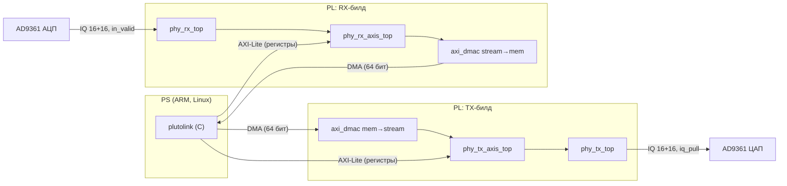
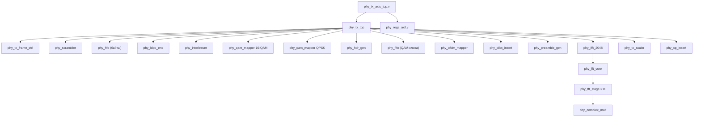
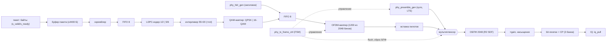

# Глава 7. Архитектура системы

## 7.1. Положение PHY в системе

**[Док/Код]** `STATUS.md` («Структура: спільне ядро + два білди»), `rtl/tx/phy_tx_axis_top.v`, `rtl/rx/phy_rx_axis_top.v`:



* В одном битстриме — **только TX или только RX** (разные «роли»), на одной плате. Обмен «пакетами» с PS — по DMA, управление
  и логи — по AXI-Lite (`phy_regs_axil`, глава 10).
* **Единственный тактовый домен PHY** — `clk` (`l_clk` AD9361; `phy_rx_axis_top.v:41`). Домен `s_axi_aclk` (FCLK0, 100 МГц по атрибуту
  `FREQ_HZ 100000000`) отделён регистровым блоком с синхронизаторами (§10.5).

## 7.2. Иерархия модулей

### 7.2.1. Передатчик



(Имена экземпляров и строки: `phy_tx_top.sv:97,143,149,162,182,202,206,218,232,242,251,259,272,277,285`.)

### 7.2.2. Приёмник

```mermaid
flowchart TD
  A["phy_rx_axis_top.v"] --> B["phy_rx_top"]
  A --> R["phy_regs_axil.v"]
  B --> S1["phy_input_scale ×2"]
  B --> S2["phy_dc_remove ×2"]
  B --> S3["phy_sync_sc"] --> DL["phy_delay_line ×3"]
  B --> S4["phy_cfo_coarse"] --> CO["phy_cordic"]
  B --> S5["phy_nco_mixer"] --> SC["phy_sincos"]
  S5 --> CM["phy_complex_mult"]
  B --> S6["phy_rx_window"]
  B --> S7["phy_rx_fft"] --> F1["phy_fft_2048"] --> F2["phy_fft_core"]
  S7 --> F3["phy_cp_insert (CP=0, bit-reverse)"]
  B --> S8["phy_bin_select"]
  B --> S9["phy_channel_estimator"] --> GS["phy_g_smooth"]
  S9 --> TA["phy_tau_est"]
  B --> S10["phy_noise_est"]
  B --> S11["phy_mmse_post"] --> LG["phy_lgcode"]
  B --> S12["phy_equalizer"]
  B --> S13["phy_phase_tracker"]
  B --> S14["phy_rssi_code"]
  B --> S15["phy_rx_decode_ldpc (CODED)"]
  S15 --> D1["phy_llr_demap"]
  S15 --> D2["phy_hdr_dec"]
  S15 --> D3["phy_interleaver (DEINT)"]
  S15 --> D4["phy_ldpc_dec"] --> DY["phy_dyn_sr"]
  S15 --> D5["phy_descrambler"]
  B --> S16["phy_rx_decode (uncoded)"]
  B --> S17["phy_ca_refine (CA=1)"] --> W1["phy_w_core"]
  S17 --> W2["phy_equalizer (второй)"]
  B --> S18["phy_rx_pkt_out"]
```



(Экземпляры: `phy_rx_top.sv:82,85,95,102,119,129,139,157,165,183,189,204,215,233,259,270,282,357`.) `phy_rx_decode_ldpc` и
`phy_rx_decode` выбираются параметром `CODED` (`generate if`, `phy_rx_top.sv:258-279`). `phy_noise_est`/`phy_mmse_post` — только
при `CODED` (`g_soft`, строки 183-200); `phy_ca_refine` — только при `CODED && CA` (строка 281).

## 7.3. Блок-схема TX (поток данных)



## 7.4. Блок-схема RX (поток данных)

```mermaid
flowchart LR
  ADC["АЦП I/Q 16 бит"] --> SC["input_scale (сдвиг)"] --> DC["dc_remove K=16"]
  DC --> SYNC["sync_sc: детектор, n_best, P"]
  DC --> DLY["линия задержки 704"]
  SYNC --> CFO["cfo_coarse → inc (CORDIC)"]
  DLY --> MIX["nco_mixer"]
  CFO --> MIX
  MIX --> WIN["rx_window (CP долой)"] --> FFT["БПФ 2048 + reorder (2 банка)"] --> BS["bin_select 1200"]
  BS -->|"кадр LTS"| CH["channel_estimator (+g_smooth, tau_est)"]
  FFT -->|"кадр LTS"| NE["noise_est (guard-бины)"]
  CH --> MP["mmse_post: веса, T/gm/ge, качество"]
  NE --> MP
  BS -->|"данные"| EQ["equalizer (1 тап)"]
  CH -. веса .-> EQ
  MP -. перезапись весов .-> CH
  EQ --> TR["phase_tracker: CPE + SFO"]
  TR --> LLR["llr_demap (16-QAM | QPSK)"]
  MP -. параметры T,gm,ge .-> LLR
  TR -->|"символ-заголовок"| HD["hdr_dec → MODE_ID, nsyms"]
  LLR --> DI["деинтерливер"] --> LD["LDPC-декодер"] --> DS["дескремблер"] --> PK["pkt_out: AXI-Stream 64 бит"]
  HD -. режим .-> LLR
  PK --> DMA["DMA → PS"]
```



## 7.5. Форматы данных (сводка)

| Сигнал | Формат | Где |
|---|---|---|
| Отсчёт TX/RX | `signed [15:0]` I и Q по отдельности, строб `valid`/`pull` | `iq_re`, `iq_im` / `in_i`, `in_q` |
| Бины после БПФ | `signed [15:0]` I/Q, естественный порядок 0…2047 | `phy_rx_fft` |
| Бины после выбора | 1200 значений, `out_first`=индекс 0, `out_last`=1199, `out_pilot` | `phy_bin_select.sv:1-3` |
| Вес эквалайзера | `{mr[15:0], mi[15:0], E[7:0]}` | RAM 1200×40 бит |
| Параметры демаппера | `{T[15:0], gm[5:0], ge[6:0]}` (29 бит) | RAM `prm[1100]` |
| LLR для LDPC | 6 бит знаковые, ±31 | |
| Угол | `[31:0]`, $2^{32}=2\pi$ | CORDIC, NCO, `ph_acc` |
| Запись пакета на DMA | 64-бит beats, 6 заголовочных + payload | `phy_rx_pkt_out` (§10.4) |

### 7.5.1. Служебные флаги потока

Почти все потоковые блоки сопровождают данные флагами `*_first` (первый отсчёт кадра/символа), `*_last` (последний). Они валидны
вместе с `*_valid`. Именно по `in_first` блоки сбрасывают внутренние счётчики (например `cur = in_first ? 0 : cnt`,
`phy_bin_select.sv:25`, `phy_equalizer.sv:26`, `phy_llr_demap.sv:33`): это делает их устойчивыми к потере предыдущего `last`.

## 7.6. Протоколы handshake

В проекте встречаются три стиля — важно знать, какой где:

1. **Valid-only (без back-pressure).** Блок принимает данные в любой такт с `in_valid=1` и не может притормозить источник;
   «пустые» такты допускаются (gap), состояние продвигается *только* по `in_valid` (valid-gated). Примеры: `phy_pilot_insert`,
   `phy_bin_select`, `phy_equalizer`, `phy_phase_tracker` (вход), `phy_nco_mixer`, `phy_fft_stage`. Поддерживаемая пропускная
   способность — 1 отсчёт/такт.
2. **Valid/ready (AXI-подобный).** Данные переходят в такте, когда оба =1. Примеры: `phy_interleaver`, `phy_fifo`,
   `phy_ldpc_enc` (`out_ready`), `phy_ldpc_dec` (`in_ready`), `phy_hdr_gen`, `phy_rx_pkt_out` (выход AXI-Stream).
3. **Pull.** Источник TX отдаёт отсчёт по запросу приёмника: `iq_pull` → `iq_valid`/`iq_re`/`iq_im` в том же такте
   (`phy_tx_top.sv:6-8`); ЦАП «тянет» сэмплы со своей скоростью.

Для TX это порождает «**контракт временных ограничений**» (`phy_tx_top.sv:10-13`): после готовности пакета первый отсчёт
появляется примерно через два времени вычисления символа, дальше отсчёты идут **непрерывно** при условии, что тактовая частота
обработки ≥ 2× частоты отсчётов; логика «кредитов» в `phy_tx_frame_ctrl` гарантирует, что банки CP-буфера заполняются
вовремя (§8.3).

## 7.7. Тактирование и частоты

**[Код]** Все блоки PHY работают от одного `clk`, привязанного к `l_clk` AD9361.

**[Док]** Какой именно `l_clk` (61,44 или 122,88 МГц) — «невідомо до першого запуску на залізі» (`STATUS.md`, «Bring-up на залізі»).
В `synth_est.tcl` ограничение 8 нс (125 МГц) используется только для оценки (`create_clock -period 8.000`); тестбенчи
`tb_phy_rx_top`/`tb_phy_tx_top` моделируют **2 такта на отсчёт** (61,44 МГц для 30,72 МГц отсчётов, `tb_phy_rx_top.sv:7`).

Следствия частоты (**[Док]** `STATUS.md` v0.7.0): время декодирования LDPC ≈ 460 тактов/итерацию (1/2) и ≈ 300 (5/6); при периоде
OFDM-символа 4384 такта (2 такта на отсчёт × 2192) 10 итераций помещаются лишь при 122,88 МГц; при 61,44 МГц работает раннее
завершение (в сценариях 2–6 итераций).

## 7.8. Структура кадра на воздухе

```
время →
  ┌──────────┬──────────┬──────────┬───────────┬───────────┬─── ... ───┐
  │  sync    │   LTS    │  header  │  data 0   │  data 1   │  data n-1 │
  │ (чётные  │ (все 1200│ (QPSK,   │ (1100     │           │           │
  │ бины)    │ бинов)   │ MODE_ID) │ данных +  │           │           │
  │          │          │          │ 100 пилот)│           │           │
  └──────────┴──────────┴──────────┴───────────┴───────────┴───────────┘
   каждый символ = CP(144) + 2048 отсчётов = 2192 отсчёта = 71,35 мкс
```

* `nsyms` — число символов данных (1…`TX_MAX_SYMS` = 8 по комментарию `phy_pkg.sv:44`).
* В некодированном режиме (`CODED=0`) заголовка нет: кадр `[sync][LTS][data…]` (`phy_tx_frame_ctrl.sv:2`).
* Контроллер TX считает **символы** так: `total = nsyms + 2` (sync и LTS) — плюс символ-заголовок в кодированном режиме
  (`go_nsyms(pkt_nsyms + 8'(CODED))`, `phy_tx_top.sv:99`).

### 7.8.1. Сколько байт в символе

| Режим | Модуляция | Кодовые слова/символ | Байт/символ | Скорость PHY (асимптотически) |
|---|---|---|---|---|
| MAX RANGE (MODE_ID=0) | QPSK | 1 (1080 пар бит) + 20 заполняющих | 135 | $\approx 15{,}14$ Мбит/с |
| MAX RATE (MODE_ID=1) | 16-QAM | 2 (по 540 нибблов) + 20 заполняющих | 450 | $\approx 50{,}45$ Мбит/с |
| uncoded (`CODED=0`) | 16-QAM | — | 550 | $\approx 61{,}7$ Мбит/с (до накладных) |

Скорости: $135\cdot8\cdot14014 = 15{,}14$ Мбит/с ✓; $450\cdot8\cdot14014 = 50{,}45$ Мбит/с ✓ (проверка арифметикой; в
`ARCHITECTURE_DUALMODE.md` те же числа; 14014 = `SYMBOL_RATE_HZ`, целая часть).

## 7.9. Временная диаграмма TX (приёмка пакета и вывод)

ASCII-схема (масштаб условный; обозначения — сигналы `phy_tx_top`):

```
s_valid  ‾‾‾‾‾‾\_/‾\__/‾‾‾‾‾\_______________________________________________
s_last                                      ‾|
pkt_valid                                    ‾‾‾‾‾‾‾‾‾‾‾‾‾‾‾‾‾‾‾‾‾‾‾‾‾‾‾‾‾‾‾‾‾‾
ctrl state   IDLE                            CREDIT START RUN ...  (sync)
                                             CREDIT START RUN ...  (LTS)
                                             ... (header) ... (data i)  FLUSH DRAIN RST IDLE
IFFT in:                                       [sync][LTS][hdr][d0][d1]     [нули 2047]
cp_valid                                              (≈ 2 символа спустя)  ╔═ 2192 отсчётов/символ ═╗
iq_pull  ──────────────────────────────────────────────────────────────────‾|‾|‾|‾|‾|‾|...
```

Когда пакет принят полностью (`pkt_valid=1`), `go_valid` запускает контроллер; он «шагает» по символам, подавая каждый на
ОБПФ; выход ОБПФ каждого символа попадает в один из трёх банков `phy_cp_insert`; чтение банка (с CP впереди) идёт по запросам
`iq_pull`.

## 7.10. Временная диаграмма RX (один пакет)

```
отсчёты:  ...шум...│ sync │ LTS │ hdr │ d0 │ d1 │...шум
индекс n:          s0                                        (n_best ≈ s0 + 2184)
sync_sc:  IDLE ───────────┐cond┌── TRACK (704 отсч.) ──┐  ev_valid ──► DONE
                                                      │
контроллер: C_IDLE ──────────────────────────────────►C_CFO(≈29 тактов, CORDIC)
                                                      ─► C_RUN: arm_valid, w0 = n_best+104+adj (+704 из-за линии задержки)
окно:     ─────────────────────────────  ARMED → WIN(LTS) GAP WIN(hdr) GAP WIN(d0) GAP WIN(d1) ─ FLUSH(2047 нулей) → done
FFT:                                       кадр LTS │ кадр hdr │ кадр d0 │ кадр d1 │ (выход с задержкой ≈ 2114)
chest/noise/post:                                     ▲ после LTS-кадра: веса, T/gm/ge (≈1200+ тактов)
tracker→decoder:                                                  hdr → mode_q; d0 → LDPC; d1 → LDPC ...
pkt_out:                                                                                   commit → 6 beats + payload
контроллер: C_RUN (fw_cnt==nwin → core_rst) → C_DECODE (dec_done && !po_busy) → C_FIN (re-arm через 4 такта)
```

Подробное объяснение каждой стрелки — в главе 9 (контроллер: §9.14).

## 7.11. Режимы: кто и где переключается

| Параметр | Где задаётся | Кто использует |
|---|---|---|
| `CODED` (`phy_tx_top`/`phy_rx_top`/обёртки) | параметр модуля, на этапе сборки | выбирает набор блоков (LDPC, заголовок, MMSE…) |
| TX `cfg_mode` | регистр `0x18` bit1 (TX), семплируется вместе с первым байтом пакета | `phy_ldpc_enc`, интерливер (`rot_en`), выбор мапера, `phy_hdr_gen` |
| RX `cfg_hdr_en` | регистр `0x1C` bit1 | брать режим из заголовка |
| RX `cfg_mode` | регистр `0x1C` bit2 | резервный режим (если CRC заголовка не сошёлся или `cfg_hdr_en=0`) |
| RX `cfg_mmse`, `cfg_smooth`, `cfg_ft_en`, `cfg_ua`, `cfg_ca` | регистры `0x1C`, `0x28` | включают соответствующие алгоритмы |

Переключение режима — **только между пакетами** (комментарий `phy_tx_top.sv:4`); внутри пакета режим не меняется.

## 7.12. Что дальше

* Глава 8 — TX по модулям (§8.1–§8.10).
* Глава 9 — RX по модулям (§9.1–§9.16).
* Глава 10 — обёртки, регистры, формат пакета.
