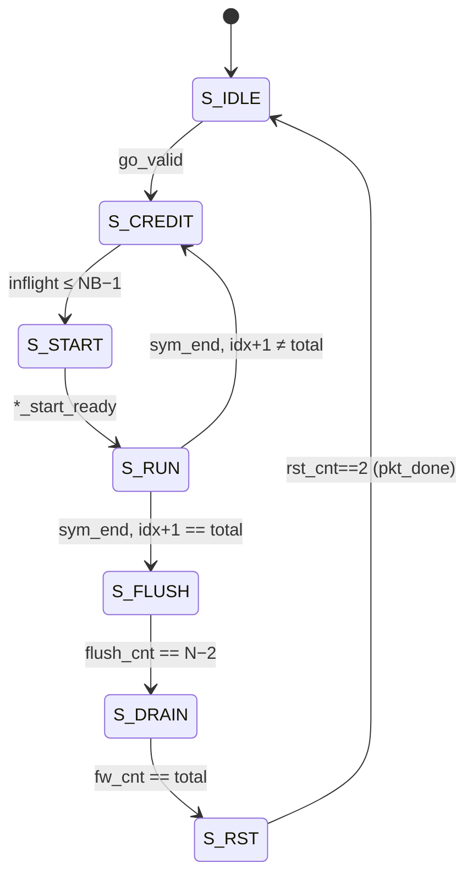

# Глава 8. Передатчик (`rtl/tx/`)

## 8.1. Обзор и последовательность обработки

Передатчик — модуль `phy_tx_top` (`rtl/tx/phy_tx_top.sv`), собирающий конвейер из подмодулей: 12 SystemVerilog-файлов каталога
`rtl/tx/`, обёртка `phy_tx_axis_top.v` и общие блоки из `rtl/common/`. Порядок обработки (комментарий в шапке файла, строки 5-6):

```
байты → буфер пакета → скремблер → [LDPC-кодер] → интерливер → QAM-маппер → OFDM-маппер → вставка пилотов
      → (мультиплексор с преамбулой) → ОБПФ → цифровой масштабер → буфер bit-reverse + CP → IQ (по запросу ЦАП)
```

| № | Модуль | Файл | Назначение | Латентность (по комментарию) |
|---|---|---|---|---|
| 1 | `phy_tx_top` | `tx/phy_tx_top.sv` | верхний уровень, буфер пакета, соединения | — |
| 2 | `phy_tx_frame_ctrl` | `tx/phy_tx_frame_ctrl.sv` | FSM кадра: преамбула, символы, flush, сброс БПФ | — |
| 3 | `phy_scrambler` | `tx/phy_scrambler.sv` | аддитивный скремблер x¹⁵+x¹⁴+1 | 1 |
| 4 | `phy_ldpc_enc` (common) | `common/phy_ldpc_enc.sv` | систематический QC-LDPC кодер | — |
| 5 | `phy_interleaver` | `tx/phy_interleaver.sv` | блочный интерливер 55×20 + вращение | блок + 2 |
| 6 | `phy_qam_mapper` | `tx/phy_qam_mapper.sv` | QPSK/16-QAM (Gray) | 1 |
| 7 | `phy_hdr_gen` | `tx/phy_hdr_gen.sv` | символ-заголовок | — |
| 8 | `phy_ofdm_mapper` | `tx/phy_ofdm_mapper.sv` | расстановка по 2048 бинам | 1 |
| 9 | `phy_pilot_insert` | `tx/phy_pilot_insert.sv` | подстановка пилотов | 1 |
| 10 | `phy_preamble_gen` | `tx/phy_preamble_gen.sv` | sync и LTS | 2 от `start` |
| 11 | `phy_ifft_2048` (+ common: `phy_fft_core`, `phy_fft_stage`, `phy_complex_mult`) | `tx/phy_ifft_2048.sv` | ОБПФ R2 SDF | 2114 + 1 (по формуле) |
| 12 | `phy_tx_scaler` | `tx/phy_tx_scaler.sv` | усиление Q2.14 + насыщение | 2 |
| 13 | `phy_cp_insert` | `tx/phy_cp_insert.sv` | реордер bit-reverse + CP | буфер |
| — | `phy_fifo` (common) | `common/phy_fifo.sv` | FIFO show-ahead | 1 |
| — | `phy_tx_axis_top.v` | `tx/phy_tx_axis_top.v` | обёртка DMA + регистры | см. главу 10 |

## 8.2. `phy_tx_top`

Файл `rtl/tx/phy_tx_top.sv`, модуль `phy_tx_top`. Шапка (строки 1-14) описывает контракт: пакет подаётся через
`s_valid/s_ready/s_data/s_last`, payload дополняется нулями до кратного размеру символа; выход «pull» по `iq_pull`.

### 8.2.1. Параметры

| Параметр | По умолчанию | Смысл | Строка |
|---|---|---|---|
| `MAX_SYMS` | `TX_MAX_SYMS` = 8 | максимум OFDM-символов в буфере (размер буфера считается как `MAX_SYMS × BYTES_PER_OFDM`) | 18, 43 |
| `SHIFT_MASK` | `32'h0FF` | маска масштабирования ОБПФ | 19 |
| `CODED` | `1'b0` | 1 — двухрежимный кодированный PHY; 0 — без кодирования (550 Б/символ) | 20 |

> Значение по умолчанию `CODED = 0`, но обёртка `phy_tx_axis_top` по умолчанию подставляет `CODED = 1` (`phy_tx_axis_top.v:28`) —
> то есть «боевой» режим включается на уровне обёртки.

### 8.2.2. Порты

| Порт | Напр. | Ширина | Назначение |
|---|---|---|---|
| `clk`, `rst` | in | 1 | такт, синхронный сброс (активный 1) |
| `gain` | in | 16 | усиление Q2.14, 16384 = 1,0 |
| `cfg_mode` | in | 1 | 0 = MAX RANGE, 1 = MAX RATE (семплируется с первым байтом пакета) |
| `s_valid/s_ready/s_data/s_last` | in/out | 1/1/8/1 | вход пакета побайтно |
| `iq_pull` | in | 1 | запрос одного отсчёта (от ЦАП) |
| `iq_re`, `iq_im`, `iq_valid` | out | 16, 16, 1 | отсчёт (нули, если нечего отправлять) |
| `underflow` | out | 1 | запрос отсчёта в активном пакете, когда данных нет («не должно происходить») |
| `overflow` | out | 1 | кадр пришёл в CP-буфер без свободного банка |
| `pkt_trunc` | out | 1 | пакет усечён (превысил размер буфера) |
| `pkt_done` | out | 1 | пакет полностью записан в CP-буфер, БПФ сброшен |
| `busy` | out | 1 | `ctrl_active | pkt_valid | cp_valid` (строка 294) |

### 8.2.3. Приём пакета в буфер (строки 46-86)

Пакет принимается в массив `bbuf` размером `MAX_SYMS × BYTES_PER_OFDM` = 8 × 550 = **4400 байт** (строка 43). Источник готов
(`s_ready = ~pkt_valid`, строка 61), пока предыдущий пакет не будет полностью считан. Конец пакета — по `s_last` либо при
заполнении буфера (`wr_end`, строка 63); во втором случае `pkt_trunc` устанавливается (`pkt_trunc <= ~s_last`, строка 79).

Счётчик `sym_byte_cnt` считает байты внутри символа; число байт на символ зависит от режима (строки 53, 73):

```systemverilog
wire [9:0] bps_w = CODED ? (wr_mode ? 10'd450 : 10'd135) : 10'(BYTES_PER_OFDM);   // payload bytes per OFDM symbol
```

Режим пакета `wr_mode` «защёлкивается» вместе с первым байтом: `wr_mode_n = (wr_ptr == 0) ? cfg_mode : wr_mode` — то есть первый
же байт уже считается с новым режимом (строка 57). Сброс устанавливает `wr_mode <= 1` (MAX RATE; строка 70).

По окончании: `pkt_len` = число принятых байт, `pkt_nsyms = nsyms_acc + 1` (число символов, включая неполный), `pkt_valid = 1` (строки 75-79).

> Расчёт: при приёме 4400 байт в режиме MAX RATE (450 Б/символ) `pkt_nsyms` может достичь 10, тогда как `TX_MAX_SYMS = 8` и RX
> (`phy_rx_top` `MAX_SYMS = 8`) рассчитан на 8 символов. По коду: ограничение накладывает только размер буфера (4400 Б), а не число символов.
> Вынесено в «Открытые вопросы».

### 8.2.4. Читатель: буфер → скремблер → FIFO (строки 106-152)

После готовности пакета контроллер даёт `go_valid`; при `go_ready` читатель стартует (`rd_busy`), запоминает режим пакета
`pkt_mode <= wr_mode` и вычисляет `total_bytes = pkt_nsyms × bytes_per_symbol` — это **дополненная** длина (строка 127). Далее читается
по 1 байту за такт (`ram_q <= bbuf[rd_idx]` — **синхронное чтение**, строка 117), с троттлингом по заполнению FIFO
(`rd_issue`, строка 114: `(bf_count + a_v + scr_v) < 6`). Байты с индексом `≥ pkt_len` заменяются нулём
(`.in_data(a_pad ? 8'h00 : ram_q)`, строка 145), затем скремблируются. **Скремблируется весь дополненный пакет** (включая нулевое
дополнение) — поэтому RX получает на выходе полное число байт `nsyms × bytes_per_symbol` (§10.4); истинную длину пакета должен
знать верхний уровень (программа).

`a_first` (индекс 0) перезагружает seed скремблера (строка 131).

### 8.2.5. Кодер и интерливер (строки 154-187)

В `CODED`-режиме байты идут в `phy_ldpc_enc` (`FILL_WORDS = 20`), `cfg_mode(pkt_mode)`; выход — 4-битные слова `enc_out_data`
(для QPSK используются два младших бита, строка 91 `phy_ldpc_enc.sv`). Без кодирования (`g_uncoded`): байт разбирается на 2 нибла
счётчиком `nib_phase` (старший первый).

Затем слова идут в `phy_interleaver #(.WORD_W(BITS_PER_SYM), .ROT_UNIT(1)) u_il` с `rot_en = CODED ? pkt_mode : 1` (строка 183).

### 8.2.6. Мапперы и символ-заголовок (строки 189-236)

Два QAM-маппера работают параллельно на одном и том же интерливерном выходе: 16-QAM (`u_qam`) по 4 битам и QPSK (`u_qpsk`, `UNIT =
QPSK_UNIT`) по двум младшим. Выбор: `qpsk_sel = CODED && !pkt_mode` (строка 210). В режиме MAX RANGE интерливер
отдаёт слова `{2'b00, b1, b0}`, поэтому QPSK-маппер берёт `il_out_data[1:0]`.

Заголовок: `phy_hdr_gen` стартует по `go_fire` (то же событие, что запускает читателя), формирует 1100 QPSK-бинов и записывает их в
`u_qfifo` **перед** данными: пока идёт заголовок (`hdr_pend`), вывод интерливера блокируется (`il_out_ready = (qf_count <= 5) && !(CODED && hdr_pend)`,
строка 199). Запись в `u_qfifo` мультиплексируется: `hdr_busy ? {hdr_i, hdr_q} : {qm_i, qm_q}` (строки 233-234).

FIFO `phy_fifo #(.W(2*IQ_W), .DEPTH(8)) u_qfifo` согласует скорости: ofdm-маппер потребляет слова только на «слотах данных».

### 8.2.7. Мультиплексор преамбулы и ОБПФ (строки 264-275)

```systemverilog
wire                   ff_valid = pr_valid | pi_valid | flush_valid;
wire signed [IQ_W-1:0] ff_re    = pr_valid ? pr_re : pi_valid ? pi_re : '0;
assign sym_end = (pr_valid & pr_last) | (pi_valid & pi_last);
```

Источники символов — преамбула, поток данных (после вставки пилотов) и «flush» (нули) — взаимоисключающи, поэтому
«мультиплексор» — это просто OR валидностей и приоритетный выбор данных. `sym_end` (последний бин символа) возвращается в
контроллер.

`phy_ifft_2048` получает `.rst(rst | fft_rst)` — мягкий сброс ядра между пакетами «выравнивает счётчики стадий»
(`phy_tx_frame_ctrl.sv:8-9`).

### 8.2.8. CP-буфер, выход, диагностика

`phy_cp_insert` принимает `out_ready = iq_pull`; `iq_valid = cp_valid`; на выход подаются 0, когда `cp_valid=0`
(строки 291-293). `underflow` формируется как `iq_pull & ~cp_valid & ctrl_active & tx_started_out` (строка 298);
`tx_started_out` взводится после первого фактически выданного отсчёта и сбрасывается по окончании кадра (строки 302-306) — «чтобы
не давать ложных срабатываний в паузе между пакетами» (`STATUS.md`, HW v0.3.0).

## 8.3. `phy_tx_frame_ctrl`

Файл `rtl/tx/phy_tx_frame_ctrl.sv`. Последовательность кадра: `[sync][LTS][data 0..nsyms-1]` (в `CODED` режиме число
«data» символов передаётся как `pkt_nsyms + 1`, то есть первый «data» — это заголовок).

### 8.3.1. Состояния



Объяснение (`phy_tx_frame_ctrl.sv:35-91`):

* `total = go_nsyms + 2` (sync и LTS в счёте), `idx` — номер символа в кадре. `idx < 2` — преамбула (`is_pre`, строка 46);
  `pre_start_kind = (idx == 1)` → idx 0 = sync (kind 0), idx 1 = LTS (kind 1) (строка 51).
* **S_CREDIT** — главное правило TX: «символ $i$ запускается, только пока число запущенных, но ещё не воспроизведённых,
  символов ≤ NB−1» (`inflight = started − done_cnt`, строка 45; `done_cnt` растёт по `sym_done`, т.е. когда DAC забрал последний
  отсчёт символа). Причина: ОБПФ SDF выдаёт кадр $i$ с конца подачи кадра $i$ до конца подачи кадра $i+1$ — к концу подачи
  необходим свободный банк (`phy_tx_frame_ctrl.sv:3-8`, `phy_cp_insert.sv:8-9`).
* **S_START** — рукопожатие со сборщиками символа: либо `phy_preamble_gen` (`pre_start_*`), либо `phy_ofdm_mapper` (`map_start_*`).
* **S_RUN** — ждёт `sym_end`.
* **S_FLUSH** — после последнего символа подаёт `FFT_SIZE − 1 = 2047` нулей (`flush_cnt` до `FFT_SIZE − 2`), чтобы вытолкнуть последний
  кадр из SDF-конвейера (строка 81).
* **S_DRAIN** — ожидание, пока все `total` кадров записаны в CP-буфер (`fw_cnt == total`).
* **S_RST** — три такта сброса ядра ОБПФ (`fft_rst`), затем `pkt_done` и возврат в `S_IDLE`.

`go_ready = (state == S_IDLE)`, `active = (state != S_IDLE)`.

> Следствие: **один пакет за раз**; следующий `go_valid` обслуживается только после `pkt_done`. Между пакетами нужна пауза
> (параметр `GAP_SAMPLES` в `phy_tx_axis_top.v`, §10.1.3: «the receiver handles one packet at a time and needs ~12000 samples to re-arm»).

## 8.4. `phy_scrambler` (также `phy_descrambler`)

Файл `rtl/tx/phy_scrambler.sv`. Порты: `in_valid/in_first/in_last/in_data[7:0]` → `out_*`. Параметр `SEED = SCR_SEED = 0x7FFF`.

Комбинационная часть (строки 28-37) обрабатывает байт побитно со старшего:

```systemverilog
lfsr_next = in_first ? SEED : lfsr;            // перезагрузка seed по первому байту
for (int i = 7; i >= 0; i--) begin
  fb           = lfsr_next[14] ^ lfsr_next[13];  // выходной бит ПСП
  data_next[i] = in_data[i] ^ fb;                // XOR данных
  lfsr_next    = {lfsr_next[13:0], fb};          // сдвиг
end
```

Регистровая часть (строки 39-55): выход регистрируется, `lfsr <= lfsr_next` только при `in_valid`. Латентность 1, пропускная способность 1
байт/такт. Теория — §5.1.

## 8.5. `phy_ldpc_enc` (`rtl/common/phy_ldpc_enc.sv`)

Систематический QC-LDPC кодер для двух кодов (`cfg_mode`: 0 → R=1/2, 1 → R=5/6). Теория: §5.6.

**Интерфейс.** Вход — байты (`in_valid/in_ready/in_data`), старший бит байта — младший по номеру информационный бит. Выход —
слова `out_data[3:0]` с `out_valid/out_ready`: для 16-QAM — ниббл (первый бит — старший), 540 нибблов на кодовое слово; для QPSK —
`out_data[1:0] = {I, Q}`, 1080 слов.

**Параметр** `FILL_WORDS = 20`: после последнего слова символа выдаются 20 «заполняющих» слов (QPSK `4'h1`, 16-QAM `4'h5`; строка 94),
дополняющих 1100 слов символа.

**Состояния** (`st_t`, строка 29): `E_LOAD → E_LAM → E_DRAIN → E_PAR → E_PACK → E_OUT → (E_FILL) → E_LOAD`.

| Состояние | Что делает | Строки |
|---|---|---|
| `E_LOAD` | принимает `nbytes` (135 или 225) байт в сдвиговый регистр `u` | 103-108 |
| `E_LAM` | для каждой блочной строки $i$ перебирает информационные элементы $(col, shift)$: 4-ступенчатый конвейер «ROM таблиц → мультиплексор столбца → 6-ступенчатый barrel-ротатор → XOR в `lam[row]`» | 109-115, 54-82 |
| `E_DRAIN` | ждёт 4 такта опустошения конвейера | 116-118 |
| `E_PAR` | вычисляет чётности: `pstep` 0: $p_0=\bigoplus\lambda_i$; 1: $p_1=\lambda_0\oplus\operatorname{rot}(p_0,a)$; далее $p_{i+1}=\lambda_i\oplus p_i$ (с $\oplus p_0$ при $i=L_{mid}$) | 119-136 |
| `E_PACK` | собирает кодовое слово `[инфо | чётность]` в `cwr` (отличается для QPSK/16-QAM) | 137-146 |
| `E_OUT` | сдвигает `cwr` на 2 (QPSK) или 4 бита, при `out_ready` | 147-156 |
| `E_FILL` | 20 заполняющих слов | 157-159 |

Barrel-ротатор (шесть ступеней сдвига на $2^s$ с мультиплексором, строки 69-74): `out[r] = in[(r + sh) mod 60]`. Ротации по
таблице `enc_sh()`, столбцы по `enc_col()` (из `phy_ldpc_pkg`, сгенерированы).

Кодер обрабатывает **одно кодовое слово за раз**; пока идёт `E_OUT`, `in_ready=0` — приём следующих байт стоит (поэтому читатель
`phy_tx_top` останавливается FIFO).

## 8.6. `phy_interleaver` (`rtl/tx/phy_interleaver.sv`)

Параметры: `WORD_W` (ширина слова; TX: 4), `ROT_UNIT` (бит вращения), `ROWS = 55`, `COLS = 20`, `DEINT` (0 — интерливер, 1 — деинтерливер).
Порты: `rot_en`, `in_valid/in_ready/in_data`, `out_valid/out_ready/out_data/out_first/out_last`.

**Структура.** Память `mem[2*NSYM]` (два банка по 1100 слов, ping-pong; строка 38). Запись последовательная (`wr_idx`); перестановка
реализована **на стороне чтения** генератором адресов с двумя счётчиками — «быстрым» (`fast_cnt` по модулю `FAST_N`, шаг `STEP`)
и «медленным» (`rd_base`): для интерливера `FAST_N = COLS = 20`, `STEP = ROWS = 55` (строки 35-36, 106-111):

```systemverilog
if (fast_cnt == IW'(FAST_N - 1)) begin fast_cnt <= 0; rd_base <= rd_base + 1; rd_addr <= rd_base + 1; end
else begin fast_cnt <= fast_cnt + 1; rd_addr <= rd_addr + IW'(STEP); end
```

Это в точности $\pi(m) = (m \bmod \text{COLS})\cdot\text{ROWS}+\lfloor m/\text{COLS}\rfloor$ без умножителя и деления.

**Вращение** применяется на *стороне записи* (чтобы чтение осталось «чистым» синхронным чтением BRAM): для нечётной выходной
позиции $m$ слово при записи вращается (`rotl` для интерливера, `rotr` для деинтерливера; строки 54-69). Чётность $m$ вычисляется из
счётчиков записи (`m_odd_w = (wfast[0] & COLS[0]) ^ wslow[0]` для интерливера).

**Handshake:** `in_ready = ~full[wr_bank]`, чтение разрешается, когда банк полон и приёмник готов (`rd_adv`, строка 52). Безопасен к
back-pressure («no loss/dup»). Латентность — «store-and-forward»: первое выходное слово через `NSYM + 2` тактов после первого входного.

## 8.7. `phy_qam_mapper` (`rtl/tx/phy_qam_mapper.sv`)

Параметры `ORDER` (4/16/64), `UNIT`. Вход `in_bits[BPS-1:0] = {I g0..g(m-1), Q g0..g(m-1)}`, где `g0` — старший бит оси. Выход
`out_i`, `out_q` — знаковые 16 бит. Латентность 1.

Функция `axis_level` (строки 26-33) переводит код Грея в двоичный индекс и считает уровень:

```systemverilog
b = g;
for (int k = 1; k < M; k++) b[M-1-k] = b[M-k] ^ g[M-1-k];   // Gray → binary (старший бит первым)
idx = int'(b);
return IQ_W'(UNIT * (2 * idx - (LV - 1)));
```

Разбор для 16-QAM ($M=2$, $LV=4$): `b[1] = g[1]`, `b[0] = b[1] ^ g[0]`. Таблица (первый бит — `g[1]`, старший):

| код (g1 g0) | idx | уровень |
|---|---|---|
| 00 | 0 | $-3U$ |
| 01 | 1 | $-U$ |
| 11 | 2 | $+U$ |
| 10 | 3 | $+3U$ |

(Соседние уровни отличаются одним битом — код Грея ✓.) Для QPSK ($M=1$, $LV=2$): бит 0 → $-U$, бит 1 → $+U$.

Для `UNIT = 4096` максимум $3\cdot4096 = 12288 < 2^{15}$ — насыщения не нужно (комментарий строка 4).

## 8.8. Построение символа в частотной области

### 8.8.1. `phy_ofdm_mapper`

Файл `rtl/tx/phy_ofdm_mapper.sv`. Строит поток из 2048 бинов в естественном порядке, 1 бин/такт. Логика:

* `bin` — счётчик бина 0…2047, `pmod` — счётчик «индекс активного потока mod 12» (строки 31-32, 55);
* `active` — бины $1\ldots600$ и $\ge1448$ (строка 34); `pilot_slot = active && pmod == PILOT_OFFSET`; `data_slot = active && !pilot_slot` (строки 35-36);
* `in_ready = busy && data_slot` (строка 39): на слотах данных берёт слово из FIFO; `step = busy && (!data_slot || in_valid)` — если данных нет, выход
  *приостанавливается* (бин не продвигается, `out_valid=0`; downstream должен принимать «дыры», что делают valid-gated SDF-стадии);
* на выходе: `out_re/out_im` — слово при `data_slot`, иначе 0 (включая DC, guard и **пустые слоты пилотов**); `out_pilot = pilot_slot`.

### 8.8.2. `phy_pilot_insert`

Файл `rtl/tx/phy_pilot_insert.sv`. Подставляет вместо слота-пилота `±PILOT_AMP` (вещественное; `out_im = 0`) со знаком из LFSR:
`out_re <= fb ? -PILOT_AMP : PILOT_AMP` (строка 36). Seed `PILOT_SEED` перезагружается по `in_first`; LFSR продвигается на каждом пилоте.
Знаки в приёмнике (`phy_phase_tracker`, `phy_channel_estimator`) восстанавливаются тем же LFSR (`sig = lf[14]^lf[13]`, пилот = `sig ? −A : +A`).

### 8.8.3. `phy_preamble_gen`

Файл `rtl/tx/phy_preamble_gen.sv`. Вход: `start_valid/start_ready/start_kind`. После рукопожатия: `busy=1`, `lfsr <= start_kind ? LTS_SEED : SYNC_SEED`.
Далее по 1 бину/такт (естественный порядок 0…2047):

```systemverilog
wire active = (bin >= 1 && bin <= NUM_POS_SC) || (bin >= NEG_FIRST_BIN);
wire used   = active && (kind || !bin[0]);       // sync: только чётные бины; LTS: все активные
out_re <= used ? (fb ? -AMP : AMP) : 0;          // AMP = kind ? PILOT_AMP : SYNC_AMP
if (used) lfsr <= {lfsr[13:0], fb};              // LFSR шагает только на задействованных бинах
```

(строки 27-45). `out_im = 0`. Знак пилота LTS на активном бине в порядке потока $s$ совпадает с тем, что восстанавливает RX
(`phy_channel_estimator.sv:43-59`: LFSR `LTS_SEED`, шаг на каждом входном бине).

### 8.8.4. `phy_hdr_gen`

Файл `rtl/tx/phy_hdr_gen.sv`. Интерфейс: `start` (семплирует `mode`, `nsyms`), `out_valid/out_ready/out_i/out_q`, `busy`. Формирование:

* слово `hdr = {mode, nsyms, 3'b000, crc4({mode,nsyms,3'b000})}` (строка 54);
* для бина $n$: `pos = n mod 8` выбирает пару бит `hdr[15−2pos]`, `hdr[15−2pos−1]` (строки 43-44); каждая XOR-ится с PN-битом
  (`s0`, `s1` — два последовательных шага LFSR `HDR_SEED = 0x1B2D`);
* `out_i = b0 ? +9216 : −9216`, `out_q = b1 ? +9216 : −9216` (строки 47-48);
* 1100 бинов (`n == NUM_DATA_SC − 1`, строка 59).

Подчёркивание: заголовок занимает те же 1100 слотов данных (с пилотами), что и обычный символ данных — для OFDM-маппера он выглядит как данные QPSK.

## 8.9. Тракт ОБПФ → масштабирование → CP

### 8.9.1. `phy_ifft_2048`, `phy_fft_core`, `phy_fft_stage`, `phy_complex_mult`

* `phy_ifft_2048` (`tx/phy_ifft_2048.sv`) — обёртка с обменом I/Q (§3.4), насыщением до 16 бит, маска `SHIFT_MASK` (0x0FF). Латентность
  `fft_core_latency(11) + 1 = 2115` тактов (по формуле, §3.3.1).
* `phy_fft_core` (`common/phy_fft_core.sv`) — генератор-цепочка 11 стадий `phy_fft_stage` с `LOGD = N_LOG−1−s`, `SHIFT = (SHIFT_MASK>>s)&1`
  (строки 36-42).
* `phy_fft_stage` (`common/phy_fft_stage.sv`) — одна стадия SDF: линия задержки (для $D\ge4$ — RAM с двухшаговой предвыборкой,
  `rd_q1/rd_q2`, строки 44-58; для $D<4$ — регистровый сдвиг), бабочка (строки 74-99), ROM twiddle и умножитель
  `phy_complex_mult` (строки 125-174), обходной тракт для сумм (`BL = 4`).
* `phy_complex_mult` (`common/phy_complex_mult.sv`) — $(a+jb)(c+jd)$, 4 умножителя, латентность 4: регистры входов → произведения →
  сумма+округление → сдвиг+насыщение (строки 44-54).

**Амплитуда на выходе.** Восемь стадий делят на 2, поэтому выход — это неотнормированная сумма, делённая на 256:
$y[n] = \tfrac1{256}\sum_k X_ke^{j2\pi kn/N}$ (то есть в $N/256 = 8$ раз больше «честного» ОБПФ). Среднеквадратичное значение
(**моя проверка комментария** `phy_ifft_2048.sv:4`: «rms ~1700»): $E|y|^2 = \tfrac1{256^2}\sum_k|X_k|^2$. Для 1100 точек 16-QAM
($10U^2 = 1{,}678\cdot10^8$ каждая) и 100 пилотов ($A^2 = 1{,}51\cdot10^8$): $\sum|X_k|^2\approx 1{,}85\cdot10^{11}+1{,}5\cdot10^{10}\approx2\cdot10^{11}$,
откуда $\mathrm{rms}\approx\sqrt{2\cdot10^{11}}/256\approx 1750$ — согласуется с комментарием.

### 8.9.2. `phy_tx_scaler`

`out = sat16(round_half_up(x · gain / 2^14))`, раздельно для I и Q (`phy_tx_scaler.sv:29-41`): произведение (`p_re <= in_re * gain`, такт 1), затем округление
`(p + RND) >>> GAIN_FRAC` и насыщение (такт 2). Параметры `GAIN_W = 16`, `GAIN_FRAC = 14`: максимум ≈ 4,0. Латентность 2.

### 8.9.3. `phy_cp_insert`

Параметры (`phy_cp_insert.sv:13-18`): `N_LOG = 11`, `CP = CP_LEN`, `BITREV = 1`, `NB = 3`. Память `mem[NB*N]` по 32 бита (I|Q) — BRAM.

* **Запись** без back-pressure: адрес `wr_base + bitrev(wr_idx)`; когда последний отсчёт кадра записан, `full[wr_bank]` взводится, импульс
  `frame_written`, переход к следующему банку по кругу (строки 91-102). Если кадр стартует, а банк занят — **кадр отбрасывается**, `overflow` фиксируется
  (строка 92).
* **Чтение** с CP: `rd_cnt` 0…`SYM−1`; при `rd_cnt < CP` смещение `N − CP + rd_cnt`, иначе `rd_cnt − CP` (строки 72-75). Чтение
  синхронное прямо в выходной регистр без логики между RAM и регистром (чтобы Vivado вывел BRAM, а не LUTRAM; `STATUS.md`, «TX: правила таймінгу»).
  Движение разрешено `rd_adv = full[rd_bank] && (!out_valid || out_ready)`.
* `sym_done` — импульс при приёме последнего отсчёта символа (строка 115).

## 8.10. Вспомогательные блоки: `phy_fifo`

`rtl/common/phy_fifo.sv`: синхронный FWFT FIFO на `DEPTH` (степень 2) слов, `count`, `wr_ready = !full`, `rd_valid = !empty`,
`rd_data = mem[rp]` (комбинаторное чтение из распределённой памяти — «show-ahead»). Используется в TX дважды: `u_bfifo` (байты, глубина 8) и `u_qfifo` (QAM-слова 32 бита, глубина 8).

## 8.11. Сквозной пример: пакет 900 байт, MAX RANGE и MAX RATE

* **MAX RATE** (`cfg_mode=1`): 900 Б = 2 × 450 → `pkt_nsyms = 2`. Кадр: sync, LTS, header, data 0, data 1 → 5 OFDM-символов =
  $5\times2192 = 10960$ отсчётов (в `tb_phy_tx_top.sv:7`: `NA = (CODED ? 5 : 4) * SYM`). Каждый символ данных — 2 кодовых слова по 225 байт.
* **MAX RANGE** (`cfg_mode=0`): 900/135 = 6,67 → `pkt_nsyms = 7` (последний неполный дополняется нулями) → 10 OFDM-символов.

## 8.12. Контрольные вопросы

1. Что произойдёт, если `iq_pull` приходит быстрее, чем обработчик успевает заполнять банки? Какой сигнал сообщит об этом?
2. Почему перестановка интерливера делается на стороне чтения, а вращение — на стороне записи?
3. Зачем между мапперами и ОБПФ стоит FIFO глубиной 8?
4. Что делает состояние `S_RST` и почему оно нужно?
