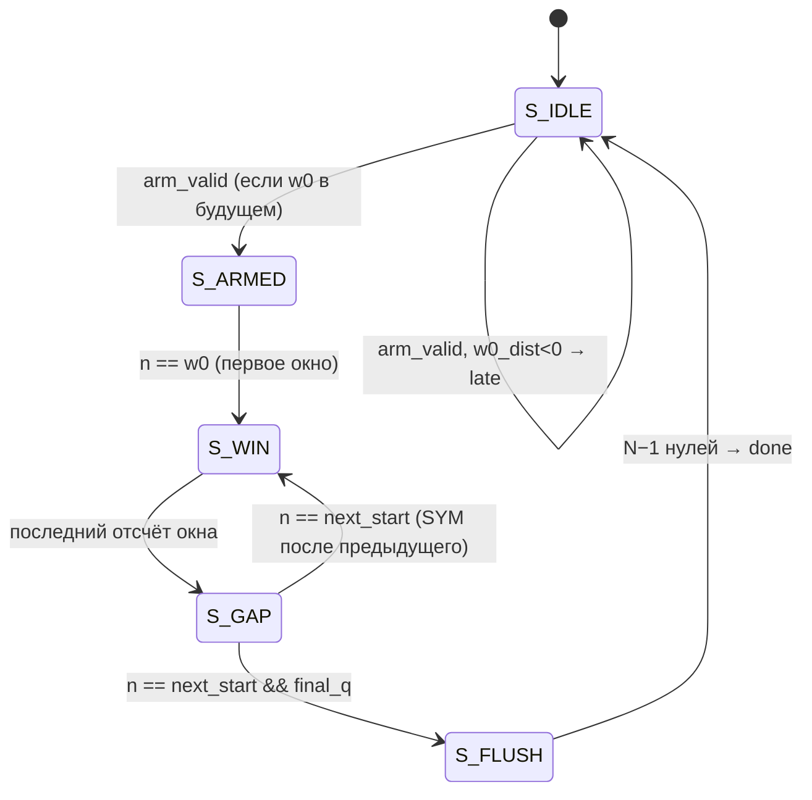
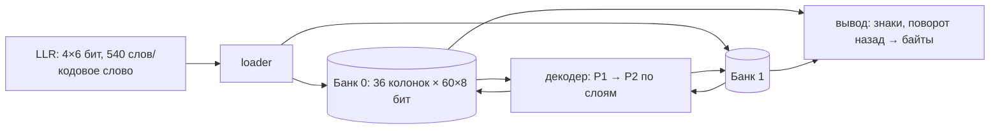

# Глава 9. Приёмник (`rtl/rx/`)

## 9.1. Обзор и таблица модулей

Приёмник — `phy_rx_top` (`rtl/rx/phy_rx_top.sv`, 443 строки): последовательность блоков + контроллер (FSM из 5 состояний).
Структурные схемы — §7.2.2 и §7.4. Все модули каталога `rtl/rx/`:

| Модуль | Файл | Назначение | Раздел |
|---|---|---|---|
| `phy_rx_top` | `phy_rx_top.sv` | верхний уровень + контроллер | 9.2, 9.14 |
| `phy_input_scale` | `phy_input_scale.sv` | степень-двойки усиление входа | 9.3 |
| `phy_dc_remove` | `phy_dc_remove.sv` | канселлер DC | 9.3 |
| `phy_sync_sc` | `phy_sync_sc.sv` | детектор Шмидля–Кокса | 9.4 |
| `phy_cfo_coarse` | `phy_cfo_coarse.sv` | дробное CFO → приращение NCO | 9.5 |
| `phy_nco_mixer` | `phy_nco_mixer.sv` | NCO + комплексный смеситель | 9.5 |
| `phy_rx_window` | `phy_rx_window.sv` | вырезание окон БПФ, flush | 9.6 |
| `phy_fft_2048` | `phy_fft_2048.sv` | обёртка БПФ | 9.7 |
| `phy_rx_fft` | `phy_rx_fft.sv` | БПФ + буфер реордера | 9.7 |
| `phy_bin_select` | `phy_bin_select.sv` | выбор 1200 активных бинов | 9.7 |
| `phy_channel_estimator` | `phy_channel_estimator.sv` | LS-оценка канала, веса, fine timing | 9.8 |
| `phy_g_smooth` | `phy_g_smooth.sv` | 3-бинное сглаживание $G$ | 9.8 |
| `phy_tau_est` | `phy_tau_est.sv` | fine timing: угол корреляции соседних бинов | 9.8 |
| `phy_noise_est` | `phy_noise_est.sv` | шум по guard-бинам | 9.8 |
| `phy_mmse_post` | `phy_mmse_post.sv` | MMSE-веса, параметры LLR, качество | 9.8 |
| `phy_equalizer` | `phy_equalizer.sv` | 1-тапный эквалайзер | 9.9 |
| `phy_phase_tracker` | `phy_phase_tracker.sv` | CPE + наклон SFO по пилотам | 9.9 |
| `phy_llr_demap` | `phy_llr_demap.sv` | мягкий демаппер 16-QAM/QPSK | 9.10 |
| `phy_hdr_dec` | `phy_hdr_dec.sv` | декодер символа-заголовка | 9.10 |
| `phy_rx_decode_ldpc` | `phy_rx_decode_ldpc.sv` | бэкенд кодированного режима | 9.10 |
| `phy_qam_demapper` | `phy_qam_demapper.sv` | max-log демаппер (uncoded) | 9.10 |
| `phy_rx_decode` | `phy_rx_decode.sv` | бэкенд uncoded | 9.10 |
| `phy_descrambler` | `phy_descrambler.sv` | обёртка скремблера | 9.10 |
| `phy_ca_refine` | `phy_ca_refine.sv` | code-aided второй проход (Patch B) | 9.13 |
| `phy_w_core` | `phy_w_core.sv` | вес эквалайзера для одного бина (потоковый) | 9.13 |
| `phy_rssi_code` | `phy_rssi_code.sv` | log-код энергии (RSSI) | 9.12 |
| `phy_crc` | `phy_crc.sv` | CRC-32 (**не инстанцируется** в RTL) | 9.12 |
| `phy_rx_pkt_out` | `phy_rx_pkt_out.sv` | буфер пакета и AXI-Stream выход | 9.15, 10.4 |
| `phy_rx_axis_top` | `phy_rx_axis_top.v` | обёртка + регистры | 10.2 |

Из `rtl/common/`: `phy_ldpc_dec` (9.11), `phy_dyn_sr` (9.11), `phy_cordic`, `phy_sincos`, `phy_complex_mult`, `phy_fft_core`,
`phy_fft_stage`, `phy_cp_insert` (в RX — буфер реордера БПФ), `phy_delay_line`, `phy_lgcode`, `phy_interleaver` (в режиме деинтерливера).

## 9.2. `phy_rx_top`: интерфейс и параметры

### 9.2.1. Параметры (`phy_rx_top.sv:18-28`)

| Параметр | По умолч. | Смысл |
|---|---|---|
| `MAX_SYMS` | 8 | макс. число символов данных (размер буферов) |
| `W0_OFFSET` | 104 | смещение начала окна LTS от `n_best` (§4.2.3) |
| `WIN_DELAY` | 704 | задержка потока перед смесителем (= `TRACK_LEN`) |
| `WATCHDOG_BITS` | 24 | разрядность сторожевого счётчика (срабатывает на $2^{24}-1$ тактах «не `C_IDLE`») |
| `FFT_MASK` | `32'h00F` | маска масштабирования БПФ |
| `DC_K` | 16 | постоянная времени DC-канселлера $2^{16}$ отсчётов |
| `UA_HW` | 1 | аппаратура uncertainty-aware LLR присутствует |
| `CA` | 0 | аппаратура code-aided второго прохода присутствует |
| `CODED` | 0 | 1 — LDPC + MMSE + мягкий бэкенд; 0 — жёсткое решение |

Для обёртки `phy_rx_axis_top` по умолчанию `CODED = 1`, `CA = 0`, `UA = 0` (включение патчей — на этапе сборки и регистром).

### 9.2.2. Порты

**Конфигурация (статическая во время пакета)**: `cfg_nsyms[7:0]`, `cfg_rmin[31:0]` (порог энергии детектора), `cfg_gain_sh[3:0]`
(знаковый сдвиг), `cfg_mmse`, `cfg_ua`, `cfg_ca`, `cfg_smooth`, `cfg_hdr_en`, `cfg_mode`, `cfg_max_iter[4:0]`, `cfg_bad_thr[12:0]`,
`cfg_ft_en`, `cfg_tau_tgt[7:0]`.

**Данные**: `in_valid`, `in_i/in_q` (16 бит) → `m_axis_valid/ready/data[63:0]/last`.

**Статус**: счётчики `st_det_count`, `st_pkt_count`, `st_drop_count`, `st_wd_count`, `st_flags`, `st_busy`, последние метрики пакета
(`st_rssi`, `st_evm`, `st_cfo_inc`, `st_nbest`, `st_angle`, `st_seq`, `st_snr_avg/min`, `st_bad`, `st_noise`, `st_ldpc_*`, `st_cw_count`,
`st_cwfail_count`, `st_tau_q8`, `st_w0_adj`, `st_mode`, `st_hdr_ok`, `st_hdr_mism`, `st_hdr_conf`), `st_pkt_pulse`.

## 9.3. Фронтенд

### 9.3.1. `phy_input_scale`

`phy_input_scale.sv`. Параметры `W = 16`, `SH_W = 4`. `sh ≥ 0` → `x << sh` с насыщением; `sh < 0` → арифметический сдвиг вправо с округлением half-up
(`(x + 2^{-sh-1}) >>> -sh`). Рабочая ширина `EW = W + 2^{SH_W-1}` = 24 бита. Латентность 1. В `phy_rx_top` — два экземпляра
(I и Q, строки 82-83), сдвиг — `cfg_gain_sh`. Назначение: «used by the AGC» (комментарий, строка 2), но петли АРУ в RTL нет (§5.4).

### 9.3.2. `phy_dc_remove`

`phy_dc_remove.sv`. Параметры `W = 16`, `K = 10` (в top — `DC_K = 16`). Формулы — §4.3.6. Ширина аккумулятора `AW = W + K + 2` (34 бита
при K=16, «no overflow»). Выход насыщается до 16 бит. Латентность 1. Два экземпляра (I и Q, строки 85-86); `dv = dv_i` — валидность
общая (строка 87).

## 9.4. Детектор `phy_sync_sc`

`phy_sync_sc.sv`, 235 строк. Теория — §4.2. Параметры `L=1024`, `QSH=8`, `BOX=128`, `TRACK_LEN=704`.

### 9.4.1. Порты

Вход: `in_valid`, `in_i/in_q` (16 бит), `rmin[31:0]`, `rearm`. Выход: `ev_valid` (одиночный импульс), `ev_n_decl[31:0]` (индекс отсчёта объявления),
`ev_n_best[31:0]`, `ev_p_re/ev_p_im` (40 бит), `ev_r[39:0]`, `det_done`.

### 9.4.2. Конвейер (стадии S0–S12)

| Стадия | Строки | Операция |
|---|---|---|
| S0 | 37-47 | регистр входа + `phy_delay_line` длиной $L$ (даёт $r[n-L]$) |
| S1 | 49-60 | 6 умножений 16×16: $p_{ii}, p_{qq}, p_{iq}, p_{qi}$ (корреляция) и $r_I^2$, $r_Q^2$ (энергия) → **6 DSP** |
| S2 | 62-73 | $q_r = (p_{ii}+p_{qq})\gg8$, $q_i = (p_{iq}-p_{qi})\gg8$, $e=(r_I^2+r_Q^2)\gg8$ |
| S3-S4 | 75-95 | вычитание значения $L$ отсчётов назад (вторая линия задержки на 75 бит: $q_r,q_i,e$ по 25 бит) |
| S5 | 97-110 | скользящие суммы $P_r, P_i, R_s$ (40 бит) |
| S6a/S6 | 112-130 | $|P_r|, |P_i|$, max и min |
| S7 | 132-140 | $\text{mag} = mx + (mn\gg1) - (mn\gg3)$ |
| S8a/S8 | 142-163 | сравнения `ge8a = (R ≥ rmin)`, `gt8a = (mag > R/2)`; `mc8 = cond ? mag : 0` |
| S9-S11 | 165-193 | скользящая сумма по `BOX = 128` от `mc` (`S_sum`, 48 бит) |
| S12 | 195-234 | FSM детекции (`ST_IDLE`/`ST_TRACK`/`ST_DONE`) |

Задержка от `TRACK_LEN`-го отсчёта до `ev_valid` — ≈14 тактов (комментарий). Принимает 1 отсчёт/такт без остановок.

**Память.** Две «длинных» линии: на $L=1024$ слов по 32 бита ($r$) и по 75 бит ($q,e$), плюс $128\times48$ бит. Первые две — BRAM; из-за
этого и других накопителей детектор — один из значительных потребителей ресурсов RX (**[Док]** числа ресурсов по модулям в
`STATUS.md` не детализированы; отчёт `synth/ff_breakdown.tcl`).

### 9.4.3. FSM детекции

```systemverilog
case:  ST_IDLE & cond11     → ST_TRACK; sbest <= S_sum; nbest <= nidx; psn <= P; tcnt <= 1
       ST_TRACK             : если S_sum > sbest — запоминаем (n, P, R); tcnt++
                              при tcnt == TRACK_LEN−1 → ST_DONE; ev_valid <= 1; (ev_n_best, ev_p, ev_r) = лучшие
```

`nidx` — индекс отсчёта, который оценивается в данный момент; он увеличивается в каждом такте `v11`. После события детектор остаётся в
`ST_DONE` (`det_done = 1`) до импульса `rearm` — его выдаёт контроллер после завершения пакета (§9.14). Особый случай `TRACK_LEN == 1`
обработан отдельно (строка 222).

## 9.5. Грубое CFO, NCO-смеситель и линия задержки

### 9.5.1. `phy_cfo_coarse`

`phy_cfo_coarse.sv`. По импульсу `start` (в момент `ev_valid`) защёлкивает $P$ (`lp_re/lp_im`), нормирует (приоритетный кодер →
сдвиг вправо, чтобы $\max(|P_r|,|P_i|) < 2^{17}$), запускает CORDIC (`XW = 18`, `NITER = 24`) и по `cdone` выдаёт `inc = -(angle >>> 10)`,
`done`. Латентность $4 + 24 + 1 = 29$ тактов (комментарий: «4 + NITER + 1»). Формулы — §4.3.

### 9.5.2. `phy_cordic`

`common/phy_cordic.sv`. Итеративный (1 итерация/такт), состояние `busy`, счётчик `it`. На старте — fold (`x<0` → инверсия и `z=2^31`).
Вход 18 бит знаковые, внутри `XW+2 = 20` бит. Углы — таблица `atan_tab[i]` (32 бита), вычисляемая при элаборации. Выход `angle[31:0]`
(2³² = 2π) сохраняется до следующего `start`. «3 сумматора, без DSP/BRAM».

### 9.5.3. Линия задержки `WIN_DELAY` (важно!)

```systemverilog
logic signed [IQ_W-1:0] dl_i [WIN_DELAY], dl_q [WIN_DELAY];
always_ff @(posedge clk) if (dv) begin
  dl_i[0] <= di; dl_q[0] <= dq;
  for (int k = 1; k < WIN_DELAY; k++) begin dl_i[k] <= dl_i[k-1]; dl_q[k] <= dl_q[k-1]; end
end
```

(`phy_rx_top.sv:114-118`). Сдвиговый регистр на 704 отсчёта (по 16 бит на I и Q), продвигаемый только по `dv`.

**Зачем.** Детектор объявляет пакет через до 704 отсчётов после реального пика, а CFO-измерение добавляет ещё несколько десятков тактов. К
моменту загрузки инкремента NCO и «взвода» окна начало окна LTS ($n_{best}+104$) уже лежит в *прошлом* по отношению к потоку
детектора. Поэтому поток для смесителя и окна берётся задержанным на `WIN_DELAY`, и **весь пакет с начала окна LTS пропускается
через смеситель с инкрементом и фазовым началом именно этого пакета**.

**История дефекта (`STATUS.md`, v0.8.0, и комментарий в коде 108-113).** Ранее линия задержки стояла *за* смесителем, поэтому начало LTS каждого
пакета, кроме первого после сброса, смешивалось с фазой и инкрементом **предыдущего** пакета: по `STATUS.md` измеренный SNR был на 0,4–0,9 дБ ниже, и больше слов декодировалось с ошибкой. Сейчас
задержка — до смесителя, `WIN_DELAY = 704`. Это поучительный пример: важный контракт «начало окна ≥ момент загрузки инкремента».

> В контроллере для согласования индексов: `arm_w0 <= w0_q + WIN_DELAY` (строка 423). Индексы окна считаются по числу отсчётов,
> прошедших через смеситель, а линия задержки не меняет нумерацию «в отсчётах», поэтому достаточно прибавить `WIN_DELAY`.

### 9.5.4. `phy_nco_mixer`

`phy_nco_mixer.sv`, 58 строк. Вход: `inc[31:0]`, `ph_clr`, `in_valid`, `in_i/in_q`. Конвейер (латентность **7**):

1. **Фаза** (стадия 0, строки 24-42): `ph_use = clr_pending ? 0 : ph`; при `in_valid`: `ph <= ph_use + inc`, `idx0 <= ph_use[31:20]`.
   `ph_clr` не обнуляет фазу сразу, а ставит `clr_pending`, чтобы очистка сработала на *следующем валидном отсчёте* (иначе очистка между отсчётами
   потерялась бы).
2. **Таблица sin/cos** (`phy_sincos`, 2 такта): четвертьволновая таблица на 1024 точки (середины интервалов), выходы Q1.15; квадрантное
   отображение (строки 33-41 `phy_sincos.sv`).
3. **Комплексное умножение** (`phy_complex_mult`, 4 такта): $y = x\cdot(\cos+j\sin)$ с округлением half-up и насыщением.

Таким образом $y[n] = x[n]e^{+j\,n\cdot\text{inc}}$. DSP: 4. Фазовый шаг 12 бит ($2\pi/4096\approx 0{,}088°$) — максимальная ошибка фазы около $0{,}044°$ ✓
(комментарий «phase error < 0.05 deg»).

## 9.6. Окно БПФ: `phy_rx_window`

`phy_rx_window.sv`, 92 строки. Параметры `N = 2048`, `SYM = 2192`. Вход: `arm_valid`, `arm_w0[31:0]`, `arm_nwin[7:0]`, поток отсчётов.
Выход: `out_valid/out_i/out_q/out_first/out_last/out_win[7:0]`, `busy`, `late`, `done`.

### 9.6.1. Состояния



* Счётчик `n` — число валидных отсчётов с момента сброса (строка 63); он «общий» с детектором, поскольку оба считают одни и те же отсчёты.
* `at_start` — сравнение **младших 16 бит** `n` с `next_start` (строка 47: «armed windows start < 2^16 samples ahead»).
* `late` — если `arm_w0` уже в прошлом на момент арма: `w0_dist = arm_w0 − (n + in_valid) < 0` (строка 53, 66); арм отклоняется, контроллер
  перезапускается (§9.14).
* Окно передаёт $N$ отсчётов (`wcnt`), помечая `out_first/out_last`; `out_win` — номер окна.
* После последнего окна (`final_q`) в момент, когда должно было бы начаться окно `nwin`, окно выдаёт `N−1` нулей — **по одному на входной `valid`**
  (строки 69-73), чтобы вытолкнуть последний кадр из SDF-БПФ; пейсинг равен темпу отсчётов, потому что «быстрый flush доставил бы два кадра
  подряд и вызвал бы переполнение трекера» (комментарий в шапке; `STATUS.md`, RX v0.2.0: «flush має йти темпом семплів»).
* Латентность 1 такт.

## 9.7. БПФ и выбор бинов

### 9.7.1. `phy_fft_2048` и `phy_rx_fft`

* `phy_fft_2048` — обёртка `phy_fft_core` (прямое БПФ, без обмена I/Q) + насыщение до 16 бит; маска `SHIFT_MASK = 0x00F` (4 деления на 2).
* `phy_rx_fft` соединяет его с `phy_cp_insert #(.CP(0), .BITREV(1), .NB(2))` — буфер реордера на два кадра. Выход — кадры в **естественном порядке**
  0…2047 с `out_first/out_last`, `frame_written`, `overflow`. В `phy_rx_top` `out_ready = 1` постоянно (строка 142). `core_rst` (мягкий сброс счётчиков
  стадий) вызывается контроллером после последнего кадра пакета (строки 428, 432).

### 9.7.2. `phy_bin_select`

`phy_bin_select.sv`, 44 строки. Принимает поток 2048 бинов, выдаёт только 1200 активных: `active = (cur in [1, 600]) || (cur >= 1448)` (строка 27).
Счётчик `pmod` (индекс активного бина mod 12) нарастает только на активных бинах; `out_pilot = (cur_pm == PILOT_OFFSET)` (строка 39).
Флаги: `out_first` при `cur == 1`, `out_last` при `cur == 2047`. Только valid, латентность 1.

> Так как `out_first` ставится на бине 1 (первом активном) и `out_last` — на бине 2047 (последнем активном), `bin_select` порядок «активного
> потока» $s = 0\ldots1199$ реализует как «бины $1\ldots600$, затем $1448\ldots2047$» (в естественном порядке БПФ они идут именно так) ✓.

## 9.8. Оценка канала, шум и мягкие параметры

Эти блоки обрабатывают **LTS-кадр**; к приходу первого символа данных в RAM уже лежат веса и параметры демаппера.

### 9.8.1. Разделение потока на LTS и данные

В `phy_rx_top.sv:145-153`: `frame_cnt` считает кадры на выходе БПФ; признак `lts_q` истинен для кадра с `frame_cnt == 0` после `arm_valid`.
`phy_channel_estimator` получает `bs_valid & lts_q`, `phy_equalizer` — `bs_valid & ~lts_q`; `phy_noise_est` получает весь кадр БПФ (2048 бинов, не `bin_select`) с `en = lts_cur`.

### 9.8.2. `phy_channel_estimator`

`phy_channel_estimator.sv`, 262 строки. Порты (основные): `cfg_smooth`, `in_valid/first/last/in_re/in_im`, `done`, чтение весов
(`rd_en`, `rd_addr` → `rd_data[39:0]`), «вторая сторона памяти» для `phy_mmse_post` (`eng_sel`, `eng_ra`, `eng_rw`, `eng_rlg`, `eng_we`, `eng_wa`, `eng_wd`),
`sig_sum[41:0]`, `tau_valid`, `tau_q8[19:0]`.

**Конвейер по стадиям** (каждая стадия регистрирует валидность, флаги и адрес):

| Стадия | Строки | Что считается |
|---|---|---|
| A | 43-59 | LFSR (`LTS_SEED`) и счётчик бина; знак $\sigma_s$ |
| B | 61-76 | $G = Y\sigma$ с насыщением $\pm32767$ |
| (smooth) | 78-89 | `phy_g_smooth` (если `cfg_smooth`) |
| C, D | 91-102 | $re^2$, $im^2$; $M=|G|^2$ (32 бита); накопитель `sig_sum` |
| E, F | 109-126 | позиция ведущей единицы; нормировка в $[2^{16},2^{17})$; $s = p - 16$ |
| G | 128-138 | таблица `rec_lut[M_f[15:8]]` (256 элементов Q16: $65536/(1+(i+0{,}5)/256)$) |
| H, I, J, K | 145-165 | $t=M\cdot y_0$; $e = 2^{17}-(t\gg16)$; $y_0\cdot e$; $y_1 = (p+2^{15})\gg16$; $k_3 = y_1 + 2y_1 = 3y_1$ |
| L, M1, M2, N | 167-196 | $G_r\cdot k_3$ и $-G_i\cdot k_3$ (это $\overline G$); $|\cdot|$; max; длина в битах → `sh1` |
| O1-O3 | 198-219 | добавка округления, сдвиг на `sh1`, насыщение $\pm32767$, упаковка `{mr, mi, E}` |
| RAM | 244-261 | запись весов и log-кода |

Лог-код $\lg|G|^2$ вычисляется параллельно (строка 142: `lg_pipe[0] <= z_f ? -1000 : ((s_f+16)*LGF + LGT_ROM[M_f[15:11]])`) и протаскивается через 12-ступенчатый
сдвиговый регистр (`lg_pipe`) до записи в `lgram`.

**Нулевой $G$.** Если $G = 0$, вес нулевой (`w_o <= z_o2 ? 0 : ...`, строка 217), лог-код −1000.

**Память.** Две RAM по 2048 слов: `wram` (40 бит) и `lgram` (12 бит), атрибут `ram_style = "block"` (строки 246-247). Порт записи общий: стадия O (`vo`) или
перезапись пост-движком (`eng_we`); порт чтения — **общий во времени**: `wr_a = eng_sel ? eng_ra : rd_addr` (строка 251), «они никогда не работают одновременно» —
потому что `phy_mmse_post` работает между LTS и первым символом данных. Эквалайзер читает веса с адресом `rd_addr`, задержка 1 такт (`wr_q`).
(В v0.8.0 вместо двух копий на LUTRAM сделана одна BRAM, `STATUS.md`.)

**Fine timing** (строки 221-242): корреляция соседних бинов. `pair_ok = vc && !fc && (ac != 600)` — пары $(s, s+1)$ внутри кадра, исключая стык положительных/отрицательных
частот между $s=599$ и $s=600$ (в этом месте физически скачок по частоте). 4 умножения (`m_rr, m_ii, m_ri, m_ir`), накопление в 44-битные `pacc_r/i`:
$P_r += G^*_pG_c$ вещественная часть $= g_pr g_cr + g_pi g_ci$, $P_i += g_pr g_ci - g_pi g_cr$. По последнему бину `tstart` запускает `phy_tau_est`.

### 9.8.3. `phy_g_smooth`

`phy_g_smooth.sv`, 116 строк. Скользящее среднее по $W = 2S+1 = 3$ бинам, `S = 1` (строка 27; комментарий: $S = 4$ даёт 9 бин и проигрывает при эхо > 2 мкс).
Устройство:

1. **Генератор шагов:** один шаг на входной бин плюс `S` шагов «flush» (нули), чтобы вывести последние бины (строки 31-57); `wr_[i]/wi_[i]` — окно из $W$ значений.
2. **Сумма** $W$ значений (17-битные сумматоры, `s2r/s2i`), счётчик бинов в окне `c2 = cnt_of(k1)` — на краях окно усечено (минимум 2 бина).
3. **Умножение на $rc(c)=\operatorname{round}(65536/c)$** (таблица `rc_of`: 2→32768, 3→21845…; строки 88-100) — 2 DSP; `+32768` и `>>16` — округление.

Результат — те же 1200 бинов (адрес `out_addr = k3`), задержанные примерно на 4 + 3 такта. Для `c = 3` в середине `rc = 21845` ($65536/3 = 21845{,}33$).

### 9.8.4. `phy_tau_est`

`phy_tau_est.sv`, 53 строки. Вход `start`, `p_re/p_im` (44 бита). Нормирует (OR модулей → приоритетный кодер → сдвиг до 17 бит), запускает CORDIC (`XW=18`, `NITER=24`),
по `cdone`: `tau_q8 <= -(cang) >>> 13` (20 бит со знаком) и `tau_valid`. Через ≈40 тактов после `start`. Формулы — §4.4.3.

### 9.8.5. `phy_noise_est`

`phy_noise_est.sv`, 87 строк. На вход подаётся **весь кадр БПФ** (все 2048 бинов, `f_valid`, а не `bs_valid`), `en` выбирает кадр LTS. Операции: счётчик бина
(`cur`), `g1` = бин в диапазоне `GUARD_LO..GUARD_HI`; квадраты (`sr2, si2` — 2 DSP); накопление `acc` (41 бит), которое перезапускается с нуля при первом guard-бине кадра (`first_g`);
по последнему бину кадра (`l2`) — вычисление log-кода: приоритетный кодер → 5 бит мантиссы → `LGT_ROM` + `CNU`: `lg_nu <= p2*LGF + LGT_ROM[fr2] + CNU` (строка 83).
`nu_valid` — через ≈8 тактов после последнего бина.

### 9.8.6. `phy_mmse_post`

`phy_mmse_post.sv`, 160 строк. Работает только при `CODED`. Порядок:

1. **Запуск.** Ждёт оба события: `chest_done` (веса записаны) и `nu_valid` (запоминает `nu_q`). Затем (`!started && have_c && have_n`) `run=1`, `k=0` (строки 52-66).
   `mode_q <= cfg_mmse` — режим фиксируется на пакет.
2. **Обход 1200 бинов**, 1 бин/такт (`eng_ra = k`), стадии S1…S6:

| Стадия | Строки | Операция |
|---|---|---|
| S1 | 72-77 | данные RAM в полёте |
| S2 | 78-83 | операнды: `w2 = eng_rw`, `lg2 = eng_rlg` |
| S3 | 84-94 | $d = lg2 - nu\_q$, клэмп в $[D_{MIN}, D_{MAX}]$, индекс `idx3 = (d - D_MIN) >>> 1` |
| S4 | 95-101 | ROM: `mu4 = MU_ROM[idx]` (Q16), `glm4 = GLM_ROM[idx]` (MMSE-лог-усиление), `glz4 = GLZ_ROM[idx]` (ZF-лог-усиление) |
| S5 | 102-114 | выбор по `mode_q`; произведения весов на $\mu$; $T$ (`mode_q ? (mu+4)>>3 : 8192`); разбиение лог-усиления на `ge = gl>>>5` и `gm = EXP2_ROM[gl & 31]` |
| S6 | 115-123 | округление ($+32768$, берём биты `[31:16]`), упаковка `wd6 = {mr, mi, e5}`, `pw6 = {t5, EXP2_ROM[...], ge5}` |

3. **Запись.** Новые веса пишутся обратно в `wram` через `eng_we = v6 & mode_q` (только в MMSE-режиме; `eng_wa = k6`), а параметры демаппера записываются в локальный
   `prm[1100]` **только для бинов данных** (`v6 && !pl6`; `jw` — порядковый номер бина данных; строки 153-159). Чтение `prm_rd <= prm[prm_ra]`.
4. **Готовность.** `ready` взводится на последнем бине; снимается по `clr` (`arm_valid` нового пакета).
5. **Качество.** Минимум `d` по бинам (`qmin`), число «плохих» (`d3q < cfg_bad_thr`), среднее из `sig_sum` (`phy_lgcode` → `q_snr_avg = lg - 327 - nu_q`) — строки 126-147.

Вывод: `prm_rd[28:0]` — `{T[15:0], gm[5:0], ge[6:0]}`.

> **Таблицы:** `MU_ROM`, `GLM_ROM`, `GLZ_ROM` (625 элементов), `EXP2_ROM`, `LGT_ROM`, константы `D_MIN = −256`, `D_MAX = 992`, `D_STEP = 2`, `SH_C = 18`,
> `GUARD_LO/HI` — **сгенерированы** `python/gen_soft_pkg.py` из `python/phy2_fixed_ref.py` (шапка `phy_soft_pkg.sv:1`: «Do not edit»).

## 9.9. Эквалайзер и фазовый трекер

### 9.9.1. `phy_equalizer`

`phy_equalizer.sv`, 98 строк. Один отвод на бин, латентность 7:

1. `rd_addr = in_first ? 0 : scnt` — адрес веса; вес приходит из RAM в том же такте (комментарий S1).
2. S2: четыре произведения `y1r*mr, y1i*mi, y1r*mi, y1i*mr` (4 DSP).
3. S3: $s_r = p_{rr} - p_{ii}$, $s_i = p_{ri} + p_{ir}$ (комплексное умножение).
4. S4: «направление/величина» сдвига по знаку $E$ и добавка округления `rnd_c = (E>0) ? 2^{E-1} : 0`; операнды 50 бит.
5. S5, S6: двухступенчатый сдвиг — на кратное 8, затем на 0…7.
6. S7: насыщение до 16 бит.

Выход — в единицах `QAM_UNIT` (§4.5.1). Используется также в `phy_ca_refine` (второй экземпляр, `u_eq2`, строка 264 `phy_ca_refine.sv`).

### 9.9.2. `phy_phase_tracker`

`phy_phase_tracker.sv`, 251 строка. Параметры: `SLOPE` (0/1; `CODED` → 1), `SFO_KB = 4849`.

**Запись и накопление** (строки 47-84). Весь эквализованный символ (1200 бин) записывается в RAM `buf_ram[1200]` по 32 бита; параллельно на пилотах
(`is_pil = (pm_cur == PILOT_OFFSET)`) накапливается $\text{acc}=\sum \sigma_p X_p$ (27-битные `acc_r/i`), знак $\sigma$ из LFSR с seed `PILOT_SEED` (строки 56-81).
При `SLOPE=1` — ещё $\sum f_pX_p\sigma_p$ (трёхстадийный конвейер, строки 86-102; `f_cur` — частотный индекс −594…595).

**FSM** (строки 104-181):

```
S_IDLE ─last_seen→ S_NORM → S_NORM2 → S_START → S_WAIT(CORDIC) → S_PHASE → S_SC(sin/cos −θ)
   ─ SLOPE=0 → S_READ
   ─ SLOPE=1 → S_M1 → S_M2 → S_M3 → S_M3B → S_M4 → S_READ → S_IDLE
```

* `S_NORM/NORM2`: сдвиг `shn` (приоритетный кодер модулей `acc`) → 18-битные `cx, cy`.
* `S_WAIT`: ожидание CORDIC (`cdone`); `angle_o <= cang`, `angle_valid`.
* `S_PHASE`: `pidx = (-angle) >> 20` (12 бит), запрос `phy_sincos`.
* `S_SC`: `c_hold, s_hold` — $\cos,\sin$ угла $-\theta$.
* `S_M1…S_M4` (SLOPE): $\Im(Me^{-j\theta}) = M_i\cos(-\theta) + M_r\sin(-\theta)$ (`pm_c <= macc_i*c_hold; pm_s <= macc_r*s_hold`, сумма со сдвигом на 15 в `S_M2`,
  умножение на `SFO_KB` в `S_M3/M3B`, результат `sbin <= sp_t[51:20]` в `S_M4`; `slope_o` — наклон на бин, $2^{32}=2\pi$); начальная фаза `ph_acc <= -angle_o - sbin`.
* `S_READ`: читает RAM по `rcnt`, подаёт в `phy_complex_mult` (`u_rot`) множитель $e^{-j(\theta + s f)}$ из `phy_sincos` по `ph_acc[31:20]` (при `SLOPE`) либо из `c_hold, s_hold` (без наклона).
  Аккумулятор фазы на каждом бине вычитает `sbin`; в середине символа (при `r_half`) добавляет `s1200 = sbin * 1200` (скачок частоты $+600\to-600$, строка 123 формирует `sbin*1200` сдвигами
  `(sbin<<10) + (sbin<<7) + (sbin<<5) + (sbin<<4)`: $1024+128+32+16 = 1200$ ✓).

**Выход:** 1100 бинов данных (пилоты замаскированы; они вращаются тем же умножителем, но не выдаются): `out_valid = mo_valid & ~ppipe[3]`. Латентность от `in_last` до первого выхода ≈ 45 тактов; скорость
выдачи 1 бин/такт.

**Метрика качества.** `l1_val` — сумма по 100 пилотам $|{\Re}-\sigma A| + |\Im|$ после поворота (строки 230-250), `l1_valid` один раз на символ; `phy_rx_top` суммирует их по пакету в `evm_acc`
(строки 225-230). Это «EVM-подобная» (но не нормированная) мера.

**Требование.** Новый символ не должен начинаться, пока предыдущий не отдан — иначе `overrun` (строка 149). Поэтому в `phy_rx_window` flush идёт в темпе отсчётов (§9.6), а между символами ≈ 2192 отсчёта.

## 9.10. Бэкенд: демаппер, заголовок, декодирование

### 9.10.1. `phy_llr_demap`

`phy_llr_demap.sv`, 131 строка. Вход: поток 1100 эквализованных бинов (`in_valid/first/last`), `qpsk` (флаг, конвейерится вместе с бином), `ua`, `in_re/in_im`; параметры из RAM
(`rd_addr → rd_data[28:0]`, адрес = номер бина данных). Выход: `out_llr[4]` — четыре 6-битных LLR: `[I b0, I b1, Q b0, Q b1]` (для QPSK `[I, Q, 0, 0]`). Латентность 8. 4 DSP.

Конвейер:

| Стадия | Строки | Операция |
|---|---|---|
| S1 | 38-46 | регистры данных; $T = rd[28:13]$, $g_m = rd[12:7]$, $g_e = rd[6:0]$ |
| S2a | 48-55 | $d = |x| - T$ по осям |
| S2b | 67-73 | UA-члены (`ua_mid`: $(57d)\gg6$; `ua_out`: $T + ((51d)\gg6)$), умножение константами сдвигами и сложениями |
| S2 | 74-95 | выбор «осевых значений» `a2[0..3]` (QPSK / UA / обычный) |
| S3 | 97-104 | умножение на $g_m$; сдвиг `sh3 = SH_C − ge − (q ? 1 : 0)` |
| S4, S5 | 106-121 | добавка округления и сдвиг (влево, если `sh ≤ 0`) |
| S6 | 123-130 | насыщение $\pm31$ |

Для 16-QAM без UA: `a2 = [-x_re, d_re, -x_im, d_im]` (строки 90-93): то есть $L_0 = -x$, $L_1 = |x|-T$ ✓ (§4.7). Для QPSK: `a2 = [-(x + x>>3), -(y + y>>3), 0, 0]` — $9/8\cdot x$ (строка 80).

### 9.10.2. `phy_hdr_dec`

`phy_hdr_dec.sv`, 86 строк. Вход: `in_llr0/in_llr1` (6-битные LLR I и Q бина), `in_first/last`. Накопление в 16 регистрах `acc[j]` по номеру бита в слове (строки 46-58):

```systemverilog
v0 = s0 ? -llr0 : llr0;  v1 = s1 ? -llr1 : llr1;      // «обратная» ПСП
acc[j] <= (in_first ? 0 : acc[j]) + ((j == pos_c) ? v0 : (j == pos_c+1) ? v1 : 0);
pos <= pos_c + 2;                                      // 2 бита за бин, mod 16
```

После последнего бина (конвейер строки 60-85): знаки аккумуляторов → 16 бит слова, проверка CRC-4; выход `o_valid`, `o_ok`, `o_mode = h[15]`, `o_nsyms = h[14:7]`, `o_conf = min|acc|` (уверенность, 14 бит).

### 9.10.3. `phy_rx_decode_ldpc` (кодированный режим)

`phy_rx_decode_ldpc.sv`, 184 строки. Подмодули: `phy_llr_demap`, `phy_hdr_dec`, `phy_interleaver` (DEINT=1, 24-битное слово = 4×6 бит LLR, `ROT_UNIT = 6`), `phy_ldpc_dec`, `phy_descrambler`.

**Маршрутизация.**
* `qm_in = in_hdr | ~mode` — QPSK-демаппинг для заголовка и для MAX RANGE.
* Флаги `hdr_sr`, `qm_sr` — 8-битные сдвиговые регистры, чтобы метки «заголовок»/«QPSK» приходили вместе с выходом демаппера (латентность 8; строки 70-74).
* Заголовок (`hdr6`) уходит в `phy_hdr_dec`, данные — в деинтерливер. Слово `dm_word` = `{llr0, llr1, llr2, llr3}` (16-QAM) или `{llr0, llr1, 12'd0}` (QPSK).

**Счётчик слов** `wcnt` 0…1099 в символе: слова `< 1080` идут в декодер, 1080…1099 (заполнители) отбрасываются (`to_dec`). В режиме QPSK **два бина упаковываются в одно слово декодера из 4 LLR**: первый
бин запоминается в `h0` (`half = 0`), со вторым формируется `ld_llr = {h0[11:6], h0[5:0], di_word[23:18], di_word[17:12]}` (строки 128-133). В 16-QAM слово 24 бита → 4 LLR.
Для второго прохода (`p2`) `p2_skip` позволяет пропустить кодовое слово (`wcnt >= 540`).

**Статистика пакета:** `cw_cnt` (кодовых слов выдано), `fail_acc` (не сошедшихся), `imax_acc`, `isum_acc`; `cw_total = qpsk ? nsyms : 2·nsyms` (строка 153); по последнему кодовому слову пакета
выдаётся `stat_valid` вместе с последним байтом.

**Дескремблер.** Байты декодера → `phy_descrambler` (seed перезагружается по `d_first`, т.е. первому байту пакета).

### 9.10.4. `phy_qam_demapper` и `phy_rx_decode` (некодированный режим)

`phy_qam_demapper.sv`: max-log демаппер (4/16/64) без параметров канала, `LLR_W = 8` бит; латентность 2. `phy_rx_decode.sv`: демаппер → деинтерливер (32-бит слово = 4×8 бит LLR; `ROT_UNIT = 8`) → жёсткое решение
(`LLR < 0 → бит 1`, берётся знаковый бит `{di_word[31], [23], [15], [7]}`) → сборка байта (первый ниббл — старший) → дескремблер. В `phy_rx_top` выбирается при `CODED = 0`. Нужен для базовой версии «Current PHY»; остальное — легаси.

### 9.10.5. `phy_descrambler`

Тонкая обёртка: `phy_scrambler u_scr (.*)` (`phy_descrambler.sv:14`) — скремблер симметричен.

## 9.11. LDPC-декодер `phy_ldpc_dec`

`rtl/common/phy_ldpc_dec.sv`, 480 строк. Параметры: `LW = 8` (апостериорные), `MW = 7` (магнитуды проверок), `REL_THR = 24` (порог надёжности для code-aided).

### 9.11.1. Архитектура (по шапке и коду)



* **Два банка** апостериорной памяти (ping-pong): пока один декодируется или читается, другой загружается следующим кодовым словом (загрузка/декодирование/вывод перекрываются). Каждый банк — BRAM 64 × (60×8 бит)
  с побайтовой записью (`we[p]`, строки 150-155).
* **Загрузчик** (строки 72-112): принимает 4 LLR за такт (`NW = 540` слов на слово кода); каждый столбец хранится **повёрнутым** на сдвиг последнего слоя, который его использовал (`lcoloff`), поэтому при чтении нужен только один
  прямой barrel-ротатор (60×8 бит, 6 ступеней), без обратного поворота; дельты поворота — константы из пакета (`ldelta`).
* **Два прохода на слой.** Проход 1 (`D_P1`): для каждого элемента слоя (`e_cnt` от 0 до `deg_l − 1`) читает $L$, поворачивает, вычитает старое $R^{old}$ (получает $Q$), накапливает `min1/min2/idx/par/sign` по 60 проверкам.
  Проход 2 (`D_P2`): читает $Q$ из `qbuf` (BRAM), добавляет $R^{new}$ и записывает $L = Q + R^{new}$ обратно.
* **Кольцо слоёв.** Запись слоя (`rg_d = {w_sg, w_par, w_idx, w_m2, w_m1}`) сохраняется в `phy_dyn_sr` и снова нужна через `lmb` слоёв (6 или 18), отвод `tap = lmb_c − 1` (строки 228-232).
  `phy_dyn_sr` (`common/phy_dyn_sr.sv`) — динамический сдвиговый регистр на SRLC32E (UG901), по одному на бит, без FF и без выходного мультиплексора. `DEPTH = LMB = 18 ≤ 32`.
* **Ранняя остановка:** счётчик `clean_cnt` — число подряд идущих «чистых» слоёв (без нарушенных проверок, `unsat_any = 0`, и без смены знака при записи, `flip_any = 0`); сходимость — `cn >= lmb_c`
  (одна полная чистая итерация); иначе после `cfg_max_iter` итераций — отказ (`res_ok = 0`).
* **Стоимость:** ≈ $(2\cdot deg + 8)$ тактов на слой, ≈ 260 тактов/итерацию (комментарий шапки). **[Док]** `STATUS.md` v0.7.0 даёт 460 (1/2) и 300 (5/6) тактов/итерацию — относится к версии до оптимизации v0.8.0
  (в v0.8.0 «Оптимизация RX без зміни функції»); расхождение вынесено в «Открытые вопросы».

### 9.11.2. Конечные автоматы

**Декодирование** (`dst_t`, 312-370): `D_IDLE` → `D_P1` → `D_P1D` (слив конвейера, 6 тактов) → `D_P2` → `D_P2D` (3 такта) → `D_END` (оценка критерия остановки; переход к следующему слою/итерации или завершение).

**Вывод** (`ost_t`, 441-478): `O_IDLE` → `O_RD` (читает пару колонок: raw → повернуть назад за 3 такта) → `O_SHIFT` (выдаёт 15 байт из 120 бит `cat`) → … Для 5/6 — 15 пар колонок (30 информационных колонок), для 1/2 — 9 пар. Последний байт сопровождается `st_valid`, `st_ok`, `st_iter`.

### 9.11.3. Порт «колонок» для code-aided (`cfg_post`)

При `cfg_post = 1` декодер **дополнительно** выдаёт все 36 колонок: жёсткие решения (`col_hard`) и флаги надёжности (`col_rel = |L| ≥ REL_THR или кодовое слово сошлось`); парные колонки (чётность) читаются *после* последнего байта, что задерживает
освобождение банка на 3 такта на пару колонок. При `cfg_post = 0` поведение и тайминг не меняются (комментарий шапки).

## 9.12. Вспомогательные блоки приёмника

* `phy_rssi_code` (`rx/phy_rssi_code.sv`): 40-битная энергия → 16-битный лог-код `{pos, mant10}`; в top — по `ev_valid`, защёлкивается в `rssi_q` (строки 232-236). Латентность 3.
* `phy_lgcode` (`common/phy_lgcode.sv`): `W = 42`; используется в `phy_mmse_post` для `sig_sum` (латентность 3).
* `phy_crc`: см. §5.2.1 — не используется.
* `phy_delay_line` (`common/phy_delay_line.sv`): линия задержки на `DEPTH` отсчётов в RAM; по `in_valid` записывает `in_data` в `ram[ptr]`, читает `ram[ptr_n]` на шаг вперёд (предвыборка), на выходе `x[n−DEPTH]`
  (0 пока не прошло DEPTH отсчётов). Продвигается только по `in_valid`. Используется в `phy_sync_sc` трижды (глубины 1024, 1024, 128).
* `phy_fifo`: не используется в RX (только TX).

## 9.13. Code-aided второй проход: `phy_ca_refine` и `phy_w_core` (Patch B)

Включается параметром `CA = 1` и битом `cfg_ca` (регистр 0x1C bit4). Теория — §4.10. Файл `phy_ca_refine.sv` (363 строки) — «боковой» блок: базовая цепочка не меняется, блок слушает первый проход и при необходимости воспроизводит пакет ещё раз.

**Что сохраняется в первом проходе:**
* `zbuf` — выход трекера (данные, 32 бита) для `MAX_SYMS × 1100` бинов, BRAM;
* `cws` — колонки декодера (hard + reliability) для `2·MAX_SYMS` кодовых слов × 36 колонок × 120 бит;
* `failm` — карта нескошедшихся слов (из `cw_valid/cw_ok`).

**Старт** (`start = p1_end & ca_go`, `ca_go = ca_on && (fail_l != 0)`, `phy_rx_top.sv:351-353`): первая фаза закончилась и есть слово, не сошедшееся.

**Состояния** (`st_t`, строка 74): `S_IDLE → S_START → S_ACC → S_ACCD → S_W → S_WD → S_NEXT → S_SEEK → S_SEND → S_WAIT → S_FIN`.

1. **ACC** (`S_ACC`): по каждому символу, по каждому кодированному слову $j$: перемодулирует слово по жёстким битам (`lev4`: уровни $\pm4,\pm12$ в «четвертных единицах» для 16-QAM; $\pm9$ для QPSK),
   определяет его бин данных $m = (j\bmod55)\cdot20 + \lfloor j/55\rfloor$ (обратная перестановка интерливера, строка 318 в виде `jf/js`), и, если **все биты надёжны** (`kn`), накапливает
   $S[m] \mathrel{+}= \overline{\hat x}\,z$, $E_h[m] \mathrel{+}= |\hat x|^2/2$ (1 слово/такт; RAM `acc`, 2·24+11 бит × 2048).
2. **W** (`S_W`): для каждого бина — $N_1 = W0H\cdot T + 4S$, $M_1 = T(W0H + E_h)$, $G = \operatorname{sat}_{16}(N_1\cdot12288/M_1)$ (деление через нормировку и ROM `rrom` обратных значений, 2048×16 бит),
   потом `phy_w_core(G)` даёт поправочный вес $1/c$ → RAM `w2ram`. `W0H = 216` — «вес оценки LTS: 3 сглаживающих бина × A²/2 в четвертных единицах²» (шапка параметров; смысл константы указан в комментарии).
3. **P2** (`S_NEXT/S_SEEK/S_SEND/S_WAIT`): для каждого символа с провалившимся словом: $z$ → `phy_equalizer` (второй экземпляр, поправочные веса) → выход `out_*` → в **ту же** цепочку демаппера/деинтерливера/декодера
   (`p2 = 1`, `p2_skip` — кодовые слова, которые не нужно декодировать повторно). Байты декодера дескремблируются **локальным** генератором ключевого потока, продвинутым до смещения кодового слова
   (`ks_pos`, `ks_l`, `S_SEEK`), и записываются прямо в буфер пакета (`bw_en/bw_addr/bw_data`).
4. **S_FIN**: импульс `done`, `fixed` (число исправленных слов), `isum2`, `imax2`.

`phy_w_core` (`phy_w_core.sv`, 135 строк) — стадии C…O модуля `phy_channel_estimator` как отдельный потоковый блок (одинаковые таблица, шаг Ньютона, округления и упаковка), латентность 16, 6 умножителей. Нужен, потому что базовый оценщик
нельзя «беспокоить» во время второго прохода.

Пока идёт второй проход (до ≈0,58 мс на 4 символах — **[Док]**), приёмник занят: пакеты не принимаются (контроллер re-arm'ит детектор только после commit).

## 9.14. Контроллер `phy_rx_top`

Контроллер — конечный автомат из 5 состояний (`cst_t`, строка 365) плюс сторожевой счётчик (`wd`, строки 407-441).

```mermaid
stateDiagram-v2
  [*] --> C_IDLE
  C_IDLE --> C_CFO: ev_valid (запомнить n_best, w0, nwin; cfo_start)
  C_CFO --> C_RUN: cfo_done (nco_inc, ph_clr, arm_valid, arm_w0 = w0 + WIN_DELAY)
  C_RUN --> C_FIN: w_late (арм отклонён)
  C_RUN --> C_DECODE: fw_cnt == nwin (core_rst)
  C_DECODE --> C_FIN: dec_done && !po_busy
  C_FIN --> C_IDLE: rst_cnt==3 (rearm)
  C_RUN --> C_FIN: watchdog
  C_DECODE --> C_FIN: watchdog
  C_CFO --> C_FIN: watchdog
```



Подробно (`phy_rx_top.sv:401-442`):

* **C_IDLE**: ждёт `ev_valid` детектора. Затем: `st_det_count++`, `nbest_q <= ev_n_best`, `w0_q <= ev_n_best + W0_OFFSET + w0_adj` (поправка fine-timing), `nwin_q <= cfg_nsyms + 1 + CODED` (LTS, при `CODED` ещё заголовок, плюс данные),
  `cfo_start <= 1`.
* **C_CFO**: по `cfo_done`: `nco_inc <= cfo_inc`, `ph_clr` (фаза NCO в ноль), `arm_valid` для окна (`arm_w0 <= w0_q + WIN_DELAY`, `arm_nwin <= nwin_q`).
* **C_RUN**: если окно отклонило арм (`w_late`) — очистка и re-arm (`C_FIN`). Иначе — ждёт, пока все `nwin` кадров записаны в буфер БПФ (`fw_cnt == nwin_q`), затем мягкий сброс ядра БПФ (`core_rst`).
* **C_DECODE**: ждёт `dec_done` (флаг ставится по `pk_commit`) и свободный выход пакетного буфера (`!po_busy`).
* **C_FIN**: 4 такта; на втором — `core_rst`, на четвёртом — `rearm` для детектора и возврат в `C_IDLE`.
* **Сторожевой таймер**: любое состояние кроме `C_IDLE` считает `wd`; при переполнении всех битов (`wd == '1`) — `st_wd_count++`, `be_rst` (мягкий сброс бэкенда), `core_rst`, переход в `C_FIN`.
  На 61,44 МГц $2^{24}$ тактов ≈ 0,27 с (**расчёт**).

> **Одновременно один пакет.** Пока контроллер не в `C_IDLE`, детектор остановлен (`ST_DONE`), поэтому новый пакет в этот период пропускается (поэтому TX держит паузу `GAP_SAMPLES`, §10.1.3).

### 9.14.1. Контур fine timing

`w0_adj` — 8-битное знаковое смещение окна (строки 374-385): `tau_err = tau_q8 − (cfg_tau_tgt << 8)`, `adj_step = tau_err >>> 9`, `w0_adj += adj_step` с ограничением ±40;
при выключенном `cfg_ft_en` (регистр 0x28 bit0) `w0_adj = 0`. Обновление — по `tau_valid` каждого пакета (`tau_valid_q && CODED`), применяется к *следующему* пакету.

### 9.14.2. Определение типа кадра, режима и заголовка

* `ptn` (строки 238-253) — номер символа на выходе трекера в пакете; `in_hdr = CODED && ptn == 0` (первый символ после LTS — заголовок).
* `mode_q` сбрасывается в `cfg_mode` при `arm_valid`; по `hd_valid`: `hdr_seen`, `hdr_ok_q`, `hdr_mism_q = (hd_nsyms != cfg_nsyms)`, `hdr_conf_q`; если `cfg_hdr_en && hd_ok` — `mode_q <= hd_mode`.
  Режим `mode_q` используется демаппером/деинтерливером/декодером, расчётом `nbytes_total` (строка 346).

### 9.14.3. Флаги и статистика

`flags_q` (строка 373) — 8 бит: `[0] il_ovf` (переполнение деинтерливера), `[1] pt_overrun` (трекер), `[2] fft_overflow`, `[3] late_seen` (окно было «late»), `[4] prm_late` (параметры MMSE не успели к первому символу),
`[5] fail_l != 0` (есть невосстановленные слова), `[6] 0` (резерв), `[7]` = `CODED && cfg_hdr_en && !hdr_ok_q` (CRC заголовка не сошёлся).
> Комментарий `phy_rx_pkt_out.sv:11` описывает только биты 0-3; остальные добавлены позже (§10.4).

Статистика `fail_l`, `imax_l`, `isum_l` обновляется по `ld_stat_valid`; после второго прохода `ca_done` корректирует (`fail_l - ca_fixed`, `isum_l + isum2`, `imax_l <= cfg_max_iter + imax2` с насыщением до 31; строки 321-326). Это условная оценка: число итераций первого прохода принимается равным лимиту `cfg_max_iter` (так как слово не сошлось).

## 9.15. Буфер пакета и выход `phy_rx_pkt_out`

Подробно — в §10.4. Здесь — как подключён: байты бэкенда пишутся в `ram` по адресу `wr_addr` (счётчик, `dc_first ? 0 : wr_addr`; строки 334-339), `commit` стартует передачу
(`pk_commit = (p1_end & ~ca_go) | ca_done_q`), поля метаданных защёлкиваются на момент commit: `nbytes_total = cfg_nsyms × (coded ? (mode_q ? 450 : 135) : 550)` (строка 346).

## 9.16. Ресурсы и таймлайн RX (по документации)

**[Док]** `STATUS.md` v0.8.0 (после оптимизации; синтез `phy_rx_top`, xc7z020, out-of-context):

| Конфигурация | LUT | FF | BRAM | DSP | WNS (нс, 8 нс период) |
|---|---|---|---|---|---|
| Baseline (v0.8.0) | 27874 | 17825 | 58 | 84 | +0,50 |
| + Patch A | 28147 | 17910 | 58 | 84 | +0,50 |
| + Patch B | 31982 | 19904 | 85 | 98 | +0,25 |

До оптимизации v0.7.0: 42243 LUT, 31851 FF, 33,5 BRAM, 84 DSP. Полная имплементация (весь проект с платформой AD9361/DMA/PS) для Baseline до исправления смесителя: 31849 LUT (60 %), WNS +0,194. Все числа — заявления авторов, не перепроверены.

## 9.17. Контрольные вопросы

1. Зачем нужен `WIN_DELAY` и что ломалось, когда линия задержки стояла после смесителя?
2. Почему `phy_noise_est` смотрит на кадр БПФ целиком, а не на выход `phy_bin_select`?
3. Откуда `phy_mmse_post` берёт данные и куда пишет, и почему порт чтения RAM весов можно разделять во времени?
4. Как два бина QPSK упаковываются в слово декодера, и как отбрасываются 20 заполнителей?
5. Что произойдёт, если окно `arm_w0` оказалось в прошлом?
